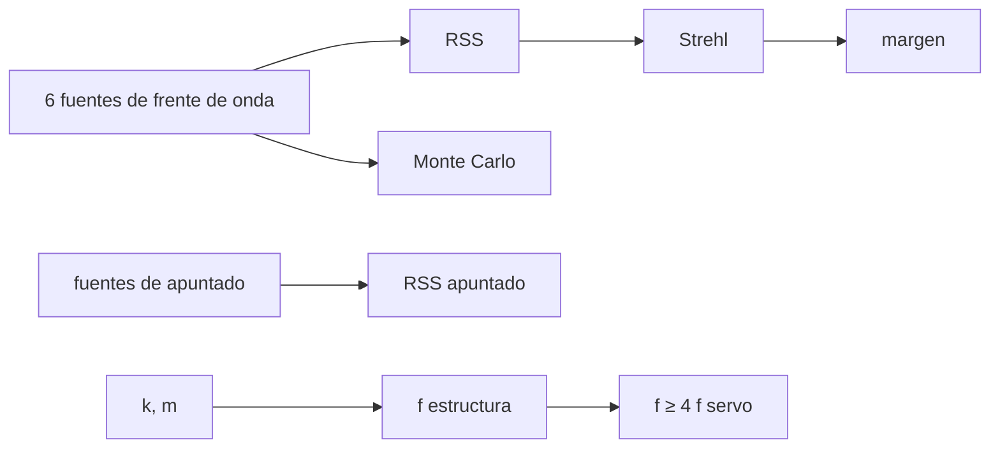

# B43-C20 — Proyecto mecánico completo de telescopio

<!-- nav:top -->
[🏠 Programa](../../../../README.md) · [📚 Bloque B43](../../../tronco-comun/B43-construccion-y-mecanica-de-telescopios.md) · [← Anterior: B43-C19 — Seguridad y mantenimiento](../B43-C19-seguridad-y-mantenimiento/CLASE.md) · [Siguiente: B43-C21 — Selección de vidrios ópticos: catálogos, homogeneidad y diagramas →](../B43-C21-seleccion-de-vidrios-opticos-catalogos-homogeneidad-y-diagramas/CLASE.md)
<!-- /nav -->

## 1. Ubicación, nivel y alcance

Clase 20 del bloque B43. Nivel N3. El proyecto reúne el presupuesto de frente de onda, el de apuntado y la rigidez estructural en un solo documento que dice si el telescopio cumple. Aquí armas ese presupuesto con RSS y Monte Carlo y compruebas la frecuencia estructural frente al servo, con un telescopio ilustrativo. Usas [B12](../../../tronco-comun/B12-probabilidad-estadistica-e-incertidumbre.md), [B16](../../../tronco-comun/B16-sistemas-dinamicos-y-control-automatico.md) y [B50](../../../tronco-comun/B50-diseno-optico-computacional-y-tolerancias.md).

## 2. Por qué esta clase existe

El proyecto completo exige que los errores se sumen, se verifiquen y se comparen con los requisitos. La decisión central: **¿qué fuente domina el error, cuánto margen queda y la estructura es lo bastante rígida para el servo?**

## 3. Lo que podrás hacer al terminar

1. Armar un presupuesto de frente de onda con seis fuentes.
2. Sumarlas en cuadratura y contrastar con Monte Carlo.
3. Calcular el Strehl de Maréchal y el margen.
4. Armar un presupuesto de apuntado.
5. Comparar la frecuencia estructural con el ancho de banda del servo.
6. Redactar un dossier con requisitos y verificación.

La evidencia es la **dossier mecánico del telescopio** del ejercicio 12 (sección 20).

## 4. Con qué llegas y cómo comprobarlo

1. ¿Qué es una suma en cuadratura?
2. ¿Qué es una simulación Monte Carlo?
3. ¿Qué es el Strehl?
4. ¿Qué es una frecuencia natural?
5. ¿Qué es un margen?

<details>
<summary>Ver respuestas</summary>

1. La raíz cuadrada de la suma de los cuadrados. 2. Repetir con números aleatorios de semilla fija. 3. La razón de intensidad central real e ideal. 4. La frecuencia de oscilación libre. 5. La diferencia entre el requisito y el valor previsto.
</details>

Con cuatro o cinco aciertos, sigue; si no, repasa los prerrequisitos.

## 5. Un caso de contexto y casos de referencia

Telescopio ilustrativo de 200 mm f/5. El frente de onda suma `26,46 nm` RMS (Monte Carlo: `26,45 nm`), Strehl `0,913` frente al requisito `0,8` (`σ ≤ 41,35 nm`; margen `14,89 nm`). El apuntado suma `2,99"`. La estructura resuena a `89,7 Hz` frente a `1,59 Hz` del servo (razón `56,3`). Es el **ejemplo conductor**.

## 6. Vocabulario

El **presupuesto de error** reparte `σ`. La **suma en cuadratura (RSS)**. El **requisito** es un valor máximo. El **margen** es la diferencia. La **frecuencia estructural** `f = √(k/m)/(2π)`. El **criterio** `f ≥ 4 f_servo`. El **dossier** documenta requisitos, cálculos y verificación.

## 7. Modelo mental: el plano de una casa con su presupuesto

Como el plano y el presupuesto de una casa: cada rubro tiene su cuota, el total debe quedar bajo el límite y se anota qué rubro conviene reducir primero.



*Descripción textual:* las fuentes se suman en cuadratura y se contrastan; el Strehl y la frecuencia estructural se comparan con los requisitos.

Analogía: el plano de una casa con su presupuesto. Límite: errores independientes de media nula, sin términos cruzados.

## 8. La explicación, paso a paso

### 8.1 Frente de onda

| Fuente | σ (nm) | Cuota de varianza |
|---|---|---|
| figura del primario (superficie 8 nm x 2) | 16,0 | 36,6 % |
| figura del secundario plano | 10,0 | 14,3 % |
| apoyo axial del primario | 8,0 | 9,1 % |
| deformacion termica | 10,0 | 14,3 % |
| colimacion residual | 12,0 | 20,6 % |
| flexion del tubo | 6,0 | 5,1 % |

RSS `26,458 nm`; Monte Carlo (400 000 muestras, semilla 20261109) `26,445 nm`. Strehl `0,9127`. El requisito `S ≥ 0,8` exige `σ ≤ 41,35 nm`; el margen es `14,89 nm`. La fuente dominante es «figura del primario (superficie 8 nm x 2)» con el `36,6 %` de la varianza.

### 8.2 Apuntado

| Fuente | σ (") |
|---|---|
| error periodico residual | 2,0 |
| alineacion polar residual | 1,5 |
| codificador y cuantizacion | 0,5 |
| flexion de la montura | 1,0 |
| viento | 1,2 |

RSS `2,990"`; Monte Carlo `2,988"`.

### 8.3 Estructura

`f = √(2,54 × 10⁶ N/m / 8 kg)/(2π) = 89,68 Hz`. El servo de C15 tiene `ω_n = 10 rad/s`, `f = 1,592 Hz`. La razón `56,3` supera el criterio de 4.

## 9. Magnitudes, símbolos y unidades

| Símbolo | Qué es | Unidad | Valor / nota |
|---|---|---|---|
| `σ` | error de frente de onda total | nm | 26,46 |
| `S` | Strehl | — | 0,913 |
| `f` | frecuencia estructural | Hz | 89,7 |
| `σ_pun` | apuntado total | " | 2,99 |

## 10. Convenciones y referencias

Unidades del SI; coma decimal en el texto y punto decimal en las salidas del laboratorio; los ángulos están en radianes salvo que se indique y las longitudes de onda en nanómetros. Los telescopios y materiales de los ejemplos son ilustrativos.

## 11. De dónde sale lo que afirmamos

| ID | Fuente | Localizador | Respalda | Estado |
|---|---|---|---|---|
| S1 | Normas de especificación de telescopios | — | estructura de un presupuesto de errores (no consultadas) | No consultado |

Límites: Las contribuciones son inventadas para el ejemplo; la RSS supone independencia y la estructura se reduce a un único modo. No se consultó ninguna norma ni dossier real.

## 12. Cómo ver el dossier

| Magnitud | Valor | Requisito | ¿Cumple? |
|---|---|---|---|
| σ frente de onda | 26,46 nm | ≤ 41,35 nm | sí |
| Strehl | 0,913 | ≥ 0,8 | sí |
| f estructura / f servo | 56,3 | ≥ 4 | sí |

Descripción larga: los tres requisitos se cumplen con margen.

## 13. Ejemplo trabajado: el presupuesto de frente de onda

**Paso 1 · Varianzas.** `16² + 10² + 8² + 10² + 12² + 6² = 700`.

**Paso 2 · RSS.** `σ = 26,458 nm`.

**Paso 3 · Strehl.** `exp(−(2πσ/550)²) = 0,9127`.

## 14. Distintas formas de describir el proyecto

**En palabras:** se reparte, suma y verifica. **En fórmulas:** `σ = √Σσ_i²`. **En tabla:** el dossier. **En código:** `proyecto.py`.

## 15. Práctica guiada

**Ejercicio 1 · con los pasos indicados.** RSS de 16 y 12 nm.

<details><summary>Solución comentada</summary>

`20 nm`.
</details>

**Ejercicio 2 · con una pista.** Varianza total del presupuesto.

<details><summary>Solución comentada</summary>

`700 nm²`.
</details>

**Ejercicio 3 · casi autónomo.** RSS del presupuesto.

<details><summary>Solución comentada</summary>

`26,46 nm`.
</details>

## 16. Práctica autónoma, transferencia e integrador

**Ejercicio 4.** Strehl.

<details><summary>Solución comentada</summary>

`0,913`.
</details>

**Ejercicio 5.** `σ` máximo para S = 0,8.

<details><summary>Solución comentada</summary>

`41,35 nm`.
</details>

**Ejercicio 6.** Cuota de la fuente dominante.

<details><summary>Solución comentada</summary>

`36,6 %`.
</details>

**Ejercicio 7.** RSS del apuntado.

<details><summary>Solución comentada</summary>

`2,99"`.
</details>

**Ejercicio 8.** Razón `f_estructura/f_servo`.

<details><summary>Solución comentada</summary>

`56,3`.
</details>

**Ejercicio 9 · transferencia.** **Transferencia.** ¿Qué fuente conviene reducir primero?

<details><summary>Solución comentada</summary>

La de mayor cuota de varianza: reducirla a la mitad quita más que otras.
</details>

**Ejercicio 10 · transferencia.** **Transferencia.** ¿Cuándo falla la RSS?

<details><summary>Solución comentada</summary>

Cuando los errores están correlacionados o no tienen media nula.
</details>

**Ejercicio 11 · transferencia.** **Transferencia.** ¿Es este dossier el de un telescopio real?

<details><summary>Solución comentada</summary>

No: es un ejercicio con valores inventados.
</details>

**Ejercicio 12.** **Integrador.** Elabora tu *dossier mecánico del telescopio*: requisitos, presupuestos y verificación.

<details><summary>Solución comentada</summary>

Secciones 8.1–8.3.
</details>

**Ejercicio 12 · integrador.** **Integrador.** Elabora tu *dossier mecánico del telescopio*: requisitos, presupuestos y verificación.

<details><summary>Solución modelo</summary>

Secciones 8.1–8.3.
</details>

## 17. Laboratorio: presupuesto y estructura

El script [proyecto.py](proyecto.py) arma los presupuestos con RSS y Monte Carlo y verifica la frecuencia estructural (**comprueba** `0,5 %`).

**Datos:** todo **ilustrativo**; semillas `20261109` y `20261110`. **Predice antes de ejecutar:** ¿cumple? (sí, con margen de ≈ 15 nm.) **Ejecución del 2026-11-09 (Python 3.12.9):**

```text
Python 3.12.9 (biblioteca estandar)
fuente | sigma (nm) | cuota de varianza
figura del primario (superficie 8 nm x 2) | 16.0 | 36.6 %
figura del secundario plano | 10.0 | 14.3 %
apoyo axial del primario | 8.0 | 9.1 %
deformacion termica | 10.0 | 14.3 %
colimacion residual | 12.0 | 20.6 %
flexion del tubo | 6.0 | 5.1 %
frente_rss = 26.4575
frente_mc = 26.4452
strehl = 0.912694
sigma_max = 41.35
margen_nm = 14.8924
apunt_rss = 2.98998
apunt_mc = 2.98826
f_estructura_hz = 89.6793
f_servo_hz = 1.59155
razon_f = 56.3471
fraccion_mayor = 0.365714
Pruebas superadas.
```

```bash
python programa/clases/B43/B43-C20-proyecto-mecanico-completo-de-telescopio/proyecto.py
```

**Límites:** independencia estadística; un solo modo.

## 18. Errores frecuentes y cómo corregirlos

**Sumar errores sin cuadratura.** Se corrige con 8.1.

**Ignorar el margen.** Se corrige con 8.1.

**Olvidar la estructura.** Se corrige con 8.3.

**Tomar el dossier como real.** Se corrige con los límites.

## 19. Cómo sabrás que vas bien

Tras la sección 8: ¿qué resultado esperabas y cuál obtuviste? Si dudas, repasa el ejemplo 13. Tras el laboratorio: ¿qué comprueba? (ver la sección 17).

## 20. Qué entregas y cómo se evalúa

El producto es tu **dossier mecánico del telescopio** (ejercicio 12).

| Criterio | Inicial | En desarrollo | Logrado | Destacado |
|---|---|---|---|---|
| Conceptos | Los confunde | Parciales | conceptos de la clase | Explica los límites |
| Cálculo | Sin unidades | Con errores | Tablas completas | Calcula casos nuevos |
| Numérico | Sin comprobar | Un caso | Contraste con el análisis | Interpreta las diferencias |
| Fuentes | Sin fuente | Sin fecha | fuentes con fecha | Declara lo ilustrativo |
| Límites | No los nombra | Uno | Tres | Discute qué falta del modelo |

**Condiciones críticas (no se compensan con promedio):** rotular todos los valores como ilustrativos; declarar la independencia supuesta; no presentar el dossier como un instrumento real.

## 21. Ética, seguridad y límites

Clase educativa: los modelos son simplificados. Accesibilidad: tablas equivalentes a las gráficas, fórmulas en texto, ejercicios sin conexión.

## 22. Para cerrar y seguir

El telescopio ilustrativo cumple: Strehl `0,91`, apuntado `3,0"` y estructura `56` veces más rápida que el servo. La ampliación añade vidrio, forma, recubrimientos, rodamientos y apuntado.

**Glosario español–inglés.** presupuesto de error · *error budget*; suma en cuadratura · *root sum square*; margen · *margin*; requisito · *requirement*; dossier · *design dossier*.

**Continuidad.** [B43-C21](../B43-C21-seleccion-de-vidrios-opticos-catalogos-homogeneidad-y-diagramas/CLASE.md) amplía con la selección de vidrios ópticos.

**Referencias:** ver sección 11.

<!-- nav:bottom -->
---

[← Anterior: B43-C19 — Seguridad y mantenimiento](../B43-C19-seguridad-y-mantenimiento/CLASE.md) · [📚 Bloque B43](../../../tronco-comun/B43-construccion-y-mecanica-de-telescopios.md) · [Siguiente: B43-C21 — Selección de vidrios ópticos: catálogos, homogeneidad y diagramas →](../B43-C21-seleccion-de-vidrios-opticos-catalogos-homogeneidad-y-diagramas/CLASE.md)
<!-- /nav -->
