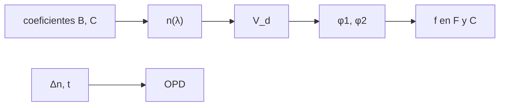

# B43-C21 — Selección de vidrios ópticos: catálogos, homogeneidad y diagramas

<!-- nav:top -->
[🏠 Programa](../../../../README.md) · [📚 Bloque B43](../../../tronco-comun/B43-construccion-y-mecanica-de-telescopios.md) · [← Anterior: B43-C20 — Proyecto mecánico completo de telescopio](../B43-C20-proyecto-mecanico-completo-de-telescopio/CLASE.md) · [Siguiente: B43-C22 — Interferometría de superficie y mapas de error de forma →](../B43-C22-interferometria-de-superficie-y-mapas-de-error-de-forma/CLASE.md)
<!-- /nav -->

## 1. Ubicación, nivel y alcance

Clase 21 del bloque B43. Nivel N3. Los vidrios ópticos se eligen por su índice de refracción, su dispersión y su homogeneidad. Aquí calculas el índice con la ecuación de Sellmeier para dos vidrios cuyos coeficientes sí se consultaron, obtienes el número de Abbe y diseñas un doblete acromático ilustrativo. Usas [B41](../../../tronco-comun/B41-optica-geometrica-y-diseno-de-telescopios.md), [B42](../../../tronco-comun/B42-optica-fisica-y-optica-adaptativa.md) y [B50](../../../tronco-comun/B50-diseno-optico-computacional-y-tolerancias.md).

## 2. Por qué esta clase existe

Un telescopio refractor o un corrector necesita vidrios que compensen el color. La decisión central: **¿qué par de vidrios, con qué potencias, anula el cromatismo primario de un doblete y qué error aporta la falta de homogeneidad?**

## 3. Lo que podrás hacer al terminar

1. Evaluar la ecuación de Sellmeier de dos vidrios.
2. Calcular el número de Abbe `V_d`.
3. Contrastar `n_d` y `V_d` con los valores tabulados leídos.
4. Diseñar un doblete acromático con `φ₁/V₁ + φ₂/V₂ = 0`.
5. Verificarlo evaluando la potencia en las líneas F y C.
6. Estimar la OPD por falta de homogeneidad `Δn t`.

La evidencia es la **ficha de vidrios ópticos** del ejercicio 12 (sección 20).

## 4. Con qué llegas y cómo comprobarlo

1. ¿Qué es el índice de refracción?
2. ¿Qué es la dispersión?
3. ¿Qué es el número de Abbe?
4. ¿Qué es una lente delgada?
5. ¿Qué es una línea espectral de Fraunhofer?

<details>
<summary>Ver respuestas</summary>

1. El cociente entre la velocidad de la luz en el vacío y en el medio. 2. La variación del índice con la longitud de onda. 3. `V_d = (n_d − 1)/(n_F − n_C)`. 4. Una lente de espesor despreciable. 5. Una línea de referencia (d, F, C) para medir la dispersión.
</details>

Con cuatro o cinco aciertos, sigue; si no, repasa los prerrequisitos.

## 5. Un caso de contexto y casos de referencia

Doblete ilustrativo de `f = 1000 mm` con N-BK7 y F2. Los coeficientes de Sellmeier leídos reproducen `n_d = 1,51680` y `V_d = 64,167` para N-BK7 (tabulados 1,5168 y 64,17), y `n_d = 1,62004` y `V_d = 36,366` para F2 (tabulados 1,62004 y 36,37). Las distancias focales de las lentes son `433,26 mm` y `-764,46 mm`. Es el **ejemplo conductor**.

## 6. Vocabulario

La **ecuación de Sellmeier** `n² − 1 = Σ B_i λ²/(λ² − C_i)`. El **número de Abbe** `V_d`. Las **líneas** d (587,56 nm), F (486,13 nm) y C (656,27 nm). El **doblete acromático** anula el cromatismo primario. La **homogeneidad** es la variación espacial del índice. La **OPD** es la diferencia de camino óptico.

## 7. Modelo mental: dos lentes que se compensan el color

Como dos jueces cuyos sesgos se cancelan: una lente de crown agrupa el azul más que el rojo y una de flint hace lo contrario; con potencias adecuadas el foco coincide en F y C.



*Descripción textual:* los coeficientes dan el índice; el índice da el número de Abbe; las potencias del doblete se eligen para igualar los focos en F y C.

Analogía: dos lentes que se compensan el color. Límite: lente delgada, 293 K, sin absorción.

## 8. La explicación, paso a paso

### 8.1 Índices y Abbe

| Vidrio | `n_d` calculado | `n_d` tabulado | `V_d` calculado | `V_d` tabulado | `n` a 550 nm |
|---|---|---|---|---|---|
| N-BK7 | 1,51680 | 1,5168 | 64,167 | 64,17 | 1,51852 |
| F2 | 1,62004 | 1,62004 | 36,366 | 36,37 | 1,62366 |

### 8.2 Doblete de 1000 mm

Con `φ₁ = φ V₁/(V₁−V₂)` y `φ₂ = −φ V₂/(V₁−V₂)`: `f₁ = 433,26 mm` (N-BK7) y `f₂ = -764,46 mm` (F2). La distancia focal es `1000,000 mm` en d, `1000,4996 mm` en F y `1000,4996 mm` en C: la diferencia F−C es `2,3 × 10⁻¹³ mm`. Una lente simple de N-BK7 de 1000 mm tendría `-15,492 mm` (aproximadamente `f/V_d = 15,584 mm`).

### 8.3 Espectro secundario

A 436 nm la distancia focal del doblete es `1002,2259 mm`, `2,226 mm` más larga que en d: el cromatismo primario se anuló en F y C, pero no en todo el espectro.

### 8.4 Homogeneidad

Una variación de índice `Δn = 2 × 10⁻⁶` en `30 mm` da `OPD = 60 nm`, comparable al presupuesto de un telescopio (C20).

## 9. Magnitudes, símbolos y unidades

| Símbolo | Qué es | Unidad | Valor / nota |
|---|---|---|---|
| `B_i, C_i` | coeficientes de Sellmeier | —, µm² | leídos (sección 11) |
| `V_d` | número de Abbe | — | 64,17 y 36,37 |
| `φ` | potencia | mm⁻¹ | 1/1000 |
| `Δn` | falta de homogeneidad | — | 2 × 10⁻⁶ (ilustrativa) |

## 10. Convenciones y referencias

Unidades del SI; coma decimal en el texto y punto decimal en las salidas del laboratorio; los ángulos están en radianes salvo que se indique y las longitudes de onda en nanómetros. Los telescopios y materiales de los ejemplos son ilustrativos.

## 11. De dónde sale lo que afirmamos

| ID | Fuente | Localizador | Respalda | Estado |
|---|---|---|---|---|
| S1 | Base de datos refractiveindex.info (CC0), archivos SCHOTT `N-BK7.yml` y `F2.yml` | https://github.com/polyanskiy/refractiveindex.info-database | coeficientes de Sellmeier, n_d y V_d de N-BK7 y F2 (catálogo SCHOTT Zemax 2017-01-20b) | Archivos leídos el 2026-11-09 vía raw.githubusercontent.com; no se consultó la hoja de datos del fabricante |
| S2 | Longitudes de onda de las líneas d, F y C | — | 587,5618, 486,1327 y 656,2725 nm | Valores de uso general, NO consultados aquí |

Límites: Los coeficientes se leyeron en una base de datos pública que reproduce el catálogo SCHOTT de 2017; no se consultó la hoja de datos oficial del fabricante. La homogeneidad usada es ilustrativa.

## 12. Cómo ver los vidrios

| Vidrio | n_d | V_d |
|---|---|---|
| N-BK7 | 1,51680 | 64,17 |
| F2 | 1,62004 | 36,37 |

Descripción larga: el crown tiene mayor número de Abbe (menos dispersión) que el flint.

## 13. Ejemplo trabajado: el doblete acromático

**Paso 1 · Potencias.** `φ₁ = (1/1000) · 64,167/(64,167 − 36,366)`.

**Paso 2 · Focales.** `f₁ = 433,3 mm`, `f₂ = -764,5 mm`.

**Paso 3 · Comprobación.** `f_F − f_C ≈ 0`.

## 14. Distintas formas de describir los vidrios

**En palabras:** una lente corrige el color de la otra. **En fórmulas:** `φ₁/V₁ + φ₂/V₂ = 0`. **En tabla:** vidrios. **En código:** `vidrios.py`.

## 15. Práctica guiada

**Ejercicio 1 · con los pasos indicados.** `V_d` de N-BK7 con `n_d = 1,5168`, `n_F−n_C = 0,008054`.

<details><summary>Solución comentada</summary>

`64,17`.
</details>

**Ejercicio 2 · con una pista.** `n` de N-BK7 a 550 nm.

<details><summary>Solución comentada</summary>

`1,5185`.
</details>

**Ejercicio 3 · casi autónomo.** `f₁` del doblete.

<details><summary>Solución comentada</summary>

`433,3 mm`.
</details>

## 16. Práctica autónoma, transferencia e integrador

**Ejercicio 4.** `f₂` del doblete.

<details><summary>Solución comentada</summary>

`-764,5 mm`.
</details>

**Ejercicio 5.** Cromatismo F−C de una lente simple de N-BK7 de 1000 mm.

<details><summary>Solución comentada</summary>

`-15,49 mm`.
</details>

**Ejercicio 6.** Cromatismo F−C del doblete.

<details><summary>Solución comentada</summary>

≈ 0.
</details>

**Ejercicio 7.** OPD con `Δn = 2 × 10⁻⁶` y 30 mm.

<details><summary>Solución comentada</summary>

`60 nm`.
</details>

**Ejercicio 8.** Diferencia de focal a 436 nm respecto de d.

<details><summary>Solución comentada</summary>

`2,23 mm`.
</details>

**Ejercicio 9 · transferencia.** **Transferencia.** ¿Por qué el doblete de este ejemplo no es perfecto?

<details><summary>Solución comentada</summary>

Queda el espectro secundario.
</details>

**Ejercicio 10 · transferencia.** **Transferencia.** ¿Por qué una lente de flint con índice alto no es siempre mejor?

<details><summary>Solución comentada</summary>

Su dispersión es mayor; el balance depende del par.
</details>

**Ejercicio 11 · transferencia.** **Transferencia.** ¿Hemos consultado el catálogo oficial de SCHOTT?

<details><summary>Solución comentada</summary>

No: se leyó una base de datos pública que lo reproduce.
</details>

**Ejercicio 12.** **Integrador.** Elabora tu *ficha de vidrios ópticos*: índices, Abbe, doblete y homogeneidad.

<details><summary>Solución comentada</summary>

Secciones 8.1–8.4.
</details>

**Ejercicio 12 · integrador.** **Integrador.** Elabora tu *ficha de vidrios ópticos*: índices, Abbe, doblete y homogeneidad.

<details><summary>Solución modelo</summary>

Secciones 8.1–8.4.
</details>

## 17. Laboratorio: Sellmeier y doblete

El script [vidrios.py](vidrios.py) evalúa Sellmeier, calcula Abbe, diseña el doblete y comprueba F y C (**comprueba** `10⁻⁴` en `n_d` y `0,02` en `V_d`).

**Datos:** coeficientes **leídos** (refractiveindex.info); doblete **ilustrativo**. **Predice antes de ejecutar:** ¿cuánto vale el cromatismo? (≈ 0.) **Ejecución del 2026-11-09 (Python 3.12.9):**

```text
Python 3.12.9 (biblioteca estandar)
nd_BK7 = 1.5168
Vd_BK7 = 64.167336
nd_F2 = 1.6200401
Vd_F2 = 36.366491
n_550_BK7 = 1.5185224
n_550_F2 = 1.6236551
f1_mm = 433.2554
f2_mm = -764.46322
f_d_mm = 1000
f_F_mm = 1000.4996
f_C_mm = 1000.4996
f_436_mm = 1002.2259
delta_F_C_doblete_mm = 2.2737368e-13
delta_F_C_simple_mm = -15.492168
f_sobre_Vd_mm = 15.584253
OPD_nm = 60
residual_acromatico = 0
Pruebas superadas.
```

```bash
python programa/clases/B43/B43-C21-seleccion-de-vidrios-opticos-catalogos-homogeneidad-y-diagramas/vidrios.py
```

**Límites:** lente delgada; 293 K.

## 18. Errores frecuentes y cómo corregirlos

**Aplicar Sellmeier fuera de su rango.** Se corrige con los límites.

**Confundir `V_d` con `n_d`.** Se corrige con la sección 6.

**Olvidar el espectro secundario.** Se corrige con 8.3.

**Usar una focal negativa sin signo.** Se corrige con 8.2.

## 19. Cómo sabrás que vas bien

Tras la sección 8: ¿qué resultado esperabas y cuál obtuviste? Si dudas, repasa el ejemplo 13. Tras el laboratorio: ¿qué comprueba? (ver la sección 17).

## 20. Qué entregas y cómo se evalúa

El producto es tu **ficha de vidrios ópticos** (ejercicio 12).

| Criterio | Inicial | En desarrollo | Logrado | Destacado |
|---|---|---|---|---|
| Conceptos | Los confunde | Parciales | conceptos de la clase | Explica los límites |
| Cálculo | Sin unidades | Con errores | Tablas completas | Calcula casos nuevos |
| Numérico | Sin comprobar | Un caso | Contraste con el análisis | Interpreta las diferencias |
| Fuentes | Sin fuente | Sin fecha | fuentes con fecha | Declara lo ilustrativo |
| Límites | No los nombra | Uno | Tres | Discute qué falta del modelo |

**Condiciones críticas (no se compensan con promedio):** citar la base de datos como fuente leída; no atribuir los valores a la hoja del fabricante; rotular el doblete como ilustrativo.

## 21. Ética, seguridad y límites

Clase educativa: los modelos son simplificados. Accesibilidad: tablas equivalentes a las gráficas, fórmulas en texto, ejercicios sin conexión.

## 22. Para cerrar y seguir

N-BK7 y F2 dan `V_d = 64,2` y `36,4`, y un doblete de `433`/`-764 mm` iguala los focos en F y C. Queda una pregunta: ¿cómo se mide la forma de la superficie?

**Glosario español–inglés.** vidrio óptico · *optical glass*; ecuación de Sellmeier · *Sellmeier equation*; número de Abbe · *Abbe number*; doblete · *doublet*; homogeneidad · *homogeneity*.

**Continuidad.** [B43-C22](../B43-C22-interferometria-de-superficie-y-mapas-de-error-de-forma/CLASE.md) estudia la interferometría de superficie.

**Referencias:** ver sección 11.

<!-- nav:bottom -->
---

[← Anterior: B43-C20 — Proyecto mecánico completo de telescopio](../B43-C20-proyecto-mecanico-completo-de-telescopio/CLASE.md) · [📚 Bloque B43](../../../tronco-comun/B43-construccion-y-mecanica-de-telescopios.md) · [Siguiente: B43-C22 — Interferometría de superficie y mapas de error de forma →](../B43-C22-interferometria-de-superficie-y-mapas-de-error-de-forma/CLASE.md)
<!-- /nav -->
