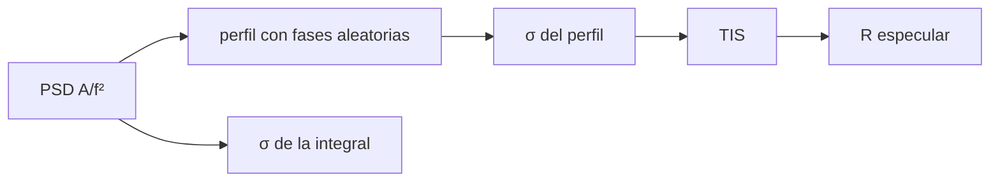

# B43-C23 — Medición de rugosidad y su efecto en la luz dispersa

<!-- nav:top -->
[🏠 Programa](../../../../README.md) · [📚 Bloque B43](../../../tronco-comun/B43-construccion-y-mecanica-de-telescopios.md) · [← Anterior: B43-C22 — Interferometría de superficie y mapas de error de forma](../B43-C22-interferometria-de-superficie-y-mapas-de-error-de-forma/CLASE.md) · [Siguiente: B43-C24 — Recubrimientos antirreflectantes de capas múltiples →](../B43-C24-recubrimientos-antirreflectantes-de-capas-multiples/CLASE.md)
<!-- /nav -->

## 1. Ubicación, nivel y alcance

Clase 23 del bloque B43. Nivel N3. La rugosidad de una superficie, mucho menor que una longitud de onda, dispersa una fracción de la luz fuera de la imagen. Aquí construyes un perfil sintético con una densidad espectral de potencia, mides su rugosidad RMS y calculas la luz dispersa total (TIS). Usas [B15](../../../tronco-comun/B15-senales-imagenes-y-estimacion-cientifica.md), [B12](../../../tronco-comun/B12-probabilidad-estadistica-e-incertidumbre.md) y [B42](../../../tronco-comun/B42-optica-fisica-y-optica-adaptativa.md).

## 2. Por qué esta clase existe

La luz dispersa reduce el contraste y la reflectancia especular. La decisión central: **¿qué rugosidad RMS, en qué banda de frecuencias espaciales, deja la luz dispersa por debajo del presupuesto?**

## 3. Lo que podrás hacer al terminar

1. Construir un perfil con una PSD `A/f²` y fases aleatorias.
2. Medir `σ` por el perfil y por la integral de la PSD.
3. Comprobar la identidad de Parseval con una FFT.
4. Calcular `TIS = (4πσ cos θ/λ)²`.
5. Ver la dependencia `λ⁻²`.
6. Calcular la reflectancia especular `R₀ e^(−TIS)`.

La evidencia es la **ficha de rugosidad y luz dispersa** del ejercicio 12 (sección 20).

## 4. Con qué llegas y cómo comprobarlo

1. ¿Qué es la rugosidad RMS?
2. ¿Qué es una densidad espectral de potencia?
3. ¿Qué es una transformada de Fourier?
4. ¿Qué es la identidad de Parseval?
5. ¿Qué es la luz dispersa?

<details>
<summary>Ver respuestas</summary>

1. La raíz cuadrática media de las alturas. 2. La distribución de la varianza por frecuencia espacial. 3. La descomposición de una señal en senos y cosenos. 4. La igualdad entre la energía en el espacio y en frecuencia. 5. La luz que sale en direcciones distintas de la especular.
</details>

Con cuatro o cinco aciertos, sigue; si no, repasa los prerrequisitos.

## 5. Un caso de contexto y casos de referencia

Perfil **sintético** de 4096 puntos con PSD `A/f²`, `A = 1 nm² mm⁻¹`, en la banda `k = 2…1842` (modos de una ventana de 1,024 mm). La rugosidad medida es `0,812 nm` (integral continua de la banda: `0,826 nm`) y la TIS a 550 nm `0,000344`. Es el **ejemplo conductor**.

## 6. Vocabulario

La **rugosidad RMS** `σ`. La **PSD** `S(f)`; `σ² = ∫ S df`. La **TIS** `(4πσ cos θ/λ)²`. La **banda** de frecuencias espaciales que dispersa luz visible. La **reflectancia especular** `R₀ e^(−TIS)`.

## 7. Modelo mental: una pared con polvo fino

Como una pared con polvo fino: la rugosidad no se ve, pero cada grano esparce un poco de luz; cuanto más corta la longitud de onda, más se nota.



*Descripción textual:* una PSD fija la rugosidad en una banda; la TIS la convierte en luz dispersa por la fórmula escalar.

Analogía: una pared con polvo fino. Límite: perfil 1D como sustituto de una superficie 2D, estadística gaussiana, `σ << λ`.

## 8. La explicación, paso a paso

### 8.1 Rugosidad

| Cálculo | σ (nm) |
|---|---|
| Suma de cuadrados de las amplitudes (PSD discreta) | 0,8123 |
| Perfil medido | 0,8123 |
| Integral continua de la banda (punto medio) | 0,8259 |

La coincidencia entre las dos primeras filas es una identidad: las cosenos de la ventana son ortogonales (Parseval, residuo `0` con una FFT); lo informativo es el contraste con la integral continua (`-1,64 %`).

### 8.2 Luz dispersa

`TIS = (4πσ/λ)²` con `λ = 550 nm`: `0,000344` con el perfil, `0,000356` con la integral continua y `0,000178` a 45° (el coseno al cuadrado). La reflectancia especular de un metal de `R₀ = 0,92` baja a `0,91968`.

### 8.3 Escala

| σ (nm) | TIS |
|---|---|
| 0,5 | 0,000131 |
| 1,0 | 0,000522 |
| 2,0 | 0,00209 |
| 5,0 | 0,0131 |

A igual `σ`, la TIS cambia por `(λ₂/λ₁)² = 4,0` entre 400 y 800 nm.

## 9. Magnitudes, símbolos y unidades

| Símbolo | Qué es | Unidad | Valor / nota |
|---|---|---|---|
| `σ` | rugosidad RMS | nm | 0,81 |
| `TIS` | luz dispersa total | — | 0,000344 |
| `S(f)` | PSD | nm² mm | A/f², A = 1 |
| `λ` | longitud de onda | nm | 550 |

## 10. Convenciones y referencias

Unidades del SI; coma decimal en el texto y punto decimal en las salidas del laboratorio; los ángulos están en radianes salvo que se indique y las longitudes de onda en nanómetros. Los telescopios y materiales de los ejemplos son ilustrativos.

## 11. De dónde sale lo que afirmamos

| ID | Fuente | Localizador | Respalda | Estado |
|---|---|---|---|---|
| S1 | Teoría escalar de la dispersión | — | fórmula `TIS = (4πσ/λ)²` (relación estándar, texto no consultado) | No consultado |

Límites: El perfil es sintético y 1D; la fórmula escalar vale para `σ << λ` y superficies lisas; ninguna medición real ni fuente se consultó para esta clase.

## 12. Cómo ver la TIS

| σ (nm) | TIS |
|---|---|
| 0,5 | 0,000131 |
| 1,0 | 0,000522 |
| 2,0 | 0,00209 |
| 5,0 | 0,0131 |

Descripción larga: la TIS crece con el cuadrado de la rugosidad.

## 13. Ejemplo trabajado: la TIS de 1 nm

**Paso 1 · Factor.** `4π σ/λ = 4π · 1/550 = 0,02285`.

**Paso 2 · Cuadrado.** `0,000522`.

**Paso 3 · Lectura.** El 0,05 % de la luz se dispersa.

## 14. Distintas formas de describir la rugosidad

**En palabras:** una superficie rugosa esparce luz en proporción a `σ²/λ²`. **En fórmulas:** `TIS = (4πσ cos θ/λ)²`. **En tabla:** rugosidades. **En código:** `rugosidad.py`.

## 15. Práctica guiada

**Ejercicio 1 · con los pasos indicados.** TIS con `σ = 1 nm` a 550 nm.

<details><summary>Solución comentada</summary>

`0,000522`.
</details>

**Ejercicio 2 · con una pista.** TIS con `σ = 2 nm`.

<details><summary>Solución comentada</summary>

`0,00209`.
</details>

**Ejercicio 3 · casi autónomo.** TIS con `σ = 5 nm`.

<details><summary>Solución comentada</summary>

`0,0131`.
</details>

## 16. Práctica autónoma, transferencia e integrador

**Ejercicio 4.** Cociente de TIS entre 400 y 800 nm.

<details><summary>Solución comentada</summary>

`4`.
</details>

**Ejercicio 5.** TIS a 45° respecto de la normal.

<details><summary>Solución comentada</summary>

La mitad (`cos² 45°`).
</details>

**Ejercicio 6.** `R` especular con `R₀ = 0,92` y la TIS del perfil.

<details><summary>Solución comentada</summary>

`0,91968`.
</details>

**Ejercicio 7.** `σ` del perfil sintético.

<details><summary>Solución comentada</summary>

`0,812 nm`.
</details>

**Ejercicio 8.** Diferencia con la integral continua.

<details><summary>Solución comentada</summary>

`-1,64 %`.
</details>

**Ejercicio 9 · transferencia.** **Transferencia.** ¿Por qué la banda de frecuencias importa?

<details><summary>Solución comentada</summary>

Porque solo las frecuencias espaciales cuyo ángulo de difracción es real dispersan luz visible.
</details>

**Ejercicio 10 · transferencia.** **Transferencia.** ¿Por qué un perfil 1D subestima o sobreestima la dispersión de una superficie real?

<details><summary>Solución comentada</summary>

Porque una superficie 2D tiene más modos; el perfil es un sustituto.
</details>

**Ejercicio 11 · transferencia.** **Transferencia.** ¿Es `A = 1 nm² mm⁻¹` una medición?

<details><summary>Solución comentada</summary>

No: es sintética.
</details>

**Ejercicio 12.** **Integrador.** Elabora tu *ficha de rugosidad y luz dispersa*: PSD, `σ` y TIS.

<details><summary>Solución comentada</summary>

Secciones 8.1–8.3.
</details>

**Ejercicio 12 · integrador.** **Integrador.** Elabora tu *ficha de rugosidad y luz dispersa*: PSD, `σ` y TIS.

<details><summary>Solución modelo</summary>

Secciones 8.1–8.3.
</details>

## 17. Laboratorio: PSD, rugosidad y TIS

El script [rugosidad.py](rugosidad.py) construye el perfil, mide la rugosidad y calcula la TIS (**comprueba** `5 %` frente a la integral y `10⁻⁹` en Parseval).

**Datos:** perfil **sintético**; semilla `20261109`. **Predice antes de ejecutar:** ¿cuánta luz se dispersa? (≈ 0,03 %.) **Ejecución del 2026-11-09 (Python 3.12.9):**

```text
Python 3.12.9 (biblioteca estandar)
modos = 1842
sigma_psd_nm = 0.812316
sigma_cont_nm = 0.8259
sigma_perfil_nm = 0.812316
parseval_rel = 0
TIS_cont = 0.000356082
TIS_perfil = 0.000344464
TIS_45 = 0.000178041
R_espec = 0.919683
TIS_lambda_ratio = 4
sigma (nm) | TIS
0.5 | 1.305e-04
1.0 | 5.220e-04
2.0 | 2.088e-03
5.0 | 1.305e-02
Pruebas superadas.
```

```bash
python programa/clases/B43/B43-C23-medicion-de-rugosidad-y-su-efecto-en-la-luz-dispersa/rugosidad.py
```

**Límites:** 1D; fórmula escalar; `σ << λ`.

## 18. Errores frecuentes y cómo corregirlos

**Confundir PSD con la amplitud de un modo.** Se corrige con 8.1.

**Aplicar la fórmula con `σ` grande.** Se corrige con los límites.

**Olvidar la banda.** Se corrige con la sección 6.

**Tomar la identidad de Parseval como validación.** Se corrige con 8.1.

## 19. Cómo sabrás que vas bien

Tras la sección 8: ¿qué resultado esperabas y cuál obtuviste? Si dudas, repasa el ejemplo 13. Tras el laboratorio: ¿qué comprueba? (ver la sección 17).

## 20. Qué entregas y cómo se evalúa

El producto es tu **ficha de rugosidad y luz dispersa** (ejercicio 12).

| Criterio | Inicial | En desarrollo | Logrado | Destacado |
|---|---|---|---|---|
| Conceptos | Los confunde | Parciales | conceptos de la clase | Explica los límites |
| Cálculo | Sin unidades | Con errores | Tablas completas | Calcula casos nuevos |
| Numérico | Sin comprobar | Un caso | Contraste con el análisis | Interpreta las diferencias |
| Fuentes | Sin fuente | Sin fecha | fuentes con fecha | Declara lo ilustrativo |
| Límites | No los nombra | Uno | Tres | Discute qué falta del modelo |

**Condiciones críticas (no se compensan con promedio):** rotular el perfil como sintético; declarar la identidad de Parseval como tal; no presentar la TIS como medida.

## 21. Ética, seguridad y límites

Clase educativa: los modelos son simplificados. Accesibilidad: tablas equivalentes a las gráficas, fórmulas en texto, ejercicios sin conexión.

## 22. Para cerrar y seguir

Un perfil de `0,81 nm` RMS dispersa `0,034 %` de la luz a 550 nm. Queda una pregunta: ¿cómo se reduce el reflejo del vidrio?

**Glosario español–inglés.** rugosidad · *roughness*; densidad espectral de potencia · *power spectral density*; luz dispersa total · *total integrated scatter*; banda · *band*; Parseval · *Parseval*.

**Continuidad.** [B43-C24](../B43-C24-recubrimientos-antirreflectantes-de-capas-multiples/CLASE.md) estudia los recubrimientos antirreflectantes.

**Referencias:** ver sección 11.

<!-- nav:bottom -->
---

[← Anterior: B43-C22 — Interferometría de superficie y mapas de error de forma](../B43-C22-interferometria-de-superficie-y-mapas-de-error-de-forma/CLASE.md) · [📚 Bloque B43](../../../tronco-comun/B43-construccion-y-mecanica-de-telescopios.md) · [Siguiente: B43-C24 — Recubrimientos antirreflectantes de capas múltiples →](../B43-C24-recubrimientos-antirreflectantes-de-capas-multiples/CLASE.md)
<!-- /nav -->
