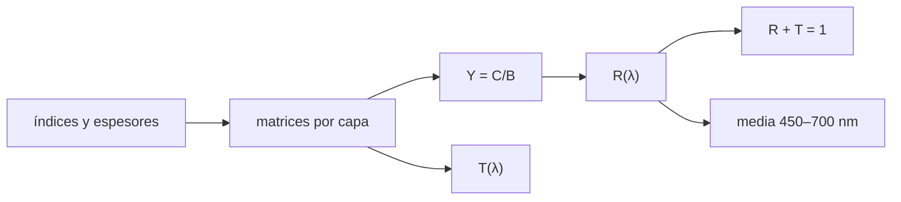

# B43-C24 — Recubrimientos antirreflectantes de capas múltiples

<!-- nav:top -->
[🏠 Programa](../../../../README.md) · [📚 Bloque B43](../../../tronco-comun/B43-construccion-y-mecanica-de-telescopios.md) · [← Anterior: B43-C23 — Medición de rugosidad y su efecto en la luz dispersa](../B43-C23-medicion-de-rugosidad-y-su-efecto-en-la-luz-dispersa/CLASE.md) · [Siguiente: B43-C25 — Rodamientos y apoyos de precisión en telescopios →](../B43-C25-rodamientos-y-apoyos-de-precision-en-telescopios/CLASE.md)
<!-- /nav -->

## 1. Ubicación, nivel y alcance

Clase 24 del bloque B43. Nivel N3. Una superficie de vidrio refleja cerca del 4 % de la luz; una o varias capas finas bien escogidas lo reducen. Aquí calculas la reflectancia con matrices de transferencia de capas de cuarto de onda de una, dos y tres capas, con índices ilustrativos. Usas [B42](../../../tronco-comun/B42-optica-fisica-y-optica-adaptativa.md), [B10](../../../tronco-comun/B10-algebra-lineal-y-matematicas-geometricas.md) y [B41](../../../tronco-comun/B41-optica-geometrica-y-diseno-de-telescopios.md).

## 2. Por qué esta clase existe

Cada reflexión sin tratar pierde luz y añade luz parásita. La decisión central: **¿cuántas capas y con qué índices y espesores se logra baja reflectancia en la banda visible?**

## 3. Lo que podrás hacer al terminar

1. Construir la matriz característica de una capa.
2. Calcular `R` y `T` de un apilamiento.
3. Verificar la reflectancia mínima de una capa de cuarto de onda.
4. Diseñar dos capas con `n₂ = n₁ √n_s` para `R = 0` en `λ₀`.
5. Comprobar la conservación `R + T = 1`.
6. Comparar la reflectancia media de banda ancha.

La evidencia es la **ficha de recubrimiento antirreflectante** del ejercicio 12 (sección 20).

## 4. Con qué llegas y cómo comprobarlo

1. ¿Qué es una capa de cuarto de onda?
2. ¿Qué es una matriz de transferencia?
3. ¿Qué es la conservación de la energía?
4. ¿Qué es un índice de refracción?
5. ¿Qué es el número complejo?

<details>
<summary>Ver respuestas</summary>

1. Una capa de espesor `λ/(4n)`. 2. Una matriz que relaciona los campos a ambos lados de una capa. 3. `R + T = 1` sin absorción. 4. El cociente entre la velocidad de la luz en el vacío y en el medio. 5. Un número `a + b i`.
</details>

Con cuatro o cinco aciertos, sigue; si no, repasa los prerrequisitos.

## 5. Un caso de contexto y casos de referencia

Vidrio ilustrativo de índice 1,52 (`R = 4,258 %`). Una capa de índice 1,38 de cuarto de onda baja a `1,260 %`; dos capas con `n₂ = 1,701` anulan `R` en 550 nm; tres capas cuarto-media-cuarto dan `0,161 %` en media de 450 a 700 nm. Es el **ejemplo conductor**.

## 6. Vocabulario

La **matriz característica** de una capa `[[cos δ, i sen δ/n],[i n sen δ, cos δ]]`. El **espesor óptico** `n t`. La **capa de cuarto de onda**. La **reflectancia mínima** `((n_s − n₁²)/(n_s + n₁²))²`. El **recubrimiento en V** de dos capas. La **banda ancha**.

## 7. Modelo mental: una cortina de cuentas

Como una cortina de cuentas que desfasa las reflexiones: con el espesor justo las ondas reflejadas en cada interfaz se cancelan; con más capas se cancelan en más colores.



*Descripción textual:* el producto de matrices da B y C; de ahí salen R y T, que suman uno sin absorción.

Analogía: una cortina de cuentas. Límite: capas homogéneas, sin absorción ni dispersión, incidencia normal.

## 8. La explicación, paso a paso

### 8.1 Casos a 550 nm

| Caso | R en 550 nm |
|---|---|
| Vidrio desnudo | 0,04258 |
| 1 capa (1,38; λ/4) | 0,01260 (cerrada: 0,01260) |
| 2 capas (1,38 y 1,701; λ/4 cada una) | 2,2 × 10⁻³² |
| 3 capas (1,38 λ/4; 2,10 λ/2; 1,70 λ/4) | 6,57 × 10⁻⁷ |

### 8.2 Espectro

| λ (nm) | desnudo | 1 capa | 2 capas | 3 capas |
|---|---|---|---|---|
| 450 | 0,04258 | 0,01620 | 0,02025 | 0,00419 |
| 500 | 0,04258 | 0,01336 | 0,00464 | 0,00115 |
| 550 | 0,04258 | 0,01260 | 0,00000 | 0,00000 |
| 600 | 0,04258 | 0,01313 | 0,00325 | 0,00085 |
| 650 | 0,04258 | 0,01437 | 0,01052 | 0,00219 |
| 700 | 0,04258 | 0,01596 | 0,01903 | 0,00384 |

### 8.3 Media de 450 a 700 nm

| Caso | R medio |
|---|---|
| Desnudo | 0,04258 |
| 1 capa | 0,01390 |
| 2 capas | 0,00762 |
| 3 capas | 0,00161 |

La conservación `R + T − 1` tiene como máximo `3,3 × 10⁻¹⁶` en cinco longitudes de onda. El recubrimiento de dos capas es excelente en 550 nm pero en 450 nm es peor que una capa (`0,02025` frente a `0,01620`).

## 9. Magnitudes, símbolos y unidades

| Símbolo | Qué es | Unidad | Valor / nota |
|---|---|---|---|
| `n₁` | capa de bajo índice | — | 1,38 (ilustrativo) |
| `n_s` | sustrato | — | 1,52 (ilustrativo) |
| `R` | reflectancia | — | 0,0126 (1 capa) |
| `λ₀` | longitud de diseño | nm | 550 |

## 10. Convenciones y referencias

Unidades del SI; coma decimal en el texto y punto decimal en las salidas del laboratorio; los ángulos están en radianes salvo que se indique y las longitudes de onda en nanómetros. Los telescopios y materiales de los ejemplos son ilustrativos.

## 11. De dónde sale lo que afirmamos

| ID | Fuente | Localizador | Respalda | Estado |
|---|---|---|---|---|
| S1 | Teoría de películas delgadas (matrices de transferencia) | — | método estándar, verificado con la forma cerrada y la conservación de la energía | No consultado |

Límites: Los índices son constantes e ilustrativos y no se consultó ninguna hoja de material; no hay dispersión, absorción ni incidencia oblicua. El óptimo real se obtiene con optimización numérica, no mostrada aquí.

## 12. Cómo ver los recubrimientos

| Caso | R medio |
|---|---|
| Desnudo | 0,0426 |
| 1 capa | 0,0139 |
| 2 capas | 0,0076 |
| 3 capas | 0,0016 |

Descripción larga: cada capa adicional baja la reflectancia media.

## 13. Ejemplo trabajado: la capa de cuarto de onda

**Paso 1 · Índices.** `n₁² = 1,38² = 1,9044`.

**Paso 2 · Fórmula.** `((1,52 − 1,9044)/(1,52 + 1,9044))² = 0,01260`.

**Paso 3 · Matrices.** El mismo valor, `0,01260`.

## 14. Distintas formas de describir el recubrimiento

**En palabras:** capas finas cancelan reflexiones. **En fórmulas:** `R = ((n_s − n₁²)/(n_s + n₁²))²`. **En tabla:** casos. **En código:** `antirreflectante.py`.

## 15. Práctica guiada

**Ejercicio 1 · con los pasos indicados.** Reflectancia del vidrio de 1,52.

<details><summary>Solución comentada</summary>

`((1,52−1)/(1,52+1))² = 0,04258`.
</details>

**Ejercicio 2 · con una pista.** Espesor de la capa de 1,38 a 550 nm.

<details><summary>Solución comentada</summary>

`550/(4·1,38) = 99,6 nm`.
</details>

**Ejercicio 3 · casi autónomo.** `R` con una capa de 1,38.

<details><summary>Solución comentada</summary>

`0,01260`.
</details>

## 16. Práctica autónoma, transferencia e integrador

**Ejercicio 4.** `n₂` para anular `R` con `n₁ = 1,38`.

<details><summary>Solución comentada</summary>

`1,38 √1,52 = 1,7014`.
</details>

**Ejercicio 5.** `R` de una capa a 450 nm.

<details><summary>Solución comentada</summary>

`0,01620`.
</details>

**Ejercicio 6.** `R` de dos capas a 450 nm.

<details><summary>Solución comentada</summary>

`0,02025`.
</details>

**Ejercicio 7.** `R` medio de tres capas.

<details><summary>Solución comentada</summary>

`0,00161`.
</details>

**Ejercicio 8.** Mejora (factor) de tres capas sobre el vidrio desnudo, en media.

<details><summary>Solución comentada</summary>

`26,4`.
</details>

**Ejercicio 9 · transferencia.** **Transferencia.** ¿Por qué dos capas pueden ser peores que una fuera de la longitud de diseño?

<details><summary>Solución comentada</summary>

Porque cancelan perfectamente en un punto y estrechan el mínimo.
</details>

**Ejercicio 10 · transferencia.** **Transferencia.** ¿Por qué no hay recubrimiento con `R = 0` en todo el espectro?

<details><summary>Solución comentada</summary>

Faltan materiales de índice adecuado y las cancelaciones dependen de `λ`.
</details>

**Ejercicio 11 · transferencia.** **Transferencia.** ¿Son estos índices de materiales reales?

<details><summary>Solución comentada</summary>

No: son ilustrativos.
</details>

**Ejercicio 12.** **Integrador.** Elabora tu *ficha de recubrimiento antirreflectante*: casos, espectro y media.

<details><summary>Solución comentada</summary>

Secciones 8.1–8.3.
</details>

**Ejercicio 12 · integrador.** **Integrador.** Elabora tu *ficha de recubrimiento antirreflectante*: casos, espectro y media.

<details><summary>Solución modelo</summary>

Secciones 8.1–8.3.
</details>

## 17. Laboratorio: matrices de transferencia

El script [antirreflectante.py](antirreflectante.py) calcula `R` y `T` de cuatro apilamientos y comprueba la forma cerrada y la conservación (**comprueba** `10⁻¹²`).

**Datos:** índices **ilustrativos**. **Predice antes de ejecutar:** ¿qué capas bajan más la media? (Las tres.) **Ejecución del 2026-11-09 (Python 3.12.9):**

```text
Python 3.12.9 (biblioteca estandar)
n2_V = 1.70138
R0_desnudo = 0.04258
R0_una = 0.0126008
R0_una_cerrada = 0.0126008
R0_dos = 2.22744e-32
R0_tres = 6.56773e-07
max_energia = 3.33067e-16
media_desnudo = 0.04258
media_una = 0.0139004
media_dos = 0.00761671
media_tres = 0.00161491
lambda (nm) | desnudo | 1 capa | 2 capas | 3 capas
450 | 0.04258 | 0.01620 | 0.02025 | 0.00419
500 | 0.04258 | 0.01336 | 0.00464 | 0.00115
550 | 0.04258 | 0.01260 | 0.00000 | 0.00000
600 | 0.04258 | 0.01313 | 0.00325 | 0.00085
650 | 0.04258 | 0.01437 | 0.01052 | 0.00219
700 | 0.04258 | 0.01596 | 0.01903 | 0.00384
Pruebas superadas.
```

```bash
python programa/clases/B43/B43-C24-recubrimientos-antirreflectantes-de-capas-multiples/antirreflectante.py
```

**Límites:** sin dispersión ni absorción; incidencia normal.

## 18. Errores frecuentes y cómo corregirlos

**Olvidar el orden de las capas.** Se corrige con el código.

**Confundir espesor físico y óptico.** Se corrige con la sección 6.

**Esperar `R = 0` en todo el visible.** Se corrige con 8.2.

**Omitir la conservación.** Se corrige con 8.3.

## 19. Cómo sabrás que vas bien

Tras la sección 8: ¿qué resultado esperabas y cuál obtuviste? Si dudas, repasa el ejemplo 13. Tras el laboratorio: ¿qué comprueba? (ver la sección 17).

## 20. Qué entregas y cómo se evalúa

El producto es tu **ficha de recubrimiento antirreflectante** (ejercicio 12).

| Criterio | Inicial | En desarrollo | Logrado | Destacado |
|---|---|---|---|---|
| Conceptos | Los confunde | Parciales | conceptos de la clase | Explica los límites |
| Cálculo | Sin unidades | Con errores | Tablas completas | Calcula casos nuevos |
| Numérico | Sin comprobar | Un caso | Contraste con el análisis | Interpreta las diferencias |
| Fuentes | Sin fuente | Sin fecha | fuentes con fecha | Declara lo ilustrativo |
| Límites | No los nombra | Uno | Tres | Discute qué falta del modelo |

**Condiciones críticas (no se compensan con promedio):** rotular los índices como ilustrativos; no presentar el diseño como real; citar solo la forma cerrada verificada.

## 21. Ética, seguridad y límites

Clase educativa: los modelos son simplificados. Accesibilidad: tablas equivalentes a las gráficas, fórmulas en texto, ejercicios sin conexión.

## 22. Para cerrar y seguir

Una capa baja la reflectancia de `4,3 %` a `1,3 %` y tres capas a `0,16 %` en media. Queda una pregunta: ¿cómo giran las piezas con precisión?

**Glosario español–inglés.** recubrimiento antirreflectante · *anti-reflection coating*; capa de cuarto de onda · *quarter-wave layer*; matriz de transferencia · *transfer matrix*; reflectancia · *reflectance*; banda ancha · *broadband*.

**Continuidad.** [B43-C25](../B43-C25-rodamientos-y-apoyos-de-precision-en-telescopios/CLASE.md) estudia los rodamientos de precisión.

**Referencias:** ver sección 11.

<!-- nav:bottom -->
---

[← Anterior: B43-C23 — Medición de rugosidad y su efecto en la luz dispersa](../B43-C23-medicion-de-rugosidad-y-su-efecto-en-la-luz-dispersa/CLASE.md) · [📚 Bloque B43](../../../tronco-comun/B43-construccion-y-mecanica-de-telescopios.md) · [Siguiente: B43-C25 — Rodamientos y apoyos de precisión en telescopios →](../B43-C25-rodamientos-y-apoyos-de-precision-en-telescopios/CLASE.md)
<!-- /nav -->
