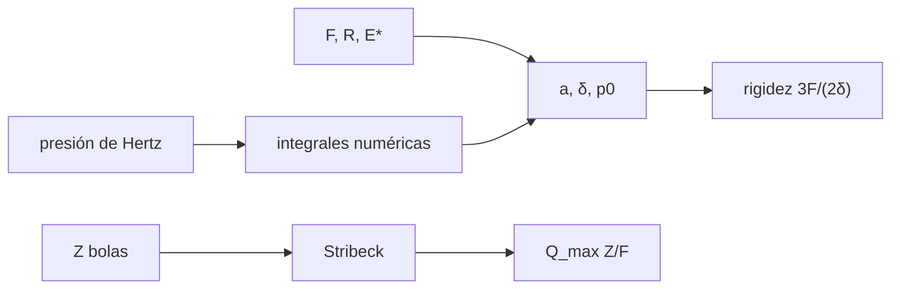

# B43-C25 — Rodamientos y apoyos de precisión en telescopios

<!-- nav:top -->
[🏠 Programa](../../../../README.md) · [📚 Bloque B43](../../../tronco-comun/B43-construccion-y-mecanica-de-telescopios.md) · [← Anterior: B43-C24 — Recubrimientos antirreflectantes de capas múltiples](../B43-C24-recubrimientos-antirreflectantes-de-capas-multiples/CLASE.md) · [Siguiente: B43-C26 — Modelo de flexiones y de apuntado de una montura →](../B43-C26-modelo-de-flexiones-y-de-apuntado-de-una-montura/CLASE.md)
<!-- /nav -->

## 1. Ubicación, nivel y alcance

Clase 25 del bloque B43. Nivel N3. Los ejes del telescopio giran sobre rodamientos de bolas o de rodillos cuya rigidez y cuyo reparto de carga limitan la precisión. Aquí calculas el contacto de Hertz de una bola sobre un plano, su rigidez y el reparto de carga entre bolas, con acero ilustrativo. Usas [B05](../../../tronco-comun/B05-fisica-fundamental-para-el-espacio.md), [B11](../../../tronco-comun/B11-ecuaciones-diferenciales-y-simulacion-numerica.md) y [B16](../../../tronco-comun/B16-sistemas-dinamicos-y-control-automatico.md).

## 2. Por qué esta clase existe

La rigidez del contacto determina cuánto se mueve el eje bajo carga y la frecuencia de resonancia. La decisión central: **¿cuánto se deforma el contacto, cuánta rigidez aporta y qué fracción de la carga soporta la bola más cargada?**

## 3. Lo que podrás hacer al terminar

1. Calcular `a`, `δ` y `p₀` de un contacto de Hertz.
2. Calcular la rigidez `3F/(2δ)` y su dependencia `F^(1/3)`.
3. Verificar con integrales numéricas de la presión.
4. Plantear el reparto de Stribeck `cos^(3/2) ψ`.
5. Calcular la fuerza máxima `Q_max Z/F`.
6. Reconocer los límites de un contacto sin precarga.

La evidencia es la **ficha de rodamientos de precisión** del ejercicio 12 (sección 20).

## 4. Con qué llegas y cómo comprobarlo

1. ¿Qué es un contacto de Hertz?
2. ¿Qué es la presión de contacto?
3. ¿Qué es la rigidez?
4. ¿Qué es la precarga?
5. ¿Qué es el módulo efectivo?

<details>
<summary>Ver respuestas</summary>

1. El contacto elástico de dos superficies curvas. 2. La fuerza por unidad de área en la zona de contacto. 3. La fuerza por unidad de desplazamiento. 4. Una carga inicial que elimina la holgura. 5. `1/E* = Σ (1−ν²)/E`.
</details>

Con cuatro o cinco aciertos, sigue; si no, repasa los prerrequisitos.

## 5. Un caso de contexto y casos de referencia

Bola de acero ilustrativa de `6 mm` sobre un plano. Con `100 N` el contacto tiene radio `127,0 µm`, acercamiento `5,375 µm`, presión máxima `2,96 GPa` y rigidez `27,9 N/µm`. En un rodamiento radial de 12 bolas sin holgura, la bola más cargada lleva `4,364 F/Z`. Es el **ejemplo conductor**.

## 6. Vocabulario

El **contacto de Hertz** esfera-plano: `a = (3FR/(4E*))^(1/3)`. El **acercamiento** `δ = a²/R`. La **presión máxima** `p₀ = 3F/(2πa²)`. La **rigidez** `dF/dδ = 3F/(2δ)`. El **reparto de Stribeck** `Q(ψ) = Q_max cos^(3/2) ψ`. El **factor** `Q_max Z/F → 4,37`.

## 7. Modelo mental: una pelota apretada contra una mesa

Como una pelota de goma apretada contra una mesa: el área de contacto crece con la carga, y por eso la rigidez crece con la carga a la potencia un tercio.



*Descripción textual:* la carga deforma el contacto en una zona circular; la rigidez crece con la carga y la bola más cargada lleva varias veces la media.

Analogía: una pelota apretada contra una mesa. Límite: elástico lineal, esférico, sin precarga ni holgura ni pista curva.

## 8. La explicación, paso a paso

### 8.1 Hertz para varias cargas

| F (N) | a (µm) | δ (µm) | p₀ (GPa) | k (N/µm) |
|---|---|---|---|---|
| 10 | 58,94 | 1,158 | 1,374 | 12,95 |
| 100 | 126,98 | 5,375 | 2,961 | 27,91 |
| 1000 | 273,57 | 24,948 | 6,380 | 60,13 |

Con `E* = E/(2(1−ν²))` y `R = 3 mm`. La rigidez crece `4,6416` veces al pasar de 10 a 1000 N (`100^(1/3) = 4,6416`).

### 8.2 Verificación numérica

La presión de Hertz integrada con Simpson devuelve `F = 99,99986 N` (fórmula `100,00000 N`) y el acercamiento `δ = (2/E*) ∫p dr = 5,37479 µm` (fórmula `5,37479 µm`).

### 8.3 Reparto entre bolas

| Z | Q_max Z/F |
|---|---|
| 6 | 4,4328 |
| 8 | 4,3457 |
| 12 | 4,3645 |
| 20 | 4,3692 |
| 400 | 4,3701 |

El límite `Z → ∞` es `2π/∫cos^(5/2) = 4,3701`. Con 12 bolas y 1000 N, `Q_max = 363,7 N`.

## 9. Magnitudes, símbolos y unidades

| Símbolo | Qué es | Unidad | Valor / nota |
|---|---|---|---|
| `E*` | módulo efectivo | GPa | 109,9 (acero ilustrativo) |
| `a` | radio de contacto | µm | 127,0 (100 N) |
| `p₀` | presión máxima | GPa | 2,96 (100 N) |
| `Z` | número de bolas | — | 6 a 400 |

## 10. Convenciones y referencias

Unidades del SI; coma decimal en el texto y punto decimal en las salidas del laboratorio; los ángulos están en radianes salvo que se indique y las longitudes de onda en nanómetros. Los telescopios y materiales de los ejemplos son ilustrativos.

## 11. De dónde sale lo que afirmamos

| ID | Fuente | Localizador | Respalda | Estado |
|---|---|---|---|---|
| S1 | Teoría de contacto de Hertz y norma de rodamientos | — | fórmulas verificadas por integración numérica; textos no consultados | No consultado |

Límites: Las fórmulas se verifican numéricamente, pero no se consultó ningún texto ni norma; el acero es ilustrativo y no hay pista curva, precarga ni holgura. El factor 4,37 se recalcula, no se cita.

## 12. Cómo ver el contacto

| F (N) | δ (µm) | k (N/µm) |
|---|---|---|
| 10 | 1,16 | 13,0 |
| 100 | 5,37 | 27,9 |
| 1000 | 24,95 | 60,1 |

Descripción larga: la rigidez crece con la raíz cúbica de la carga.

## 13. Ejemplo trabajado: el contacto con 100 N

**Paso 1 · Radio.** `a = (3 · 100 · 0,003/(4 · 1,099 × 10¹¹))^(1/3) = 127,0 µm`.

**Paso 2 · Acercamiento.** `δ = a²/R = 5,375 µm`.

**Paso 3 · Rigidez.** `3F/(2δ) = 27,9 N/µm`.

## 14. Distintas formas de describir los rodamientos

**En palabras:** la carga hace crecer el contacto y la rigidez. **En fórmulas:** `k ∝ F^(1/3)`. **En tabla:** Hertz. **En código:** `rodamientos.py`.

## 15. Práctica guiada

**Ejercicio 1 · con los pasos indicados.** `a` con 10 N.

<details><summary>Solución comentada</summary>

`58,94 µm`.
</details>

**Ejercicio 2 · con una pista.** `δ` con 100 N.

<details><summary>Solución comentada</summary>

`5,375 µm`.
</details>

**Ejercicio 3 · casi autónomo.** `p₀` con 1000 N.

<details><summary>Solución comentada</summary>

`6,38 GPa`.
</details>

## 16. Práctica autónoma, transferencia e integrador

**Ejercicio 4.** Rigidez con 100 N.

<details><summary>Solución comentada</summary>

`27,9 N/µm`.
</details>

**Ejercicio 5.** Razón de rigideces 1000 N / 10 N.

<details><summary>Solución comentada</summary>

`4,642`.
</details>

**Ejercicio 6.** `Q_max Z/F` para 8 bolas.

<details><summary>Solución comentada</summary>

`4,346`.
</details>

**Ejercicio 7.** `Q_max Z/F` para 20 bolas.

<details><summary>Solución comentada</summary>

`4,369`.
</details>

**Ejercicio 8.** Límite cuando `Z` crece.

<details><summary>Solución comentada</summary>

`4,370`.
</details>

**Ejercicio 9 · transferencia.** **Transferencia.** ¿Por qué se precarga un rodamiento?

<details><summary>Solución comentada</summary>

Para eliminar la holgura y aumentar la rigidez, a costa de fricción.
</details>

**Ejercicio 10 · transferencia.** **Transferencia.** ¿Por qué cambia `Q_max Z/F` con `Z`?

<details><summary>Solución comentada</summary>

Porque la distribución discreta muestrea el coseno en pocos puntos.
</details>

**Ejercicio 11 · transferencia.** **Transferencia.** ¿Son estas cifras de un rodamiento comercial?

<details><summary>Solución comentada</summary>

No: son ilustrativas.
</details>

**Ejercicio 12.** **Integrador.** Elabora tu *ficha de rodamientos de precisión*: Hertz, rigidez y reparto.

<details><summary>Solución comentada</summary>

Secciones 8.1–8.3.
</details>

**Ejercicio 12 · integrador.** **Integrador.** Elabora tu *ficha de rodamientos de precisión*: Hertz, rigidez y reparto.

<details><summary>Solución modelo</summary>

Secciones 8.1–8.3.
</details>

## 17. Laboratorio: Hertz y Stribeck

El script [rodamientos.py](rodamientos.py) calcula Hertz, lo verifica con integrales y calcula el reparto de Stribeck (**comprueba** `10⁻⁵` y `0,5 %`).

**Datos:** acero **ilustrativo**. **Predice antes de ejecutar:** ¿cuánto crece la rigidez con 100 veces más carga? (4,64 veces.) **Ejecución del 2026-11-09 (Python 3.12.9):**

```text
Python 3.12.9 (biblioteca estandar)
F (N) | a (um) | delta (um) | p0 (GPa) | k (N/um)
10 | 58.94 | 1.158 | 1.374 | 12.95
100 | 126.98 | 5.375 | 2.961 | 27.91
1000 | 273.57 | 24.948 | 6.380 | 60.13
F_num_N = 99.9999
F_formula_N = 100
delta_num_um = 5.37479
delta_formula_um = 5.37479
razon_rigidez_1000_10 = 4.64159
stribeck_limite = 4.3701
Qmax_12_N = 363.708
Z | Q_max Z/F
6 | 4.4328
8 | 4.3457
12 | 4.3645
20 | 4.3692
400 | 4.3701
Pruebas superadas.
```

```bash
python programa/clases/B43/B43-C25-rodamientos-y-apoyos-de-precision-en-telescopios/rodamientos.py
```

**Límites:** sin precarga, holgura ni pista curva.

## 18. Errores frecuentes y cómo corregirlos

**Confundir carga y presión.** Se corrige con la sección 6.

**Olvidar que `k ∝ F^(1/3)`.** Se corrige con 8.1.

**Usar Stribeck con precarga.** Se corrige con los límites.

**Mezclar newton y micrómetro.** Se corrige con la sección 9.

## 19. Cómo sabrás que vas bien

Tras la sección 8: ¿qué resultado esperabas y cuál obtuviste? Si dudas, repasa el ejemplo 13. Tras el laboratorio: ¿qué comprueba? (ver la sección 17).

## 20. Qué entregas y cómo se evalúa

El producto es tu **ficha de rodamientos de precisión** (ejercicio 12).

| Criterio | Inicial | En desarrollo | Logrado | Destacado |
|---|---|---|---|---|
| Conceptos | Los confunde | Parciales | conceptos de la clase | Explica los límites |
| Cálculo | Sin unidades | Con errores | Tablas completas | Calcula casos nuevos |
| Numérico | Sin comprobar | Un caso | Contraste con el análisis | Interpreta las diferencias |
| Fuentes | Sin fuente | Sin fecha | fuentes con fecha | Declara lo ilustrativo |
| Límites | No los nombra | Uno | Tres | Discute qué falta del modelo |

**Condiciones críticas (no se compensan con promedio):** rotular el acero como ilustrativo; no atribuir resultados a textos no leídos; no presentar el modelo como una especificación.

## 21. Ética, seguridad y límites

Clase educativa: los modelos son simplificados. Accesibilidad: tablas equivalentes a las gráficas, fórmulas en texto, ejercicios sin conexión.

## 22. Para cerrar y seguir

El contacto de 100 N deforma `5,4 µm` con rigidez `28 N/µm` y la bola más cargada lleva `4,37` veces la media en el límite. Queda una pregunta: ¿cómo se corrige el apuntado?

**Glosario español–inglés.** contacto de Hertz · *Hertzian contact*; rodamiento · *bearing*; rigidez · *stiffness*; precarga · *preload*; reparto de carga · *load distribution*.

**Continuidad.** [B43-C26](../B43-C26-modelo-de-flexiones-y-de-apuntado-de-una-montura/CLASE.md) estudia el modelo de apuntado.

**Referencias:** ver sección 11.

<!-- nav:bottom -->
---

[← Anterior: B43-C24 — Recubrimientos antirreflectantes de capas múltiples](../B43-C24-recubrimientos-antirreflectantes-de-capas-multiples/CLASE.md) · [📚 Bloque B43](../../../tronco-comun/B43-construccion-y-mecanica-de-telescopios.md) · [Siguiente: B43-C26 — Modelo de flexiones y de apuntado de una montura →](../B43-C26-modelo-de-flexiones-y-de-apuntado-de-una-montura/CLASE.md)
<!-- /nav -->
