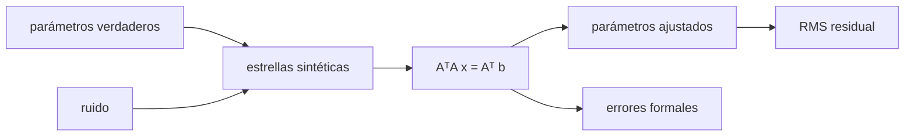

# B43-C26 — Modelo de flexiones y de apuntado de una montura

<!-- nav:top -->
[🏠 Programa](../../../../README.md) · [📚 Bloque B43](../../../tronco-comun/B43-construccion-y-mecanica-de-telescopios.md) · [← Anterior: B43-C25 — Rodamientos y apoyos de precisión en telescopios](../B43-C25-rodamientos-y-apoyos-de-precision-en-telescopios/CLASE.md) · [Siguiente: B44-C01 — Principios fotoeléctricos →](../../../tronco-comun/B44-detectores-y-adquisicion-astronomica.md#b44-c01)
<!-- /nav -->

## 1. Ubicación, nivel y alcance

Clase 26 del bloque B43. Nivel N3. Una montura nunca apunta exactamente donde se le pide: los ceros, las no perpendicularidades, la inclinación del eje vertical y la flexión del tubo añaden errores sistemáticos. Un modelo de apuntado los ajusta por mínimos cuadrados a partir de estrellas medidas. Aquí lo haces con datos sintéticos y parámetros conocidos. Usas [B12](../../../tronco-comun/B12-probabilidad-estadistica-e-incertidumbre.md), [B10](../../../tronco-comun/B10-algebra-lineal-y-matematicas-geometricas.md) y [B16](../../../tronco-comun/B16-sistemas-dinamicos-y-control-automatico.md).

## 2. Por qué esta clase existe

El modelo convierte errores de decenas de segundos de arco en residuos de segundos de arco. La decisión central: **¿qué términos incluir, cuántas estrellas medir y con qué incertidumbre se determina cada parámetro?**

## 3. Lo que podrás hacer al terminar

1. Escribir un modelo lineal de siete términos para una montura altacimutal.
2. Generar observaciones sintéticas con parámetros conocidos y ruido de semilla fija.
3. Resolver las ecuaciones normales por eliminación de Gauss.
4. Calcular los errores formales de los parámetros.
5. Verificar la recuperación con `error/σ`.
6. Comparar el RMS residual con el ruido inyectado.

La evidencia es la **ficha del modelo de apuntado** del ejercicio 12 (sección 20).

## 4. Con qué llegas y cómo comprobarlo

1. ¿Qué es un mínimo cuadrado?
2. ¿Qué es una ecuación normal?
3. ¿Qué es una matriz de covarianza?
4. ¿Qué es el ruido gaussiano?
5. ¿Qué es un error sistemático?

<details>
<summary>Ver respuestas</summary>

1. Minimizar la suma de los cuadrados de los residuos. 2. `AᵀA x = Aᵀ b`. 3. La inversa de `AᵀA` por la varianza del ruido. 4. Ruido con distribución normal. 5. Un error que se repite de forma determinista.
</details>

Con cuatro o cinco aciertos, sigue; si no, repasa los prerrequisitos.

## 5. Un caso de contexto y casos de referencia

Montura **sintética** con `IA = 120"`, `IE = −80"`, `CA = 45"`, `NPAE = 20"`, `AN = 30"`, `AW = −25"` y `TF = 15"`, con 60 estrellas y ruido gaussiano de `1"` (el ruido realmente inyectado resulta de `1,162"` con la semilla). Sin modelo el RMS de las 120 ecuaciones es `107,8"`; tras el ajuste el residuo es `1,167"`. Es el **ejemplo conductor**.

## 6. Vocabulario

Los **términos** del modelo: **IA** y **IE** (ceros de acimut y altura), **CA** (colimación), **NPAE** (no perpendicularidad de ejes), **AN** y **AW** (inclinación del eje vertical al norte y al oeste) y **TF** (flexión del tubo). El **modelo** es simplificado, de primer orden. Los **errores formales** `σ √diag((AᵀA)⁻¹)`.

## 7. Modelo mental: ajustar la brújula de un barco

Como ajustar la brújula de un barco: se miden desvíos en muchos rumbos y se ajustan unas pocas constantes que explican el patrón; lo que sobra es el ruido.



*Descripción textual:* el modelo lineal se ajusta a los desvíos medidos; la covarianza da la incertidumbre de cada término.

Analogía: ajustar la brújula de un barco. Límite: ángulos pequeños, errores independientes, sin histéresis.

## 8. La explicación, paso a paso

### 8.1 Parámetros

| Parámetro | Verdadero (") | Ajustado (") | σ formal (") | error/σ |
|---|---|---|---|---|
| IA | 120,0 | 119,34 | 2,54 | -0,26 |
| IE | -80,0 | -79,71 | 0,36 | 0,80 |
| CA | 45,0 | 44,91 | 4,15 | -0,02 |
| NPAE | 20,0 | 20,46 | 3,50 | 0,13 |
| AN | 30,0 | 30,25 | 0,15 | 1,67 |
| AW | -25,0 | -25,19 | 0,14 | -1,30 |
| TF | 15,0 | 14,48 | 0,60 | -0,86 |

### 8.2 Residuo

Con `120` ecuaciones y 7 incógnitas: RMS inicial `107,76"`; RMS residual `1,1671"`; ruido realmente inyectado `1,1616"`. Los errores formales más grandes son los de `CA` y `NPAE`, que están más correlacionados con otros términos.

### 8.3 Lectura

Cada `error/σ` queda dentro de `±2`, como se espera para siete parámetros. El RMS residual iguala al ruido real (no al nominal de 1"): con 120 ecuaciones el RMS muestral fluctúa algunos por ciento.

## 9. Magnitudes, símbolos y unidades

| Símbolo | Qué es | Unidad | Valor / nota |
|---|---|---|---|
| `IA, IE` | ceros de acimut y altura | " | 120, −80 (sintéticos) |
| `CA, NPAE` | colimación y no perpendicularidad | " | 45, 20 |
| `AN, AW` | inclinación del eje vertical | " | 30, −25 |
| `TF` | flexión del tubo | " | 15 |

## 10. Convenciones y referencias

Unidades del SI; coma decimal en el texto y punto decimal en las salidas del laboratorio; los ángulos están en radianes salvo que se indique y las longitudes de onda en nanómetros. Los telescopios y materiales de los ejemplos son ilustrativos.

## 11. De dónde sale lo que afirmamos

| ID | Fuente | Localizador | Respalda | Estado |
|---|---|---|---|---|
| S1 | Modelos de apuntado de monturas (TPOINT y similares) | — | estructura de los términos (el modelo de aquí es una simplificación propia, no una implementación de ninguno) | No consultado |

Límites: Datos y parámetros sintéticos; el modelo es simplificado y no reproduce al pie de la letra ninguna implementación publicada ni se contrastó con ninguna fuente.

## 12. Cómo ver los parámetros

| Parámetro | Ajustado (") | σ (") |
|---|---|---|
| IA | 119,34 | 2,54 |
| IE | -79,71 | 0,36 |
| CA | 44,91 | 4,15 |
| NPAE | 20,46 | 3,50 |
| AN | 30,25 | 0,15 |
| AW | -25,19 | 0,14 |
| TF | 14,48 | 0,60 |

Descripción larga: los ceros y la flexión se determinan mejor que CA y NPAE.

## 13. Ejemplo trabajado: los ceros

**Paso 1 · Verdadero.** `IE = −80"`.

**Paso 2 · Ajustado.** `-79,71"`.

**Paso 3 · Razón.** `error/σ = 0,80`.

## 14. Distintas formas de describir el apuntado

**En palabras:** se ajustan pocas constantes a muchos desvíos. **En fórmulas:** `AᵀA x = Aᵀ b`. **En tabla:** parámetros. **En código:** `apuntado.py`.

## 15. Práctica guiada

**Ejercicio 1 · con los pasos indicados.** ¿Cuántos parámetros tiene el modelo?

<details><summary>Solución comentada</summary>

Siete.
</details>

**Ejercicio 2 · con una pista.** ¿Cuántas ecuaciones hay?

<details><summary>Solución comentada</summary>

`120`.
</details>

**Ejercicio 3 · casi autónomo.** Error de `IA` ajustado frente al verdadero.

<details><summary>Solución comentada</summary>

`-0,66"`.
</details>

## 16. Práctica autónoma, transferencia e integrador

**Ejercicio 4.** Error de `AN`.

<details><summary>Solución comentada</summary>

`0,25"`.
</details>

**Ejercicio 5.** `σ` formal de `IE`.

<details><summary>Solución comentada</summary>

`0,36"`.
</details>

**Ejercicio 6.** `σ` formal de `CA`.

<details><summary>Solución comentada</summary>

`4,15"`.
</details>

**Ejercicio 7.** RMS residual.

<details><summary>Solución comentada</summary>

`1,167"`.
</details>

**Ejercicio 8.** Reducción del RMS por el modelo (factor).

<details><summary>Solución comentada</summary>

`92`.
</details>

**Ejercicio 9 · transferencia.** **Transferencia.** ¿Por qué hay estrellas de altura 25° a 80°?

<details><summary>Solución comentada</summary>

Para que los términos con `sen h` y `cos h` se separen.
</details>

**Ejercicio 10 · transferencia.** **Transferencia.** ¿Qué pasa si falta un término real en el modelo?

<details><summary>Solución comentada</summary>

El residuo no baja al ruido y los demás parámetros se sesgan.
</details>

**Ejercicio 11 · transferencia.** **Transferencia.** ¿Son estos parámetros de una montura real?

<details><summary>Solución comentada</summary>

No: son sintéticos.
</details>

**Ejercicio 12.** **Integrador.** Elabora tu *ficha del modelo de apuntado*: parámetros, errores formales y residuo.

<details><summary>Solución comentada</summary>

Secciones 8.1–8.3.
</details>

**Ejercicio 12 · integrador.** **Integrador.** Elabora tu *ficha del modelo de apuntado*: parámetros, errores formales y residuo.

<details><summary>Solución modelo</summary>

Secciones 8.1–8.3.
</details>

## 17. Laboratorio: ajuste del modelo de apuntado

El script [apuntado.py](apuntado.py) genera 60 estrellas sintéticas, ajusta siete parámetros y compara con los verdaderos (**comprueba** `|error| < 4 σ` y residuo dentro del 10 % del ruido real).

**Datos:** datos **sintéticos**; semilla `20261109`. **Predice antes de ejecutar:** ¿cuánto baja el RMS? (de ≈ 108" a ≈ 1,2".) **Ejecución del 2026-11-09 (Python 3.12.9):**

```text
Python 3.12.9 (biblioteca estandar)
parametro | verdadero (") | ajustado (") | sigma formal (") | error/sigma
IA | 120.0 | 119.34 | 2.54 | -0.26
IE | -80.0 | -79.71 | 0.36 | +0.80
CA | 45.0 | 44.91 | 4.15 | -0.02
NPAE | 20.0 | 20.46 | 3.50 | +0.13
AN | 30.0 | 30.25 | 0.15 | +1.67
AW | -25.0 | -25.19 | 0.14 | -1.30
TF | 15.0 | 14.48 | 0.60 | -0.86
n_ecuaciones = 120
rms_antes = 107.7626
rms_ruido_inyectado = 1.1616
rms_residual = 1.1671
Pruebas superadas.
```

```bash
python programa/clases/B43/B43-C26-modelo-de-flexiones-y-de-apuntado-de-una-montura/apuntado.py
```

**Límites:** primer orden; sin histéresis.

## 18. Errores frecuentes y cómo corregirlos

**Usar pocas estrellas o mal distribuidas.** Se corrige con la tabla de σ.

**Creer que el residuo debe ser exactamente 1".** Se corrige con 8.3.

**Omitir términos.** Se corrige con el ejercicio 10.

**Tomar el modelo por una implementación estándar.** Se corrige con los límites.

## 19. Cómo sabrás que vas bien

Tras la sección 8: ¿qué resultado esperabas y cuál obtuviste? Si dudas, repasa el ejemplo 13. Tras el laboratorio: ¿qué comprueba? (ver la sección 17).

## 20. Qué entregas y cómo se evalúa

El producto es tu **ficha del modelo de apuntado** (ejercicio 12).

| Criterio | Inicial | En desarrollo | Logrado | Destacado |
|---|---|---|---|---|
| Conceptos | Los confunde | Parciales | conceptos de la clase | Explica los límites |
| Cálculo | Sin unidades | Con errores | Tablas completas | Calcula casos nuevos |
| Numérico | Sin comprobar | Un caso | Contraste con el análisis | Interpreta las diferencias |
| Fuentes | Sin fuente | Sin fecha | fuentes con fecha | Declara lo ilustrativo |
| Límites | No los nombra | Uno | Tres | Discute qué falta del modelo |

**Condiciones críticas (no se compensan con promedio):** rotular todo como sintético; declarar que el modelo es una simplificación propia; no atribuir la estructura a una fuente no leída.

## 21. Ética, seguridad y límites

Clase educativa: los modelos son simplificados. Accesibilidad: tablas equivalentes a las gráficas, fórmulas en texto, ejercicios sin conexión.

## 22. Para cerrar y seguir

El ajuste devuelve los siete parámetros con `error/σ` menor que `1,7` y baja el RMS de `108"` a `1,2"`. Con esto se cierra el bloque: de los requisitos del primer día se llega a un telescopio que apunta.

**Glosario español–inglés.** modelo de apuntado · *pointing model*; mínimos cuadrados · *least squares*; ecuaciones normales · *normal equations*; error formal · *formal error*; flexión · *flexure*.

**Continuidad.** cierra el bloque; el siguiente (B44) trata los detectores.

**Referencias:** ver sección 11.

<!-- nav:bottom -->
---

[← Anterior: B43-C25 — Rodamientos y apoyos de precisión en telescopios](../B43-C25-rodamientos-y-apoyos-de-precision-en-telescopios/CLASE.md) · [📚 Bloque B43](../../../tronco-comun/B43-construccion-y-mecanica-de-telescopios.md) · [Siguiente: B44-C01 — Principios fotoeléctricos →](../../../tronco-comun/B44-detectores-y-adquisicion-astronomica.md#b44-c01)
<!-- /nav -->
