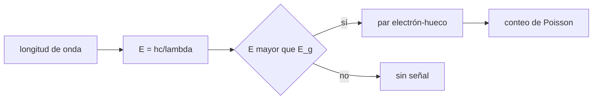

# B44-C01 — Principios fotoeléctricos

<!-- nav:top -->
[🏠 Programa](../../../../README.md) · [📚 Bloque B44](../../../tronco-comun/B44-detectores-y-adquisicion-astronomica.md) · [← Anterior: B43-C26 — Modelo de flexiones y de apuntado de una montura](../../B43/B43-C26-modelo-de-flexiones-y-de-apuntado-de-una-montura/CLASE.md) · [Siguiente: B44-C02 — Sensores CCD →](../B44-C02-sensores-ccd/CLASE.md)
<!-- /nav -->

## 1. Ubicación, nivel y alcance

Clase 1 del bloque B44. Nivel N3. Un detector astronómico convierte fotones en electrones. Aquí calculas la **energía del fotón**, la **longitud de onda de corte** del silicio y la **estadística de Poisson** de los fotones detectados. Usas [B05](../../../tronco-comun/B05-fisica-fundamental-para-el-espacio.md) y [B12](../../../tronco-comun/B12-probabilidad-estadistica-e-incertidumbre.md). El valor de la banda prohibida del silicio es ilustrativo y no se consultó una fuente; ningún detector real se describe.

## 2. Por qué esta clase existe

Todo lo que mide un detector parte de un fotón que cede su energía a un electrón. La decisión central: **¿qué fotones puede registrar un material y con qué fluctuación mínima?**

## 3. Lo que podrás hacer al terminar

1. Calcular la energía de un fotón a partir de su longitud de onda.
2. Hallar la longitud de onda de corte a partir de una energía de banda.
3. Convertir una potencia en una tasa de fotones.
4. Explicar por qué los fotones contados fluctúan como una variable de Poisson.
5. Comprobar una conversión de unidades por dos vías.
6. Reconocer qué asume el modelo de un electrón por fotón.

La evidencia es la **ficha de los principios fotoeléctricos** del ejercicio 12 (sección 20).

## 4. Con qué llegas y cómo comprobarlo

1. ¿Qué es una incertidumbre?
2. ¿Qué es una simulación Monte Carlo?
3. ¿Qué es una tabla de resultados?
4. ¿Qué es un valor ilustrativo?
5. ¿Qué es una verificación?

<details>
<summary>Ver respuestas</summary>

1. Un intervalo en que se espera el valor verdadero. 2. Repetir con números aleatorios de semilla fija. 3. Un resumen ordenado de cálculos. 4. Un valor propuesto para el ejemplo, no medido. 5. Comparar un cálculo con un caso independiente.
</details>

Con cuatro o cinco aciertos, sigue; si no, repasa los prerrequisitos.

## 5. Un caso de contexto y casos de referencia

Un haz de `1 pW` a `550 nm` trae `2,7688 × 10⁶` fotones por segundo. El silicio con una banda prohibida de `1,12 eV` (valor ilustrativo) deja de absorber por encima de `1107,0 nm`. Es el **ejemplo conductor**.

## 6. Vocabulario

El **fotón** es el cuanto de luz de energía `E = hc/λ`. La **banda prohibida** `E_g` es la energía mínima para liberar un electrón en el semiconductor. La **longitud de onda de corte** `λ_c = hc/E_g`. El **ruido de disparo** es la fluctuación de Poisson del número de fotones: varianza igual a la media.

## 7. Modelo mental: una lluvia sobre un balde

Los fotones caen como gotas: el balde recoge un número entero y distinto cada vez, aunque la lluvia media sea constante. Solo las gotas con energía suficiente abren la compuerta.



*Descripción textual:* la longitud de onda fija la energía; si supera la banda prohibida se libera un electrón y el número de eventos sigue una distribución de Poisson.

Analogía: una lluvia sobre un balde. Límite: un fotón libera como máximo un electrón y la absorción no es perfecta.

## 8. La explicación, paso a paso

### 8.1 Energía del fotón

La energía se calcula por dos vías: con `h`, `c` y `e` y con `h` en eV·s. Coinciden a mejor que `10⁻⁹` en valor relativo.

| `λ` (nm) | `E` (eV) | `E` (J) |
|---|---|---|
| 400 | 3,0996 | 4,9661 × 10⁻¹⁹ |
| 550 | 2,2543 | 3,6117 × 10⁻¹⁹ |
| 700 | 1,7712 | 2,8378 × 10⁻¹⁹ |
| 900 | 1,3776 | 2,2072 × 10⁻¹⁹ |
| 1100 | 1,1271 | 1,8059 × 10⁻¹⁹ |

### 8.2 Corte y tasa de fotones

Con `E_g = 1,12 eV` (ilustrativo), `λ_c = 1107,0 nm`: a `1100 nm` el fotón (`1,1271 eV`) aún supera la banda, a `1200 nm` no. Un haz de `1 pW` a `550 nm` equivale a `2,7688 × 10⁶` fotones por segundo.

### 8.3 Estadística de Poisson (4000 muestras, semilla 20261109)

| Media | Media muestral | Varianza / media |
|---|---|---|
| 4,0 | 4,043 | 1,024 |
| 20,0 | 19,951 | 1,014 |
| 100,0 | 99,963 | 1,007 |

### 8.4 Lectura

La energía crece al acortar la longitud de onda; un material solo ve por debajo de su corte. El cociente varianza/media cercano a 1 es la firma de Poisson: con `N` fotones el ruido relativo es `1/√N`.

## 9. Magnitudes, símbolos y unidades

| Símbolo | Qué es | Unidad | Valor / nota |
|---|---|---|---|
| `E` | energía del fotón | eV o J | 2,2543 eV a 550 nm |
| `λ_c` | longitud de onda de corte | nm | 1107,0 (con 1,12 eV ilustrativo) |
| `h`, `c`, `e` | constantes | — | exactas en el SI desde 2019 |

## 10. Convenciones y referencias

Las constantes son las de CODATA 2022 (NIST, consultada el 2026-11-09). La banda prohibida del silicio es un valor típico de texto, **ilustrativo**. La semilla es `20261109`. Para media ≥ 30 el laboratorio aproxima Poisson por una normal redondeada.

## 11. De dónde sale lo que afirmamos

| ID | Fuente | Localizador | Respalda | Estado |
|---|---|---|---|---|
| S1 | NIST, *Fundamental Physical Constants* (CODATA 2022) | https://physics.nist.gov/cuu/Constants/Table/allascii.txt | h, c y e (constantes exactas) | Consultada el 2026-11-09 |

Límites: NIST respalda solo las constantes; la banda prohibida, la potencia de 1 pW y las medias de Poisson son ilustrativas.

## 12. Cómo ver la energía por longitud de onda

| `λ` (nm) | `E` (eV) |
|---|---|
| 400 | 3,0996 |
| 550 | 2,2543 |
| 900 | 1,3776 |
| 1100 | 1,1271 |

Descripción larga: la energía baja de forma hiperbólica al aumentar la longitud de onda.

## 13. Ejemplo trabajado: fotones por segundo de 1 pW

**Paso 1 · Energía.** `E = 3,6117 × 10⁻¹⁹ J` a `550 nm`.

**Paso 2 · Cociente.** `P/E = 10⁻¹² / 3,6117 × 10⁻¹⁹`.

**Paso 3 · Resultado.** `2,7688 × 10⁶` fotones/s.

## 14. Distintas formas de describir un fotón

**Por energía:** `E = hc/λ`. **Por longitud de onda:** `λ`. **Por frecuencia:** `ν = c/λ`. **Por estadística:** una cuenta de Poisson.

## 15. Práctica guiada

**Ejercicio 1 · con los pasos indicados.** Energía a `400 nm` en eV. *Pasos:* `hc = 1239,84 eV·nm`; divide.

<details><summary>Solución comentada</summary>

`1239,84 / 400 = 3,0996 eV`.
</details>

**Ejercicio 2 · con una pista.** Longitud de onda de corte para `E_g = 1,12 eV`. *Pista:* `λ = hc/E`.

<details><summary>Solución comentada</summary>

`1239,84 / 1,12 = 1107,0 nm`.
</details>

**Ejercicio 3 · casi autónomo.** Fotones por segundo de `1 pW` a `550 nm`. *Pasos:* ejemplo 13.

<details><summary>Solución comentada</summary>

`2,7688 × 10⁶` fotones/s.
</details>

## 16. Práctica autónoma, transferencia e integrador

**Ejercicio 4.** ¿Se absorbe un fotón de `900 nm` en el modelo?

<details><summary>Solución comentada</summary>

Sí: `1,3776 eV` supera `1,12 eV`.
</details>

**Ejercicio 5.** ¿Y uno de `1200 nm`?

<details><summary>Solución comentada</summary>

`1239,84/1200 = 1,0332 eV`, menor que `1,12 eV`: no.
</details>

**Ejercicio 6.** Energía en J de un fotón de `700 nm`.

<details><summary>Solución comentada</summary>

`2,8378 × 10⁻¹⁹ J`.
</details>

**Ejercicio 7.** Ruido relativo de `10⁴` fotones.

<details><summary>Solución comentada</summary>

`1/√10⁴ = 1 %`.
</details>

**Ejercicio 8.** Fotones para un 0,1 % de ruido de disparo.

<details><summary>Solución comentada</summary>

`10⁶`.
</details>

**Ejercicio 9 · transferencia.** **Transferencia.** ¿Por qué un sensor de silicio es ciego a `1200 nm` aunque lleguen muchos fotones?

<details><summary>Solución comentada</summary>

Porque cada fotón tiene menos energía que la banda prohibida.
</details>

**Ejercicio 10 · transferencia.** **Transferencia.** Un colega afirma que con más luz el ruido de disparo baja en valor absoluto. Responde.

<details><summary>Solución comentada</summary>

Sube como `√N`; solo baja el ruido relativo.
</details>

**Ejercicio 11 · transferencia.** **Transferencia.** ¿Qué limita la afirmación «un fotón, un electrón»?

<details><summary>Solución comentada</summary>

La reflexión, la absorción incompleta y la recombinación (eficiencia cuántica, clase 4).
</details>

**Ejercicio 12.** **Integrador.** Elabora tu *ficha de los principios fotoeléctricos*: energías, corte, tasa y Poisson.

<details><summary>Solución comentada</summary>

Secciones 8.1–8.4.
</details>

**Ejercicio 12 · integrador.** **Integrador.** Elabora tu *ficha de los principios fotoeléctricos*: energías, corte, tasa y Poisson.

<details><summary>Solución modelo</summary>

Secciones 8.1–8.4.
</details>

## 17. Laboratorio: energía, corte y Poisson

El script [fotones.py](fotones.py) calcula energías por dos vías, el corte del silicio, la tasa de fotones y la estadística de Poisson (**comprueba** la coincidencia de las dos vías y la razón varianza/media).

**Datos:** `h`, `c`, `e` de NIST CODATA 2022 (consultada el 2026-11-09); banda prohibida, potencia y flujo **ilustrativos**; semilla `20261109`. **Predice antes de ejecutar:** ¿cuál será la longitud de onda de corte? (1107,0 nm.) **Ejecución del 2026-11-09 (Python 3.12.9):**

```text
Python 3.12.9 (biblioteca estandar)
 lambda [nm]  E [eV] (h,c,e)  E [eV] (h_eV)        E [J]
         400          3.0996         3.0996   4.9661e-19
         550          2.2543         2.2543   3.6117e-19
         700          1.7712         1.7712   2.8378e-19
         900          1.3776         1.3776   2.2072e-19
        1100          1.1271         1.1271   1.8059e-19
longitud de corte del silicio (E_g = 1.12 eV, ilustrativo): 1107.0 nm
tasa de fotones de 1 pW a 550 nm: 2.7688e+06 fotones/s
 media  media muestral  var/media
   4.0           4.043      1.024
  20.0          19.951      1.014
 100.0          99.963      1.007
Pruebas superadas.
```

```bash
python programa/clases/B44/B44-C01-principios-fotoelectricos/fotones.py
```

**Límites:** un electrón por fotón; sin reflexión ni profundidad de absorción.

## 18. Errores frecuentes y cómo corregirlos

**Confundir `eV` con `J`.** Se corrige con 8.1.

**Creer que más luz baja el ruido absoluto.** Se corrige con 8.3.

**Olvidar que el corte depende del material.** Se corrige con 8.2.

**Tomar la banda del silicio como dato medido.** Se corrige con la sección 10.

## 19. Cómo sabrás que vas bien

Tras la sección 8: ¿qué resultado esperabas y cuál obtuviste? Si dudas, repasa el ejemplo 13. Tras el laboratorio: ¿qué comprueba? (ver la sección 17).

## 20. Qué entregas y cómo se evalúa

El producto es tu **ficha de los principios fotoeléctricos** (ejercicio 12).

| Criterio | Inicial | En desarrollo | Logrado | Destacado |
|---|---|---|---|---|
| Conceptos | Los confunde | Parciales | conceptos de la clase | Explica los límites |
| Cálculo | Sin unidades | Con errores | Tablas completas | Calcula casos nuevos |
| Numérico | Sin comprobar | Un caso | Contraste con el análisis | Interpreta las diferencias |
| Fuentes | Sin fuente | Sin fecha | fuentes con fecha | Declara lo ilustrativo |
| Límites | No los nombra | Uno | Tres | Discute qué falta del modelo |

**Condiciones críticas (no se compensan con promedio):** rotular lo ilustrativo; citar NIST solo para las constantes; no describir un detector real.

## 21. Ética, seguridad y límites

Clase educativa: los modelos son simplificados. Accesibilidad: tablas equivalentes a las gráficas, fórmulas en texto, ejercicios sin conexión.

## 22. Para cerrar y seguir

Un fotón de `550 nm` aporta `2,2543 eV`; el silicio de este modelo corta en `1107 nm` y el conteo es de Poisson. Queda una pregunta: ¿cómo se guardan y se mueven los electrones liberados?

**Glosario español–inglés.** fotón · *photon*; banda prohibida · *band gap*; longitud de onda de corte · *cutoff wavelength*; ruido de disparo · *shot noise*; electrón · *electron*.

**Continuidad.** [B44-C02](../B44-C02-sensores-ccd/CLASE.md) estudia cómo un CCD mueve la carga.

**Referencias:** ver sección 11.

<!-- nav:bottom -->
---

[← Anterior: B43-C26 — Modelo de flexiones y de apuntado de una montura](../../B43/B43-C26-modelo-de-flexiones-y-de-apuntado-de-una-montura/CLASE.md) · [📚 Bloque B44](../../../tronco-comun/B44-detectores-y-adquisicion-astronomica.md) · [Siguiente: B44-C02 — Sensores CCD →](../B44-C02-sensores-ccd/CLASE.md)
<!-- /nav -->
