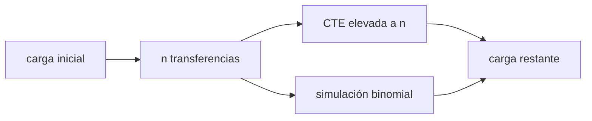

# B44-C02 — Sensores CCD

<!-- nav:top -->
<!-- /nav -->

## 1. Ubicación, nivel y alcance

Clase 2 del bloque B44. Nivel N3. En un CCD la carga de cada píxel viaja por el chip hasta un único amplificador de salida. Aquí calculas la **eficiencia de transferencia de carga (CTE)** y la **pérdida acumulada** con una simulación de semilla fija. Usas [B44-C01](../B44-C01-principios-fotoelectricos/CLASE.md) y [B12](../../../tronco-comun/B12-probabilidad-estadistica-e-incertidumbre.md). El sensor y la CTE son ilustrativos.

## 2. Por qué esta clase existe

Cada transferencia pierde una pequeña fracción de carga, y un píxel lejano se transfiere miles de veces. La decisión central: **¿qué CTE hace aceptable un sensor de 2048 × 2048?**

## 3. Lo que podrás hacer al terminar

1. Calcular la fracción restante tras `n` transferencias.
2. Comparar píxeles cercanos y lejanos.
3. Simular la pérdida de carga con semilla fija.
4. Estimar la CTE necesaria para una pérdida dada.
5. Interpretar la incertidumbre binomial.
6. Reconocer qué ignora el modelo (trampas, dependencia de la carga).

La evidencia es la **ficha del sensor CCD** del ejercicio 12 (sección 20).

## 4. Con qué llegas y cómo comprobarlo

1. ¿Qué es una incertidumbre?
2. ¿Qué es una simulación Monte Carlo?
3. ¿Qué es una tabla de resultados?
4. ¿Qué es un valor ilustrativo?
5. ¿Qué es una verificación?

<details>
<summary>Ver respuestas</summary>

1. Un intervalo en que se espera el valor verdadero. 2. Repetir con números aleatorios de semilla fija. 3. Un resumen ordenado de cálculos. 4. Un valor propuesto para el ejemplo, no medido. 5. Comparar un cálculo con un caso independiente.
</details>

Con cuatro o cinco aciertos, sigue; si no, repasa los prerrequisitos.

## 5. Un caso de contexto y casos de referencia

Con `CTE = 0,99999` y `4096` transferencias (2048 + 2048), el píxel de la esquina retiene `0,95987` de su carga (pérdida `4,013 %`). Es el **ejemplo conductor**. Todo es **ilustrativo**.

## 6. Vocabulario

La **CTE** es la fracción de carga que pasa de un píxel al siguiente. La **ineficiencia** es `1 − CTE`. El **registro de salida** lee las filas una a una. La **transferencia** es un paso de carga entre píxeles vecinos.

## 7. Modelo mental: pasar cubos por una fila de personas

Cada persona derrama una pizca al pasar el cubo; el cubo de quien está al final de la fila llega más vacío que el de quien está al principio.



*Descripción textual:* la carga inicial atraviesa `n` transferencias; la fracción restante es `CTE^n` y la simulación lo confirma.

Analogía: pasar cubos por una fila de personas. Límite: pérdida independiente y sin trampas dependientes de la carga.

## 8. La explicación, paso a paso

### 8.1 Fracción restante tras 4096 transferencias

| CTE | Fracción restante | Pérdida (%) |
|---|---|---|
| 0,999990 | 0,95987 | 4,013 |
| 0,999995 | 0,97973 | 2,027 |
| 0,999900 | 0,66390 | 33,610 |

### 8.2 Simulación

Con `1000 e⁻`, `CTE = 0,9999` y `400` transferencias, el valor analítico es `960,79 e⁻` y el simulado (300 repeticiones, semilla 20261109) `960,75 e⁻`, con error estándar de la media `0,35 e⁻`.

### 8.3 Cercano y lejano

El píxel de una transferencia conserva `0,999990`; el de `4096`, `0,959867`.

### 8.4 Lectura

Una ineficiencia de `10⁻⁵` por transferencia parece despreciable, pero cuesta el 4 % en la esquina. La pérdida es proporcional a la distancia al amplificador.

## 9. Magnitudes, símbolos y unidades

| Símbolo | Qué es | Unidad | Valor / nota |
|---|---|---|---|
| CTE | eficiencia de transferencia | — | 0,99999 |
| `n` | número de transferencias | — | 4096 |
| `1 − CTE^n` | pérdida acumulada | — | 0,04013 |

## 10. Convenciones y referencias

Pérdida independiente en cada transferencia y electrón (aproximada por Poisson en la simulación); semilla `20261109`; sensor ilustrativo.

## 11. De dónde sale lo que afirmamos

| ID | Fuente | Localizador | Respalda | Estado |
|---|---|---|---|---|
| — | Sin fuente externa | — | relaciones estándar que verifica el laboratorio | No se consultó una fuente para esta clase |

Límites: no se consultó una fuente; la CTE y el tamaño son ilustrativos.

## 12. Cómo ver la pérdida por CTE

| CTE | Fracción restante a 4096 |
|---|---|
| 0,999990 | 0,95987 |
| 0,999995 | 0,97973 |
| 0,999900 | 0,66390 |

Descripción larga: la fracción restante cae rápido al bajar la CTE.

## 13. Ejemplo trabajado: fracción restante de la esquina

**Paso 1 · Logaritmo.** `ln(0,99999) = −1,00000 × 10⁻⁵`.

**Paso 2 · Producto.** `4096 × (−10⁻⁵) = −0,040960`.

**Paso 3 · Exponencial.** `e^(−0,040960) = 0,95987`.

## 14. Distintas formas de describir la pérdida de carga

**Por fracción:** `CTE^n`. **Por pérdida:** `1 − CTE^n`. **Por simulación:** una binomial por transferencia. **Por distancia:** crece con el número de pasos.

## 15. Práctica guiada

**Ejercicio 1 · con los pasos indicados.** Fracción restante con `CTE = 0,99999` y `4096` pasos. *Pasos:* ejemplo 13.

<details><summary>Solución comentada</summary>

`0,95987`.
</details>

**Ejercicio 2 · con una pista.** Carga que pierde un píxel de `1000 e⁻` en la esquina. *Pista:* `1000 × (1 − 0,95987)`.

<details><summary>Solución comentada</summary>

`40,1 e⁻`.
</details>

**Ejercicio 3 · casi autónomo.** Fracción restante tras `400` pasos con `CTE = 0,9999`. *Pasos:* `0,9999^400`.

<details><summary>Solución comentada</summary>

`0,96079`, es decir `960,79 e⁻` de 1000.
</details>

## 16. Práctica autónoma, transferencia e integrador

**Ejercicio 4.** Número de pasos para perder el 5 % con `CTE = 0,99999`.

<details><summary>Solución comentada</summary>

`ln 0,95 / ln 0,99999 ≈ 5129`.
</details>

**Ejercicio 5.** CTE máxima de pérdida 1 % en `4096` pasos.

<details><summary>Solución comentada</summary>

`0,99^(1/4096) = 0,99999755`.
</details>

**Ejercicio 6.** ¿Qué mejora más: pasar de 0,99999 a 0,999995 o reducir pasos a la mitad?

<details><summary>Solución comentada</summary>

Similar: ambos reducen la pérdida a la mitad aproximadamente (4,0 % a 2,0 %).
</details>

**Ejercicio 7.** Pérdida con `CTE = 0,9999` a `4096` pasos.

<details><summary>Solución comentada</summary>

`33,6 %`.
</details>

**Ejercicio 8.** Error estándar de la media simulada.

<details><summary>Solución comentada</summary>

`0,35 e⁻`: la media simulada `960,75` coincide con `960,79`.
</details>

**Ejercicio 9 · transferencia.** **Transferencia.** ¿Por qué un sensor más grande exige mejor CTE?

<details><summary>Solución comentada</summary>

Porque el número máximo de transferencias crece con el tamaño.
</details>

**Ejercicio 10 · transferencia.** **Transferencia.** Un compañero dice que `0,99999` es «casi perfecta». Responde con una cifra.

<details><summary>Solución comentada</summary>

Pierde el 4 % de la esquina de 2048 × 2048.
</details>

**Ejercicio 11 · transferencia.** **Transferencia.** ¿Qué ignora el modelo?

<details><summary>Solución comentada</summary>

Las trampas de carga dependientes del nivel y de la temperatura.
</details>

**Ejercicio 12.** **Integrador.** Elabora tu *ficha del sensor CCD*: fracciones, simulación y límites.

<details><summary>Solución comentada</summary>

Secciones 8.1–8.4.
</details>

**Ejercicio 12 · integrador.** **Integrador.** Elabora tu *ficha del sensor CCD*: fracciones, simulación y límites.

<details><summary>Solución modelo</summary>

Secciones 8.1–8.4.
</details>

## 17. Laboratorio: CTE y pérdida acumulada

El script [transferencia.py](transferencia.py) calcula la fracción restante y la contrasta con una simulación de pérdidas por transferencia (**comprueba** que la media simulada coincide con la analítica dentro de 4 errores estándar).

**Datos:** sin constantes; sensor, CTE y carga **ilustrativos**; semilla `20261109`. **Predice antes de ejecutar:** ¿cuánto retiene el píxel más lejano? (0,95987.) **Ejecución del 2026-11-09 (Python 3.12.9):**

```text
Python 3.12.9 (biblioteca estandar)
       CTE  n transf.  fraccion restante  perdida [%]
  0.999990       4096            0.95987        4.013
  0.999995       4096            0.97973        2.027
  0.999900       4096            0.66390       33.610
1000 e-, CTE 0.9999, 400 transferencias: analitico 960.79 e-, simulado 960.75 e- (sigma de la media 0.35)
pixel cercano (1 transf.): 0.999990  pixel lejano (4096 transf.): 0.959867
Pruebas superadas.
```

```bash
python programa/clases/B44/B44-C02-sensores-ccd/transferencia.py
```

**Límites:** pérdida independiente y uniforme; sin trampas.

## 18. Errores frecuentes y cómo corregirlos

**Sumar pérdidas en lugar de multiplicar fracciones.** Se corrige con 8.1.

**Creer que la CTE es irrelevante por ser casi 1.** Se corrige con 8.4.

**Olvidar la distancia al amplificador.** Se corrige con 8.3.

**Presentar el sensor como real.** Se corrige con la sección 10.

## 19. Cómo sabrás que vas bien

Tras la sección 8: ¿qué resultado esperabas y cuál obtuviste? Si dudas, repasa el ejemplo 13. Tras el laboratorio: ¿qué comprueba? (ver la sección 17).

## 20. Qué entregas y cómo se evalúa

El producto es tu **ficha del sensor CCD** (ejercicio 12).

| Criterio | Inicial | En desarrollo | Logrado | Destacado |
|---|---|---|---|---|
| Conceptos | Los confunde | Parciales | conceptos de la clase | Explica los límites |
| Cálculo | Sin unidades | Con errores | Tablas completas | Calcula casos nuevos |
| Numérico | Sin comprobar | Un caso | Contraste con el análisis | Interpreta las diferencias |
| Fuentes | Sin fuente | Sin fecha | fuentes con fecha | Declara lo ilustrativo |
| Límites | No los nombra | Uno | Tres | Discute qué falta del modelo |

**Condiciones críticas (no se compensan con promedio):** rotular lo ilustrativo; no atribuir la CTE a un sensor real.

## 21. Ética, seguridad y límites

Clase educativa: los modelos son simplificados. Accesibilidad: tablas equivalentes a las gráficas, fórmulas en texto, ejercicios sin conexión.

## 22. Para cerrar y seguir

Con `CTE = 0,99999` la esquina de un CCD de 2048 × 2048 pierde el 4 %. Queda una pregunta: ¿cómo cambia el diseño cuando cada píxel tiene su propio amplificador?

**Glosario español–inglés.** CCD · *CCD*; eficiencia de transferencia · *charge transfer efficiency*; registro de salida · *output register*; carga · *charge*; pérdida · *loss*.

**Continuidad.** [B44-C03](../B44-C03-sensores-cmos/CLASE.md) compara con el sensor CMOS.

**Referencias:** ver sección 11.

<!-- nav:bottom -->
---

<!-- /nav -->
