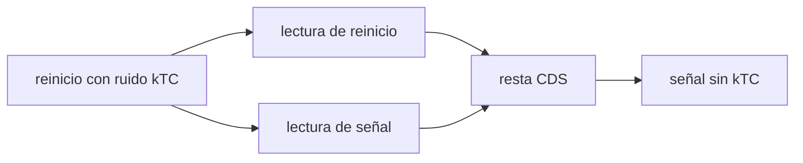

# B44-C03 — Sensores CMOS

<!-- nav:top -->
<!-- /nav -->

## 1. Ubicación, nivel y alcance

Clase 3 del bloque B44. Nivel N3. En un CMOS cada píxel (o cada columna) tiene su propio amplificador. Aquí calculas el **ruido kTC** del reinicio, el efecto del **muestreo doble correlacionado (CDS)** y el desplazamiento del **obturador rodante**. Usas [B05](../../../tronco-comun/B05-fisica-fundamental-para-el-espacio.md) y [B44-C02](../B44-C02-sensores-ccd/CLASE.md). Los valores del sensor son ilustrativos.

## 2. Por qué esta clase existe

El diseño CMOS cambia el ruido y la geometría de la lectura. La decisión central: **¿qué ruido elimina el CDS y qué artefacto introduce el obturador rodante?**

## 3. Lo que podrás hacer al terminar

1. Calcular el ruido kTC en electrones.
2. Simular el CDS y medir su efecto.
3. Calcular el desplazamiento del obturador rodante.
4. Distinguir lectura por píxel y por columna.
5. Comparar con el CCD de la clase anterior.
6. Reconocer los límites del modelo.

La evidencia es la **ficha del sensor CMOS** del ejercicio 12 (sección 20).

## 4. Con qué llegas y cómo comprobarlo

1. ¿Qué es una incertidumbre?
2. ¿Qué es una simulación Monte Carlo?
3. ¿Qué es una tabla de resultados?
4. ¿Qué es un valor ilustrativo?
5. ¿Qué es una verificación?

<details>
<summary>Ver respuestas</summary>

1. Un intervalo en que se espera el valor verdadero. 2. Repetir con números aleatorios de semilla fija. 3. Un resumen ordenado de cálculos. 4. Un valor propuesto para el ejemplo, no medido. 5. Comparar un cálculo con un caso independiente.
</details>

Con cuatro o cinco aciertos, sigue; si no, repasa los prerrequisitos.

## 5. Un caso de contexto y casos de referencia

Con `C = 10 fF` y `T = 300 K`, el ruido de reinicio es `40,17 e⁻`; un CDS con ruido de lectura de `2 e⁻` lo baja a `2,85 e⁻`. Un obturador rodante de 1000 filas a `20 µs` por fila desplaza un objeto de `5000 px/s` en `100 px`. Es el **ejemplo conductor**.

## 6. Vocabulario

El **ruido kTC** es el ruido térmico de la carga al reiniciar un condensador, `√(k_B T C)/e`. El **CDS** resta la lectura del reinicio de la lectura de señal. El **obturador rodante** expone y lee fila a fila. La **lectura por columna** usa un amplificador por columna.

## 7. Modelo mental: medir dos veces el mismo escalón

Si al medir una altura anotas primero el suelo y luego la cima, la resta cancela el error del suelo: eso hace el CDS.



*Descripción textual:* el reinicio introduce un ruido que aparece en las dos lecturas del mismo píxel; restarlas lo cancela.

Analogía: medir dos veces el mismo escalón. Límite: el ruido de reinicio se repite exactamente en las dos lecturas.

## 8. La explicación, paso a paso

### 8.1 Ruido kTC

Con `k_B` y `e` exactas (NIST, consultada el 2026-11-09): `σ = √(k_B T C)/e`.

| `C` (fF) | `σ` (e⁻) |
|---|---|
| 1 | 12,70 |
| 10 | 40,17 |
| 100 | 127,03 |

### 8.2 CDS (20 000 píxeles, semilla 20261109)

Sin CDS el ruido es `40,24 e⁻` (esperado `40,22`); con CDS, `2,85 e⁻` (esperado `√2 × 2 = 2,83`).

### 8.3 Obturador rodante

El desplazamiento entre la primera y la última fila es `v · N · t_fila = 5000 × 1000 × 20 µs = 100 px`, igual en la simulación.

### 8.4 Lectura

El ruido kTC crece como `√C`. El CDS lo elimina pero suma la lectura dos veces (`√2`). El obturador rodante deforma objetos en movimiento.

## 9. Magnitudes, símbolos y unidades

| Símbolo | Qué es | Unidad | Valor / nota |
|---|---|---|---|
| `σ_kTC` | ruido de reinicio | e⁻ | 40,17 a 10 fF |
| `k_B` | constante de Boltzmann | J/K | 1,380649 × 10⁻²³ |
| `t_fila` | tiempo por fila | µs | 20 |

## 10. Convenciones y referencias

`T = 300 K` y `C` ilustrativos; ruido de lectura de `2 e⁻` ilustrativo; semilla `20261109`.

## 11. De dónde sale lo que afirmamos

| ID | Fuente | Localizador | Respalda | Estado |
|---|---|---|---|---|
| S1 | NIST, *Fundamental Physical Constants* (CODATA 2022) | https://physics.nist.gov/cuu/Constants/Table/allascii.txt | k_B y e (constantes exactas) | Consultada el 2026-11-09 |

Límites: NIST respalda `k_B` y `e`; la capacidad, la temperatura y las velocidades son ilustrativas.

## 12. Cómo ver el ruido de reinicio

| `C` (fF) | `σ` (e⁻) |
|---|---|
| 1 | 12,70 |
| 10 | 40,17 |
| 100 | 127,03 |

Descripción larga: el ruido crece con la raíz de la capacidad.

## 13. Ejemplo trabajado: kTC a 10 fF

**Paso 1 · Producto.** `k_B T C = 1,380649 × 10⁻²³ × 300 × 10⁻¹⁴ = 4,14 × 10⁻³⁵ J·F`.

**Paso 2 · Raíz.** `6,43 × 10⁻¹⁸ C`.

**Paso 3 · Electrones.** Dividido por `e`: `40,17 e⁻`.

## 14. Distintas formas de describir el ruido de reinicio

**Por fórmula:** `√(kTC)/e`. **Por simulación:** desviación de lecturas. **Por técnica:** CDS. **Por efecto:** el ruido de lectura final.

## 15. Práctica guiada

**Ejercicio 1 · con los pasos indicados.** Ruido kTC con `C = 1 fF`. *Pasos:* escala con `√C`.

<details><summary>Solución comentada</summary>

`40,17/√10 = 12,70 e⁻`.
</details>

**Ejercicio 2 · con una pista.** Ruido tras CDS con lectura de `2 e⁻`. *Pista:* suma en cuadratura de dos lecturas.

<details><summary>Solución comentada</summary>

`2√2 = 2,83 e⁻`.
</details>

**Ejercicio 3 · casi autónomo.** Desplazamiento con `2500 px/s`. *Pasos:* `v · N · t`.

<details><summary>Solución comentada</summary>

`50 px`.
</details>

## 16. Práctica autónoma, transferencia e integrador

**Ejercicio 4.** Duración de la lectura de las 1000 filas.

<details><summary>Solución comentada</summary>

`20 ms`.
</details>

**Ejercicio 5.** Tiempo de lectura para un desplazamiento menor de 1 px a `5000 px/s`.

<details><summary>Solución comentada</summary>

Menos de `0,2 ms` (0,2 µs por fila).
</details>

**Ejercicio 6.** Ruido kTC con `C = 40 fF`.

<details><summary>Solución comentada</summary>

`40,17 × 2 = 80,34 e⁻`.
</details>

**Ejercicio 7.** Cociente entre sin CDS y con CDS simulado.

<details><summary>Solución comentada</summary>

`40,24/2,85 ≈ 14,1`.
</details>

**Ejercicio 8.** ¿Qué pasa si el reinicio no se repite entre lecturas?

<details><summary>Solución comentada</summary>

El CDS no cancela el ruido.
</details>

**Ejercicio 9 · transferencia.** **Transferencia.** ¿Por qué el CMOS necesita CDS más a menudo que un CCD?

<details><summary>Solución comentada</summary>

Porque cada píxel se reinicia con su propio condensador.
</details>

**Ejercicio 10 · transferencia.** **Transferencia.** Un objeto veloz aparece inclinado. ¿Causa?

<details><summary>Solución comentada</summary>

El obturador rodante: cada fila ve una posición distinta.
</details>

**Ejercicio 11 · transferencia.** **Transferencia.** ¿Qué hace el CDS al ruido de lectura?

<details><summary>Solución comentada</summary>

Lo multiplica por `√2`.
</details>

**Ejercicio 12.** **Integrador.** Elabora tu *ficha del sensor CMOS*: kTC, CDS y obturador.

<details><summary>Solución comentada</summary>

Secciones 8.1–8.4.
</details>

**Ejercicio 12 · integrador.** **Integrador.** Elabora tu *ficha del sensor CMOS*: kTC, CDS y obturador.

<details><summary>Solución modelo</summary>

Secciones 8.1–8.4.
</details>

## 17. Laboratorio: kTC, CDS y obturador rodante

El script [cmos.py](cmos.py) calcula el ruido kTC, simula el CDS y el desplazamiento del obturador rodante (**comprueba** el ruido con y sin CDS frente al analítico).

**Datos:** `k_B` y `e` de NIST CODATA 2022 (consultada el 2026-11-09); capacidad, temperatura, tiempo por fila y velocidad **ilustrativos**; semilla `20261109`. **Predice antes de ejecutar:** ¿cuánto ruido queda tras el CDS? (2,85 e⁻.) **Ejecución del 2026-11-09 (Python 3.12.9):**

```text
Python 3.12.9 (biblioteca estandar)
ruido kTC (T = 300 K, C = 10 fF): 40.17 e- rms
  C =    1.0 fF ->   12.70 e-
  C =   10.0 fF ->   40.17 e-
  C =  100.0 fF ->  127.03 e-
sin CDS: 40.24 e-   con CDS: 2.85 e-   (esperado 40.22 y 2.83)
desplazamiento entre primera y ultima fila: analitico 100.0 px, simulado 100.0 px
Pruebas superadas.
```

```bash
python programa/clases/B44/B44-C03-sensores-cmos/cmos.py
```

**Límites:** reinicio idéntico en ambas lecturas; sin ruido 1/f.

## 18. Errores frecuentes y cómo corregirlos

**Pensar que el CDS elimina todo el ruido.** Se corrige con 8.2.

**Olvidar el `√2` del CDS.** Se corrige con 8.4.

**Ignorar el obturador rodante en objetos veloces.** Se corrige con 8.3.

**Atribuir cifras a un sensor real.** Se corrige con la sección 10.

## 19. Cómo sabrás que vas bien

Tras la sección 8: ¿qué resultado esperabas y cuál obtuviste? Si dudas, repasa el ejemplo 13. Tras el laboratorio: ¿qué comprueba? (ver la sección 17).

## 20. Qué entregas y cómo se evalúa

El producto es tu **ficha del sensor CMOS** (ejercicio 12).

| Criterio | Inicial | En desarrollo | Logrado | Destacado |
|---|---|---|---|---|
| Conceptos | Los confunde | Parciales | conceptos de la clase | Explica los límites |
| Cálculo | Sin unidades | Con errores | Tablas completas | Calcula casos nuevos |
| Numérico | Sin comprobar | Un caso | Contraste con el análisis | Interpreta las diferencias |
| Fuentes | Sin fuente | Sin fecha | fuentes con fecha | Declara lo ilustrativo |
| Límites | No los nombra | Uno | Tres | Discute qué falta del modelo |

**Condiciones críticas (no se compensan con promedio):** rotular lo ilustrativo; citar NIST solo para las constantes.

## 21. Ética, seguridad y límites

Clase educativa: los modelos son simplificados. Accesibilidad: tablas equivalentes a las gráficas, fórmulas en texto, ejercicios sin conexión.

## 22. Para cerrar y seguir

Un reinicio de 10 fF mete `40,17 e⁻`; el CDS lo deja en `2,85 e⁻`. Queda una pregunta: ¿qué fracción de los fotones convierte realmente el sensor en electrones?

**Glosario español–inglés.** CMOS · *CMOS*; ruido kTC · *kTC noise*; muestreo doble correlacionado · *correlated double sampling*; obturador rodante · *rolling shutter*; reinicio · *reset*.

**Continuidad.** [B44-C04](../B44-C04-eficiencia-cuantica-espectral/CLASE.md) define la eficiencia cuántica espectral.

**Referencias:** ver sección 11.

<!-- nav:bottom -->
---

<!-- /nav -->
