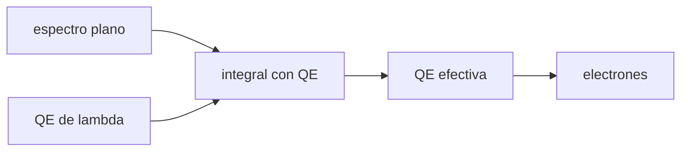

# B44-C04 — Eficiencia cuántica espectral

<!-- nav:top -->
[🏠 Programa](../../../../README.md) · [📚 Bloque B44](../../../tronco-comun/B44-detectores-y-adquisicion-astronomica.md) · [← Anterior: B44-C03 — Sensores CMOS](../B44-C03-sensores-cmos/CLASE.md) · [Siguiente: B44-C05 — Pozo lleno y rango dinámico →](../B44-C05-pozo-lleno-y-rango-dinamico/CLASE.md)
<!-- /nav -->

## 1. Ubicación, nivel y alcance

Clase 4 del bloque B44. Nivel N3. La **eficiencia cuántica** es la fracción de fotones que genera un electrón, y depende de la longitud de onda. Aquí integras una curva ilustrativa sobre una banda por tres métodos. Usas [B44-C01](../B44-C01-principios-fotoelectricos/CLASE.md) y [B12](../../../tronco-comun/B12-probabilidad-estadistica-e-incertidumbre.md). La curva no es la de ningún detector real.

## 2. Por qué esta clase existe

La luz de una estrella llega repartida en longitudes de onda y el detector responde distinto a cada una. La decisión central: **¿qué eficiencia efectiva tiene el detector en esta banda?**

## 3. Lo que podrás hacer al terminar

1. Evaluar una curva de eficiencia cuántica.
2. Integrar sobre una banda con trapecio y Simpson.
3. Comparar con la integral exacta con erf.
4. Convertir fotones en electrones.
5. Interpretar el error de integración.
6. Reconocer qué supone el espectro plano.

La evidencia es la **ficha de la eficiencia cuántica** del ejercicio 12 (sección 20).

## 4. Con qué llegas y cómo comprobarlo

1. ¿Qué es una incertidumbre?
2. ¿Qué es una simulación Monte Carlo?
3. ¿Qué es una tabla de resultados?
4. ¿Qué es un valor ilustrativo?
5. ¿Qué es una verificación?

<details>
<summary>Ver respuestas</summary>

1. Un intervalo en que se espera el valor verdadero. 2. Repetir con números aleatorios de semilla fija. 3. Un resumen ordenado de cálculos. 4. Un valor propuesto para el ejemplo, no medido. 5. Comparar un cálculo con un caso independiente.
</details>

Con cuatro o cinco aciertos, sigue; si no, repasa los prerrequisitos.

## 5. Un caso de contexto y casos de referencia

Con una curva gaussiana ilustrativa (máximo `0,90` en `650 nm`, anchura `150 nm`) y un espectro plano en fotones entre `500` y `800 nm`, la eficiencia efectiva es `0,77006`: `10⁶` fotones dan `770 062` electrones. Es el **ejemplo conductor**.

## 6. Vocabulario

La **eficiencia cuántica** `QE(λ)` es la fracción de fotones que se convierten en electrones. La **eficiencia efectiva** es su promedio ponderado por el espectro. La **banda** es el intervalo de longitudes de onda observado. La **regla de Simpson** integra con parábolas.

## 7. Modelo mental: una criba de malla variable

Una criba deja pasar más o menos arena según el tamaño del grano; la fracción total depende de cuánta arena de cada tamaño llega.



*Descripción textual:* el espectro ponderado por la curva da una eficiencia efectiva y de ella el número de electrones.

Analogía: una criba de malla variable. Límite: el espectro es plano en fotones y la curva es gaussiana de juguete.

## 8. La explicación, paso a paso

### 8.1 La curva

| `λ` (nm) | `QE` |
|---|---|
| 400 | 0,2244 |
| 500 | 0,5459 |
| 650 | 0,9000 |
| 800 | 0,5459 |
| 900 | 0,2244 |

### 8.2 Integración sobre 500–800 nm

| Intervalos | Trapecio | Simpson |
|---|---|---|
| 4 | 0,75859 | 0,77048 |
| 10 | 0,76824 | 0,77007 |
| 40 | 0,76995 | 0,77006 |
| 400 | 0,77006 | 0,77006 |

La integral exacta (con erf) es `0,77006195`. Simpson con 400 intervalos coincide a `10⁻⁹` relativo.

### 8.3 Electrones

`10⁶` fotones en la banda dan `770 062` electrones.

### 8.4 Lectura

Con 4 intervalos el trapecio se equivoca un 1,5 % y Simpson un 0,05 %. La eficiencia efectiva (`0,77`) es menor que el máximo (`0,90`).

## 9. Magnitudes, símbolos y unidades

| Símbolo | Qué es | Unidad | Valor / nota |
|---|---|---|---|
| `QE` | eficiencia cuántica | — | 0,90 máx. |
| `QE_ef` | eficiencia efectiva | — | 0,77006 |
| `S` | anchura de la curva | nm | 150 (ilustrativa) |

## 10. Convenciones y referencias

La curva gaussiana y la banda son **ilustrativas**; espectro plano en fotones por unidad de longitud de onda.

## 11. De dónde sale lo que afirmamos

| ID | Fuente | Localizador | Respalda | Estado |
|---|---|---|---|---|
| — | Sin fuente externa | — | relaciones estándar que verifica el laboratorio | No se consultó una fuente para esta clase |

Límites: no se consultó una fuente; la curva no corresponde a ningún detector.

## 12. Cómo ver la eficiencia en la banda

| Método | `QE_ef` |
|---|---|
| Trapecio (4) | 0,75859 |
| Simpson (4) | 0,77048 |
| Exacta | 0,77006 |

Descripción larga: Simpson converge más rápido que el trapecio.

## 13. Ejemplo trabajado: electrones de un millón de fotones

**Paso 1 · Eficiencia efectiva.** `0,77006`.

**Paso 2 · Producto.** `10⁶ × 0,77006`.

**Paso 3 · Resultado.** `770 062 e⁻`.

## 14. Distintas formas de describir la respuesta espectral

**Por curva:** `QE(λ)`. **Por promedio:** `QE_ef`. **Por electrones:** `N·QE_ef`. **Por error:** diferencia con la integral exacta.

## 15. Práctica guiada

**Ejercicio 1 · con los pasos indicados.** `QE(500 nm)` con la curva. *Pasos:* `0,9 · e^(−0,5)`.

<details><summary>Solución comentada</summary>

`0,9 × 0,6065 = 0,5459`.
</details>

**Ejercicio 2 · con una pista.** `QE(400 nm)`. *Pista:* `z = 250/150`.

<details><summary>Solución comentada</summary>

`0,9 × e^(−1,3889) = 0,2244`.
</details>

**Ejercicio 3 · casi autónomo.** Electrones de `1000` fotones a `800 nm`. *Pasos:* `QE(800)`.

<details><summary>Solución comentada</summary>

`546`.
</details>

## 16. Práctica autónoma, transferencia e integrador

**Ejercicio 4.** Error relativo del trapecio con 4 intervalos.

<details><summary>Solución comentada</summary>

`0,75859/0,77006 − 1 = −1,5 %`.
</details>

**Ejercicio 5.** Error relativo de Simpson con 4 intervalos.

<details><summary>Solución comentada</summary>

`+0,05 %`.
</details>

**Ejercicio 6.** Electrones de `5 × 10⁵` fotones en la banda.

<details><summary>Solución comentada</summary>

`385 031`.
</details>

**Ejercicio 7.** ¿Y si la QE fuera constante `0,90`?

<details><summary>Solución comentada</summary>

`QE_ef = 0,90`.
</details>

**Ejercicio 8.** ¿Por qué `QE_ef` es menor que `0,90`?

<details><summary>Solución comentada</summary>

Porque la banda incluye longitudes de onda lejos del máximo.
</details>

**Ejercicio 9 · transferencia.** **Transferencia.** Un espectro rojo (más fotones a `800 nm`). ¿Sube o baja `QE_ef`?

<details><summary>Solución comentada</summary>

Baja, porque `QE(800) < QE(650)`.
</details>

**Ejercicio 10 · transferencia.** **Transferencia.** ¿Por qué importa la banda al comparar detectores?

<details><summary>Solución comentada</summary>

Porque la eficiencia efectiva depende de la banda y del espectro.
</details>

**Ejercicio 11 · transferencia.** **Transferencia.** ¿Es esta curva la de un sensor real?

<details><summary>Solución comentada</summary>

No: es una gaussiana de juguete.
</details>

**Ejercicio 12.** **Integrador.** Elabora tu *ficha de la eficiencia cuántica*: curva, integrales y electrones.

<details><summary>Solución comentada</summary>

Secciones 8.1–8.4.
</details>

**Ejercicio 12 · integrador.** **Integrador.** Elabora tu *ficha de la eficiencia cuántica*: curva, integrales y electrones.

<details><summary>Solución modelo</summary>

Secciones 8.1–8.4.
</details>

## 17. Laboratorio: eficiencia efectiva en una banda

El script [eficiencia.py](eficiencia.py) integra la curva por trapecio y Simpson y la contrasta con la integral exacta (**comprueba** Simpson a `10⁻⁹` y el trapecio a `10⁻⁴`).

**Datos:** sin constantes; curva y banda **ilustrativas**. **Predice antes de ejecutar:** ¿cuál es la eficiencia efectiva? (0,77006.) **Ejecución del 2026-11-09 (Python 3.12.9):**

```text
Python 3.12.9 (biblioteca estandar)
 lambda [nm]       QE
         400   0.2244
         500   0.5459
         650   0.9000
         800   0.5459
         900   0.2244
     n     trapecio      Simpson
     4   0.75859300   0.77047774
    10   0.76823993   0.77007180
    40   0.76994822   0.77006199
   400   0.77006082   0.77006195
exacta (erf): 0.77006195
1 000 000 fotones en la banda -> 770062 electrones
Pruebas superadas.
```

```bash
python programa/clases/B44/B44-C04-eficiencia-cuantica-espectral/eficiencia.py
```

**Límites:** espectro plano; sin dependencia de la temperatura ni del ángulo.

## 18. Errores frecuentes y cómo corregirlos

**Usar el máximo de QE como valor de la banda.** Se corrige con 8.4.

**Integrar con pocos intervalos.** Se corrige con 8.2.

**Olvidar el espectro de la fuente.** Se corrige con la sección 10.

**Presentar la curva como medida.** Se corrige con la sección 10.

## 19. Cómo sabrás que vas bien

Tras la sección 8: ¿qué resultado esperabas y cuál obtuviste? Si dudas, repasa el ejemplo 13. Tras el laboratorio: ¿qué comprueba? (ver la sección 17).

## 20. Qué entregas y cómo se evalúa

El producto es tu **ficha de la eficiencia cuántica** (ejercicio 12).

| Criterio | Inicial | En desarrollo | Logrado | Destacado |
|---|---|---|---|---|
| Conceptos | Los confunde | Parciales | conceptos de la clase | Explica los límites |
| Cálculo | Sin unidades | Con errores | Tablas completas | Calcula casos nuevos |
| Numérico | Sin comprobar | Un caso | Contraste con el análisis | Interpreta las diferencias |
| Fuentes | Sin fuente | Sin fecha | fuentes con fecha | Declara lo ilustrativo |
| Límites | No los nombra | Uno | Tres | Discute qué falta del modelo |

**Condiciones críticas (no se compensan con promedio):** rotular la curva como ilustrativa; no atribuirla a un detector.

## 21. Ética, seguridad y límites

Clase educativa: los modelos son simplificados. Accesibilidad: tablas equivalentes a las gráficas, fórmulas en texto, ejercicios sin conexión.

## 22. Para cerrar y seguir

Con una curva de juguete, la banda de 500 a 800 nm convierte `10⁶` fotones en `770 062` electrones. Queda una pregunta: ¿cuántos electrones cabe almacenar por píxel?

**Glosario español–inglés.** eficiencia cuántica · *quantum efficiency*; banda · *passband*; trapecio · *trapezoidal rule*; espectro · *spectrum*; respuesta espectral · *spectral response*.

**Continuidad.** [B44-C05](../B44-C05-pozo-lleno-y-rango-dinamico/CLASE.md) estudia el pozo lleno y el rango dinámico.

**Referencias:** ver sección 11.

<!-- nav:bottom -->
---

[← Anterior: B44-C03 — Sensores CMOS](../B44-C03-sensores-cmos/CLASE.md) · [📚 Bloque B44](../../../tronco-comun/B44-detectores-y-adquisicion-astronomica.md) · [Siguiente: B44-C05 — Pozo lleno y rango dinámico →](../B44-C05-pozo-lleno-y-rango-dinamico/CLASE.md)
<!-- /nav -->
