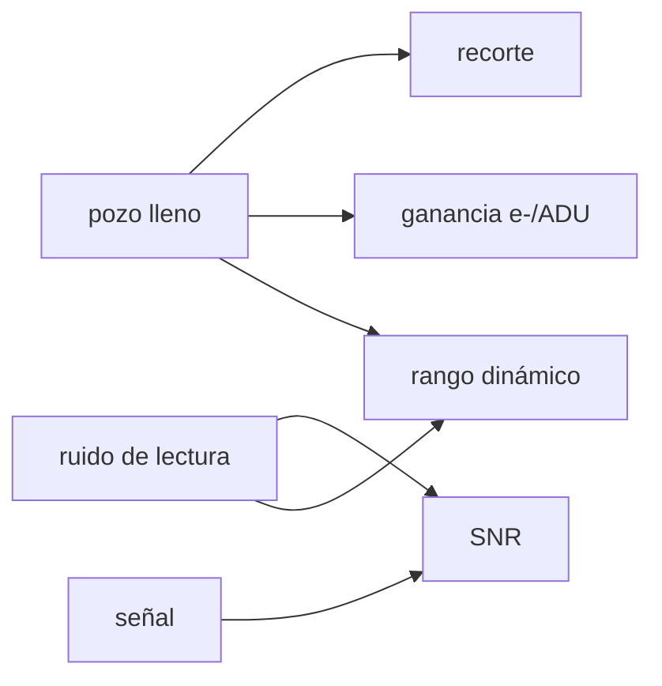

# B44-C05 — Pozo lleno y rango dinámico

<!-- nav:top -->
[🏠 Programa](../../../../README.md) · [📚 Bloque B44](../../../tronco-comun/B44-detectores-y-adquisicion-astronomica.md) · [← Anterior: B44-C04 — Eficiencia cuántica espectral](../B44-C04-eficiencia-cuantica-espectral/CLASE.md) · [Siguiente: B44-C06 — Ruido de lectura →](../B44-C06-ruido-de-lectura/CLASE.md)
<!-- /nav -->

## 1. Ubicación, nivel y alcance

Clase 5 del bloque B44. Nivel N3. El **pozo lleno** limita cuánta carga cabe en un píxel y el **ruido de lectura** fija el suelo; su cociente es el **rango dinámico**. Aquí calculas el rango, la **relación señal-ruido** y la **fracción de píxeles saturados**. Usas [B44-C04](../B44-C04-eficiencia-cuantica-espectral/CLASE.md) y [B12](../../../tronco-comun/B12-probabilidad-estadistica-e-incertidumbre.md). La cámara es ilustrativa.

## 2. Por qué esta clase existe

Una cámara debe medir a la vez estrellas débiles y brillantes sin saturar. La decisión central: **¿hasta qué señal media puedo exponer sin saturar el pozo?**

## 3. Lo que podrás hacer al terminar

1. Calcular el rango dinámico en cociente, dB y pasos.
2. Elegir la ganancia para usar todo el ADC.
3. Calcular la SNR con ruido de disparo y de lectura.
4. Simular el recorte del pozo.
5. Hallar la señal media máxima para un 1 % de recorte.
6. Reconocer los límites del modelo.

La evidencia es la **ficha del pozo lleno y el rango dinámico** del ejercicio 12 (sección 20).

## 4. Con qué llegas y cómo comprobarlo

1. ¿Qué es una incertidumbre?
2. ¿Qué es una simulación Monte Carlo?
3. ¿Qué es una tabla de resultados?
4. ¿Qué es un valor ilustrativo?
5. ¿Qué es una verificación?

<details>
<summary>Ver respuestas</summary>

1. Un intervalo en que se espera el valor verdadero. 2. Repetir con números aleatorios de semilla fija. 3. Un resumen ordenado de cálculos. 4. Un valor propuesto para el ejemplo, no medido. 5. Comparar un cálculo con un caso independiente.
</details>

Con cuatro o cinco aciertos, sigue; si no, repasa los prerrequisitos.

## 5. Un caso de contexto y casos de referencia

Con un pozo de `50 000 e⁻` y un ruido de lectura de `5 e⁻`, el rango dinámico es `10 000` (`80,0 dB`, `13,29` pasos). Con un ADC de 16 bits la ganancia es `0,7630 e⁻/ADU`. Es el **ejemplo conductor**. Todo es **ilustrativo**.

## 6. Vocabulario

El **pozo lleno** es la carga máxima por píxel. El **rango dinámico** es `pozo / ruido de lectura`. La **ganancia** `g` convierte electrones en cuentas (ADU). La **saturación** ocurre cuando la carga supera el pozo. El **paso** (*stop*) es un factor de dos.

## 7. Modelo mental: un vaso y una cucharita

El vaso grande es el pozo y la cucharita es el ruido de lectura: el número de cucharitas que caben mide el rango dinámico.



*Descripción textual:* el pozo y el ruido fijan el rango; la señal determina la SNR y la cercanía al pozo, el recorte.

Analogía: un vaso y una cucharita. Límite: el pozo recorta de forma abrupta y el ruido es gaussiano.

## 8. La explicación, paso a paso

### 8.1 Rango y ganancia

`DR = 50 000 / 5 = 10 000 = 80,0 dB = 13,29` pasos. Para usar los `65 535` niveles de un ADC de 16 bits: `g = 0,7630 e⁻/ADU` y el ruido de lectura vale `6,55 ADU`.

### 8.2 SNR

| `S` (e⁻) | SNR | Solo disparo |
|---|---|---|
| 10 | 1,69 | 3,16 |
| 100 | 8,94 | 10,00 |
| 1000 | 31,23 | 31,62 |
| 10 000 | 99,88 | 100,00 |
| 49 000 | 221,30 | 221,36 |

### 8.3 Recorte (semilla 20261109, 20 000 píxeles)

Con una media de `49 800 e⁻`, la fracción simulada por encima del pozo es `0,1835` y la normal da `0,1851` (`z = 0,896`). La media máxima con un 1 % recortado es `49 483 e⁻`.

### 8.4 Lectura

A baja señal domina la lectura; a alta, el disparo. Hay que dejar margen respecto del pozo: exponer a `49 800 e⁻` recorta casi uno de cada cinco píxeles.

## 9. Magnitudes, símbolos y unidades

| Símbolo | Qué es | Unidad | Valor / nota |
|---|---|---|---|
| `FW` | pozo lleno | e⁻ | 50 000 |
| `RN` | ruido de lectura | e⁻ | 5 |
| `g` | ganancia | e⁻/ADU | 0,7630 |
| DR | rango dinámico | — | 10 000 |

## 10. Convenciones y referencias

Valores ilustrativos; ruido de disparo de Poisson aproximado por una normal en la simulación; semilla `20261109`.

## 11. De dónde sale lo que afirmamos

| ID | Fuente | Localizador | Respalda | Estado |
|---|---|---|---|---|
| — | Sin fuente externa | — | relaciones estándar que verifica el laboratorio | No se consultó una fuente para esta clase |

Límites: no se consultó una fuente; la cámara es ilustrativa.

## 12. Cómo ver la SNR frente a la señal

| `S` (e⁻) | SNR |
|---|---|
| 10 | 1,69 |
| 1000 | 31,23 |
| 49 000 | 221,30 |

Descripción larga: la SNR crece con la raíz de la señal una vez superado el ruido de lectura.

## 13. Ejemplo trabajado: media máxima con 1 % de recorte

**Paso 1 · Condición.** `(FW − S)/√S = 2,326`.

**Paso 2 · Cuadrática.** `S + 2,326 √S − 50 000 = 0`.

**Paso 3 · Raíz.** `√S = 222,45`, `S = 49 483 e⁻`.

## 14. Distintas formas de describir el rango

**Por cociente:** `FW/RN`. **Por decibelios:** `20 log₁₀`. **Por pasos:** `log₂`. **Por cuentas:** `FW/g`.

## 15. Práctica guiada

**Ejercicio 1 · con los pasos indicados.** Rango dinámico para `FW = 100 000 e⁻` y `RN = 10 e⁻`. *Pasos:* cociente.

<details><summary>Solución comentada</summary>

`10 000` (80 dB).
</details>

**Ejercicio 2 · con una pista.** Ganancia para un ADC de 16 bits. *Pista:* `FW/65 535`.

<details><summary>Solución comentada</summary>

`0,7630 e⁻/ADU`.
</details>

**Ejercicio 3 · casi autónomo.** SNR de `S = 100 e⁻` con `RN = 5 e⁻`. *Pasos:* `S/√(S + RN²)`.

<details><summary>Solución comentada</summary>

`100/√125 = 8,94`.
</details>

## 16. Práctica autónoma, transferencia e integrador

**Ejercicio 4.** Ruido de lectura en ADU.

<details><summary>Solución comentada</summary>

`5/0,7630 = 6,55 ADU`.
</details>

**Ejercicio 5.** Pasos del rango de `10 000`.

<details><summary>Solución comentada</summary>

`log₂ 10 000 = 13,29`.
</details>

**Ejercicio 6.** SNR de `S = 49 000 e⁻`.

<details><summary>Solución comentada</summary>

`221,30`.
</details>

**Ejercicio 7.** ¿Por qué `S = 10 e⁻` tiene SNR 1,69 y no 3,16?

<details><summary>Solución comentada</summary>

Porque el ruido de lectura domina a baja señal.
</details>

**Ejercicio 8.** Fracción recortada si la media fuera `49 000 e⁻`.

<details><summary>Solución comentada</summary>

Casi 0 (`z = 4,5`).
</details>

**Ejercicio 9 · transferencia.** **Transferencia.** ¿Conviene un ADC de 12 bits con este pozo?

<details><summary>Solución comentada</summary>

Daría `12,2 e⁻/ADU`: más del doble del ruido de lectura, se pierde resolución.
</details>

**Ejercicio 10 · transferencia.** **Transferencia.** Un compañero expone a la media del pozo. ¿Qué responde?

<details><summary>Solución comentada</summary>

Casi la mitad de los píxeles recortados.
</details>

**Ejercicio 11 · transferencia.** **Transferencia.** ¿Qué ignora el modelo del pozo?

<details><summary>Solución comentada</summary>

La no linealidad previa a la saturación (clase 10).
</details>

**Ejercicio 12.** **Integrador.** Elabora tu *ficha del pozo lleno y el rango dinámico*: DR, SNR y recorte.

<details><summary>Solución comentada</summary>

Secciones 8.1–8.4.
</details>

**Ejercicio 12 · integrador.** **Integrador.** Elabora tu *ficha del pozo lleno y el rango dinámico*: DR, SNR y recorte.

<details><summary>Solución modelo</summary>

Secciones 8.1–8.4.
</details>

## 17. Laboratorio: rango dinámico, SNR y recorte

El script [rango.py](rango.py) calcula el rango y la SNR y simula el recorte del pozo (**comprueba** la fracción recortada frente a la normal dentro de 4 sigma).

**Datos:** sin constantes; pozo, ruido y ADC **ilustrativos**; semilla `20261109`. **Predice antes de ejecutar:** ¿qué fracción de píxeles se recorta con media `49 800 e⁻`? (0,18.) **Ejecución del 2026-11-09 (Python 3.12.9):**

```text
Python 3.12.9 (biblioteca estandar)
rango dinamico: 10000 = 80.0 dB = 13.29 pasos
ganancia para usar todo el ADC: 0.7630 e-/ADU ; ruido de lectura = 6.55 ADU
  S [e-]      SNR  SNR solo Poisson
      10     1.69              3.16
     100     8.94             10.00
    1000    31.23             31.62
   10000    99.88            100.00
   49000   221.30            221.36
fraccion recortada: simulada 0.1835, analitica 0.1851 (z = 0.896)
media maxima con 1 % de pixeles recortados: 49483 e-
Pruebas superadas.
```

```bash
python programa/clases/B44/B44-C05-pozo-lleno-y-rango-dinamico/rango.py
```

**Límites:** recorte abrupto; sin no linealidad.

## 18. Errores frecuentes y cómo corregirlos

**Confundir cuentas con electrones.** Se corrige con 8.1.

**Ignorar el ruido de lectura a baja señal.** Se corrige con 8.2.

**Exponer sin margen al pozo.** Se corrige con 8.3.

**Presentar la cámara como real.** Se corrige con la sección 10.

## 19. Cómo sabrás que vas bien

Tras la sección 8: ¿qué resultado esperabas y cuál obtuviste? Si dudas, repasa el ejemplo 13. Tras el laboratorio: ¿qué comprueba? (ver la sección 17).

## 20. Qué entregas y cómo se evalúa

El producto es tu **ficha del pozo lleno y el rango dinámico** (ejercicio 12).

| Criterio | Inicial | En desarrollo | Logrado | Destacado |
|---|---|---|---|---|
| Conceptos | Los confunde | Parciales | conceptos de la clase | Explica los límites |
| Cálculo | Sin unidades | Con errores | Tablas completas | Calcula casos nuevos |
| Numérico | Sin comprobar | Un caso | Contraste con el análisis | Interpreta las diferencias |
| Fuentes | Sin fuente | Sin fecha | fuentes con fecha | Declara lo ilustrativo |
| Límites | No los nombra | Uno | Tres | Discute qué falta del modelo |

**Condiciones críticas (no se compensan con promedio):** rotular lo ilustrativo; dejar margen respecto del pozo en las decisiones de exposición.

## 21. Ética, seguridad y límites

Clase educativa: los modelos son simplificados. Accesibilidad: tablas equivalentes a las gráficas, fórmulas en texto, ejercicios sin conexión.

## 22. Para cerrar y seguir

El rango de `10 000` y la media máxima de `49 483 e⁻` fijan lo medible. Queda una pregunta: ¿cómo se mide el suelo, es decir, el ruido de lectura?

**Glosario español–inglés.** pozo lleno · *full well*; rango dinámico · *dynamic range*; ganancia · *gain*; saturación · *saturation*; cuentas · *counts*.

**Continuidad.** [B44-C06](../B44-C06-ruido-de-lectura/CLASE.md) mide el ruido de lectura con cuadros de bias.

**Referencias:** ver sección 11.

<!-- nav:bottom -->
---

[← Anterior: B44-C04 — Eficiencia cuántica espectral](../B44-C04-eficiencia-cuantica-espectral/CLASE.md) · [📚 Bloque B44](../../../tronco-comun/B44-detectores-y-adquisicion-astronomica.md) · [Siguiente: B44-C06 — Ruido de lectura →](../B44-C06-ruido-de-lectura/CLASE.md)
<!-- /nav -->
