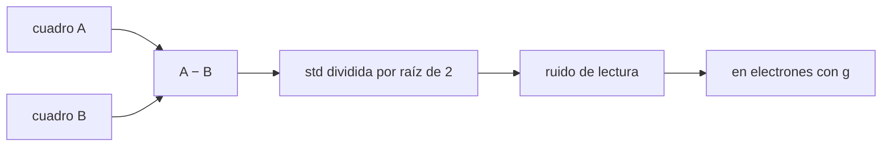

# B44-C06 — Ruido de lectura

<!-- nav:top -->
<!-- /nav -->

## 1. Ubicación, nivel y alcance

Clase 6 del bloque B44. Nivel N3. El **ruido de lectura** es el ruido que añade la electrónica al leer un píxel, aunque no llegue luz. Aquí lo mides con **dos cuadros de bias** restados entre sí y evalúas el efecto de la **cuantización** del ADC. Usas [B44-C05](../B44-C05-pozo-lleno-y-rango-dinamico/CLASE.md) y [B12](../../../tronco-comun/B12-probabilidad-estadistica-e-incertidumbre.md). Los cuadros son sintéticos.

## 2. Por qué esta clase existe

Sin conocer el ruido de lectura no se puede planificar una exposición ni estimar una incertidumbre. La decisión central: **¿cómo medirlo sin que el patrón fijo del sensor lo contamine?**

## 3. Lo que podrás hacer al terminar

1. Medir el ruido de lectura con la diferencia de dos cuadros.
2. Convertir de ADU a electrones con la ganancia.
3. Explicar por qué un solo cuadro sobreestima el ruido.
4. Calcular el efecto de la cuantización.
5. Comparar el resultado con el valor impuesto.
6. Reconocer los supuestos del método.

La evidencia es la **ficha del ruido de lectura** del ejercicio 12 (sección 20).

## 4. Con qué llegas y cómo comprobarlo

1. ¿Qué es una incertidumbre?
2. ¿Qué es una simulación Monte Carlo?
3. ¿Qué es una tabla de resultados?
4. ¿Qué es un valor ilustrativo?
5. ¿Qué es una verificación?

<details>
<summary>Ver respuestas</summary>

1. Un intervalo en que se espera el valor verdadero. 2. Repetir con números aleatorios de semilla fija. 3. Un resumen ordenado de cálculos. 4. Un valor propuesto para el ejemplo, no medido. 5. Comparar un cálculo con un caso independiente.
</details>

Con cuatro o cinco aciertos, sigue; si no, repasa los prerrequisitos.

## 5. Un caso de contexto y casos de referencia

Con un ruido verdadero de `5,0 e⁻` y una ganancia de `1,5 e⁻/ADU` (`3,333 ADU`), la diferencia de dos cuadros da `3,355 ADU = 5,033 e⁻`; un solo cuadro da `4,451 ADU`. Es el **ejemplo conductor**. Todo es **sintético**.

## 6. Vocabulario

El **bias** es el nivel que lee el sensor con exposición cero. El **patrón fijo** es la estructura repetible entre cuadros. El **ruido de lectura** es la parte aleatoria de cada lectura. La **cuantización** es el redondeo del ADC, con varianza `1/12 ADU²`.

## 7. Modelo mental: pesar dos veces la misma bolsa

Si pesas dos veces la misma bolsa, la diferencia entre las pesadas mide el error de la balanza y no el peso de la bolsa.



*Descripción textual:* la resta de dos cuadros idénticos elimina el patrón fijo y deja solo el ruido aleatorio, cuya desviación se divide por `√2`.

Analogía: pesar dos veces la misma bolsa. Límite: ruido gaussiano independiente entre cuadros y patrón fijo estable.

## 8. La explicación, paso a paso

### 8.1 Medida

| Cantidad | Valor |
|---|---|
| std de un solo cuadro | 4,451 ADU |
| std(A − B)/√2 | 3,355 ADU |
| En electrones (`g = 1,5`) | 5,033 e⁻ |
| Esperado con cuantización | 3,346 ADU |
| Sin cuantización | 3,333 ADU |

### 8.2 Cuantización

| Ruido (ADU) | Cuantización (ADU) | Efecto relativo |
|---|---|---|
| 0,30 | 0,2887 | 0,3878 |
| 1,00 | 0,2887 | 0,0408 |
| 3,33 | 0,2887 | 0,0038 |

### 8.3 Lectura

El método da `5,03 e⁻` frente a `5,00 e⁻` impuestos (0,7 % de diferencia). Un solo cuadro sobreestima (`4,451 ADU`) porque incluye el patrón fijo. La cuantización importa solo si el ruido es menor que unos `1 ADU`.

## 9. Magnitudes, símbolos y unidades

| Símbolo | Qué es | Unidad | Valor / nota |
|---|---|---|---|
| `σ_R` | ruido de lectura | e⁻ | 5,0 (verdadero), 5,033 (medido) |
| `g` | ganancia | e⁻/ADU | 1,5 |
| `σ_q` | cuantización | ADU | 0,2887 |

## 10. Convenciones y referencias

Cuadros de 64 × 64; patrón fijo de `3 ADU`; valores sintéticos; semilla `20261109`.

## 11. De dónde sale lo que afirmamos

| ID | Fuente | Localizador | Respalda | Estado |
|---|---|---|---|---|
| — | Sin fuente externa | — | relaciones estándar que verifica el laboratorio | No se consultó una fuente para esta clase |

Límites: no se consultó una fuente; todo es sintético.

## 12. Cómo ver el ruido por dos métodos

| Método | ADU |
|---|---|
| Un cuadro | 4,451 |
| Diferencia | 3,355 |

Descripción larga: el cuadro único incluye el patrón fijo y da una cifra mayor.

## 13. Ejemplo trabajado: ruido en electrones

**Paso 1 · Diferencia.** `std(A − B) = 4,745 ADU`.

**Paso 2 · Raíz de 2.** `4,745/1,4142 = 3,355 ADU`.

**Paso 3 · Ganancia.** `3,355 × 1,5 = 5,033 e⁻`.

## 14. Distintas formas de describir el ruido de lectura

**Por ADU:** desviación del bias. **Por electrones:** `× g`. **Por método:** diferencia de dos cuadros. **Por límite:** cuantización.

## 15. Práctica guiada

**Ejercicio 1 · con los pasos indicados.** Ruido verdadero en ADU para `5 e⁻` y `g = 1,5`. *Pasos:* `5/1,5`.

<details><summary>Solución comentada</summary>

`3,333 ADU`.
</details>

**Ejercicio 2 · con una pista.** Cuantización de un ADC. *Pista:* `1/√12`.

<details><summary>Solución comentada</summary>

`0,2887 ADU`.
</details>

**Ejercicio 3 · casi autónomo.** Ruido total esperado con cuantización. *Pasos:* suma en cuadratura.

<details><summary>Solución comentada</summary>

`√(3,333² + 0,0833) = 3,346 ADU`.
</details>

## 16. Práctica autónoma, transferencia e integrador

**Ejercicio 4.** Si `std(A − B) = 4,74 ADU`, ¿cuál es el ruido en electrones con `g = 1,5`?

<details><summary>Solución comentada</summary>

`4,74/√2 = 3,35 ADU`, es decir `5,03 e⁻`.
</details>

**Ejercicio 5.** Efecto relativo de la cuantización con ruido de `0,3 ADU`.

<details><summary>Solución comentada</summary>

`√(0,09 + 0,0833)/0,3 − 1 = 0,388`.
</details>

**Ejercicio 6.** ¿Por qué el cuadro único da `4,451`?

<details><summary>Solución comentada</summary>

Porque contiene el patrón fijo (`3 ADU`) además del ruido.
</details>

**Ejercicio 7.** Cuadrado de `4,451` menos cuadrado de `3,346`.

<details><summary>Solución comentada</summary>

`19,81 − 11,20 = 8,6`: del orden del patrón fijo al cuadrado (`9`).
</details>

**Ejercicio 8.** ¿Qué pasa si el patrón fijo cambia entre cuadros?

<details><summary>Solución comentada</summary>

La diferencia lo incluye y sobreestima el ruido.
</details>

**Ejercicio 9 · transferencia.** **Transferencia.** ¿Por qué se usan cuadros de bias de exposición cero?

<details><summary>Solución comentada</summary>

Para que la corriente oscura y la luz no entren en la medida.
</details>

**Ejercicio 10 · transferencia.** **Transferencia.** Un colega mide el ruido con un solo cuadro. ¿Qué error comete?

<details><summary>Solución comentada</summary>

Lo sobreestima por el patrón fijo.
</details>

**Ejercicio 11 · transferencia.** **Transferencia.** ¿Qué limita la precisión de la estimación?

<details><summary>Solución comentada</summary>

El número de píxeles: con 4096 el error relativo ronda el 1 %.
</details>

**Ejercicio 12.** **Integrador.** Elabora tu *ficha del ruido de lectura*: método, cifras y límites.

<details><summary>Solución comentada</summary>

Secciones 8.1–8.3.
</details>

**Ejercicio 12 · integrador.** **Integrador.** Elabora tu *ficha del ruido de lectura*: método, cifras y límites.

<details><summary>Solución modelo</summary>

Secciones 8.1–8.3.
</details>

## 17. Laboratorio: ruido de lectura por diferencia

El script [lectura.py](lectura.py) mide el ruido con dos cuadros de bias sintéticos y evalúa la cuantización (**comprueba** que el resultado está a menos del 2 % del valor impuesto).

**Datos:** sin constantes; ganancia, ruido y patrón **sintéticos**; semilla `20261109`. **Predice antes de ejecutar:** ¿qué ruido en e⁻ medirá? (≈5,03.) **Ejecución del 2026-11-09 (Python 3.12.9):**

```text
Python 3.12.9 (biblioteca estandar)
std de un solo cuadro: 4.451 ADU (incluye patron fijo)
std(A-B)/sqrt(2): 3.355 ADU = 5.033 e-  (verdadero 5.000 e-)
esperado por diferencia con cuantizacion: 3.346 ADU ; sin cuantizacion 3.333 ADU
 ruido [ADU]  cuantizacion [ADU]  efecto relativo
        0.30              0.2887           0.3878
        1.00              0.2887           0.0408
        3.33              0.2887           0.0038
Pruebas superadas.
```

```bash
python programa/clases/B44/B44-C06-ruido-de-lectura/lectura.py
```

**Límites:** ruido gaussiano; patrón fijo estable.

## 18. Errores frecuentes y cómo corregirlos

**Usar un solo cuadro.** Se corrige con 8.1.

**Olvidar la raíz de dos.** Se corrige con el ejemplo 13.

**Mezclar ADU y electrones.** Se corrige con 8.1.

**Ignorar la cuantización con ruido pequeño.** Se corrige con 8.2.

## 19. Cómo sabrás que vas bien

Tras la sección 8: ¿qué resultado esperabas y cuál obtuviste? Si dudas, repasa el ejemplo 13. Tras el laboratorio: ¿qué comprueba? (ver la sección 17).

## 20. Qué entregas y cómo se evalúa

El producto es tu **ficha del ruido de lectura** (ejercicio 12).

| Criterio | Inicial | En desarrollo | Logrado | Destacado |
|---|---|---|---|---|
| Conceptos | Los confunde | Parciales | conceptos de la clase | Explica los límites |
| Cálculo | Sin unidades | Con errores | Tablas completas | Calcula casos nuevos |
| Numérico | Sin comprobar | Un caso | Contraste con el análisis | Interpreta las diferencias |
| Fuentes | Sin fuente | Sin fecha | fuentes con fecha | Declara lo ilustrativo |
| Límites | No los nombra | Uno | Tres | Discute qué falta del modelo |

**Condiciones críticas (no se compensan con promedio):** rotular lo sintético; no atribuir el ruido a una cámara real.

## 21. Ética, seguridad y límites

Clase educativa: los modelos son simplificados. Accesibilidad: tablas equivalentes a las gráficas, fórmulas en texto, ejercicios sin conexión.

## 22. Para cerrar y seguir

Dos cuadros de bias dan `5,03 e⁻` frente a `5,00 e⁻` impuestos. Queda una pregunta: ¿cómo crece la señal oscura con el tiempo y la temperatura?

**Glosario español–inglés.** ruido de lectura · *read noise*; bias · *bias*; patrón fijo · *fixed pattern*; cuantización · *quantization*; ganancia · *gain*.

**Continuidad.** [B44-C07](../B44-C07-corriente-oscura/CLASE.md) estudia la corriente oscura.

**Referencias:** ver sección 11.

<!-- nav:bottom -->
---

<!-- /nav -->
