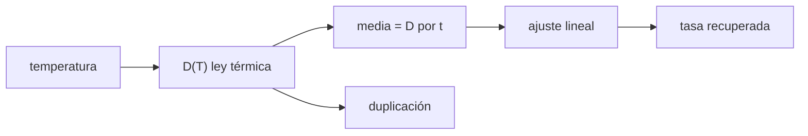

# B44-C07 — Corriente oscura

<!-- nav:top -->
[🏠 Programa](../../../../README.md) · [📚 Bloque B44](../../../tronco-comun/B44-detectores-y-adquisicion-astronomica.md) · [← Anterior: B44-C06 — Ruido de lectura](../B44-C06-ruido-de-lectura/CLASE.md) · [Siguiente: B44-C08 — Enfriamiento de detectores →](../B44-C08-enfriamiento-de-detectores/CLASE.md)
<!-- /nav -->

## 1. Ubicación, nivel y alcance

Clase 7 del bloque B44. Nivel N3. La **corriente oscura** es la carga que se acumula sin luz y crece fuertemente con la temperatura. Aquí usas un modelo térmico de juguete, calculas la **temperatura de duplicación** y ajustas la tasa con exposiciones crecientes. Usas [B44-C06](../B44-C06-ruido-de-lectura/CLASE.md) y [B05](../../../tronco-comun/B05-fisica-fundamental-para-el-espacio.md). Los parámetros son ilustrativos y no describen un sensor real.

## 2. Por qué esta clase existe

La oscuridad añade señal y ruido; saber cómo escala permite elegir temperatura y exposición. La decisión central: **¿cuánto hay que enfriar para que la corriente oscura deje de importar?**

## 3. Lo que podrás hacer al terminar

1. Evaluar una ley térmica de la corriente oscura.
2. Calcular la temperatura de duplicación.
3. Ajustar la tasa con la exposición.
4. Comparar dos vías para la duplicación.
5. Interpretar el sesgo del ajuste.
6. Reconocer los límites del modelo.

La evidencia es la **ficha de la corriente oscura** del ejercicio 12 (sección 20).

## 4. Con qué llegas y cómo comprobarlo

1. ¿Qué es una incertidumbre?
2. ¿Qué es una simulación Monte Carlo?
3. ¿Qué es una tabla de resultados?
4. ¿Qué es un valor ilustrativo?
5. ¿Qué es una verificación?

<details>
<summary>Ver respuestas</summary>

1. Un intervalo en que se espera el valor verdadero. 2. Repetir con números aleatorios de semilla fija. 3. Un resumen ordenado de cálculos. 4. Un valor propuesto para el ejemplo, no medido. 5. Comparar un cálculo con un caso independiente.
</details>

Con cuatro o cinco aciertos, sigue; si no, repasa los prerrequisitos.

## 5. Un caso de contexto y casos de referencia

Con el modelo de juguete (`E_a = 0,60 eV`, referencia `1 e⁻/s/pix` a `293 K`), la tasa baja a `0,01874` a `253 K` y la duplicación es de `6,187 K` allí. Un ajuste lineal recupera `0,93751 e⁻/s` frente a `0,93685` verdadero. Es el **ejemplo conductor**. Todo es **ilustrativo**.

## 6. Vocabulario

La **corriente oscura** `D(T)` es la tasa de electrones térmicos por píxel. La **energía de activación** `E_a` fija su dependencia exponencial. La **temperatura de duplicación** es el aumento que la duplica. El **ajuste lineal** estima la tasa como pendiente de la media frente a la exposición.

## 7. Modelo mental: un grifo que gotea más con el calor

Un grifo gotea más cuando se calienta: al enfriar, la tasa cae de forma exponencial y la cantidad en el balde depende del tiempo.



*Descripción textual:* la temperatura fija la tasa; la media crece linealmente con la exposición y la pendiente del ajuste recupera la tasa.

Analogía: un grifo que gotea más con el calor. Límite: modelo de juguete con prefactor `T^1,5` y una sola energía de activación.

## 8. La explicación, paso a paso

### 8.1 Ley térmica

`D(T) = D₀ (T/T₀)^1,5 exp[−E_a/k_B (1/T − 1/T₀)]`, con `k_B = 8,617333 × 10⁻⁵ eV/K` (NIST, consultada el 2026-11-09).

| `T` (K) | `D` (e⁻/s/pix) |
|---|---|
| 293 | 1,00000 |
| 273 | 0,15771 |
| 253 | 0,01874 |
| 233 | 0,00156 |
| 213 | 0,00008 |

### 8.2 Duplicación

A `293 K` la duplicación es `8,259 K` (numérica) y `8,039 K` (aproximación `ln 2 / pendiente`); a `253 K`, `6,187 K` y `6,043 K`. La aproximación subestima algo porque la pendiente de `ln D` disminuye al subir la temperatura.

### 8.3 Ajuste con la exposición (semilla 20261109, 5000 píxeles)

Tasa verdadera `0,93685 e⁻/s`; ajustada `0,93751 e⁻/s`; sesgo `−0,125 e⁻`.

### 8.4 Lectura

Enfriar 20 K reduce la oscuridad más de 6 veces. La pendiente es insesgada si hay varias exposiciones.

## 9. Magnitudes, símbolos y unidades

| Símbolo | Qué es | Unidad | Valor / nota |
|---|---|---|---|
| `D` | corriente oscura | e⁻/s/pix | 1,0 a 293 K (ilustrativo) |
| `E_a` | energía de activación | eV | 0,60 (ilustrativa) |
| `k_B` | constante de Boltzmann | eV/K | 8,617333 × 10⁻⁵ |

## 10. Convenciones y referencias

Modelo de juguete, **ilustrativo**; tasa escalada ×50 para tener conteos medibles; Poisson aproximado por normal para media ≥ 30; semilla `20261109`.

## 11. De dónde sale lo que afirmamos

| ID | Fuente | Localizador | Respalda | Estado |
|---|---|---|---|---|
| S1 | NIST, *Fundamental Physical Constants* (CODATA 2022) | https://physics.nist.gov/cuu/Constants/Table/allascii.txt | k_B en eV/K (constante exacta) | Consultada el 2026-11-09 |

Límites: NIST respalda solo `k_B`; la energía de activación, la tasa de referencia y la ley son ilustrativas.

## 12. Cómo ver la tasa frente a la temperatura

| `T` (K) | `D` |
|---|---|
| 293 | 1,00000 |
| 273 | 0,15771 |
| 253 | 0,01874 |

Descripción larga: la tasa cae unas seis veces cada 20 K.

## 13. Ejemplo trabajado: cociente entre 293 K y 273 K

**Paso 1 · Valores.** `D(273)/D(293) = 0,15771`.

**Paso 2 · Inversa.** `1/0,15771`.

**Paso 3 · Resultado.** La corriente oscura baja `6,34` veces.

## 14. Distintas formas de describir la corriente oscura

**Por temperatura:** `D(T)`. **Por duplicación:** `ΔT₂`. **Por exposición:** `D t`. **Por ajuste:** pendiente.

## 15. Práctica guiada

**Ejercicio 1 · con los pasos indicados.** Factor de reducción de `293 K` a `273 K`. *Pasos:* ejemplo 13.

<details><summary>Solución comentada</summary>

`6,34`.
</details>

**Ejercicio 2 · con una pista.** Pendiente logarítmica a `293 K`. *Pista:* `1,5/T + E_a/(k_B T²)`.

<details><summary>Solución comentada</summary>

`0,005119 + 0,08110 = 0,08622 K⁻¹`.
</details>

**Ejercicio 3 · casi autónomo.** Duplicación aproximada. *Pasos:* `ln 2 / pendiente`.

<details><summary>Solución comentada</summary>

`8,04 K`.
</details>

## 16. Práctica autónoma, transferencia e integrador

**Ejercicio 4.** Electrones en `600 s` con tasa `0,93685 e⁻/s`.

<details><summary>Solución comentada</summary>

`562 e⁻`.
</details>

**Ejercicio 5.** Exposición en que la oscuridad iguala `RN² = 25 e⁻`.

<details><summary>Solución comentada</summary>

`25/0,93685 = 26,7 s`.
</details>

**Ejercicio 6.** Reducción entre `253 K` y `233 K`.

<details><summary>Solución comentada</summary>

`0,01874/0,00156 = 12,0`.
</details>

**Ejercicio 7.** ¿Por qué la duplicación a `253 K` es menor que a `293 K`?

<details><summary>Solución comentada</summary>

Porque `E_a/(k_B T²)` crece al bajar `T`.
</details>

**Ejercicio 8.** Sesgo del ajuste.

<details><summary>Solución comentada</summary>

`−0,125 e⁻`, despreciable frente a `562 e⁻`.
</details>

**Ejercicio 9 · transferencia.** **Transferencia.** Un colega dice que la oscuridad se duplica «cada 6 K» en cualquier sensor. Responde.

<details><summary>Solución comentada</summary>

Es un número del modelo de juguete; cada sensor se mide.
</details>

**Ejercicio 10 · transferencia.** **Transferencia.** ¿Por qué se usan varias exposiciones y no una?

<details><summary>Solución comentada</summary>

Para separar la pendiente del sesgo.
</details>

**Ejercicio 11 · transferencia.** **Transferencia.** ¿Qué hace el enfriamiento al ruido de la oscuridad?

<details><summary>Solución comentada</summary>

Lo baja como `√D`.
</details>

**Ejercicio 12.** **Integrador.** Elabora tu *ficha de la corriente oscura*: ley, duplicación y ajuste.

<details><summary>Solución comentada</summary>

Secciones 8.1–8.4.
</details>

**Ejercicio 12 · integrador.** **Integrador.** Elabora tu *ficha de la corriente oscura*: ley, duplicación y ajuste.

<details><summary>Solución modelo</summary>

Secciones 8.1–8.4.
</details>

## 17. Laboratorio: ley térmica y ajuste

El script [oscura.py](oscura.py) evalúa la ley térmica, halla la duplicación por dos vías y ajusta la tasa con exposiciones crecientes (**comprueba** la pendiente frente a la verdadera dentro del 3 %).

**Datos:** `k_B` de NIST CODATA 2022 (consultada el 2026-11-09); energía de activación, tasas y exposiciones **ilustrativas**; semilla `20261109`. **Predice antes de ejecutar:** ¿cuánto baja la tasa de `293 K` a `273 K`? (≈6,3 veces.) **Ejecución del 2026-11-09 (Python 3.12.9):**

```text
Python 3.12.9 (biblioteca estandar)
  T [K]   D [e-/s/pix]
    293        1.00000
    273        0.15771
    253        0.01874
    233        0.00156
    213        0.00008
duplicacion a 293 K: numerica 8.259 K ; aproximacion ln2/pendiente 8.039 K
duplicacion a 253 K: numerica 6.187 K ; aproximacion ln2/pendiente 6.043 K
tasa verdadera 0.93685 e-/s ; ajustada 0.93751 e-/s ; sesgo -0.125 e-
Pruebas superadas.
```

```bash
python programa/clases/B44/B44-C07-corriente-oscura/oscura.py
```

**Límites:** ley de juguete; sin píxeles calientes.

## 18. Errores frecuentes y cómo corregirlos

**Aplicar la duplicación de juguete a un sensor real.** Se corrige con la sección 10.

**Olvidar que la ley es exponencial.** Se corrige con 8.1.

**Ajustar con una sola exposición.** Se corrige con 8.3.

**Confundir la tasa con la carga total.** Se corrige con el ejemplo 13.

## 19. Cómo sabrás que vas bien

Tras la sección 8: ¿qué resultado esperabas y cuál obtuviste? Si dudas, repasa el ejemplo 13. Tras el laboratorio: ¿qué comprueba? (ver la sección 17).

## 20. Qué entregas y cómo se evalúa

El producto es tu **ficha de la corriente oscura** (ejercicio 12).

| Criterio | Inicial | En desarrollo | Logrado | Destacado |
|---|---|---|---|---|
| Conceptos | Los confunde | Parciales | conceptos de la clase | Explica los límites |
| Cálculo | Sin unidades | Con errores | Tablas completas | Calcula casos nuevos |
| Numérico | Sin comprobar | Un caso | Contraste con el análisis | Interpreta las diferencias |
| Fuentes | Sin fuente | Sin fecha | fuentes con fecha | Declara lo ilustrativo |
| Límites | No los nombra | Uno | Tres | Discute qué falta del modelo |

**Condiciones críticas (no se compensan con promedio):** rotular lo ilustrativo; citar NIST solo para `k_B`.

## 21. Ética, seguridad y límites

Clase educativa: los modelos son simplificados. Accesibilidad: tablas equivalentes a las gráficas, fórmulas en texto, ejercicios sin conexión.

## 22. Para cerrar y seguir

En el modelo de juguete, 20 K menos reducen la oscuridad `6,34` veces. Queda una pregunta: ¿cómo se enfría un detector y qué tan rápido?

**Glosario español–inglés.** corriente oscura · *dark current*; energía de activación · *activation energy*; duplicación · *doubling*; ajuste · *fit*; exposición · *exposure*.

**Continuidad.** [B44-C08](../B44-C08-enfriamiento-de-detectores/CLASE.md) modela el enfriamiento del detector.

**Referencias:** ver sección 11.

<!-- nav:bottom -->
---

[← Anterior: B44-C06 — Ruido de lectura](../B44-C06-ruido-de-lectura/CLASE.md) · [📚 Bloque B44](../../../tronco-comun/B44-detectores-y-adquisicion-astronomica.md) · [Siguiente: B44-C08 — Enfriamiento de detectores →](../B44-C08-enfriamiento-de-detectores/CLASE.md)
<!-- /nav -->
