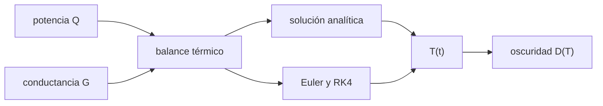

# B44-C08 — Enfriamiento de detectores

<!-- nav:top -->
[🏠 Programa](../../../../README.md) · [📚 Bloque B44](../../../tronco-comun/B44-detectores-y-adquisicion-astronomica.md) · [← Anterior: B44-C07 — Corriente oscura](../B44-C07-corriente-oscura/CLASE.md) · [Siguiente: B44-C09 — Ganancia electrónica →](../B44-C09-ganancia-electronica/CLASE.md)
<!-- /nav -->

## 1. Ubicación, nivel y alcance

Clase 8 del bloque B44. Nivel N3. El enfriamiento reduce la corriente oscura pero tarda en alcanzar el equilibrio. Aquí resuelves un **modelo térmico de primer orden** de forma analítica, con **Euler** y con **Runge–Kutta 4**, y calculas el efecto en la oscuridad. Usas [B44-C07](../B44-C07-corriente-oscura/CLASE.md) y [B05](../../../tronco-comun/B05-fisica-fundamental-para-el-espacio.md). Todos los parámetros son ilustrativos.

## 2. Por qué esta clase existe

La cámara no está fría al encenderla. La decisión central: **¿cuánto hay que esperar antes de calibrar y qué temperatura final se alcanza?**

## 3. Lo que podrás hacer al terminar

1. Plantear el balance térmico de un detector.
2. Hallar la temperatura límite y la constante de tiempo.
3. Integrar con Euler y con RK4.
4. Comparar con la solución analítica.
5. Calcular la oscuridad restante.
6. Reconocer los límites del modelo.

La evidencia es la **ficha del enfriamiento** del ejercicio 12 (sección 20).

## 4. Con qué llegas y cómo comprobarlo

1. ¿Qué es una incertidumbre?
2. ¿Qué es una simulación Monte Carlo?
3. ¿Qué es una tabla de resultados?
4. ¿Qué es un valor ilustrativo?
5. ¿Qué es una verificación?

<details>
<summary>Ver respuestas</summary>

1. Un intervalo en que se espera el valor verdadero. 2. Repetir con números aleatorios de semilla fija. 3. Un resumen ordenado de cálculos. 4. Un valor propuesto para el ejemplo, no medido. 5. Comparar un cálculo con un caso independiente.
</details>

Con cuatro o cinco aciertos, sigue; si no, repasa los prerrequisitos.

## 5. Un caso de contexto y casos de referencia

Con `C = 200 J/K`, `G = 0,5 W/K`, `Q = 30 W` y `T_a = 293 K`, la temperatura límite es `233 K` y `τ = 400 s`. A `3200 s` la oscuridad es `0,00156` de la de `293 K`. Es el **ejemplo conductor**. Todo es **ilustrativo**.

## 6. Vocabulario

La **capacidad térmica** `C` y la **conductancia** `G` describen la masa y el aislamiento. La **potencia de enfriamiento** `Q` extrae calor. La **constante de tiempo** `τ = C/G`. La **temperatura límite** es `T_a − Q/G`. **RK4** es un integrador de cuarto orden.

## 7. Modelo mental: una taza que se enfría

Una taza de café pierde calor hacia el ambiente: aquí además un enfriador extrae calor, y el sistema se acerca a su temperatura final con constante de tiempo `τ`.



*Descripción textual:* el balance térmico da una ecuación de primer orden; la solución analítica y los métodos numéricos dan la misma curva y de ella la oscuridad.

Analogía: una taza que se enfría. Límite: una sola masa térmica y potencia de enfriamiento constante.

## 8. La explicación, paso a paso

### 8.1 Parámetros

`τ = 400 s` y `T_límite = 233,0 K`.

### 8.2 Evolución

| `t` (s) | Exacta (K) | Euler (K) | RK4 (K) | `D / D(293 K)` |
|---|---|---|---|---|
| 200 | 269,3918 | 269,3805 | 269,3918 | 0,10986 |
| 400 | 255,0728 | 255,0590 | 255,0728 | 0,02372 |
| 800 | 241,1201 | 241,1100 | 241,1201 | 0,00449 |
| 1600 | 234,0989 | 234,0962 | 234,0989 | 0,00181 |
| 3200 | 233,0201 | 233,0200 | 233,0201 | 0,00156 |

### 8.3 Errores

Con paso de `0,5 s`, el error máximo de Euler es `0,01380 K` y el de RK4 `4,8 × 10⁻¹³ K`. El 90 % del descenso se alcanza en `921 s`.

### 8.4 Lectura

Pasada una hora (`9 τ`) el detector está a menos de `0,02 K` del límite. Calibrar antes de ese tiempo mezcla cuadros a temperaturas distintas.

## 9. Magnitudes, símbolos y unidades

| Símbolo | Qué es | Unidad | Valor / nota |
|---|---|---|---|
| `τ` | constante de tiempo | s | 400 |
| `T_lím` | temperatura límite | K | 233,0 |
| `Q` | potencia de enfriamiento | W | 30 (ilustrativa) |

## 10. Convenciones y referencias

Modelo de una sola masa; parámetros **ilustrativos**; la ley de oscuridad es la de la clase anterior; `k_B` de NIST (consultada el 2026-11-09).

## 11. De dónde sale lo que afirmamos

| ID | Fuente | Localizador | Respalda | Estado |
|---|---|---|---|---|
| S1 | NIST, *Fundamental Physical Constants* (CODATA 2022) | https://physics.nist.gov/cuu/Constants/Table/allascii.txt | k_B en eV/K (constante exacta) | Consultada el 2026-11-09 |

Límites: NIST respalda solo `k_B` usada en la ley de oscuridad; el modelo térmico es ilustrativo.

## 12. Cómo ver la temperatura del detector

| `t` (s) | `T` (K) |
|---|---|
| 200 | 269,39 |
| 800 | 241,12 |
| 3200 | 233,02 |

Descripción larga: la temperatura cae rápido al principio y se estabiliza cerca de 233 K.

## 13. Ejemplo trabajado: temperatura a 400 s

**Paso 1 · Límite.** `T_lím = 293 − 30/0,5 = 233 K`.

**Paso 2 · Exponencial.** `e^(−1) = 0,36788`.

**Paso 3 · Resultado.** `233 + 60 × 0,36788 = 255,07 K`.

## 14. Distintas formas de describir el enfriamiento

**Por ecuación:** `C dT/dt = −G(T − T_a) − Q`. **Por solución:** exponencial. **Por método:** Euler o RK4. **Por efecto:** `D(T)`.

## 15. Práctica guiada

**Ejercicio 1 · con los pasos indicados.** Temperatura límite. *Pasos:* `T_a − Q/G`.

<details><summary>Solución comentada</summary>

`233 K`.
</details>

**Ejercicio 2 · con una pista.** Constante de tiempo. *Pista:* `C/G`.

<details><summary>Solución comentada</summary>

`400 s`.
</details>

**Ejercicio 3 · casi autónomo.** `T(400 s)`. *Pasos:* ejemplo 13.

<details><summary>Solución comentada</summary>

`255,07 K`.
</details>

## 16. Práctica autónoma, transferencia e integrador

**Ejercicio 4.** Tiempo para recorrer el 90 % del descenso.

<details><summary>Solución comentada</summary>

`400 ln 10 = 921 s`.
</details>

**Ejercicio 5.** Temperatura límite con `Q = 10 W`.

<details><summary>Solución comentada</summary>

`293 − 20 = 273 K`.
</details>

**Ejercicio 6.** Oscuridad relativa a `273 K` (tabla de la clase 7).

<details><summary>Solución comentada</summary>

`0,15771`.
</details>

**Ejercicio 7.** Error de Euler frente a RK4.

<details><summary>Solución comentada</summary>

`0,0138 K` frente a `~10⁻¹³ K`.
</details>

**Ejercicio 8.** Reducción de la oscuridad entre `200 s` y `3200 s`.

<details><summary>Solución comentada</summary>

`0,10986/0,00156 = 70,4`.
</details>

**Ejercicio 9 · transferencia.** **Transferencia.** ¿Por qué esperar antes de tomar el dark?

<details><summary>Solución comentada</summary>

Para que la temperatura (y la oscuridad) estén estables.
</details>

**Ejercicio 10 · transferencia.** **Transferencia.** ¿Qué ocurre si `G` aumenta por mal aislamiento?

<details><summary>Solución comentada</summary>

La temperatura límite sube y `τ` baja.
</details>

**Ejercicio 11 · transferencia.** **Transferencia.** ¿Por qué RK4 es más preciso que Euler a igual paso?

<details><summary>Solución comentada</summary>

Su error local es de mayor orden.
</details>

**Ejercicio 12.** **Integrador.** Elabora tu *ficha del enfriamiento*: curva, errores y oscuridad.

<details><summary>Solución comentada</summary>

Secciones 8.1–8.4.
</details>

**Ejercicio 12 · integrador.** **Integrador.** Elabora tu *ficha del enfriamiento*: curva, errores y oscuridad.

<details><summary>Solución modelo</summary>

Secciones 8.1–8.4.
</details>

## 17. Laboratorio: enfriamiento y oscuridad

El script [enfriamiento.py](enfriamiento.py) integra el balance térmico por Euler y RK4 y lo contrasta con la solución analítica (**comprueba** RK4 a `10⁻⁶ K` y Euler a `0,05 K`).

**Datos:** `k_B` de NIST CODATA 2022 (consultada el 2026-11-09); capacidad, conductancia y potencia **ilustrativas**. **Predice antes de ejecutar:** ¿a qué temperatura se estabiliza? (233 K.) **Ejecución del 2026-11-09 (Python 3.12.9):**

```text
Python 3.12.9 (biblioteca estandar)
constante de tiempo tau = 400.0 s ; temperatura limite = 233.0 K
  t [s]  exacta [K]  Euler [K]    RK4 [K]  D/D(293 K)
    200    269.3918   269.3805   269.3918     0.10986
    400    255.0728   255.0590   255.0728     0.02372
    800    241.1201   241.1100   241.1201     0.00449
   1600    234.0989   234.0962   234.0989     0.00181
   3200    233.0201   233.0200   233.0201     0.00156
error maximo: Euler 0.01380 K ; RK4 4.83e-13 K
tiempo para recorrer el 90 % del descenso: 921 s
Pruebas superadas.
```

```bash
python programa/clases/B44/B44-C08-enfriamiento-de-detectores/enfriamiento.py
```

**Límites:** una sola masa; sin límite de potencia del enfriador.

## 18. Errores frecuentes y cómo corregirlos

**Calibrar antes del equilibrio.** Se corrige con 8.4.

**Confundir `τ` con el tiempo de equilibrio.** Se corrige con 8.3.

**Usar Euler con paso grande.** Se corrige con 8.3.

**Tomar los parámetros como reales.** Se corrige con la sección 10.

## 19. Cómo sabrás que vas bien

Tras la sección 8: ¿qué resultado esperabas y cuál obtuviste? Si dudas, repasa el ejemplo 13. Tras el laboratorio: ¿qué comprueba? (ver la sección 17).

## 20. Qué entregas y cómo se evalúa

El producto es tu **ficha del enfriamiento** (ejercicio 12).

| Criterio | Inicial | En desarrollo | Logrado | Destacado |
|---|---|---|---|---|
| Conceptos | Los confunde | Parciales | conceptos de la clase | Explica los límites |
| Cálculo | Sin unidades | Con errores | Tablas completas | Calcula casos nuevos |
| Numérico | Sin comprobar | Un caso | Contraste con el análisis | Interpreta las diferencias |
| Fuentes | Sin fuente | Sin fecha | fuentes con fecha | Declara lo ilustrativo |
| Límites | No los nombra | Uno | Tres | Discute qué falta del modelo |

**Condiciones críticas (no se compensan con promedio):** rotular los parámetros como ilustrativos; no extrapolar a un enfriador real.

## 21. Ética, seguridad y límites

Clase educativa: los modelos son simplificados. Accesibilidad: tablas equivalentes a las gráficas, fórmulas en texto, ejercicios sin conexión.

## 22. Para cerrar y seguir

El modelo llega a `233 K` con `τ = 400 s` y reduce la oscuridad más de 600 veces. Queda una pregunta: ¿cómo se amplifica una señal muy débil antes de leerla?

**Glosario español–inglés.** enfriamiento · *cooling*; capacidad térmica · *heat capacity*; conductancia · *conductance*; constante de tiempo · *time constant*; integrador · *integrator*.

**Continuidad.** [B44-C09](../B44-C09-ganancia-electronica/CLASE.md) estudia la ganancia electrónica.

**Referencias:** ver sección 11.

<!-- nav:bottom -->
---

[← Anterior: B44-C07 — Corriente oscura](../B44-C07-corriente-oscura/CLASE.md) · [📚 Bloque B44](../../../tronco-comun/B44-detectores-y-adquisicion-astronomica.md) · [Siguiente: B44-C09 — Ganancia electrónica →](../B44-C09-ganancia-electronica/CLASE.md)
<!-- /nav -->
