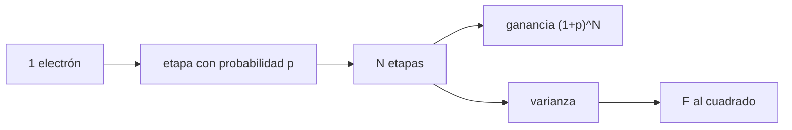

# B44-C09 — Ganancia electrónica

<!-- nav:top -->
[🏠 Programa](../../../../README.md) · [📚 Bloque B44](../../../tronco-comun/B44-detectores-y-adquisicion-astronomica.md) · [← Anterior: B44-C08 — Enfriamiento de detectores](../B44-C08-enfriamiento-de-detectores/CLASE.md) · [Siguiente: B44-C10 — No linealidad y saturación →](../B44-C10-no-linealidad-y-saturacion/CLASE.md)
<!-- /nav -->

## 1. Ubicación, nivel y alcance

Clase 9 del bloque B44. Nivel N3. La **ganancia electrónica** (EMCCD) multiplica la carga antes de leerla, de modo que el ruido de lectura pesa menos, pero añade un ruido propio. Aquí simulas una **cascada de etapas** y calculas la **ganancia media** y el **factor de ruido en exceso**. Usas [B44-C06](../B44-C06-ruido-de-lectura/CLASE.md) y [B12](../../../tronco-comun/B12-probabilidad-estadistica-e-incertidumbre.md). El número de etapas y la probabilidad son ilustrativos.

## 2. Por qué esta clase existe

Para señales muy débiles el ruido de lectura domina. La decisión central: **¿cuándo compensa multiplicar la carga a costa del ruido en exceso?**

## 3. Lo que podrás hacer al terminar

1. Calcular la ganancia media de una cascada.
2. Calcular la varianza y el factor de ruido en exceso.
3. Simular la cascada con semilla fija.
4. Comparar simulación y fórmula.
5. Explicar por qué el factor tiende a 2.
6. Reconocer cuándo la ganancia ayuda.

La evidencia es la **ficha de la ganancia electrónica** del ejercicio 12 (sección 20).

## 4. Con qué llegas y cómo comprobarlo

1. ¿Qué es una incertidumbre?
2. ¿Qué es una simulación Monte Carlo?
3. ¿Qué es una tabla de resultados?
4. ¿Qué es un valor ilustrativo?
5. ¿Qué es una verificación?

<details>
<summary>Ver respuestas</summary>

1. Un intervalo en que se espera el valor verdadero. 2. Repetir con números aleatorios de semilla fija. 3. Un resumen ordenado de cálculos. 4. Un valor propuesto para el ejemplo, no medido. 5. Comparar un cálculo con un caso independiente.
</details>

Con cuatro o cinco aciertos, sigue; si no, repasa los prerrequisitos.

## 5. Un caso de contexto y casos de referencia

Con `N = 40` etapas y `p = 0,05`, la ganancia es `g = 7,0400` y `F² = 1,7762`; la simulación de `20 000` electrones da `6,9496` y `1,7770`. Con `p = 0,0147` y `600` etapas, `g ≈ 6347` y `F² → 1,971`. Es el **ejemplo conductor**. Todo es **ilustrativo**.

## 6. Vocabulario

La **etapa de multiplicación** da a cada electrón una probabilidad `p` de producir otro. La **ganancia** `g = (1 + p)^N`. El **factor de ruido en exceso** `F²` multiplica la varianza de Poisson. El **proceso de ramificación** es el modelo matemático de la cascada.

## 7. Modelo mental: aplausos que se contagian

Cada persona que aplaude contagia a otra con cierta probabilidad en cada fila de la sala: el total final crece mucho, pero varía de un intento a otro.



*Descripción textual:* cada etapa multiplica la carga con probabilidad `p`; tras `N` etapas la media crece como `(1+p)^N` y la varianza da el factor de ruido en exceso.

Analogía: aplausos que se contagian. Límite: etapas independientes, sin saturación ni ruido de reloj.

## 8. La explicación, paso a paso

### 8.1 Fórmulas

`g = (1 + p)^N`; varianza para un electrón de entrada `p(1 − p) m^(N−1)(m^N − 1)/(m − 1)` con `m = 1 + p`; `F² = 1 + Var/g²`.

### 8.2 Simulación (`N = 40`, `p = 0,05`)

| | Ganancia | Varianza | `F²` |
|---|---|---|---|
| Analítico | 7,0400 | 38,472 | 1,7762 |
| Simulado (20 000) | 6,9496 | 37,525 | 1,7770 |

### 8.3 Más etapas (`p = 0,0147`)

| `N` | `g` | `F²` |
|---|---|---|
| 10 | 1,16 | 1,1318 |
| 40 | 1,79 | 1,4294 |
| 100 | 4,30 | 1,7454 |
| 400 | 342,82 | 1,9682 |
| 600 | 6347,41 | 1,9709 |

### 8.4 Lectura

Con ganancia alta `F² → 2`: la varianza se duplica, equivalente a perder la mitad de los fotones. La ganancia compensa cuando `RN/g` es mucho menor que el ruido de disparo.

## 9. Magnitudes, símbolos y unidades

| Símbolo | Qué es | Unidad | Valor / nota |
|---|---|---|---|
| `N` | etapas | — | 40; 600 |
| `p` | probabilidad por etapa | — | 0,05; 0,0147 |
| `g` | ganancia | — | 7,04; 6347 |
| `F²` | factor de ruido en exceso | — | → 2 |

## 10. Convenciones y referencias

Valores **ilustrativos**; semilla `20261109`; la media de 20 000 entradas se compara a 4 errores estándar.

## 11. De dónde sale lo que afirmamos

| ID | Fuente | Localizador | Respalda | Estado |
|---|---|---|---|---|
| — | Sin fuente externa | — | relaciones estándar que verifica el laboratorio | No se consultó una fuente para esta clase |

Límites: no se consultó una fuente; el modelo y sus valores son ilustrativos.

## 12. Cómo ver el factor de ruido

| `N` | `F²` |
|---|---|
| 10 | 1,1318 |
| 100 | 1,7454 |
| 600 | 1,9709 |

Descripción larga: el factor crece y se acerca a dos.

## 13. Ejemplo trabajado: ganancia de 40 etapas

**Paso 1 · Base.** `m = 1,05`.

**Paso 2 · Potencia.** `1,05^40`.

**Paso 3 · Resultado.** `g = 7,04`.

## 14. Distintas formas de describir la amplificación

**Por media:** `(1+p)^N`. **Por varianza:** fórmula de ramificación. **Por simulación:** conteo por etapas. **Por ruido:** `F²`.

## 15. Práctica guiada

**Ejercicio 1 · con los pasos indicados.** Ganancia con `N = 40` y `p = 0,05`. *Pasos:* ejemplo 13.

<details><summary>Solución comentada</summary>

`7,04`.
</details>

**Ejercicio 2 · con una pista.** Etapas para `g = 1000` con `p = 0,0147`. *Pista:* `ln 1000 / ln 1,0147`.

<details><summary>Solución comentada</summary>

`6,9078/0,014593 = 473`.
</details>

**Ejercicio 3 · casi autónomo.** Ganancia con `600` etapas y `p = 0,0147`. *Pasos:* `e^(600 ln 1,0147)`.

<details><summary>Solución comentada</summary>

`≈ 6347`.
</details>

## 16. Práctica autónoma, transferencia e integrador

**Ejercicio 4.** Ruido de lectura equivalente de `50 e⁻` con `g = 1000`.

<details><summary>Solución comentada</summary>

`0,05 e⁻`.
</details>

**Ejercicio 5.** SNR sin ganancia para `S = 1 e⁻` y `RN = 50 e⁻`.

<details><summary>Solución comentada</summary>

`1/√(1 + 2500) = 0,020`.
</details>

**Ejercicio 6.** SNR con `g = 1000` y `F² = 2`.

<details><summary>Solución comentada</summary>

`1/√(2·1 + 0,0025) = 0,707`.
</details>

**Ejercicio 7.** ¿Cuánto vale `F` si `F² = 2`?

<details><summary>Solución comentada</summary>

`1,414`.
</details>

**Ejercicio 8.** Cociente simulado/analítico de la ganancia.

<details><summary>Solución comentada</summary>

`6,9496/7,0400 = 0,987`: a `2,1` errores estándar.
</details>

**Ejercicio 9 · transferencia.** **Transferencia.** ¿Por qué no se usa ganancia en una señal brillante?

<details><summary>Solución comentada</summary>

Porque `F²` duplica la varianza y saturaría el registro.
</details>

**Ejercicio 10 · transferencia.** **Transferencia.** ¿Qué relación hay con restar bias?

<details><summary>Solución comentada</summary>

La ganancia reduce el ruido de lectura efectivo, no el patrón fijo.
</details>

**Ejercicio 11 · transferencia.** **Transferencia.** ¿Qué ignora el modelo?

<details><summary>Solución comentada</summary>

Saturación de etapas y ruido inducido por el reloj.
</details>

**Ejercicio 12.** **Integrador.** Elabora tu *ficha de la ganancia electrónica*: fórmula, simulación y límite.

<details><summary>Solución comentada</summary>

Secciones 8.1–8.4.
</details>

**Ejercicio 12 · integrador.** **Integrador.** Elabora tu *ficha de la ganancia electrónica*: fórmula, simulación y límite.

<details><summary>Solución modelo</summary>

Secciones 8.1–8.4.
</details>

## 17. Laboratorio: cascada de multiplicación

El script [cascada.py](cascada.py) simula la cascada y compara con la ganancia y la varianza analíticas (**comprueba** la ganancia a 4 errores estándar y `F²` al 3 %).

**Datos:** sin constantes; etapas y probabilidades **ilustrativas**; semilla `20261109`. **Predice antes de ejecutar:** ¿hacia qué valor tiende `F²`? (2.) **Ejecución del 2026-11-09 (Python 3.12.9):**

```text
Python 3.12.9 (biblioteca estandar)
N = 40, p = 0.05: ganancia analitica g = 7.0400 ; varianza = 38.472 ; F^2 = 1.7762
simulacion (20000 entradas de 1 e-): g = 6.9496 ; varianza = 37.525 ; F^2 = 1.7770
    N            g      F^2
   10         1.16   1.1318
   40         1.79   1.4294
  100         4.30   1.7454
  400       342.82   1.9682
  600      6347.41   1.9709
Pruebas superadas.
```

```bash
python programa/clases/B44/B44-C09-ganancia-electronica/cascada.py
```

**Límites:** etapas independientes; sin saturación.

## 18. Errores frecuentes y cómo corregirlos

**Olvidar el ruido en exceso.** Se corrige con 8.4.

**Creer que la ganancia siempre ayuda.** Se corrige con 8.4.

**Usar ganancia lineal sin la varianza.** Se corrige con 8.1.

**Tomar `p` y `N` como reales.** Se corrige con la sección 10.

## 19. Cómo sabrás que vas bien

Tras la sección 8: ¿qué resultado esperabas y cuál obtuviste? Si dudas, repasa el ejemplo 13. Tras el laboratorio: ¿qué comprueba? (ver la sección 17).

## 20. Qué entregas y cómo se evalúa

El producto es tu **ficha de la ganancia electrónica** (ejercicio 12).

| Criterio | Inicial | En desarrollo | Logrado | Destacado |
|---|---|---|---|---|
| Conceptos | Los confunde | Parciales | conceptos de la clase | Explica los límites |
| Cálculo | Sin unidades | Con errores | Tablas completas | Calcula casos nuevos |
| Numérico | Sin comprobar | Un caso | Contraste con el análisis | Interpreta las diferencias |
| Fuentes | Sin fuente | Sin fecha | fuentes con fecha | Declara lo ilustrativo |
| Límites | No los nombra | Uno | Tres | Discute qué falta del modelo |

**Condiciones críticas (no se compensan con promedio):** rotular lo ilustrativo; no extrapolar a un EMCCD real.

## 21. Ética, seguridad y límites

Clase educativa: los modelos son simplificados. Accesibilidad: tablas equivalentes a las gráficas, fórmulas en texto, ejercicios sin conexión.

## 22. Para cerrar y seguir

La cascada de 40 etapas da `g = 7,04` y `F² = 1,78`; con muchas etapas, `F² → 2`. Queda una pregunta: ¿hasta dónde responde linealmente el detector?

**Glosario español–inglés.** ganancia electrónica · *electron multiplication gain*; etapa · *stage*; ramificación · *branching*; ruido en exceso · *excess noise*; cascada · *cascade*.

**Continuidad.** [B44-C10](../B44-C10-no-linealidad-y-saturacion/CLASE.md) estudia la no linealidad y la saturación.

**Referencias:** ver sección 11.

<!-- nav:bottom -->
---

[← Anterior: B44-C08 — Enfriamiento de detectores](../B44-C08-enfriamiento-de-detectores/CLASE.md) · [📚 Bloque B44](../../../tronco-comun/B44-detectores-y-adquisicion-astronomica.md) · [Siguiente: B44-C10 — No linealidad y saturación →](../B44-C10-no-linealidad-y-saturacion/CLASE.md)
<!-- /nav -->
