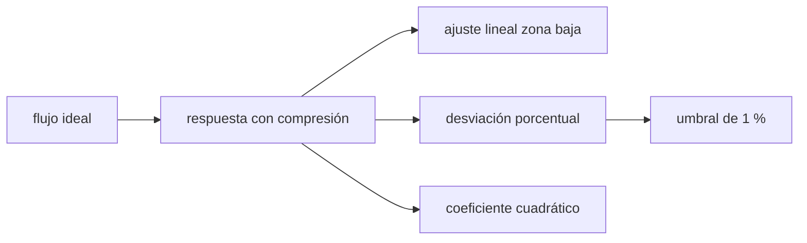

# B44-C10 — No linealidad y saturación

<!-- nav:top -->
[🏠 Programa](../../../../README.md) · [📚 Bloque B44](../../../tronco-comun/B44-detectores-y-adquisicion-astronomica.md) · [← Anterior: B44-C09 — Ganancia electrónica](../B44-C09-ganancia-electronica/CLASE.md) · [Siguiente: B44-C11 — Tiempo de exposición →](../B44-C11-tiempo-de-exposicion/CLASE.md)
<!-- /nav -->

## 1. Ubicación, nivel y alcance

Clase 10 del bloque B44. Nivel N3. Un detector ideal responde en proporción a la luz, pero el real se desvía de la recta antes de saturar. Aquí barres la exposición, **ajustas una recta a la zona baja** y mides la **desviación de la linealidad**. Usas [B44-C05](../B44-C05-pozo-lleno-y-rango-dinamico/CLASE.md) y [B12](../../../tronco-comun/B12-probabilidad-estadistica-e-incertidumbre.md). La respuesta cuadrática es ilustrativa.

## 2. Por qué esta clase existe

Si la respuesta se curva, la fotometría se sesga mucho antes del pozo lleno. La decisión central: **¿hasta qué flujo puedo confiar en la respuesta lineal?**

## 3. Lo que podrás hacer al terminar

1. Modelar una respuesta con término cuadrático.
2. Ajustar una recta a la zona baja.
3. Medir la desviación porcentual.
4. Hallar el umbral de 1 % por dos vías.
5. Recuperar el coeficiente cuadrático.
6. Reconocer los límites del modelo.

La evidencia es la **ficha de la linealidad y la saturación** del ejercicio 12 (sección 20).

## 4. Con qué llegas y cómo comprobarlo

1. ¿Qué es una incertidumbre?
2. ¿Qué es una simulación Monte Carlo?
3. ¿Qué es una tabla de resultados?
4. ¿Qué es un valor ilustrativo?
5. ¿Qué es una verificación?

<details>
<summary>Ver respuestas</summary>

1. Un intervalo en que se espera el valor verdadero. 2. Repetir con números aleatorios de semilla fija. 3. Un resumen ordenado de cálculos. 4. Un valor propuesto para el ejemplo, no medido. 5. Comparar un cálculo con un caso independiente.
</details>

Con cuatro o cinco aciertos, sigue; si no, repasa los prerrequisitos.

## 5. Un caso de contexto y casos de referencia

Con `salida = x(1 − b x)` y `b = 1,5 × 10⁻⁶ ADU⁻¹` (ilustrativo), la desviación llega al `1 %` en `x = 6667 ADU` (analítico); en el barrido de 1000 en 1000, el primer punto fuera es `8000 ADU`. El coeficiente recuperado es `1,505 × 10⁻⁶`. Es el **ejemplo conductor**. Todo es **sintético**.

## 6. Vocabulario

La **linealidad** es la proporcionalidad entre luz y cuentas. La **desviación** es `(salida − ideal)/ideal`. El **umbral de linealidad** es el flujo donde la desviación llega a un límite. La **compresión** es la salida menor que la ideal.

## 7. Modelo mental: una escala de baño que se comprime

Una balanza barata marca bien los pesos pequeños y subestima los grandes: el error crece con la carga.



*Descripción textual:* la respuesta comprimida se compara con la recta ajustada en la zona baja y con el flujo ideal; de ahí salen el umbral y el coeficiente.

Analogía: una escala de baño que se comprime. Límite: no linealidad cuadrática pura y ruido gaussiano de 3 ADU.

## 8. La explicación, paso a paso

### 8.1 Ajuste lineal

Con los puntos de `x ≤ 3000 ADU`: pendiente `0,99214`, ordenada `9,48 ADU`.

### 8.2 Desviaciones

| `x` ideal | Salida | Desviación respecto del ideal (%) | Respecto del ajuste (%) |
|---|---|---|---|
| 5000 | 4965,0 | −0,700 | −0,104 |
| 10 000 | 9852,0 | −1,480 | −0,794 |
| 20 000 | 19 398,5 | −3,007 | −2,286 |
| 30 000 | 28 646,2 | −4,513 | −3,787 |
| 40 000 | 37 600,8 | −5,998 | −5,276 |
| 50 000 | 46 246,5 | −7,507 | −6,792 |
| 60 000 | 54 600,6 | −8,999 | −8,293 |

### 8.3 Umbral y coeficiente

Umbral de 1 % frente al ideal: analítico `0,01/b = 6667 ADU`, numérico `8000 ADU` (un paso de 1000 por el ruido de 3 ADU y la resolución del barrido). El coeficiente recuperado por regresión es `1,505 × 10⁻⁶`.

### 8.4 Lectura

La desviación respecto del **ajuste de la zona baja** subestima la no linealidad (el ajuste absorbe parte de la curvatura); respecto del flujo **ideal** es la correcta. En este barrido la salida máxima es `54 600 ADU`, por debajo del recorte de `60 000`: la no linealidad aparece mucho antes de la saturación.

## 9. Magnitudes, símbolos y unidades

| Símbolo | Qué es | Unidad | Valor / nota |
|---|---|---|---|
| `b` | coeficiente de compresión | ADU⁻¹ | 1,5 × 10⁻⁶ (ilustrativo) |
| `x` | flujo ideal | ADU | 1000–60 000 |
| desviación | (salida − ideal)/ideal | % | −1,48 a 10 000 |

## 10. Convenciones y referencias

Modelo cuadrático **sintético**; ruido de 3 ADU; semilla `20261109`; el flujo ideal solo se conoce en la simulación.

## 11. De dónde sale lo que afirmamos

| ID | Fuente | Localizador | Respalda | Estado |
|---|---|---|---|---|
| — | Sin fuente externa | — | relaciones estándar que verifica el laboratorio | No se consultó una fuente para esta clase |

Límites: no se consultó una fuente; el modelo es ilustrativo.

## 12. Cómo ver la desviación de la linealidad

| `x` (ADU) | Desviación (%) |
|---|---|
| 5000 | −0,70 |
| 10 000 | −1,48 |
| 30 000 | −4,51 |

Descripción larga: la desviación crece casi en proporción al flujo.

## 13. Ejemplo trabajado: umbral de 1 %

**Paso 1 · Desviación.** `(salida − x)/x = −b x`.

**Paso 2 · Condición.** `b x = 0,01`.

**Paso 3 · Resultado.** `x = 0,01/(1,5 × 10⁻⁶) = 6667 ADU`.

## 14. Distintas formas de describir la linealidad

**Por recta:** pendiente y ordenada. **Por desviación:** porcentaje. **Por umbral:** flujo máximo. **Por modelo:** `b`.

## 15. Práctica guiada

**Ejercicio 1 · con los pasos indicados.** Desviación esperada a `x = 10 000`. *Pasos:* `−b x`.

<details><summary>Solución comentada</summary>

`−1,5 %` (observada `−1,48`).
</details>

**Ejercicio 2 · con una pista.** Umbral de 0,5 %. *Pista:* `0,005/b`.

<details><summary>Solución comentada</summary>

`3333 ADU`.
</details>

**Ejercicio 3 · casi autónomo.** Salida a `x = 20 000`. *Pasos:* `x(1 − b x)`.

<details><summary>Solución comentada</summary>

`20 000 × 0,97 = 19 400 ADU` (observada `19 398,5`).
</details>

## 16. Práctica autónoma, transferencia e integrador

**Ejercicio 4.** Umbral de 2 %.

<details><summary>Solución comentada</summary>

`13 333 ADU`.
</details>

**Ejercicio 5.** Salida máxima del barrido.

<details><summary>Solución comentada</summary>

`54 600 ADU` (en `x = 60 000`).
</details>

**Ejercicio 6.** Error de fotometría si se usa `x = 30 000` sin corregir.

<details><summary>Solución comentada</summary>

`−4,5 %`.
</details>

**Ejercicio 7.** ¿Por qué la desviación respecto del ajuste es menor?

<details><summary>Solución comentada</summary>

Porque el ajuste incluye puntos curvados.
</details>

**Ejercicio 8.** Cociente umbral numérico/analítico.

<details><summary>Solución comentada</summary>

`8000/6667 = 1,20`.
</details>

**Ejercicio 9 · transferencia.** **Transferencia.** ¿Cómo se mide la linealidad en la práctica?

<details><summary>Solución comentada</summary>

Con una fuente estable y exposiciones crecientes o un flujo de referencia.
</details>

**Ejercicio 10 · transferencia.** **Transferencia.** Un colega usa hasta el pozo lleno. ¿Qué riesgo?

<details><summary>Solución comentada</summary>

Sesgos de varios por ciento antes de saturar.
</details>

**Ejercicio 11 · transferencia.** **Transferencia.** ¿Qué hace una curva de corrección?

<details><summary>Solución comentada</summary>

Invierte la compresión con el coeficiente medido.
</details>

**Ejercicio 12.** **Integrador.** Elabora tu *ficha de la linealidad y la saturación*: ajuste, umbral y coeficiente.

<details><summary>Solución comentada</summary>

Secciones 8.1–8.4.
</details>

**Ejercicio 12 · integrador.** **Integrador.** Elabora tu *ficha de la linealidad y la saturación*: ajuste, umbral y coeficiente.

<details><summary>Solución modelo</summary>

Secciones 8.1–8.4.
</details>

## 17. Laboratorio: linealidad y umbral

El script [linealidad.py](linealidad.py) barre el flujo, ajusta la zona baja y mide la desviación y el umbral de 1 % (**comprueba** el umbral a dos pasos del analítico y el coeficiente al 5 %).

**Datos:** sin constantes; coeficiente, pozo y ruido **sintéticos**; semilla `20261109`. **Predice antes de ejecutar:** ¿en qué flujo llega la desviación a 1 %? (≈6667 ADU analítico.) **Ejecución del 2026-11-09 (Python 3.12.9):**

```text
Python 3.12.9 (biblioteca estandar)
ajuste lineal a x <= 3000: pendiente 0.99214, ordenada 9.48 ADU
 x ideal    salida  dev. ideal [%]  dev. ajuste [%]
    5000    4965.0          -0.700           -0.104
   10000    9852.0          -1.480           -0.794
   20000   19398.5          -3.007           -2.286
   30000   28646.2          -4.513           -3.787
   40000   37600.8          -5.998           -5.276
   50000   46246.5          -7.507           -6.792
   60000   54600.6          -8.999           -8.293
umbral de 1 % frente al flujo ideal: analitico x = 6667 ADU ; numerico (primer punto fuera) x = 8000 ADU
coeficiente cuadratico recuperado: 1.505e-06 (verdadero 1.500e-06)
puntos saturados: 0 (el flujo ideal ya no mide)
Pruebas superadas.
```

```bash
python programa/clases/B44/B44-C10-no-linealidad-y-saturacion/linealidad.py
```

**Límites:** no linealidad cuadrática pura; sin histéresis.

## 18. Errores frecuentes y cómo corregirlos

**Ajustar la recta con todo el rango.** Se corrige con 8.4.

**Esperar a saturar para dudar de la respuesta.** Se corrige con 8.4.

**Medir contra un ideal desconocido.** Se corrige con la sección 10.

**Presentar `b` como de un detector real.** Se corrige con la sección 10.

## 19. Cómo sabrás que vas bien

Tras la sección 8: ¿qué resultado esperabas y cuál obtuviste? Si dudas, repasa el ejemplo 13. Tras el laboratorio: ¿qué comprueba? (ver la sección 17).

## 20. Qué entregas y cómo se evalúa

El producto es tu **ficha de la linealidad y la saturación** (ejercicio 12).

| Criterio | Inicial | En desarrollo | Logrado | Destacado |
|---|---|---|---|---|
| Conceptos | Los confunde | Parciales | conceptos de la clase | Explica los límites |
| Cálculo | Sin unidades | Con errores | Tablas completas | Calcula casos nuevos |
| Numérico | Sin comprobar | Un caso | Contraste con el análisis | Interpreta las diferencias |
| Fuentes | Sin fuente | Sin fecha | fuentes con fecha | Declara lo ilustrativo |
| Límites | No los nombra | Uno | Tres | Discute qué falta del modelo |

**Condiciones críticas (no se compensan con promedio):** rotular lo sintético; no corregir una cámara real con este coeficiente.

## 21. Ética, seguridad y límites

Clase educativa: los modelos son simplificados. Accesibilidad: tablas equivalentes a las gráficas, fórmulas en texto, ejercicios sin conexión.

## 22. Para cerrar y seguir

Con `b = 1,5 × 10⁻⁶`, la respuesta se desvía un 1 % hacia `6667 ADU`, mucho antes del pozo. Queda una pregunta: ¿cómo se elige la exposición dentro del rango lineal?

**Glosario español–inglés.** linealidad · *linearity*; desviación · *deviation*; compresión · *compression*; umbral · *threshold*; saturación · *saturation*.

**Continuidad.** [B44-C11](../B44-C11-tiempo-de-exposicion/CLASE.md) elige el tiempo de exposición.

**Referencias:** ver sección 11.

<!-- nav:bottom -->
---

[← Anterior: B44-C09 — Ganancia electrónica](../B44-C09-ganancia-electronica/CLASE.md) · [📚 Bloque B44](../../../tronco-comun/B44-detectores-y-adquisicion-astronomica.md) · [Siguiente: B44-C11 — Tiempo de exposición →](../B44-C11-tiempo-de-exposicion/CLASE.md)
<!-- /nav -->
