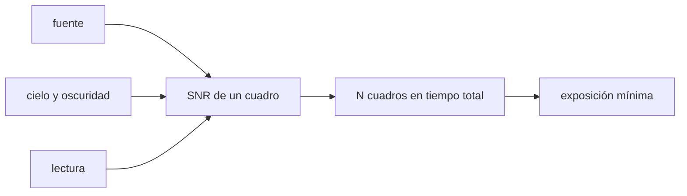

# B44-C11 — Tiempo de exposición

<!-- nav:top -->
<!-- /nav -->

## 1. Ubicación, nivel y alcance

Clase 11 del bloque B44. Nivel N3. La exposición decide cuánta señal se acumula y cuánto ruido entra. Aquí calculas la **SNR de un cuadro**, la **SNR total de una serie de cuadros** a tiempo total fijo y la **exposición mínima limitada por el cielo**, y lo verificas con Monte Carlo. Usas [B44-C05](../B44-C05-pozo-lleno-y-rango-dinamico/CLASE.md), [B44-C06](../B44-C06-ruido-de-lectura/CLASE.md) y [B12](../../../tronco-comun/B12-probabilidad-estadistica-e-incertidumbre.md). Todos los números son ilustrativos.

## 2. Por qué esta clase existe

Exponer poco multiplica el ruido de lectura; exponer mucho arriesga la saturación. La decisión central: **¿cuánto debe durar cada cuadro dentro de un tiempo total dado?**

## 3. Lo que podrás hacer al terminar

1. Calcular la SNR de un cuadro con fuente, cielo, oscuridad y lectura.
2. Comparar series de cuadros a tiempo total fijo.
3. Hallar la exposición mínima limitada por el cielo.
4. Cuantificar la penalización de usar cuadros cortos.
5. Verificar con una simulación.
6. Reconocer los límites del modelo.

La evidencia es la **ficha del tiempo de exposición** del ejercicio 12 (sección 20).

## 4. Con qué llegas y cómo comprobarlo

1. ¿Qué es una incertidumbre?
2. ¿Qué es una simulación Monte Carlo?
3. ¿Qué es una tabla de resultados?
4. ¿Qué es un valor ilustrativo?
5. ¿Qué es una verificación?

<details>
<summary>Ver respuestas</summary>

1. Un intervalo en que se espera el valor verdadero. 2. Repetir con números aleatorios de semilla fija. 3. Un resumen ordenado de cálculos. 4. Un valor propuesto para el ejemplo, no medido. 5. Comparar un cálculo con un caso independiente.
</details>

Con cuatro o cinco aciertos, sigue; si no, repasa los prerrequisitos.

## 5. Un caso de contexto y casos de referencia

Con una fuente de `20 e⁻/s`, cielo de `2 e⁻/s/pix`, oscuridad de `0,1 e⁻/s/pix`, lectura de `6 e⁻` y `20` píxeles, un cuadro de `100 s` tiene SNR `24,042`; `36` cuadros dan `144,254`. Es el **ejemplo conductor**. Todo es **ilustrativo**.

## 6. Vocabulario

La **SNR** es señal sobre ruido total. El **cielo** (`B`) y la **oscuridad** (`D`) añaden fondo. La **exposición limitada por el cielo** es aquella en que el fondo supera con holgura a la lectura. La **serie de cuadros** suma SNR en cuadratura.

## 7. Modelo mental: llenar una alberca con baldes

Cada ida a la alberca (un cuadro) paga un peaje fijo (la lectura): conviene llevar baldes grandes, hasta que se derrama (la saturación).



*Descripción textual:* la SNR de un cuadro depende de la exposición; una serie a tiempo total fijo se compara con un solo cuadro y define la exposición mínima.

Analogía: llenar una alberca con baldes. Límite: ruidos independientes y gaussianos, sin saturación.

## 8. La explicación, paso a paso

### 8.1 SNR de un cuadro

`SNR(t) = S t / √(S t + n[(B + D)t + RN²])`. Con `n = 20`, `S = 20`, `B = 2`, `D = 0,1` y `RN = 6`.

### 8.2 Serie a tiempo total de 3600 s

| `t` (s) | Cuadros | SNR de un cuadro | SNR total |
|---|---|---|---|
| 10 | 360,0 | 5,464 | 103,664 |
| 30 | 120,0 | 11,812 | 129,399 |
| 100 | 36,0 | 24,042 | 144,254 |
| 300 | 12,0 | 43,167 | 149,533 |
| 1000 | 3,6 | 79,860 | 151,523 |
| 3600 | 1,0 | 152,155 | 152,155 |

### 8.3 Exposición mínima

Con la condición `(B + D) t = 10 RN²`: `t = 171,4 s`. A esa duración, la SNR total es `147,486` frente a `152,155` de un único cuadro (cociente `0,9693`).

### 8.4 Monte Carlo (semilla 20261109, 40 000 repeticiones, `t = 100 s`)

SNR simulada `24,007` frente a `24,042` analítica.

### 8.5 Lectura

Cuadros de 10 s pierden un 32 % de la SNR respecto de un cuadro único. Con la exposición mínima de 171 s la pérdida es de un 3 %. Más largo gana poco y arriesga saturar o perder el cuadro por un rayo cósmico.

## 9. Magnitudes, símbolos y unidades

| Símbolo | Qué es | Unidad | Valor / nota |
|---|---|---|---|
| `S` | tasa de la fuente | e⁻/s | 20 (ilustrativa) |
| `B`, `D` | cielo y oscuridad por píxel | e⁻/s | 2 y 0,1 |
| `RN` | ruido de lectura | e⁻ | 6 |
| `n` | píxeles de la apertura | — | 20 |

## 10. Convenciones y referencias

Valores **ilustrativos**; ruidos gaussianos independientes; semilla `20261109`.

## 11. De dónde sale lo que afirmamos

| ID | Fuente | Localizador | Respalda | Estado |
|---|---|---|---|---|
| — | Sin fuente externa | — | relaciones estándar que verifica el laboratorio | No se consultó una fuente para esta clase |

Límites: no se consultó una fuente; la observación no existe.

## 12. Cómo ver la SNR total frente a la exposición

| `t` (s) | SNR total |
|---|---|
| 10 | 103,664 |
| 100 | 144,254 |
| 3600 | 152,155 |

Descripción larga: la SNR total sube y se aplana al alargar el cuadro.

## 13. Ejemplo trabajado: SNR de un cuadro de 100 s

**Paso 1 · Señal.** `S t = 2000 e⁻`.

**Paso 2 · Ruido.** `√(2000 + 20 × (2,1 × 100 + 36)) = √6920 = 83,19`.

**Paso 3 · Cociente.** `2000/83,19 = 24,04`.

## 14. Distintas formas de describir una exposición

**Por cuadro:** `SNR(t)`. **Por serie:** `√N · SNR(t)`. **Por regla:** `(B+D)t ≥ k RN²`. **Por simulación:** Monte Carlo.

## 15. Práctica guiada

**Ejercicio 1 · con los pasos indicados.** SNR de un cuadro de `100 s`. *Pasos:* ejemplo 13.

<details><summary>Solución comentada</summary>

`24,04`.
</details>

**Ejercicio 2 · con una pista.** Exposición mínima con `k = 10`. *Pista:* `10 RN²/(B + D)`.

<details><summary>Solución comentada</summary>

`360/2,1 = 171,4 s`.
</details>

**Ejercicio 3 · casi autónomo.** Cuadros de `171,4 s` en `3600 s`. *Pasos:* división.

<details><summary>Solución comentada</summary>

`21,0`.
</details>

## 16. Práctica autónoma, transferencia e integrador

**Ejercicio 4.** SNR de un cuadro de `3600 s`.

<details><summary>Solución comentada</summary>

`√(223 920) = 473,2`; `72 000/473,2 = 152,15`.
</details>

**Ejercicio 5.** Límite de cielo puro por `√t`. *Pista:* `S/√(S + n(B+D))`.

<details><summary>Solución comentada</summary>

`20/√62 = 2,54` por `√t`; a `3600 s`: `152,4`.
</details>

**Ejercicio 6.** Pérdida de la serie de `10 s` frente al cuadro único.

<details><summary>Solución comentada</summary>

`1 − 103,664/152,155 = 31,9 %`.
</details>

**Ejercicio 7.** Cuadros de `300 s` necesarios en `3600 s`.

<details><summary>Solución comentada</summary>

`12`; SNR total `149,533`.
</details>

**Ejercicio 8.** ¿Cuándo importa más la lectura que el cielo?

<details><summary>Solución comentada</summary>

Cuando `(B+D)t < RN²`, es decir `t < 17 s`.
</details>

**Ejercicio 9 · transferencia.** **Transferencia.** ¿Por qué no siempre un único cuadro largo?

<details><summary>Solución comentada</summary>

Por saturación, rayos cósmicos y deriva del seguimiento.
</details>

**Ejercicio 10 · transferencia.** **Transferencia.** ¿Qué cambia con un sensor de menor ruido de lectura?

<details><summary>Solución comentada</summary>

La exposición mínima baja proporcionalmente a `RN²`.
</details>

**Ejercicio 11 · transferencia.** **Transferencia.** Un colega apila 360 cuadros de 10 s. ¿Qué sacrifica?

<details><summary>Solución comentada</summary>

Un tercio de la SNR por el ruido de lectura repetido.
</details>

**Ejercicio 12.** **Integrador.** Elabora tu *ficha del tiempo de exposición*: tabla, mínimo y simulación.

<details><summary>Solución comentada</summary>

Secciones 8.1–8.5.
</details>

**Ejercicio 12 · integrador.** **Integrador.** Elabora tu *ficha del tiempo de exposición*: tabla, mínimo y simulación.

<details><summary>Solución modelo</summary>

Secciones 8.1–8.5.
</details>

## 17. Laboratorio: SNR y exposición mínima

El script [exposicion.py](exposicion.py) calcula la SNR de cuadros de distinta duración a tiempo total fijo y la verifica por Monte Carlo (**comprueba** la penalización de la exposición mínima y la SNR simulada al 3 %).

**Datos:** sin constantes; tasas, ruido y apertura **ilustrativos**; semilla `20261109`. **Predice antes de ejecutar:** ¿qué exposición minimiza el costo de la lectura sin esperar demasiado? (≈171 s.) **Ejecución del 2026-11-09 (Python 3.12.9):**

```text
Python 3.12.9 (biblioteca estandar)
  t [s]  N cuadros  SNR 1 cuadro  SNR total
     10      360.0         5.464    103.664
     30      120.0        11.812    129.399
    100       36.0        24.042    144.254
    300       12.0        43.167    149.533
   1000        3.6        79.860    151.523
   3600        1.0       152.155    152.155
exposicion minima limitada por el cielo (k = 10): 171.4 s
con t = 171 s: SNR total 147.486 frente a 152.155 (cociente 0.9693)
Monte Carlo (t = 100 s): SNR simulada 24.007 ; analitica 24.042
Pruebas superadas.
```

```bash
python programa/clases/B44/B44-C11-tiempo-de-exposicion/exposicion.py
```

**Límites:** ruidos gaussianos independientes; sin saturación.

## 18. Errores frecuentes y cómo corregirlos

**Elegir la exposición sin considerar la lectura.** Se corrige con 8.2.

**Olvidar el tiempo muerto.** Se corrige en la clase 18.

**Suponer que más largo siempre mejora.** Se corrige con 8.5.

**Presentar la fuente como una observación real.** Se corrige con la sección 10.

## 19. Cómo sabrás que vas bien

Tras la sección 8: ¿qué resultado esperabas y cuál obtuviste? Si dudas, repasa el ejemplo 13. Tras el laboratorio: ¿qué comprueba? (ver la sección 17).

## 20. Qué entregas y cómo se evalúa

El producto es tu **ficha del tiempo de exposición** (ejercicio 12).

| Criterio | Inicial | En desarrollo | Logrado | Destacado |
|---|---|---|---|---|
| Conceptos | Los confunde | Parciales | conceptos de la clase | Explica los límites |
| Cálculo | Sin unidades | Con errores | Tablas completas | Calcula casos nuevos |
| Numérico | Sin comprobar | Un caso | Contraste con el análisis | Interpreta las diferencias |
| Fuentes | Sin fuente | Sin fecha | fuentes con fecha | Declara lo ilustrativo |
| Límites | No los nombra | Uno | Tres | Discute qué falta del modelo |

**Condiciones críticas (no se compensan con promedio):** rotular lo ilustrativo; no proponer exposiciones para un instrumento real.

## 21. Ética, seguridad y límites

Clase educativa: los modelos son simplificados. Accesibilidad: tablas equivalentes a las gráficas, fórmulas en texto, ejercicios sin conexión.

## 22. Para cerrar y seguir

La exposición mínima de `171,4 s` pierde un 3 % de SNR frente a un cuadro único de una hora. Queda una pregunta: ¿cómo se prepara el cuadro de bias que resta el nivel de cero?

**Glosario español–inglés.** tiempo de exposición · *exposure time*; relación señal-ruido · *signal-to-noise ratio*; cielo · *sky*; apilado · *stacking*; cuadro · *frame*.

**Continuidad.** [B44-C12](../B44-C12-calibracion-con-bias/CLASE.md) construye el cuadro maestro de bias.

**Referencias:** ver sección 11.

<!-- nav:bottom -->
---

<!-- /nav -->
