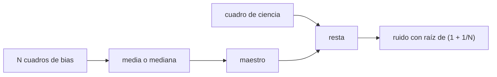

# B44-C12 — Calibración con bias

<!-- nav:top -->
<!-- /nav -->

## 1. Ubicación, nivel y alcance

Clase 12 del bloque B44. Nivel N3. El **bias** es el nivel que lee el sensor con exposición cero y un patrón fijo. Aquí construyes un **cuadro maestro** con la media y la mediana de 25 cuadros y propagas su ruido. Usas [B44-C06](../B44-C06-ruido-de-lectura/CLASE.md) y [B12](../../../tronco-comun/B12-probabilidad-estadistica-e-incertidumbre.md). El orden de los pasos de calibración sigue lo consultado en la documentación de ccdproc; los cuadros son sintéticos.

## 2. Por qué esta clase existe

Si el bias no se resta, el patrón fijo queda en la imagen. La decisión central: **¿cuántos cuadros se necesitan para que el maestro no añada ruido apreciable?**

## 3. Lo que podrás hacer al terminar

1. Construir un maestro con la media y con la mediana.
2. Calcular el ruido del maestro.
3. Propagar el ruido al restar el maestro.
4. Comparar el resultado con no restar el patrón.
5. Elegir el número de cuadros.
6. Reconocer los supuestos del método.

La evidencia es la **ficha de la calibración con bias** del ejercicio 12 (sección 20).

## 4. Con qué llegas y cómo comprobarlo

1. ¿Qué es una incertidumbre?
2. ¿Qué es una simulación Monte Carlo?
3. ¿Qué es una tabla de resultados?
4. ¿Qué es un valor ilustrativo?
5. ¿Qué es una verificación?

<details>
<summary>Ver respuestas</summary>

1. Un intervalo en que se espera el valor verdadero. 2. Repetir con números aleatorios de semilla fija. 3. Un resumen ordenado de cálculos. 4. Un valor propuesto para el ejemplo, no medido. 5. Comparar un cálculo con un caso independiente.
</details>

Con cuatro o cinco aciertos, sigue; si no, repasa los prerrequisitos.

## 5. Un caso de contexto y casos de referencia

Con 25 cuadros de `4 ADU` de ruido, el maestro por media tiene `0,7948 ADU` (esperado `0,8000`), por mediana `0,9993` (esperado `1,0027`); un cuadro nuevo menos el maestro tiene `4,1182 ADU`. Es el **ejemplo conductor**. Todo es **sintético**.

## 6. Vocabulario

El **cuadro maestro** combina muchos cuadros para reducir ruido. La **mediana** resiste valores atípicos pero es `√(π/2) = 1,2533` veces más ruidosa. El **patrón de columnas** es una estructura fija por columna. La **propagación** suma las varianzas.

## 7. Modelo mental: una regla con el cero marcado

Medir con una regla bien marcada en el cero evita sumar siempre el mismo error; cuanto más veces mides el cero, mejor lo conoces.



*Descripción textual:* los cuadros de bias se combinan en un maestro que se resta de cada cuadro; el ruido final es el de lectura por `√(1 + 1/N)`.

Analogía: una regla con el cero marcado. Límite: patrón fijo estable y ruido independiente entre cuadros.

## 8. La explicación, paso a paso

### 8.1 Ruido del maestro (25 cuadros de 48 × 48, semilla 20261109)

| Combinación | Medido (ADU) | Analítico (ADU) |
|---|---|---|
| Media | 0,7948 | 0,8000 |
| Mediana | 0,9993 | 1,0027 |

### 8.2 Resta en un cuadro nuevo

La desviación de `cuadro − maestro` es `4,1182 ADU` (analítico `4 √(1 + 1/25) = 4,0792`) con media `+0,0190`. Sin maestro, restando solo el nivel medio, la desviación es `4,7776 ADU`, porque queda el patrón de columnas.

### 8.3 Dependencia con el número de cuadros

| `N` | Ruido del maestro (ADU) |
|---|---|
| 1 | 4,0000 |
| 5 | 1,7889 |
| 25 | 0,8000 |
| 100 | 0,4000 |

### 8.4 Lectura

La media es más eficiente que la mediana (factor `1,25`). Con `N = 25` el maestro agrega solo un 2 % al ruido de un cuadro. La resta elimina el patrón de columnas.

## 9. Magnitudes, símbolos y unidades

| Símbolo | Qué es | Unidad | Valor / nota |
|---|---|---|---|
| `N` | cuadros del maestro | — | 25 |
| `RN` | ruido de lectura | ADU | 4 (sintético) |
| `√(1 + 1/N)` | factor de propagación | — | 1,0198 |

## 10. Convenciones y referencias

Cuadros sintéticos; patrón de columnas con `σ = 2 ADU` (la muestra de 48 columnas fluctúa); semilla `20261109`. Orden de pasos según la documentación de ccdproc.

## 11. De dónde sale lo que afirmamos

| ID | Fuente | Localizador | Respalda | Estado |
|---|---|---|---|---|
| S1 | Astropy, documentación de ccdproc (reduction toolbox) | https://docs.astropy.org/projects/ccdproc/en/latest/reduction_toolbox.html | el orden de los pasos: overscan y recorte, bias, dark, flat | Consultada el 2026-11-09 (la página de documentación, no el código) |

Límites: la fuente respalda el orden de los pasos, no ninguna cifra; todas las cifras salen del laboratorio sintético.

## 12. Cómo ver el ruido del maestro

| `N` | Ruido (ADU) |
|---|---|
| 1 | 4,0000 |
| 25 | 0,8000 |
| 100 | 0,4000 |

Descripción larga: el ruido del maestro cae como la raíz del número de cuadros.

## 13. Ejemplo trabajado: ruido tras la resta

**Paso 1 · Maestro.** `4/√25 = 0,8 ADU`.

**Paso 2 · Suma en cuadratura.** `√(4² + 0,8²) = 4,0792`.

**Paso 3 · Comparación.** Observado `4,1182`.

## 14. Distintas formas de describir el bias

**Por nivel:** media del cuadro. **Por estructura:** patrón de columnas. **Por maestro:** media o mediana. **Por ruido:** `RN √(1 + 1/N)`.

## 15. Práctica guiada

**Ejercicio 1 · con los pasos indicados.** Ruido del maestro de `25` cuadros con `RN = 4 ADU`. *Pasos:* `RN/√N`.

<details><summary>Solución comentada</summary>

`0,8 ADU`.
</details>

**Ejercicio 2 · con una pista.** Ruido del maestro por mediana. *Pista:* factor `√(π/2)`.

<details><summary>Solución comentada</summary>

`1,0027 ADU`.
</details>

**Ejercicio 3 · casi autónomo.** Ruido de `cuadro − maestro`. *Pasos:* ejemplo 13.

<details><summary>Solución comentada</summary>

`4,0792 ADU`.
</details>

## 16. Práctica autónoma, transferencia e integrador

**Ejercicio 4.** Cuadros para un maestro de `0,2 ADU`.

<details><summary>Solución comentada</summary>

`(4/0,2)² = 400`.
</details>

**Ejercicio 5.** Cociente mediana/media.

<details><summary>Solución comentada</summary>

`1,2533`.
</details>

**Ejercicio 6.** Ruido si el maestro tuviera `N = 1`.

<details><summary>Solución comentada</summary>

`4 √2 = 5,66 ADU`.
</details>

**Ejercicio 7.** ¿Por qué la desviación sin maestro es `4,78`?

<details><summary>Solución comentada</summary>

Se suma el patrón fijo de columnas al ruido de lectura.
</details>

**Ejercicio 8.** Media de la resta.

<details><summary>Solución comentada</summary>

`+0,0190 ADU`, compatible con cero.
</details>

**Ejercicio 9 · transferencia.** **Transferencia.** ¿Cuándo preferir la mediana?

<details><summary>Solución comentada</summary>

Con cuadros que pueden tener valores atípicos.
</details>

**Ejercicio 10 · transferencia.** **Transferencia.** ¿Qué pasa si el patrón cambia con la temperatura?

<details><summary>Solución comentada</summary>

El maestro deja de valer y hay que rehacerlo.
</details>

**Ejercicio 11 · transferencia.** **Transferencia.** Un colega toma el bias con exposición larga. ¿Qué error?

<details><summary>Solución comentada</summary>

Incluye corriente oscura.
</details>

**Ejercicio 12.** **Integrador.** Elabora tu *ficha de la calibración con bias*: maestro, ruido y resta.

<details><summary>Solución comentada</summary>

Secciones 8.1–8.4.
</details>

**Ejercicio 12 · integrador.** **Integrador.** Elabora tu *ficha de la calibración con bias*: maestro, ruido y resta.

<details><summary>Solución modelo</summary>

Secciones 8.1–8.4.
</details>

## 17. Laboratorio: maestro de bias

El script [bias.py](bias.py) construye maestros de bias por media y mediana, mide su ruido y el de la resta (**comprueba** los tres ruidos frente a los analíticos dentro del 4 %).

**Datos:** sin constantes; cuadros **sintéticos**; semilla `20261109`; orden de pasos de ccdproc (consultada el 2026-11-09). **Predice antes de ejecutar:** ¿cuánto ruido añade un maestro de 25 cuadros? (≈2 %.) **Ejecución del 2026-11-09 (Python 3.12.9):**

```text
Python 3.12.9 (biblioteca estandar)
ruido del maestro (media):   0.7948 ADU ; analitico 0.8000
ruido del maestro (mediana): 0.9993 ADU ; analitico 1.0027
cuadro nuevo - maestro: std 4.1182 ADU ; analitico 4.0792 ; media +0.0190
cuadro nuevo - nivel medio (sin maestro): std 4.7776 ADU (incluye el patron de columnas)
 N cuadros  ruido maestro [ADU]
         1               4.0000
         5               1.7889
        25               0.8000
       100               0.4000
Pruebas superadas.
```

```bash
python programa/clases/B44/B44-C12-calibracion-con-bias/bias.py
```

**Límites:** patrón fijo estable; sin deriva.

## 18. Errores frecuentes y cómo corregirlos

**Usar pocos cuadros para el maestro.** Se corrige con 8.3.

**Olvidar la propagación.** Se corrige con el ejemplo 13.

**Restar solo el nivel medio.** Se corrige con 8.2.

**Atribuir las cifras a ccdproc.** Se corrige con la sección 11.

## 19. Cómo sabrás que vas bien

Tras la sección 8: ¿qué resultado esperabas y cuál obtuviste? Si dudas, repasa el ejemplo 13. Tras el laboratorio: ¿qué comprueba? (ver la sección 17).

## 20. Qué entregas y cómo se evalúa

El producto es tu **ficha de la calibración con bias** (ejercicio 12).

| Criterio | Inicial | En desarrollo | Logrado | Destacado |
|---|---|---|---|---|
| Conceptos | Los confunde | Parciales | conceptos de la clase | Explica los límites |
| Cálculo | Sin unidades | Con errores | Tablas completas | Calcula casos nuevos |
| Numérico | Sin comprobar | Un caso | Contraste con el análisis | Interpreta las diferencias |
| Fuentes | Sin fuente | Sin fecha | fuentes con fecha | Declara lo ilustrativo |
| Límites | No los nombra | Uno | Tres | Discute qué falta del modelo |

**Condiciones críticas (no se compensan con promedio):** rotular lo sintético; no atribuir cifras a la fuente consultada.

## 21. Ética, seguridad y límites

Clase educativa: los modelos son simplificados. Accesibilidad: tablas equivalentes a las gráficas, fórmulas en texto, ejercicios sin conexión.

## 22. Para cerrar y seguir

Un maestro de 25 cuadros añade `0,8 ADU` y la resta deja `4,12 ADU`. Queda una pregunta: ¿cómo se resta la corriente oscura que depende del tiempo?

**Glosario español–inglés.** cuadro maestro · *master frame*; mediana · *median*; patrón fijo · *fixed pattern*; propagación · *propagation*; sustracción · *subtraction*.

**Continuidad.** [B44-C13](../B44-C13-calibracion-con-dark/CLASE.md) construye el maestro de dark.

**Referencias:** ver sección 11.

<!-- nav:bottom -->
---

<!-- /nav -->
