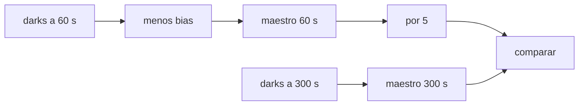

# B44-C13 — Calibración con dark

<!-- nav:top -->
[🏠 Programa](../../../../README.md) · [📚 Bloque B44](../../../tronco-comun/B44-detectores-y-adquisicion-astronomica.md) · [← Anterior: B44-C12 — Calibración con bias](../B44-C12-calibracion-con-bias/CLASE.md) · [Siguiente: B44-C14 — Calibración con flat →](../B44-C14-calibracion-con-flat/CLASE.md)
<!-- /nav -->

## 1. Ubicación, nivel y alcance

Clase 13 del bloque B44. Nivel N3. El **cuadro de dark** registra la corriente oscura con el obturador cerrado. Aquí construyes un maestro a `60 s`, lo **reescalas a `300 s`** y lo comparas con un maestro medido directamente a `300 s`. Usas [B44-C07](../B44-C07-corriente-oscura/CLASE.md), [B44-C12](../B44-C12-calibracion-con-bias/CLASE.md) y [B12](../../../tronco-comun/B12-probabilidad-estadistica-e-incertidumbre.md). El orden (bias, luego dark) sigue lo consultado en ccdproc; los cuadros son sintéticos.

## 2. Por qué esta clase existe

La oscuridad depende de la exposición y de la temperatura, y algunos píxeles son muy calientes. La decisión central: **¿se puede reutilizar un dark de otra exposición, y a qué costo en ruido?**

## 3. Lo que podrás hacer al terminar

1. Construir un dark maestro sin bias.
2. Reescalar por la razón de exposiciones.
3. Comparar con una medida directa.
4. Cuantificar la amplificación del ruido al escalar.
5. Recuperar la tasa de píxeles calientes.
6. Reconocer los límites del escalado.

La evidencia es la **ficha de la calibración con dark** del ejercicio 12 (sección 20).

## 4. Con qué llegas y cómo comprobarlo

1. ¿Qué es una incertidumbre?
2. ¿Qué es una simulación Monte Carlo?
3. ¿Qué es una tabla de resultados?
4. ¿Qué es un valor ilustrativo?
5. ¿Qué es una verificación?

<details>
<summary>Ver respuestas</summary>

1. Un intervalo en que se espera el valor verdadero. 2. Repetir con números aleatorios de semilla fija. 3. Un resumen ordenado de cálculos. 4. Un valor propuesto para el ejemplo, no medido. 5. Comparar un cálculo con un caso independiente.
</details>

Con cuatro o cinco aciertos, sigue; si no, repasa los prerrequisitos.

## 5. Un caso de contexto y casos de referencia

Con `9` cuadros por maestro y píxeles de `0,05 e⁻/s` (más `3` calientes de `2 e⁻/s`), el escalado de `60 s` a `300 s` difiere del directo en `+0,310 e⁻` por píxel, con error estándar `0,311`; el ruido por píxel de la diferencia es `9,93 e⁻`. Es el **ejemplo conductor**. Todo es **sintético**.

## 6. Vocabulario

El **dark maestro** es la combinación de cuadros oscuros sin bias. El **reescalado** multiplica por `t₂/t₁`. Un **píxel caliente** tiene una tasa mucho mayor que la media. La **amplificación del ruido** del escalado es el factor `t₂/t₁`.

## 7. Modelo mental: una vela que se consume

Si sabes cuánto cera pierde una vela por minuto, puedes calcular cuánta perderá en cinco: pero si mediste solo un minuto, el error de esa medida también se multiplica por cinco.



*Descripción textual:* el maestro corto se multiplica por la razón de exposiciones y se compara con el medido directamente.

Analogía: una vela que se consume. Límite: corriente oscura lineal con el tiempo y bias estable.

## 8. La explicación, paso a paso

### 8.1 Tasas medias

Tasa media verdadera de los píxeles normales: `0,0517 e⁻/s`; medida a `60 s`: `0,0527`; a `300 s`: `0,0517`.

### 8.2 Escalado frente a directo

La diferencia media (`5 × d60 − d300`) es `+0,310 e⁻` por píxel, con error estándar esperado `0,311 e⁻`: compatible con cero. El ruido por píxel de la diferencia es `9,93 e⁻`. `1020` de `1021` píxeles normales están dentro de `3σ`.

### 8.3 Píxeles calientes

| Píxel | Tasa verdadera (e⁻/s) | Medida a 300 s (e⁻/s) |
|---|---|---|
| 100 | 2,000 | 2,052 |
| 400 | 2,000 | 1,952 |
| 777 | 2,000 | 1,950 |

### 8.4 Lectura

Un píxel típico de `0,0576 e⁻/s` acumula `14,56 e⁻` a `300 s` (predicho `17,28`; el maestro tiene `2,4 e⁻` de ruido). El escalado desde `60 s` multiplica por `5` el ruido del maestro corto. Si hay exposición larga, conviene un maestro propio.

## 9. Magnitudes, símbolos y unidades

| Símbolo | Qué es | Unidad | Valor / nota |
|---|---|---|---|
| `t₂/t₁` | factor de escalado | — | 5 |
| tasa | corriente oscura por píxel | e⁻/s | 0,0517 (media); 2,0 (calientes) |
| `σ_dif` | ruido de la diferencia | e⁻ | 9,93 |

## 10. Convenciones y referencias

Cuadros sintéticos de 32 × 32; `k` cuadros por maestro `= 9`; bias con 25 cuadros; semilla `20261109`.

## 11. De dónde sale lo que afirmamos

| ID | Fuente | Localizador | Respalda | Estado |
|---|---|---|---|---|
| S1 | Astropy, documentación de ccdproc (reduction toolbox) | https://docs.astropy.org/projects/ccdproc/en/latest/reduction_toolbox.html | el orden de los pasos: overscan y recorte, bias, dark, flat | Consultada el 2026-11-09 (la página de documentación, no el código) |

Límites: la fuente respalda el orden de los pasos; todas las cifras salen del laboratorio sintético.

## 12. Cómo ver las tasas de los píxeles calientes

| Píxel | Medida (e⁻/s) |
|---|---|
| 100 | 2,052 |
| 400 | 1,952 |
| 777 | 1,950 |

Descripción larga: las tres medidas están a menos del 3 % de la tasa verdadera de 2,0.

## 13. Ejemplo trabajado: oscuridad esperada de un píxel

**Paso 1 · Tasa.** `0,0576 e⁻/s`.

**Paso 2 · Exposición.** `× 300 s`.

**Paso 3 · Resultado.** `17,28 e⁻` esperados; el maestro midió `14,56 e⁻`.

## 14. Distintas formas de describir la oscuridad

**Por tasa:** `D`. **Por cuadro:** `D t`. **Por maestro:** mediana de cuadros. **Por escalado:** `× t₂/t₁`.

## 15. Práctica guiada

**Ejercicio 1 · con los pasos indicados.** Factor de escalado de `60 s` a `300 s`. *Pasos:* cociente.

<details><summary>Solución comentada</summary>

`5`.
</details>

**Ejercicio 2 · con una pista.** Oscuridad de un píxel de `0,0576 e⁻/s` en `300 s`. *Pasos:* ejemplo 13.

<details><summary>Solución comentada</summary>

`17,28 e⁻`.
</details>

**Ejercicio 3 · casi autónomo.** Ruido del maestro a `300 s` en ese píxel. *Pista:* `√[(17,3 + 25)/9 + 25/25]`.

<details><summary>Solución comentada</summary>

`√5,70 = 2,39 e⁻`.
</details>

## 16. Práctica autónoma, transferencia e integrador

**Ejercicio 4.** Ruido del maestro de `60 s` escalado por `5`.

<details><summary>Solución comentada</summary>

`5 √[(3,5 + 25)/9 + 1] ≈ 10 e⁻`.
</details>

**Ejercicio 5.** Tasa de un píxel caliente que acumula `600 e⁻` en `300 s`.

<details><summary>Solución comentada</summary>

`2,0 e⁻/s`.
</details>

**Ejercicio 6.** ¿Por qué restar el bias antes del dark?

<details><summary>Solución comentada</summary>

Para que el maestro de dark contenga solo oscuridad.
</details>

**Ejercicio 7.** Porcentaje de píxeles dentro de `3σ`.

<details><summary>Solución comentada</summary>

`1020/1021 = 99,9 %`.
</details>

**Ejercicio 8.** Error de la medida del caliente 400.

<details><summary>Solución comentada</summary>

`1,952/2,000 − 1 = −2,4 %`.
</details>

**Ejercicio 9 · transferencia.** **Transferencia.** ¿Cuándo no vale reescalar?

<details><summary>Solución comentada</summary>

Si cambió la temperatura o hay luz parásita.
</details>

**Ejercicio 10 · transferencia.** **Transferencia.** ¿Qué hace un píxel caliente en la imagen?

<details><summary>Solución comentada</summary>

Un falso punto brillante: se enmascara (clase 15).
</details>

**Ejercicio 11 · transferencia.** **Transferencia.** ¿Por qué el ruido por píxel de la diferencia es tan grande?

<details><summary>Solución comentada</summary>

El escalado multiplica por 5 el ruido de lectura del maestro corto.
</details>

**Ejercicio 12.** **Integrador.** Elabora tu *ficha de la calibración con dark*: maestro, escalado y calientes.

<details><summary>Solución comentada</summary>

Secciones 8.1–8.4.
</details>

**Ejercicio 12 · integrador.** **Integrador.** Elabora tu *ficha de la calibración con dark*: maestro, escalado y calientes.

<details><summary>Solución modelo</summary>

Secciones 8.1–8.4.
</details>

## 17. Laboratorio: maestro de dark y escalado

El script [dark.py](dark.py) construye maestros de dark a `60 s` y `300 s` y compara el escalado con la medida directa (**comprueba** la diferencia media a 4 errores estándar y las tasas de los calientes al 5 %).

**Datos:** sin constantes; cuadros **sintéticos**; semilla `20261109`; orden de pasos de ccdproc (consultada el 2026-11-09). **Predice antes de ejecutar:** ¿cuánto ruido por píxel añade escalar? (≈9,9 e⁻.) **Ejecución del 2026-11-09 (Python 3.12.9):**

```text
Python 3.12.9 (biblioteca estandar)
tasa media verdadera (pixeles normales) 0.0517 e-/s ; a 60 s: 0.0527 ; a 300 s: 0.0517
diferencia media (escalado - directo a 300 s): +0.310 e- por pixel
error estandar esperado de la diferencia media: 0.311 e- ; ruido por pixel de la diferencia: 9.93 e-
pixeles normales dentro de 3 sigma: 1020/1021
pixel caliente 100: tasa verdadera 2.000 ; medida a 300 s 2.052 e-/s
pixel caliente 400: tasa verdadera 2.000 ; medida a 300 s 1.952 e-/s
pixel caliente 777: tasa verdadera 2.000 ; medida a 300 s 1.950 e-/s
pixel tipico: tasa 0.0576 e-/s -> dark(300 s) 14.56 e-
Pruebas superadas.
```

```bash
python programa/clases/B44/B44-C13-calibracion-con-dark/dark.py
```

**Límites:** oscuridad lineal; temperatura constante.

## 18. Errores frecuentes y cómo corregirlos

**Escalar sin restar el bias.** Se corrige con 8.1.

**Olvidar el ruido amplificado.** Se corrige con 8.2.

**Reutilizar el maestro tras cambiar la temperatura.** Se corrige en la clase 8.

**Tomar las cifras como de un sensor real.** Se corrige con la sección 10.

## 19. Cómo sabrás que vas bien

Tras la sección 8: ¿qué resultado esperabas y cuál obtuviste? Si dudas, repasa el ejemplo 13. Tras el laboratorio: ¿qué comprueba? (ver la sección 17).

## 20. Qué entregas y cómo se evalúa

El producto es tu **ficha de la calibración con dark** (ejercicio 12).

| Criterio | Inicial | En desarrollo | Logrado | Destacado |
|---|---|---|---|---|
| Conceptos | Los confunde | Parciales | conceptos de la clase | Explica los límites |
| Cálculo | Sin unidades | Con errores | Tablas completas | Calcula casos nuevos |
| Numérico | Sin comprobar | Un caso | Contraste con el análisis | Interpreta las diferencias |
| Fuentes | Sin fuente | Sin fecha | fuentes con fecha | Declara lo ilustrativo |
| Límites | No los nombra | Uno | Tres | Discute qué falta del modelo |

**Condiciones críticas (no se compensan con promedio):** rotular lo sintético; no atribuir cifras a la fuente consultada.

## 21. Ética, seguridad y límites

Clase educativa: los modelos son simplificados. Accesibilidad: tablas equivalentes a las gráficas, fórmulas en texto, ejercicios sin conexión.

## 22. Para cerrar y seguir

El dark escalado desde `60 s` es compatible con el directo a `300 s` en media, pero con `9,9 e⁻` de ruido por píxel. Queda una pregunta: ¿cómo se corrige la sensibilidad desigual de los píxeles?

**Glosario español–inglés.** cuadro oscuro · *dark frame*; píxel caliente · *hot pixel*; escalado · *scaling*; corriente oscura · *dark current*; maestro · *master*.

**Continuidad.** [B44-C14](../B44-C14-calibracion-con-flat/CLASE.md) construye el cuadro de flat.

**Referencias:** ver sección 11.

<!-- nav:bottom -->
---

[← Anterior: B44-C12 — Calibración con bias](../B44-C12-calibracion-con-bias/CLASE.md) · [📚 Bloque B44](../../../tronco-comun/B44-detectores-y-adquisicion-astronomica.md) · [Siguiente: B44-C14 — Calibración con flat →](../B44-C14-calibracion-con-flat/CLASE.md)
<!-- /nav -->
