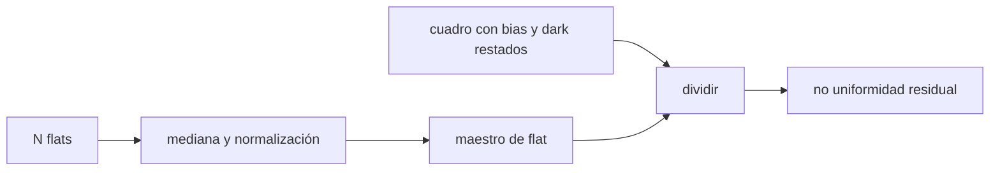

# B44-C14 — Calibración con flat

<!-- nav:top -->
[🏠 Programa](../../../../README.md) · [📚 Bloque B44](../../../tronco-comun/B44-detectores-y-adquisicion-astronomica.md) · [← Anterior: B44-C13 — Calibración con dark](../B44-C13-calibracion-con-dark/CLASE.md) · [Siguiente: B44-C15 — Píxeles defectuosos →](../B44-C15-pixeles-defectuosos/CLASE.md)
<!-- /nav -->

## 1. Ubicación, nivel y alcance

Clase 14 del bloque B44. Nivel N3. El **flat** mide la sensibilidad relativa de cada píxel y el viñeteo del sistema. Aquí construyes un maestro de flat con `N` cuadros, lo normalizas y mides la **no uniformidad residual**. Usas [B44-C12](../B44-C12-calibracion-con-bias/CLASE.md), [B44-C13](../B44-C13-calibracion-con-dark/CLASE.md) y [B12](../../../tronco-comun/B12-probabilidad-estadistica-e-incertidumbre.md). El orden (el flat se aplica al final) sigue ccdproc; la respuesta es sintética.

## 2. Por qué esta clase existe

Los píxeles no responden igual y el campo se oscurece hacia el borde. La decisión central: **¿cuántos flats hacen falta para que el ruido del flat no domine?**

## 3. Lo que podrás hacer al terminar

1. Construir y normalizar un maestro de flat.
2. Calcular el ruido del maestro.
3. Dividir un cuadro por el maestro.
4. Calcular la no uniformidad residual.
5. Relacionarla con el ruido de fotones.
6. Reconocer los supuestos del flat.

La evidencia es la **ficha de la calibración con flat** del ejercicio 12 (sección 20).

## 4. Con qué llegas y cómo comprobarlo

1. ¿Qué es una incertidumbre?
2. ¿Qué es una simulación Monte Carlo?
3. ¿Qué es una tabla de resultados?
4. ¿Qué es un valor ilustrativo?
5. ¿Qué es una verificación?

<details>
<summary>Ver respuestas</summary>

1. Un intervalo en que se espera el valor verdadero. 2. Repetir con números aleatorios de semilla fija. 3. Un resumen ordenado de cálculos. 4. Un valor propuesto para el ejemplo, no medido. 5. Comparar un cálculo con un caso independiente.
</details>

Con cuatro o cinco aciertos, sigue; si no, repasa los prerrequisitos.

## 5. Un caso de contexto y casos de referencia

Con una respuesta de `3,77 %` de dispersión (PRNU de `1,5 %` y viñeteo de `15 %`) y `20 000 e⁻` por píxel, un flat de `80` cuadros deja una no uniformidad residual de `0,00738`, frente a `0,0386` sin flat. Es el **ejemplo conductor**. Todo es **sintético**.

## 6. Vocabulario

El **flat** es un cuadro de campo uniformemente iluminado. La **PRNU** es la variación de sensibilidad entre píxeles. El **viñeteo** es el oscurecimiento hacia los bordes. La **normalización** divide por la media. La **no uniformidad residual** es la dispersión relativa tras corregir.

## 7. Modelo mental: nivelar un mapa de alturas

Si sabes cuánto sube o baja cada baldosa, puedes nivelar el piso dividiendo por su desnivel; pero cada medida del desnivel tiene su propio error.



*Descripción textual:* los flats se combinan y se normalizan en un maestro por el que se divide el cuadro; el residuo queda fijado por el ruido de fotones.

Analogía: nivelar un mapa de alturas. Límite: iluminación del flat uniforme y sin bias ni dark residuales.

## 8. La explicación, paso a paso

### 8.1 Ruido del maestro y residuo (semilla 20261109, 48 × 48)

| `N` flats | Ruido del maestro | Analítico | Residuo del cuadro | Analítico |
|---|---|---|---|---|
| 5 | 0,003293 | 0,003251 | 0,008183 | 0,007963 |
| 20 | 0,001646 | 0,001625 | 0,007354 | 0,007449 |
| 80 | 0,000813 | 0,000813 | 0,007381 | 0,007315 |

El analítico usa `√[media(1/(N r L))]` y `√[media((1 + 1/N)/(r L))]`, con `r` la respuesta de cada píxel y `L = 20 000 e⁻`.

### 8.2 Sin flat frente a con flat

La dispersión de la respuesta verdadera es `0,0377`. Sin corregir, la no uniformidad es `0,0386`; con un flat de `80` cuadros, `0,00738`.

### 8.3 Lectura

El residuo no baja de `1/√L = 0,00707` aunque `N` crezca: queda el ruido de fotones del propio cuadro. El maestro con `N = 80` ya es mucho más preciso que ese suelo.

## 9. Magnitudes, símbolos y unidades

| Símbolo | Qué es | Unidad | Valor / nota |
|---|---|---|---|
| `L` | nivel de cada flat | e⁻ | 20 000 |
| PRNU | variación de respuesta | — | 1,5 % (sintética) |
| residuo | no uniformidad tras flat | — | 0,00738 |

## 10. Convenciones y referencias

Respuesta **sintética** (PRNU de 1,5 % y viñeteo de 15 %); ruido de fotones gaussiano; semilla `20261109`; el flat se aplica tras bias y dark según ccdproc.

## 11. De dónde sale lo que afirmamos

| ID | Fuente | Localizador | Respalda | Estado |
|---|---|---|---|---|
| S1 | Astropy, documentación de ccdproc (reduction toolbox) | https://docs.astropy.org/projects/ccdproc/en/latest/reduction_toolbox.html | el orden de los pasos: overscan y recorte, bias, dark, flat | Consultada el 2026-11-09 (la página de documentación, no el código) |

Límites: la fuente respalda el orden de los pasos; las cifras salen del laboratorio sintético.

## 12. Cómo ver el residuo frente a N

| `N` | Residuo |
|---|---|
| 5 | 0,008183 |
| 20 | 0,007354 |
| 80 | 0,007381 |

Descripción larga: el residuo se aplana en el suelo del ruido de fotones.

## 13. Ejemplo trabajado: suelo del residuo

**Paso 1 · Fotones.** `L = 20 000 e⁻`.

**Paso 2 · Raíz.** `√L = 141,4`.

**Paso 3 · Cociente.** `1/141,4 = 0,00707`.

## 14. Distintas formas de describir el flat

**Por respuesta:** `r`. **Por maestro:** media normalizada. **Por corrección:** división. **Por residuo:** `√[(1+1/N)/L]`.

## 15. Práctica guiada

**Ejercicio 1 · con los pasos indicados.** Ruido relativo de fotones de `20 000 e⁻`. *Pasos:* ejemplo 13.

<details><summary>Solución comentada</summary>

`0,00707`.
</details>

**Ejercicio 2 · con una pista.** Ruido del maestro con `N = 80` sin viñeteo. *Pista:* `1/√(N L)`.

<details><summary>Solución comentada</summary>

`1/√(1,6 × 10⁶) = 0,000791`.
</details>

**Ejercicio 3 · casi autónomo.** `N` para un maestro de `0,1 %`. *Pasos:* `N L = 10⁶`.

<details><summary>Solución comentada</summary>

`50`.
</details>

## 16. Práctica autónoma, transferencia e integrador

**Ejercicio 4.** Residuo mínimo posible con `L = 20 000`.

<details><summary>Solución comentada</summary>

`0,00707`.
</details>

**Ejercicio 5.** Reducción de la no uniformidad con el flat de `80`.

<details><summary>Solución comentada</summary>

`0,0386/0,00738 = 5,2`.
</details>

**Ejercicio 6.** ¿Por qué el residuo con `N = 5` es mayor?

<details><summary>Solución comentada</summary>

El maestro aporta un `√(1+1/5) = 1,095` más de ruido.
</details>

**Ejercicio 7.** Nivel de flat para residuo de `0,3 %` con `N` grande.

<details><summary>Solución comentada</summary>

`L = 1/0,003² = 111 000 e⁻`.
</details>

**Ejercicio 8.** ¿Qué pasa si el flat está saturado?

<details><summary>Solución comentada</summary>

La respuesta medida es plana y no corrige.
</details>

**Ejercicio 9 · transferencia.** **Transferencia.** ¿Por qué se normaliza el maestro?

<details><summary>Solución comentada</summary>

Para conservar el nivel de cuentas del cuadro.
</details>

**Ejercicio 10 · transferencia.** **Transferencia.** ¿Por qué restar bias y dark también de los flats?

<details><summary>Solución comentada</summary>

Para que el flat contenga solo respuesta.
</details>

**Ejercicio 11 · transferencia.** **Transferencia.** ¿Qué límite pone el cielo del crepúsculo?

<details><summary>Solución comentada</summary>

La iluminación no es perfectamente uniforme.
</details>

**Ejercicio 12.** **Integrador.** Elabora tu *ficha de la calibración con flat*: maestro, residuo y suelo.

<details><summary>Solución comentada</summary>

Secciones 8.1–8.3.
</details>

**Ejercicio 12 · integrador.** **Integrador.** Elabora tu *ficha de la calibración con flat*: maestro, residuo y suelo.

<details><summary>Solución modelo</summary>

Secciones 8.1–8.3.
</details>

## 17. Laboratorio: maestro de flat y residuo

El script [flat.py](flat.py) construye maestros de flat de 5, 20 y 80 cuadros y mide la no uniformidad residual (**comprueba** el residuo frente al analítico al 4 % y que el flat reduce la no uniformidad al menos 4 veces).

**Datos:** sin constantes; respuesta y cuadros **sintéticos**; semilla `20261109`; orden de pasos de ccdproc (consultada el 2026-11-09). **Predice antes de ejecutar:** ¿cuál es el suelo del residuo? (≈0,0071.) **Ejecución del 2026-11-09 (Python 3.12.9):**

```text
Python 3.12.9 (biblioteca estandar)
respuesta verdadera: std relativa 0.0377 (PRNU + vineteo)
 N flats  ruido maestro  analitico  residuo cuadro  analitico
       5       0.003293   0.003251        0.008183   0.007963
      20       0.001646   0.001625        0.007354   0.007449
      80       0.000813   0.000813        0.007381   0.007315
sin flat: no uniformidad 0.0386 ; con flat de 80 cuadros: 0.00738
Pruebas superadas.
```

```bash
python programa/clases/B44/B44-C14-calibracion-con-flat/flat.py
```

**Límites:** iluminación uniforme; sin dependencia del color.

## 18. Errores frecuentes y cómo corregirlos

**Aplicar el flat antes del bias y el dark.** Se corrige con la sección 11.

**Usar pocos cuadros de flat.** Se corrige con 8.1.

**Pensar que el flat elimina todo el ruido.** Se corrige con 8.3.

**Atribuir las cifras a ccdproc.** Se corrige con la sección 11.

## 19. Cómo sabrás que vas bien

Tras la sección 8: ¿qué resultado esperabas y cuál obtuviste? Si dudas, repasa el ejemplo 13. Tras el laboratorio: ¿qué comprueba? (ver la sección 17).

## 20. Qué entregas y cómo se evalúa

El producto es tu **ficha de la calibración con flat** (ejercicio 12).

| Criterio | Inicial | En desarrollo | Logrado | Destacado |
|---|---|---|---|---|
| Conceptos | Los confunde | Parciales | conceptos de la clase | Explica los límites |
| Cálculo | Sin unidades | Con errores | Tablas completas | Calcula casos nuevos |
| Numérico | Sin comprobar | Un caso | Contraste con el análisis | Interpreta las diferencias |
| Fuentes | Sin fuente | Sin fecha | fuentes con fecha | Declara lo ilustrativo |
| Límites | No los nombra | Uno | Tres | Discute qué falta del modelo |

**Condiciones críticas (no se compensan con promedio):** rotular lo sintético; no atribuir cifras a la fuente consultada.

## 21. Ética, seguridad y límites

Clase educativa: los modelos son simplificados. Accesibilidad: tablas equivalentes a las gráficas, fórmulas en texto, ejercicios sin conexión.

## 22. Para cerrar y seguir

Un flat de 80 cuadros reduce la no uniformidad de `0,0386` a `0,00738`, a pocos puntos del suelo de fotones. Queda una pregunta: ¿cómo se detectan los píxeles que ni el flat arregla?

**Glosario español–inglés.** campo plano · *flat field*; viñeteo · *vignetting*; PRNU · *photo-response non-uniformity*; normalización · *normalization*; residuo · *residual*.

**Continuidad.** [B44-C15](../B44-C15-pixeles-defectuosos/CLASE.md) detecta y enmascara píxeles defectuosos.

**Referencias:** ver sección 11.

<!-- nav:bottom -->
---

[← Anterior: B44-C13 — Calibración con dark](../B44-C13-calibracion-con-dark/CLASE.md) · [📚 Bloque B44](../../../tronco-comun/B44-detectores-y-adquisicion-astronomica.md) · [Siguiente: B44-C15 — Píxeles defectuosos →](../B44-C15-pixeles-defectuosos/CLASE.md)
<!-- /nav -->
