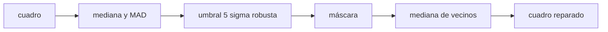

# B44-C15 — Píxeles defectuosos

<!-- nav:top -->
[🏠 Programa](../../../../README.md) · [📚 Bloque B44](../../../tronco-comun/B44-detectores-y-adquisicion-astronomica.md) · [← Anterior: B44-C14 — Calibración con flat](../B44-C14-calibracion-con-flat/CLASE.md) · [Siguiente: B44-C16 — Ruido cósmico e identificación →](../B44-C16-ruido-cosmico-e-identificacion/CLASE.md)
<!-- /nav -->

## 1. Ubicación, nivel y alcance

Clase 15 del bloque B44. Nivel N3. Los **píxeles calientes y muertos** no se corrigen con bias, dark ni flat. Aquí los detectas con una estadística **robusta (MAD)**, los reemplazas por la mediana de sus vecinos y mides el error. Usas [B44-C13](../B44-C13-calibracion-con-dark/CLASE.md), [B44-C14](../B44-C14-calibracion-con-flat/CLASE.md) y [B12](../../../tronco-comun/B12-probabilidad-estadistica-e-incertidumbre.md). Los defectos son inyectados en un cuadro sintético.

## 2. Por qué esta clase existe

La media y la desviación habituales se distorsionan con los defectos. La decisión central: **¿qué umbral detecta todos los defectos sin falsos positivos?**

## 3. Lo que podrás hacer al terminar

1. Calcular una sigma robusta con la MAD.
2. Marcar píxeles a más de 5σ.
3. Comparar con la media y la desviación habituales.
4. Estimar los falsos positivos esperados.
5. Reemplazar por la mediana de los vecinos.
6. Reconocer los límites de la interpolación.

La evidencia es la **ficha de los píxeles defectuosos** del ejercicio 12 (sección 20).

## 4. Con qué llegas y cómo comprobarlo

1. ¿Qué es una incertidumbre?
2. ¿Qué es una simulación Monte Carlo?
3. ¿Qué es una tabla de resultados?
4. ¿Qué es un valor ilustrativo?
5. ¿Qué es una verificación?

<details>
<summary>Ver respuestas</summary>

1. Un intervalo en que se espera el valor verdadero. 2. Repetir con números aleatorios de semilla fija. 3. Un resumen ordenado de cálculos. 4. Un valor propuesto para el ejemplo, no medido. 5. Comparar un cálculo con un caso independiente.
</details>

Con cuatro o cinco aciertos, sigue; si no, repasa los prerrequisitos.

## 5. Un caso de contexto y casos de referencia

En un cuadro de `64 × 64` con `30` calientes (+300 ADU) y `20` muertos (valor 0), la sigma robusta es `10,10 ADU` (verdadera `10`) frente a una desviación habitual de `75,07`. Se detectan `50` de `50` con `0` falsos positivos. Es el **ejemplo conductor**. Todo es **sintético**.

## 6. Vocabulario

El **píxel caliente** da más señal que el vecino; el **muerto**, menos o ninguna. La **MAD** es la mediana de las desviaciones absolutas; `σ_rob = 1,4826 MAD`. La **máscara** lista los píxeles excluidos. La **interpolación** reemplaza un valor por el de sus vecinos.

## 7. Modelo mental: detectar errores en una fila de datos

Si en una lista de pesos hay dos valores absurdos, la mediana sigue siendo razonable mientras que la media se arrastra; así se detectan los absurdos.



*Descripción textual:* la mediana y la MAD fijan el umbral que marca los defectos, que luego se reemplazan por la mediana de sus vecinos válidos.

Analogía: detectar errores en una fila de datos. Límite: ruido gaussiano y defectos aislados.

## 8. La explicación, paso a paso

### 8.1 Estadística

| Estadística | Valor (ADU) |
|---|---|
| Mediana | 1000,07 |
| Sigma robusta | 10,10 |
| Media | 997,02 |
| Desviación habitual | 75,07 |

### 8.2 Detección

Defectos inyectados `50`; detectados `50`; falsos positivos `0` (esperados `4096 × erfc(5/√2) = 0,0023`). La fracción enmascarada es `0,0122`.

### 8.3 Reemplazo

El error medio tras reemplazar es `3,33 ADU` (máximo `10,88`). La media del cuadro pasa de `997,02` a `999,70 ADU`.

### 8.4 Lectura

La desviación habitual (`75`) es siete veces la verdadera: usarla como umbral dejaría pasar los defectos. La interpolación no recupera información, solo evita sesgar la fotometría.

## 9. Magnitudes, símbolos y unidades

| Símbolo | Qué es | Unidad | Valor / nota |
|---|---|---|---|
| `σ_rob` | sigma robusta | ADU | 10,10 |
| umbral | 5 σ_rob | ADU | 50,5 |
| falsos positivos | esperados | — | 0,0023 |

## 10. Convenciones y referencias

Cuadro **sintético** (nivel 1000 ADU, ruido 10 ADU); defectos inyectados; semilla `20261109`.

## 11. De dónde sale lo que afirmamos

| ID | Fuente | Localizador | Respalda | Estado |
|---|---|---|---|---|
| — | Sin fuente externa | — | relaciones estándar que verifica el laboratorio | No se consultó una fuente para esta clase |

Límites: no se consultó una fuente; los defectos son sintéticos.

## 12. Cómo ver la estadística robusta

| Estadística | ADU |
|---|---|
| Sigma robusta | 10,10 |
| Desviación habitual | 75,07 |

Descripción larga: la desviación habitual es siete veces la robusta.

## 13. Ejemplo trabajado: falsos positivos esperados

**Paso 1 · Cola.** `erfc(5/√2) = 5,73 × 10⁻⁷`.

**Paso 2 · Píxeles.** `× 4096`.

**Paso 3 · Resultado.** `0,0023`.

## 14. Distintas formas de describir un defecto

**Por estadística:** `|x − med| > 5σ_rob`. **Por tipo:** caliente o muerto. **Por máscara:** lista de índices. **Por reparación:** mediana de vecinos.

## 15. Práctica guiada

**Ejercicio 1 · con los pasos indicados.** Umbral de detección en ADU. *Pasos:* `5 × 10,10`.

<details><summary>Solución comentada</summary>

`50,5 ADU`.
</details>

**Ejercicio 2 · con una pista.** Falsos positivos esperados. *Pista:* ejemplo 13.

<details><summary>Solución comentada</summary>

`0,0023`.
</details>

**Ejercicio 3 · casi autónomo.** ¿Se detecta un caliente de `+300 ADU`? *Pasos:* compara con el umbral.

<details><summary>Solución comentada</summary>

Sí: `300 > 50,5`.
</details>

## 16. Práctica autónoma, transferencia e integrador

**Ejercicio 4.** ¿Y un muerto de valor `0`?

<details><summary>Solución comentada</summary>

Sí: `|0 − 1000| = 1000 > 50,5`.
</details>

**Ejercicio 5.** Sesgo de la media por los defectos.

<details><summary>Solución comentada</summary>

`(30 × 300 − 20 × 1000)/4096 = −2,7 ADU`.
</details>

**Ejercicio 6.** Fracción enmascarada.

<details><summary>Solución comentada</summary>

`50/4096 = 0,0122`.
</details>

**Ejercicio 7.** ¿Detecta el método un caliente de `+30 ADU`?

<details><summary>Solución comentada</summary>

No: `30 < 50,5`.
</details>

**Ejercicio 8.** Falsos positivos esperados con un umbral de `3σ`.

<details><summary>Solución comentada</summary>

`4096 × 0,0027 = 11`: demasiados.
</details>

**Ejercicio 9 · transferencia.** **Transferencia.** ¿Por qué usar MAD y no la desviación habitual?

<details><summary>Solución comentada</summary>

Los defectos inflan la desviación habitual.
</details>

**Ejercicio 10 · transferencia.** **Transferencia.** ¿Cómo se reparan defectos agrupados?

<details><summary>Solución comentada</summary>

No sirve la mediana de vecinos: se enmascara y se pierde el dato.
</details>

**Ejercicio 11 · transferencia.** **Transferencia.** ¿Qué hace la máscara en la fotometría?

<details><summary>Solución comentada</summary>

Excluye los píxeles de la suma.
</details>

**Ejercicio 12.** **Integrador.** Elabora tu *ficha de los píxeles defectuosos*: detección y reparación.

<details><summary>Solución comentada</summary>

Secciones 8.1–8.4.
</details>

**Ejercicio 12 · integrador.** **Integrador.** Elabora tu *ficha de los píxeles defectuosos*: detección y reparación.

<details><summary>Solución modelo</summary>

Secciones 8.1–8.4.
</details>

## 17. Laboratorio: detección robusta y reparación

El script [defectuosos.py](defectuosos.py) detecta calientes y muertos con la MAD y los repara con la mediana de los vecinos (**comprueba** que se detectan los 50 y que hay menos de 3 falsos positivos).

**Datos:** sin constantes; cuadro y defectos **sintéticos**; semilla `20261109`. **Predice antes de ejecutar:** ¿cuántos defectos se detectarán? (50 de 50.) **Ejecución del 2026-11-09 (Python 3.12.9):**

```text
Python 3.12.9 (biblioteca estandar)
mediana 1000.07, sigma robusta 10.10 (verdadera 10.00) ; media 997.02, desviacion habitual 75.07
defectos inyectados 50 ; detectados 50 ; falsos positivos 0 (esperados 0.0023)
error medio tras el reemplazo: 3.33 ADU ; maximo 10.88
media de la imagen antes 997.02 -> despues 999.70 ADU
fraccion de pixeles enmascarados: 0.0122
Pruebas superadas.
```

```bash
python programa/clases/B44/B44-C15-pixeles-defectuosos/defectuosos.py
```

**Límites:** defectos aislados; ruido gaussiano.

## 18. Errores frecuentes y cómo corregirlos

**Usar la desviación habitual como umbral.** Se corrige con 8.1.

**Umbrales de 3σ con muchos píxeles.** Se corrige con el ejercicio 8.

**Reparar sin guardar la máscara.** Se corrige con 8.3.

**Presentar los defectos como de un sensor real.** Se corrige con la sección 10.

## 19. Cómo sabrás que vas bien

Tras la sección 8: ¿qué resultado esperabas y cuál obtuviste? Si dudas, repasa el ejemplo 13. Tras el laboratorio: ¿qué comprueba? (ver la sección 17).

## 20. Qué entregas y cómo se evalúa

El producto es tu **ficha de los píxeles defectuosos** (ejercicio 12).

| Criterio | Inicial | En desarrollo | Logrado | Destacado |
|---|---|---|---|---|
| Conceptos | Los confunde | Parciales | conceptos de la clase | Explica los límites |
| Cálculo | Sin unidades | Con errores | Tablas completas | Calcula casos nuevos |
| Numérico | Sin comprobar | Un caso | Contraste con el análisis | Interpreta las diferencias |
| Fuentes | Sin fuente | Sin fecha | fuentes con fecha | Declara lo ilustrativo |
| Límites | No los nombra | Uno | Tres | Discute qué falta del modelo |

**Condiciones críticas (no se compensan con promedio):** rotular lo sintético; conservar la máscara en cualquier reparación.

## 21. Ética, seguridad y límites

Clase educativa: los modelos son simplificados. Accesibilidad: tablas equivalentes a las gráficas, fórmulas en texto, ejercicios sin conexión.

## 22. Para cerrar y seguir

La MAD detecta los `50` defectos sin falsos positivos y la reparación deja la media a `999,70 ADU`. Queda una pregunta: ¿cómo se distinguen los rayos cósmicos de los defectos fijos?

**Glosario español–inglés.** píxel caliente · *hot pixel*; píxel muerto · *dead pixel*; desviación absoluta mediana · *median absolute deviation*; máscara · *mask*; interpolación · *interpolation*.

**Continuidad.** [B44-C16](../B44-C16-ruido-cosmico-e-identificacion/CLASE.md) identifica los rayos cósmicos.

**Referencias:** ver sección 11.

<!-- nav:bottom -->
---

[← Anterior: B44-C14 — Calibración con flat](../B44-C14-calibracion-con-flat/CLASE.md) · [📚 Bloque B44](../../../tronco-comun/B44-detectores-y-adquisicion-astronomica.md) · [Siguiente: B44-C16 — Ruido cósmico e identificación →](../B44-C16-ruido-cosmico-e-identificacion/CLASE.md)
<!-- /nav -->
