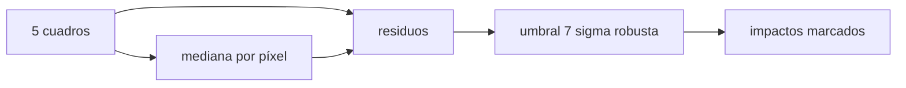

# B44-C16 — Ruido cósmico e identificación

<!-- nav:top -->
[🏠 Programa](../../../../README.md) · [📚 Bloque B44](../../../tronco-comun/B44-detectores-y-adquisicion-astronomica.md) · [← Anterior: B44-C15 — Píxeles defectuosos](../B44-C15-pixeles-defectuosos/CLASE.md) · [Siguiente: B44-C17 — Escala de imagen y muestreo →](../B44-C17-escala-de-imagen-y-muestreo/CLASE.md)
<!-- /nav -->

## 1. Ubicación, nivel y alcance

Clase 16 del bloque B44. Nivel N3. Los **rayos cósmicos** depositan carga en pocos píxeles de un cuadro y no se repiten en el siguiente. Aquí los detectas comparando cada cuadro con la **mediana de una pila de cinco** y calculas la **probabilidad de coincidencia** en el mismo píxel. Usas [B44-C11](../B44-C11-tiempo-de-exposicion/CLASE.md), [B44-C15](../B44-C15-pixeles-defectuosos/CLASE.md) y [B12](../../../tronco-comun/B12-probabilidad-estadistica-e-incertidumbre.md). La tasa de impactos es ilustrativa y no describe ningún sitio ni sensor.

## 2. Por qué esta clase existe

Un impacto fuerte parece una estrella o un defecto. La decisión central: **¿cuántos cuadros hacen falta para identificar los impactos y cuándo falla la mediana?**

## 3. Lo que podrás hacer al terminar

1. Simular impactos independientes en una pila.
2. Detectarlos con la mediana y una sigma robusta.
3. Contar falsos positivos.
4. Calcular la probabilidad de coincidencias.
5. Comparar la media y la mediana del apilado.
6. Reconocer los límites del método.

La evidencia es la **ficha de los rayos cósmicos** del ejercicio 12 (sección 20).

## 4. Con qué llegas y cómo comprobarlo

1. ¿Qué es una incertidumbre?
2. ¿Qué es una simulación Monte Carlo?
3. ¿Qué es una tabla de resultados?
4. ¿Qué es un valor ilustrativo?
5. ¿Qué es una verificación?

<details>
<summary>Ver respuestas</summary>

1. Un intervalo en que se espera el valor verdadero. 2. Repetir con números aleatorios de semilla fija. 3. Un resumen ordenado de cálculos. 4. Un valor propuesto para el ejemplo, no medido. 5. Comparar un cálculo con un caso independiente.
</details>

Con cuatro o cinco aciertos, sigue; si no, repasa los prerrequisitos.

## 5. Un caso de contexto y casos de referencia

Con `5` cuadros de `100 × 100`, probabilidad `0,01` por píxel y cuadro, y `+500 e⁻` por impacto, se inyectan `540` impactos (esperados `500`); todos se detectan sin falsos positivos y `13` píxeles reciben dos impactos (esperados `9,80`). Es el **ejemplo conductor**. Todo es **sintético**.

## 6. Vocabulario

El **rayo cósmico** es una partícula que deposita carga en el detector. La **pila** son varios cuadros del mismo campo. La **mediana de la pila** ignora valores atípicos si menos de la mitad de los cuadros los tienen. La **coincidencia** es un impacto en el mismo píxel de dos cuadros.

## 7. Modelo mental: votar entre cinco testigos

Si cinco testigos describen una escena y uno cuenta algo distinto, se descarta; si tres coinciden en el mismo detalle falso, se acepta por error.



*Descripción textual:* la mediana de la pila da el valor esperado por píxel; los residuos grandes se marcan como impactos.

Analogía: votar entre cinco testigos. Límite: impactos de un solo píxel e independientes, sin trazas extendidas.

## 8. La explicación, paso a paso

### 8.1 Detección

Impactos inyectados `540` (esperados `500`). La sigma robusta de los residuos es `3,686 e⁻` (menor que el ruido de `5 e⁻` porque la mediana sigue al propio cuadro); con el umbral de `7σ = 25,8 e⁻`, los `540` impactos en píxeles con dos impactos o menos se detectan y los falsos positivos son `0`.

### 8.2 Coincidencias

| Cantidad | Observado | Esperado |
|---|---|---|
| Píxeles con ≥ 2 impactos | 13 | 9,80 |
| Píxeles con ≥ 3 impactos | 0 | 0,098 |

### 8.3 Apilado

El nivel apilado por **media** es `105,351 e⁻` (sesgo `+5,351`, esperado `+5,0`); por **mediana**, `100,019 e⁻`.

### 8.4 Lectura

La mediana de cinco cuadros tolera dos impactos en el mismo píxel, pero no tres. La media arrastra el sesgo `p × 500` en todo el campo. Con una probabilidad mayor habría que usar más cuadros.

## 9. Magnitudes, símbolos y unidades

| Símbolo | Qué es | Unidad | Valor / nota |
|---|---|---|---|
| `p` | probabilidad de impacto | — | 0,01 (ilustrativa) |
| impacto | carga depositada | e⁻ | 500 (ilustrativa) |
| `K` | cuadros de la pila | — | 5 |

## 10. Convenciones y referencias

Cuadros sintéticos; ruido de `5 e⁻`; sin trazas extendidas; semilla `20261109`.

## 11. De dónde sale lo que afirmamos

| ID | Fuente | Localizador | Respalda | Estado |
|---|---|---|---|---|
| — | Sin fuente externa | — | relaciones estándar que verifica el laboratorio | No se consultó una fuente para esta clase |

Límites: no se consultó una fuente; la tasa de impactos es ilustrativa.

## 12. Cómo ver las coincidencias

| Impactos por píxel | Observado | Esperado |
|---|---|---|
| 2 o más | 13 | 9,80 |
| 3 o más | 0 | 0,098 |

Descripción larga: los píxeles con tres impactos son rarísimos.

## 13. Ejemplo trabajado: píxeles con dos o más impactos

**Paso 1 · Complemento.** `1 − 0,99⁵ = 0,04901`.

**Paso 2 · Un impacto.** `5 × 0,01 × 0,99⁴ = 0,04803`.

**Paso 3 · Resultado.** `0,00098 × 10 000 = 9,80`.

## 14. Distintas formas de describir un impacto

**Por residuo:** valor menos mediana. **Por umbral:** `7σ_rob`. **Por coincidencia:** binomial. **Por apilado:** media o mediana.

## 15. Práctica guiada

**Ejercicio 1 · con los pasos indicados.** Impactos esperados. *Pasos:* `100 × 100 × 5 × 0,01`.

<details><summary>Solución comentada</summary>

`500`.
</details>

**Ejercicio 2 · con una pista.** Probabilidad de ≥ 2 impactos en un píxel. *Pista:* ejemplo 13.

<details><summary>Solución comentada</summary>

`9,8 × 10⁻⁴`.
</details>

**Ejercicio 3 · casi autónomo.** Píxeles esperados con ≥ 2 impactos. *Pasos:* `× 10 000`.

<details><summary>Solución comentada</summary>

`9,80`.
</details>

## 16. Práctica autónoma, transferencia e integrador

**Ejercicio 4.** Umbral con `σ_rob = 3,686`.

<details><summary>Solución comentada</summary>

`7 × 3,686 = 25,8 e⁻`.
</details>

**Ejercicio 5.** Sesgo de la media apilada.

<details><summary>Solución comentada</summary>

`0,01 × 500 = +5 e⁻`.
</details>

**Ejercicio 6.** ¿Se detecta un impacto de `500 e⁻`?

<details><summary>Solución comentada</summary>

Sí: `500 ≫ 25,8`.
</details>

**Ejercicio 7.** Probabilidad de ≥ 3 impactos.

<details><summary>Solución comentada</summary>

`≈ 9,85 × 10⁻⁶`, es decir `0,098` píxeles.
</details>

**Ejercicio 8.** ¿Qué hace la mediana si 3 de 5 cuadros tienen impacto?

<details><summary>Solución comentada</summary>

Toma un valor impactado y no marca el píxel.
</details>

**Ejercicio 9 · transferencia.** **Transferencia.** ¿Cómo cambia la detección con `p = 0,05`?

<details><summary>Solución comentada</summary>

Más coincidencias: conviene más cuadros.
</details>

**Ejercicio 10 · transferencia.** **Transferencia.** ¿Por qué no basta un solo cuadro?

<details><summary>Solución comentada</summary>

Un impacto es indistinguible de una estrella débil.
</details>

**Ejercicio 11 · transferencia.** **Transferencia.** ¿Qué fallos tiene un impacto extendido?

<details><summary>Solución comentada</summary>

No cae en un píxel: hay que enmascarar vecinos.
</details>

**Ejercicio 12.** **Integrador.** Elabora tu *ficha de los rayos cósmicos*: detección y coincidencias.

<details><summary>Solución comentada</summary>

Secciones 8.1–8.4.
</details>

**Ejercicio 12 · integrador.** **Integrador.** Elabora tu *ficha de los rayos cósmicos*: detección y coincidencias.

<details><summary>Solución modelo</summary>

Secciones 8.1–8.4.
</details>

## 17. Laboratorio: rechazo con pila de cuadros

El script [rayos.py](rayos.py) inyecta impactos en cinco cuadros, los detecta con la mediana y cuenta coincidencias (**comprueba** que se detectan todos los de píxeles con dos impactos o menos y las coincidencias a 4σ).

**Datos:** sin constantes; cuadros e impactos **sintéticos**; semilla `20261109`. **Predice antes de ejecutar:** ¿cuántos falsos positivos con umbral 7σ? (0.) **Ejecución del 2026-11-09 (Python 3.12.9):**

```text
Python 3.12.9 (biblioteca estandar)
impactos inyectados: 540 (esperados 500)
sigma robusta de los residuos: 3.686 e- (ruido del cuadro 5.000; los residuos respecto de la mediana son menores porque la mediana sigue al propio cuadro)
impactos en pixeles con <= 2 impactos: 540 ; detectados 540 ; falsos positivos 0
pixeles con >= 2 impactos: observados 13, esperados 9.80 ; con >= 3: observados 0
nivel apilado: media 105.351 e- (sesgo +5.351; esperado +5.0) ; mediana 100.019 e-
Pruebas superadas.
```

```bash
python programa/clases/B44/B44-C16-ruido-cosmico-e-identificacion/rayos.py
```

**Límites:** impactos puntuales; sin trazas.

## 18. Errores frecuentes y cómo corregirlos

**Apilar con la media sin rechazar.** Se corrige con 8.3.

**Olvidar las coincidencias.** Se corrige con 8.2.

**Un umbral demasiado bajo.** Se corrige con 8.1.

**Tomar la tasa por real.** Se corrige con la sección 10.

## 19. Cómo sabrás que vas bien

Tras la sección 8: ¿qué resultado esperabas y cuál obtuviste? Si dudas, repasa el ejemplo 13. Tras el laboratorio: ¿qué comprueba? (ver la sección 17).

## 20. Qué entregas y cómo se evalúa

El producto es tu **ficha de los rayos cósmicos** (ejercicio 12).

| Criterio | Inicial | En desarrollo | Logrado | Destacado |
|---|---|---|---|---|
| Conceptos | Los confunde | Parciales | conceptos de la clase | Explica los límites |
| Cálculo | Sin unidades | Con errores | Tablas completas | Calcula casos nuevos |
| Numérico | Sin comprobar | Un caso | Contraste con el análisis | Interpreta las diferencias |
| Fuentes | Sin fuente | Sin fecha | fuentes con fecha | Declara lo ilustrativo |
| Límites | No los nombra | Uno | Tres | Discute qué falta del modelo |

**Condiciones críticas (no se compensan con promedio):** rotular lo sintético; no extrapolar la tasa a un sitio real.

## 21. Ética, seguridad y límites

Clase educativa: los modelos son simplificados. Accesibilidad: tablas equivalentes a las gráficas, fórmulas en texto, ejercicios sin conexión.

## 22. Para cerrar y seguir

Con 5 cuadros se detectan los `540` impactos y la mediana limpia el apilado (`100,02 e⁻`). Queda una pregunta: ¿qué tamaño de píxel muestrea correctamente la imagen?

**Glosario español–inglés.** rayo cósmico · *cosmic ray*; pila · *stack*; coincidencia · *coincidence*; mediana · *median*; impacto · *hit*.

**Continuidad.** [B44-C17](../B44-C17-escala-de-imagen-y-muestreo/CLASE.md) estudia la escala y el muestreo.

**Referencias:** ver sección 11.

<!-- nav:bottom -->
---

[← Anterior: B44-C15 — Píxeles defectuosos](../B44-C15-pixeles-defectuosos/CLASE.md) · [📚 Bloque B44](../../../tronco-comun/B44-detectores-y-adquisicion-astronomica.md) · [Siguiente: B44-C17 — Escala de imagen y muestreo →](../B44-C17-escala-de-imagen-y-muestreo/CLASE.md)
<!-- /nav -->
