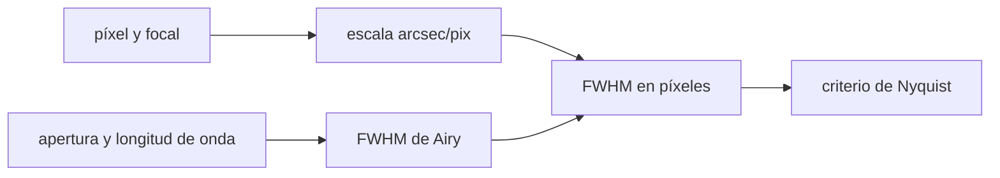

# B44-C17 — Escala de imagen y muestreo

<!-- nav:top -->
<!-- /nav -->

## 1. Ubicación, nivel y alcance

Clase 17 del bloque B44. Nivel N3. La **escala de placa** convierte píxeles en segundos de arco y el **muestreo** decide si la imagen conserva el detalle. Aquí calculas la escala, el **ancho del disco de Airy** y el efecto del tamaño del píxel en la **medida del ancho y la posición** de una estrella. Usas [B44-C05](../B44-C05-pozo-lleno-y-rango-dinamico/CLASE.md) y [B05](../../../tronco-comun/B05-fisica-fundamental-para-el-espacio.md). El telescopio y la cámara son ilustrativos.

## 2. Por qué esta clase existe

Un píxel demasiado grande pierde detalle y uno demasiado pequeño reparte la luz y sube el ruido. La decisión central: **¿cuántos píxeles por ancho de la imagen estelar son suficientes?**

## 3. Lo que podrás hacer al terminar

1. Calcular la escala de placa por dos vías.
2. Calcular el FWHM de Airy numéricamente.
3. Clasificar el muestreo con el criterio de Nyquist.
4. Medir el centroide con distintos muestreos.
5. Calcular el ensanchamiento de `1/12` por el pixel.
6. Reconocer los límites del modelo.

La evidencia es la **ficha de la escala y el muestreo** del ejercicio 12 (sección 20).

## 4. Con qué llegas y cómo comprobarlo

1. ¿Qué es una incertidumbre?
2. ¿Qué es una simulación Monte Carlo?
3. ¿Qué es una tabla de resultados?
4. ¿Qué es un valor ilustrativo?
5. ¿Qué es una verificación?

<details>
<summary>Ver respuestas</summary>

1. Un intervalo en que se espera el valor verdadero. 2. Repetir con números aleatorios de semilla fija. 3. Un resumen ordenado de cálculos. 4. Un valor propuesto para el ejemplo, no medido. 5. Comparar un cálculo con un caso independiente.
</details>

Con cuatro o cinco aciertos, sigue; si no, repasa los prerrequisitos.

## 5. Un caso de contexto y casos de referencia

Con `D = 0,5 m`, `f = 4000 mm`, píxel de `9 µm` y `550 nm`, la escala es `0,46410 ″/pix` y el FWHM de Airy `0,23347″` (`0,50 px`, submuestreado). Un seeing de `1,5″` ocupa `3,23 px`. Es el **ejemplo conductor**. Todo es **ilustrativo**.

## 6. Vocabulario

La **escala de placa** es `206 264,806 p/f` en segundos de arco por píxel. El **disco de Airy** es la imagen de una fuente puntual de una apertura circular, con FWHM `1,029 λ/D`. El **muestreo de Nyquist** pide al menos `2` píxeles por FWHM. El **seeing** es el ancho de la imagen por turbulencia.

## 7. Modelo mental: una cuadrícula sobre un dibujo

Para copiar un dibujo con una cuadrícula, los cuadros deben ser mucho menores que los rasgos más finos; si no, pierdes detalle.



*Descripción textual:* la escala convierte los anchos angulares en píxeles; el cociente se compara con 2 para clasificar el muestreo.

Analogía: una cuadrícula sobre un dibujo. Límite: PSF gaussiana y ruido gaussiano.

## 8. La explicación, paso a paso

### 8.1 Escala y Airy

Escala `206 264,806 × 9×10⁻⁶ / 4 = 0,46410″/pix` (con `atan` coincide a `10⁻⁸`). El FWHM de Airy, hallado numéricamente con `J₁` como la raíz de `(2J₁(x)/x)² = 0,5`, es `0,23347″`, igual a `1,029 λ/D`.

### 8.2 Muestreo

| Seeing (″) | FWHM (px) | Clase |
|---|---|---|
| 0,6 | 1,29 | submuestreado |
| 1,5 | 3,23 | adecuado |
| 3,0 | 6,46 | adecuado |
| 6,0 | 12,93 | adecuado |

### 8.3 Centroide y ancho (semilla 20261109)

| FWHM (px) | Sesgo en x (px) | Error rms (px) | `σ` medida/verdadera | Analítico |
|---|---|---|---|---|
| 1,0 | −0,0092 | 0,0103 | 1,2092 | 1,2092 |
| 2,0 | −0,0006 | 0,0069 | 1,0562 | 1,0562 |
| 3,0 | −0,0002 | 0,0094 | 1,0254 | 1,0254 |

### 8.4 Lectura

El centroide con fotones suficientes es insesgado aunque el muestreo sea pobre; pero el **ancho** medido por momentos crece como `√(1 + 1/(12σ²))`: `21 %` con FWHM de `1 px` y `2,5 %` con `3 px`.

## 9. Magnitudes, símbolos y unidades

| Símbolo | Qué es | Unidad | Valor / nota |
|---|---|---|---|
| escala | segundos de arco por píxel | ″/pix | 0,46410 |
| FWHM de Airy | `1,029 λ/D` | ″ | 0,23347 |
| `σ` | ancho gaussiano | px | FWHM/2,3548 |

## 10. Convenciones y referencias

Definición `1 rad = 648 000/π ″` (exacta); telescopio, cámara y seeing **ilustrativos**; semilla `20261109`.

## 11. De dónde sale lo que afirmamos

| ID | Fuente | Localizador | Respalda | Estado |
|---|---|---|---|---|
| — | Sin fuente externa | — | relaciones estándar que verifica el laboratorio | No se consultó una fuente para esta clase |

Límites: no se consultó una fuente; `J₁` se calculó por serie; el telescopio no existe.

## 12. Cómo ver el muestreo por seeing

| Seeing (″) | FWHM (px) |
|---|---|
| 0,6 | 1,29 |
| 1,5 | 3,23 |
| 6,0 | 12,93 |

Descripción larga: el FWHM en píxeles crece en proporción al seeing.

## 13. Ejemplo trabajado: escala de placa

**Paso 1 · Cociente.** `p/f = 9×10⁻⁶ / 4 = 2,25×10⁻⁶ rad`.

**Paso 2 · Conversión.** `× 206 264,806`.

**Paso 3 · Resultado.** `0,46410″/pix`.

## 14. Distintas formas de describir el muestreo

**Por escala:** ″/pix. **Por FWHM:** píxeles. **Por Nyquist:** ≥ 2. **Por efecto:** `√(1 + 1/(12σ²))`.

## 15. Práctica guiada

**Ejercicio 1 · con los pasos indicados.** Escala con `p = 9 µm` y `f = 4 m`. *Pasos:* ejemplo 13.

<details><summary>Solución comentada</summary>

`0,46410″/pix`.
</details>

**Ejercicio 2 · con una pista.** Focal para `0,2″/pix` con `9 µm`. *Pista:* invierte la fórmula.

<details><summary>Solución comentada</summary>

`206 264,8 × 9×10⁻⁶/0,2 = 9,28 m`.
</details>

**Ejercicio 3 · casi autónomo.** FWHM en píxeles de un seeing de `1,5″`. *Pasos:* cociente.

<details><summary>Solución comentada</summary>

`3,23`.
</details>

## 16. Práctica autónoma, transferencia e integrador

**Ejercicio 4.** Mayor píxel que muestrea Nyquist un seeing de `1,5″`.

<details><summary>Solución comentada</summary>

`0,75″/pix`.
</details>

**Ejercicio 5.** FWHM de Airy en píxeles.

<details><summary>Solución comentada</summary>

`0,23347/0,46410 = 0,50`: submuestreado.
</details>

**Ejercicio 6.** Píxel (µm) que muestrearía Airy con `f = 4 m`.

<details><summary>Solución comentada</summary>

`0,117″ → 2,26 µm`.
</details>

**Ejercicio 7.** Ensanchamiento para `σ = 0,4247 px`.

<details><summary>Solución comentada</summary>

`√(1 + 1/(12·0,1804)) = 1,209`.
</details>

**Ejercicio 8.** Ensanchamiento para `σ = 1,274 px`.

<details><summary>Solución comentada</summary>

`1,025`.
</details>

**Ejercicio 9 · transferencia.** **Transferencia.** ¿Por qué un seeing mejor exige píxeles más pequeños?

<details><summary>Solución comentada</summary>

Para mantener 2 píxeles por FWHM.
</details>

**Ejercicio 10 · transferencia.** **Transferencia.** ¿Qué pierde un sensor submuestreado?

<details><summary>Solución comentada</summary>

Detalle y precisión del ancho; el centroide con muchos fotones sigue bien.
</details>

**Ejercicio 11 · transferencia.** **Transferencia.** ¿Por qué no usar píxeles diminutos siempre?

<details><summary>Solución comentada</summary>

Reparten la luz y suben el ruido de lectura por fotón.
</details>

**Ejercicio 12.** **Integrador.** Elabora tu *ficha de la escala y el muestreo*: escala, Airy y ensanchamiento.

<details><summary>Solución comentada</summary>

Secciones 8.1–8.4.
</details>

**Ejercicio 12 · integrador.** **Integrador.** Elabora tu *ficha de la escala y el muestreo*: escala, Airy y ensanchamiento.

<details><summary>Solución modelo</summary>

Secciones 8.1–8.4.
</details>

## 17. Laboratorio: escala, Airy y muestreo

El script [muestreo.py](muestreo.py) calcula la escala por dos vías, el FWHM de Airy con `J₁` y el centroide y el ancho medidos con distintos muestreos (**comprueba** la escala a `10⁻⁸`, Airy al 0,5 % y el ensanchamiento al 1 %).

**Datos:** sin constantes medidas; apertura, focal, píxel y seeing **ilustrativos**; semilla `20261109`. **Predice antes de ejecutar:** ¿qué escala tiene? (0,46410″/pix.) **Ejecución del 2026-11-09 (Python 3.12.9):**

```text
Python 3.12.9 (biblioteca estandar)
escala de placa: 0.46410 arcsec/pix (definicion) ; 0.46410 (atan) 
FWHM de Airy: numerico 0.23347 arcsec ; 1.029 lambda/D = 0.23347 arcsec
 seeing [arcsec]  FWHM [pix]   muestreo
             0.6        1.29 sub-Nyquist
             1.5        3.23   adecuado
             3.0        6.46   adecuado
             6.0       12.93   adecuado
 FWHM [pix]  sesgo x [pix]  error rms [pix]  sigma med/ver  analitico
        1.0        -0.0092           0.0103         1.2092     1.2092
        2.0        -0.0006           0.0069         1.0562     1.0562
        3.0        -0.0002           0.0094         1.0254     1.0254
Pruebas superadas.
```

```bash
python programa/clases/B44/B44-C17-escala-de-imagen-y-muestreo/muestreo.py
```

**Límites:** PSF gaussiana; sin aberraciones.

## 18. Errores frecuentes y cómo corregirlos

**Confundir FWHM con sigma.** Se corrige con el ejercicio 7.

**Olvidar convertir radianes a segundos de arco.** Se corrige con 8.1.

**Aplicar Nyquist al seeing sin la escala.** Se corrige con 8.2.

**Presentar el telescopio como real.** Se corrige con la sección 10.

## 19. Cómo sabrás que vas bien

Tras la sección 8: ¿qué resultado esperabas y cuál obtuviste? Si dudas, repasa el ejemplo 13. Tras el laboratorio: ¿qué comprueba? (ver la sección 17).

## 20. Qué entregas y cómo se evalúa

El producto es tu **ficha de la escala y el muestreo** (ejercicio 12).

| Criterio | Inicial | En desarrollo | Logrado | Destacado |
|---|---|---|---|---|
| Conceptos | Los confunde | Parciales | conceptos de la clase | Explica los límites |
| Cálculo | Sin unidades | Con errores | Tablas completas | Calcula casos nuevos |
| Numérico | Sin comprobar | Un caso | Contraste con el análisis | Interpreta las diferencias |
| Fuentes | Sin fuente | Sin fecha | fuentes con fecha | Declara lo ilustrativo |
| Límites | No los nombra | Uno | Tres | Discute qué falta del modelo |

**Condiciones críticas (no se compensan con promedio):** rotular lo ilustrativo; no atribuir cifras a un telescopio real.

## 21. Ética, seguridad y límites

Clase educativa: los modelos son simplificados. Accesibilidad: tablas equivalentes a las gráficas, fórmulas en texto, ejercicios sin conexión.

## 22. Para cerrar y seguir

La escala de `0,464″/pix` muestrea bien un seeing de `1,5″` pero no la imagen de Airy. Queda una pregunta: ¿cómo controla la electrónica la lectura y la digitalización?

**Glosario español–inglés.** escala de placa · *plate scale*; disco de Airy · *Airy disk*; muestreo · *sampling*; seeing · *seeing*; centroide · *centroid*.

**Continuidad.** [B44-C18](../B44-C18-control-electronico-de-camaras/CLASE.md) estudia el control electrónico de la cámara.

**Referencias:** ver sección 11.

<!-- nav:bottom -->
---

<!-- /nav -->
