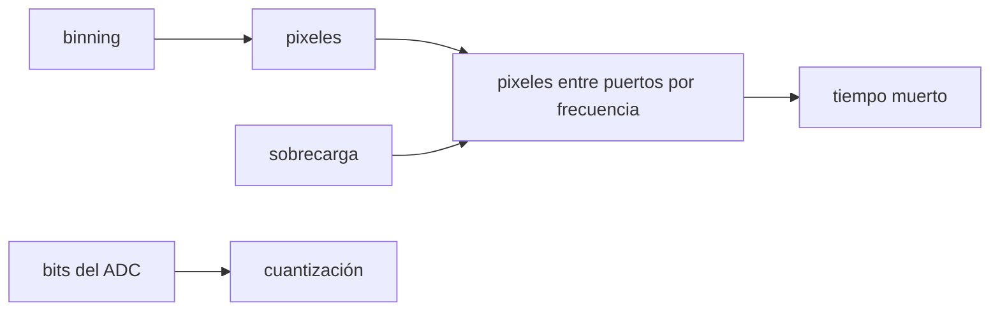

# B44-C18 — Control electrónico de cámaras

<!-- nav:top -->
<!-- /nav -->

## 1. Ubicación, nivel y alcance

Clase 18 del bloque B44. Nivel N3. La electrónica de la cámara fija **cuánto tarda la lectura**, **cuánto tiempo muerto** queda y cuánto ruido añade la **digitalización**. Aquí calculas tiempos de lectura con y sin **binning**, la **cuantización** de distintos ADC y el ruido del binning en el chip frente al binning por programa. Usas [B44-C05](../B44-C05-pozo-lleno-y-rango-dinamico/CLASE.md) y [B44-C06](../B44-C06-ruido-de-lectura/CLASE.md). La cámara es ilustrativa.

## 2. Por qué esta clase existe

Leer lento reduce ruido pero desperdicia tiempo de observación. La decisión central: **¿qué modo de lectura equilibra ruido y tiempo muerto?**

## 3. Lo que podrás hacer al terminar

1. Calcular el tiempo de lectura de un sensor multipuerto.
2. Calcular el tiempo muerto.
3. Calcular la cuantización de un ADC.
4. Comparar binning en el chip y por programa.
5. Elegir los bits del ADC.
6. Reconocer los supuestos del modelo.

La evidencia es la **ficha de la electrónica de la cámara** del ejercicio 12 (sección 20).

## 4. Con qué llegas y cómo comprobarlo

1. ¿Qué es una incertidumbre?
2. ¿Qué es una simulación Monte Carlo?
3. ¿Qué es una tabla de resultados?
4. ¿Qué es un valor ilustrativo?
5. ¿Qué es una verificación?

<details>
<summary>Ver respuestas</summary>

1. Un intervalo en que se espera el valor verdadero. 2. Repetir con números aleatorios de semilla fija. 3. Un resumen ordenado de cálculos. 4. Un valor propuesto para el ejemplo, no medido. 5. Comparar un cálculo con un caso independiente.
</details>

Con cuatro o cinco aciertos, sigue; si no, repasa los prerrequisitos.

## 5. Un caso de contexto y casos de referencia

Un sensor de `4096 × 4096` con `4` puertos a `1 MHz` y `0,5 s` de sobrecarga se lee en `4,6943 s`: `7,26 %` de tiempo muerto con exposiciones de `60 s`. Con binning `2 × 2`, `1,5486 s`. Es el **ejemplo conductor**. Todo es **ilustrativo**.

## 6. Vocabulario

Un **puerto** es un amplificador de salida independiente. El **ADC** convierte voltaje en cuentas con `b` bits. El **binning** suma píxeles vecinos. El **tiempo muerto** es el que no se expone. La **sobrecarga** es el tiempo fijo por cuadro.

## 7. Modelo mental: un cajero con varias ventanillas

Más ventanillas atienden más rápido; pero cada cliente (píxel) tarda lo mismo y siempre hay un trámite fijo al comienzo.



*Descripción textual:* el número de píxeles, los puertos y la frecuencia fijan el tiempo de lectura; este y la exposición dan el tiempo muerto.

Analogía: un cajero con varias ventanillas. Límite: la sobrecarga no depende del binning y el ruido de lectura no depende de la velocidad.

## 8. La explicación, paso a paso

### 8.1 Lectura

| Binning | Píxeles | Lectura (s) | Fórmula (s) | Muerto con 60 s (%) |
|---|---|---|---|---|
| 1 | 16 777 216 | 4,6943 | 4,6943 | 7,26 |
| 2 | 4 194 304 | 1,5486 | 1,5486 | 2,52 |
| 4 | 1 048 576 | 0,7621 | 0,7621 | 1,25 |

### 8.2 ADC

Con pozo de `100 000 e⁻`:

| Bits | Ganancia (e⁻/ADU) | Cuantización (e⁻) |
|---|---|---|
| 8 | 392,157 | 113,206 |
| 12 | 24,420 | 7,049 |
| 16 | 1,526 | 0,440 |

Con 16 bits la cuantización (`0,4405 e⁻`) agrega un `0,6 %` a un ruido de lectura de `4 e⁻`.

### 8.3 Binning (40 000 pixeles simulados, semilla 20261109)

Binning `2 × 2` en el chip: ruido `4,002 e⁻` (una lectura); por programa: `7,966 e⁻` (cuatro lecturas, esperado `8`).

### 8.4 Lectura

El binning reduce el tiempo de lectura y, en el chip, el ruido relativo; por programa se paga `2 RN`. Un ADC de 12 bits (`7,05 e⁻`) con este pozo supera al ruido de lectura de `4 e⁻`.

## 9. Magnitudes, símbolos y unidades

| Símbolo | Qué es | Unidad | Valor / nota |
|---|---|---|---|
| puertos | salidas simultáneas | — | 4 |
| `f` | frecuencia por puerto | MHz | 1 |
| `g` | ganancia | e⁻/ADU | 1,526 (16 bits) |

## 10. Convenciones y referencias

Cámara **ilustrativa**; el tiempo de lectura se cuenta con un bucle de ciclos y se compara con la fórmula; semilla `20261109`.

## 11. De dónde sale lo que afirmamos

| ID | Fuente | Localizador | Respalda | Estado |
|---|---|---|---|---|
| — | Sin fuente externa | — | relaciones estándar que verifica el laboratorio | No se consultó una fuente para esta clase |

Límites: no se consultó una fuente; la cámara no existe.

## 12. Cómo ver el tiempo muerto

| Binning | Lectura (s) | Muerto (%) |
|---|---|---|
| 1 | 4,6943 | 7,26 |
| 2 | 1,5486 | 2,52 |
| 4 | 0,7621 | 1,25 |

Descripción larga: el tiempo muerto cae con el binning.

## 13. Ejemplo trabajado: tiempo de lectura sin binning

**Paso 1 · Píxeles.** `4096² = 16 777 216`.

**Paso 2 · Ciclos.** `÷ (4 × 10⁶ /s) = 4,1943 s`.

**Paso 3 · Sobrecarga.** `+ 0,5 = 4,6943 s`.

## 14. Distintas formas de describir la lectura

**Por tiempo:** píxeles/(puertos·f) + sobrecarga. **Por fracción:** muerto. **Por bits:** cuantización. **Por binning:** una o cuatro lecturas.

## 15. Práctica guiada

**Ejercicio 1 · con los pasos indicados.** Tiempo de lectura sin binning. *Pasos:* ejemplo 13.

<details><summary>Solución comentada</summary>

`4,6943 s`.
</details>

**Ejercicio 2 · con una pista.** Tiempo muerto con exposiciones de `60 s`. *Pista:* `t/(60 + t)`.

<details><summary>Solución comentada</summary>

`7,26 %`.
</details>

**Ejercicio 3 · casi autónomo.** Lectura con binning `2 × 2`. *Pasos:* píxeles / 4.

<details><summary>Solución comentada</summary>

`1,0486 + 0,5 = 1,5486 s`.
</details>

## 16. Práctica autónoma, transferencia e integrador

**Ejercicio 4.** Cuantización de 16 bits.

<details><summary>Solución comentada</summary>

`1,526/√12 = 0,4405 e⁻`.
</details>

**Ejercicio 5.** Efecto relativo en `RN = 4 e⁻`.

<details><summary>Solución comentada</summary>

`√(16 + 0,194)/4 − 1 = 0,006`.
</details>

**Ejercicio 6.** ¿Y con 12 bits?

<details><summary>Solución comentada</summary>

`7,049 e⁻`, superior al ruido de lectura.
</details>

**Ejercicio 7.** Ruido del binning por programa.

<details><summary>Solución comentada</summary>

`4 × 2 = 8 e⁻`.
</details>

**Ejercicio 8.** Lectura con 8 puertos.

<details><summary>Solución comentada</summary>

`16 777 216/(8·10⁶) + 0,5 = 2,597 s`.
</details>

**Ejercicio 9 · transferencia.** **Transferencia.** ¿Cuándo conviene lectura lenta?

<details><summary>Solución comentada</summary>

Si la señal es débil y el ruido de lectura domina.
</details>

**Ejercicio 10 · transferencia.** **Transferencia.** ¿Por qué el binning en el chip es mejor que por programa?

<details><summary>Solución comentada</summary>

Una sola lectura de ruido.
</details>

**Ejercicio 11 · transferencia.** **Transferencia.** ¿Qué pierde el binning?

<details><summary>Solución comentada</summary>

Resolución espacial.
</details>

**Ejercicio 12.** **Integrador.** Elabora tu *ficha de la electrónica de la cámara*: lectura, ADC y binning.

<details><summary>Solución comentada</summary>

Secciones 8.1–8.4.
</details>

**Ejercicio 12 · integrador.** **Integrador.** Elabora tu *ficha de la electrónica de la cámara*: lectura, ADC y binning.

<details><summary>Solución modelo</summary>

Secciones 8.1–8.4.
</details>

## 17. Laboratorio: lectura, ADC y binning

El script [control.py](control.py) calcula tiempos de lectura por bucle y fórmula, la cuantización de varios ADC y el ruido del binning (**comprueba** el tiempo a `10⁻⁹ s` y el ruido simulado al 3 %).

**Datos:** sin constantes; cámara **ilustrativa**; semilla `20261109`. **Predice antes de ejecutar:** ¿cuánto tarda la lectura sin binning? (4,6943 s.) **Ejecución del 2026-11-09 (Python 3.12.9):**

```text
Python 3.12.9 (biblioteca estandar)
 binning    pixeles  t lectura [s]  formula [s]  muerto (60 s) [%]
       1   16777216         4.6943       4.6943               7.26
       2    4194304         1.5486       1.5486               2.52
       4    1048576         0.7621       0.7621               1.25
ganancia 1.5259 e-/ADU ; ruido de cuantizacion 0.4405 e- frente a 4 e- de lectura (efecto relativo 0.00605)
  ADC de  8 bits:   392.157 e-/ADU ; cuantizacion  113.206 e-
  ADC de 12 bits:    24.420 e-/ADU ; cuantizacion    7.049 e-
  ADC de 16 bits:     1.526 e-/ADU ; cuantizacion    0.440 e-
binning 2x2 en el chip: ruido 4.002 e- ; por programa: 7.966 e- (esperados 4.000 y 8.000)
Pruebas superadas.
```

```bash
python programa/clases/B44/B44-C18-control-electronico-de-camaras/control.py
```

**Límites:** ruido independiente de la velocidad; sobrecarga constante.

## 18. Errores frecuentes y cómo corregirlos

**Olvidar la sobrecarga.** Se corrige con 8.1.

**Elegir pocos bits.** Se corrige con 8.2.

**Sumar píxeles por programa creyendo igual ruido.** Se corrige con 8.3.

**Tomar la cámara por real.** Se corrige con la sección 10.

## 19. Cómo sabrás que vas bien

Tras la sección 8: ¿qué resultado esperabas y cuál obtuviste? Si dudas, repasa el ejemplo 13. Tras el laboratorio: ¿qué comprueba? (ver la sección 17).

## 20. Qué entregas y cómo se evalúa

El producto es tu **ficha de la electrónica de la cámara** (ejercicio 12).

| Criterio | Inicial | En desarrollo | Logrado | Destacado |
|---|---|---|---|---|
| Conceptos | Los confunde | Parciales | conceptos de la clase | Explica los límites |
| Cálculo | Sin unidades | Con errores | Tablas completas | Calcula casos nuevos |
| Numérico | Sin comprobar | Un caso | Contraste con el análisis | Interpreta las diferencias |
| Fuentes | Sin fuente | Sin fecha | fuentes con fecha | Declara lo ilustrativo |
| Límites | No los nombra | Uno | Tres | Discute qué falta del modelo |

**Condiciones críticas (no se compensan con promedio):** rotular lo ilustrativo; no atribuir tiempos a una cámara real.

## 21. Ética, seguridad y límites

Clase educativa: los modelos son simplificados. Accesibilidad: tablas equivalentes a las gráficas, fórmulas en texto, ejercicios sin conexión.

## 22. Para cerrar y seguir

La lectura de `4,69 s` cuesta un `7,26 %` de tiempo muerto; con binning `2 × 2`, `2,5 %`. Queda una pregunta: ¿cómo se guardan los cuadros con sus metadatos?

**Glosario español–inglés.** puerto · *port*; binning · *binning*; tiempo muerto · *dead time*; convertidor analógico-digital · *ADC*; sobrecarga · *overhead*.

**Continuidad.** [B44-C19](../B44-C19-formato-fits-y-metadatos/CLASE.md) estudia el formato FITS y los metadatos.

**Referencias:** ver sección 11.

<!-- nav:bottom -->
---

<!-- /nav -->
