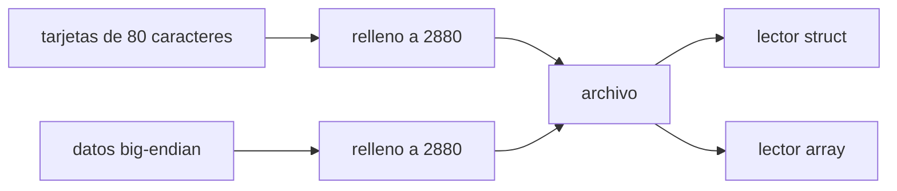

# B44-C19 — Formato FITS y metadatos

<!-- nav:top -->
[🏠 Programa](../../../../README.md) · [📚 Bloque B44](../../../tronco-comun/B44-detectores-y-adquisicion-astronomica.md) · [← Anterior: B44-C18 — Control electrónico de cámaras](../B44-C18-control-electronico-de-camaras/CLASE.md) · [Siguiente: B44-C20 — Pipeline inicial de calibración de imágenes →](../B44-C20-pipeline-inicial-de-calibracion-de-imagenes/CLASE.md)
<!-- /nav -->

## 1. Ubicación, nivel y alcance

Clase 19 del bloque B44. Nivel N3. **FITS** es el formato habitual de las imágenes astronómicas: una cabecera de texto y datos binarios. Aquí escribes una HDU primaria mínima **a mano** y la lees por **dos vías independientes**. Usas [B44-C18](../B44-C18-control-electronico-de-camaras/CLASE.md). Se consultó solo la página de NASA/HEASARC que da la versión vigente; las reglas de formato que usa el laboratorio se **comprueban sobre el archivo propio**, no se citan del estándar.

## 2. Por qué esta clase existe

Un cuadro sin metadatos es un arreglo de números sin contexto. La decisión central: **¿qué debe llevar la cabecera para interpretar los datos?**

## 3. Lo que podrás hacer al terminar

1. Escribir tarjetas de 80 caracteres.
2. Rellenar cabecera y datos a bloques de 2880 bytes.
3. Almacenar enteros sin signo con BZERO.
4. Leer el archivo por dos vías y compararlas.
5. Calcular el tamaño de un archivo.
6. Reconocer lo que el laboratorio no cubre.

La evidencia es la **ficha del formato FITS** del ejercicio 12 (sección 20).

## 4. Con qué llegas y cómo comprobarlo

1. ¿Qué es una incertidumbre?
2. ¿Qué es una simulación Monte Carlo?
3. ¿Qué es una tabla de resultados?
4. ¿Qué es un valor ilustrativo?
5. ¿Qué es una verificación?

<details>
<summary>Ver respuestas</summary>

1. Un intervalo en que se espera el valor verdadero. 2. Repetir con números aleatorios de semilla fija. 3. Un resumen ordenado de cálculos. 4. Un valor propuesto para el ejemplo, no medido. 5. Comparar un cálculo con un caso independiente.
</details>

Con cuatro o cinco aciertos, sigue; si no, repasa los prerrequisitos.

## 5. Un caso de contexto y casos de referencia

Una imagen sintética de `40 × 30` píxeles con `BITPIX = 16` y `BZERO = 32768` ocupa `5760` bytes: `2880` de cabecera y `2880` de datos (`2400` útiles). Dos lectores independientes recuperan los mismos datos. Es el **ejemplo conductor**. Todo es **sintético**.

## 6. Vocabulario

Una **HDU** es una unidad de cabecera y datos. Una **tarjeta** es una línea de 80 caracteres `CLAVE = valor / comentario`. `BITPIX` indica el tipo de dato. `BZERO` y `BSCALE` convierten el valor almacenado en físico: `físico = BZERO + BSCALE × almacenado`. Un **bloque** es un múltiplo de `2880` bytes.

## 7. Modelo mental: una carta con su sobre

La cabecera es el sobre con remitente y fecha; los datos son la carta. Sin el sobre no sabes qué es ni cuándo se escribió.



*Descripción textual:* las tarjetas y los datos se rellenan a bloques y se escriben juntos; dos lectores distintos recuperan los mismos valores.

Analogía: una carta con su sobre. Límite: una sola HDU sin extensiones ni compresión.

## 8. La explicación, paso a paso

### 8.1 Tamaños

Cabecera `2880` bytes; datos `2880` bytes (`40 × 30 × 2 = 2400` rellenados a `2880`); archivo `5760` bytes, `2` bloques.

### 8.2 Lectura por dos vías

Se leen `12` tarjetas antes de `END`: `NAXIS1 = 40`, `NAXIS2 = 30`, `BITPIX = 16`, `EXPTIME = 30,0`. La vía A (`struct`) y la B (`array` con intercambio de bytes) devuelven los datos originales: `True` y `True`.

### 8.3 Enteros sin signo

El primer píxel (valor físico `0`) se almacena como `−32768` y el último (`65535`) como `32767`.

### 8.4 Lectura

La conversión `BZERO = 32768` permite guardar enteros sin signo en un tipo con signo. El relleno a bloques explica por qué un archivo pequeño ocupa múltiplos de `2880`.

## 9. Magnitudes, símbolos y unidades

| Símbolo | Qué es | Unidad | Valor / nota |
|---|---|---|---|
| `BITPIX` | bits por dato | — | 16 |
| `BZERO` | desplazamiento | — | 32768 |
| bloque | unidad de relleno | bytes | 2880 |

## 10. Convenciones y referencias

Todos los valores de las palabras clave son **ficticios**; el archivo se escribe en un directorio temporal y se borra; semilla `20261109`.

## 11. De dónde sale lo que afirmamos

| ID | Fuente | Localizador | Respalda | Estado |
|---|---|---|---|---|
| S1 | NASA/HEASARC, página del estándar FITS | https://fits.gsfc.nasa.gov/fits_standard.html | la versión vigente del estándar es la 4.0, del 13 de agosto de 2018 | Consultada el 2026-11-09; el documento del estándar no se leyó |

Límites: la fuente solo respalda que la versión vigente es la 4.0; 80 caracteres, 2880 bytes, big-endian y BZERO son conocimiento general comprobado sobre el archivo propio, no una cita del estándar (cuyo documento no se leyó).

## 12. Cómo ver los bloques del archivo

| Parte | Bytes |
|---|---|
| Cabecera | 2880 |
| Datos útiles | 2400 |
| Datos con relleno | 2880 |
| Total | 5760 |

Descripción larga: tanto la cabecera como los datos se rellenan hasta 2880.

## 13. Ejemplo trabajado: tamaño de los datos

**Paso 1 · Píxeles.** `40 × 30 = 1200`.

**Paso 2 · Bytes.** `1200 × 2 = 2400`.

**Paso 3 · Bloque.** `⌈2400/2880⌉ × 2880 = 2880`.

## 14. Distintas formas de describir un cuadro

**Por cabecera:** metadatos. **Por datos:** arreglo binario. **Por tipo:** `BITPIX`. **Por escala:** `BZERO`, `BSCALE`.

## 15. Práctica guiada

**Ejercicio 1 · con los pasos indicados.** Bytes de datos de `40 × 30` con `BITPIX = 16`. *Pasos:* ejemplo 13.

<details><summary>Solución comentada</summary>

`2400`, rellenados a `2880`.
</details>

**Ejercicio 2 · con una pista.** Valor físico de un almacenado `−32768`. *Pista:* `BZERO + valor`.

<details><summary>Solución comentada</summary>

`0`.
</details>

**Ejercicio 3 · casi autónomo.** Valor físico de un almacenado `32767`.

<details><summary>Solución comentada</summary>

`65535`.
</details>

## 16. Práctica autónoma, transferencia e integrador

**Ejercicio 4.** Bloques de datos de `4096 × 4096` con `BITPIX = 16`.

<details><summary>Solución comentada</summary>

`33 554 432/2880 → 11 651` bloques, `33 554 880` bytes.
</details>

**Ejercicio 5.** Tarjetas por bloque de cabecera (80 caracteres).

<details><summary>Solución comentada</summary>

`2880/80 = 36`.
</details>

**Ejercicio 6.** ¿Por qué dos lectores independientes?

<details><summary>Solución comentada</summary>

Para detectar errores de orden de bytes.
</details>

**Ejercicio 7.** ¿Qué pasa si falta `END`?

<details><summary>Solución comentada</summary>

El lector no sabe dónde termina la cabecera.
</details>

**Ejercicio 8.** Tarjetas leídas antes de `END`.

<details><summary>Solución comentada</summary>

`12`.
</details>

**Ejercicio 9 · transferencia.** **Transferencia.** ¿Qué metadatos añadirías para calibrar?

<details><summary>Solución comentada</summary>

Tiempo de exposición, ganancia, temperatura y filtro.
</details>

**Ejercicio 10 · transferencia.** **Transferencia.** ¿Por qué no basta el nombre del archivo?

<details><summary>Solución comentada</summary>

No viaja con los datos ni es verificable.
</details>

**Ejercicio 11 · transferencia.** **Transferencia.** ¿Qué no cubre este laboratorio?

<details><summary>Solución comentada</summary>

Extensiones, compresión, WCS y el estándar completo.
</details>

**Ejercicio 12.** **Integrador.** Elabora tu *ficha del formato FITS*: estructura, tamaño y lectura por dos vías.

<details><summary>Solución comentada</summary>

Secciones 8.1–8.4.
</details>

**Ejercicio 12 · integrador.** **Integrador.** Elabora tu *ficha del formato FITS*: estructura, tamaño y lectura por dos vías.

<details><summary>Solución modelo</summary>

Secciones 8.1–8.4.
</details>

## 17. Laboratorio: escritura y lectura de FITS

El script [fits.py](fits.py) escribe una HDU mínima y la lee con `struct` y con `array` (**comprueba** que el tamaño es múltiplo de 2880 y que ambas vías devuelven los datos).

**Datos:** sin constantes; valores de cabecera y píxeles **ficticios**; página de HEASARC consultada el 2026-11-09 solo para la versión; semilla `20261109`. **Predice antes de ejecutar:** ¿cuántos bytes tendrá el archivo? (5760.) **Ejecución del 2026-11-09 (Python 3.12.9):**

```text
Python 3.12.9 (biblioteca estandar)
cabecera 2880 bytes, datos 2880 bytes, archivo 5760 bytes (2 bloques de 2880)
tarjetas leidas: 12 ; NAXIS1=40 NAXIS2=30 BITPIX=16 EXPTIME=30.0
via A (struct) == datos: True ; via B (array) == datos: True
valor almacenado del primer pixel: -32768 -> fisico 0 ; ultimo: 32767 -> fisico 65535
Pruebas superadas.
```

```bash
python programa/clases/B44/B44-C19-formato-fits-y-metadatos/fits.py
```

**Límites:** una HDU; no es una biblioteca FITS.

## 18. Errores frecuentes y cómo corregirlos

**Olvidar el relleno a 2880.** Se corrige con 8.1.

**Confundir el valor almacenado con el físico.** Se corrige con 8.3.

**Atribuir al estándar lo que no se leyó.** Se corrige con la sección 11.

**Dejar la cabecera sin `END`.** Se corrige con el ejercicio 7.

## 19. Cómo sabrás que vas bien

Tras la sección 8: ¿qué resultado esperabas y cuál obtuviste? Si dudas, repasa el ejemplo 13. Tras el laboratorio: ¿qué comprueba? (ver la sección 17).

## 20. Qué entregas y cómo se evalúa

El producto es tu **ficha del formato FITS** (ejercicio 12).

| Criterio | Inicial | En desarrollo | Logrado | Destacado |
|---|---|---|---|---|
| Conceptos | Los confunde | Parciales | conceptos de la clase | Explica los límites |
| Cálculo | Sin unidades | Con errores | Tablas completas | Calcula casos nuevos |
| Numérico | Sin comprobar | Un caso | Contraste con el análisis | Interpreta las diferencias |
| Fuentes | Sin fuente | Sin fecha | fuentes con fecha | Declara lo ilustrativo |
| Límites | No los nombra | Uno | Tres | Discute qué falta del modelo |

**Condiciones críticas (no se compensan con promedio):** citar solo lo consultado del estándar; rotular lo ficticio.

## 21. Ética, seguridad y límites

Clase educativa: los modelos son simplificados. Accesibilidad: tablas equivalentes a las gráficas, fórmulas en texto, ejercicios sin conexión.

## 22. Para cerrar y seguir

Un archivo mínimo de `5760` bytes se lee igual por dos vías y conserva el valor físico de cada píxel. Queda una pregunta: ¿cómo se encadenan todos los pasos de calibración?

**Glosario español–inglés.** formato FITS · *FITS format*; cabecera · *header*; tarjeta · *card*; bloque · *block*; metadatos · *metadata*.

**Continuidad.** [B44-C20](../B44-C20-pipeline-inicial-de-calibracion-de-imagenes/CLASE.md) reúne todo en un pipeline inicial.

**Referencias:** ver sección 11.

<!-- nav:bottom -->
---

[← Anterior: B44-C18 — Control electrónico de cámaras](../B44-C18-control-electronico-de-camaras/CLASE.md) · [📚 Bloque B44](../../../tronco-comun/B44-detectores-y-adquisicion-astronomica.md) · [Siguiente: B44-C20 — Pipeline inicial de calibración de imágenes →](../B44-C20-pipeline-inicial-de-calibracion-de-imagenes/CLASE.md)
<!-- /nav -->
