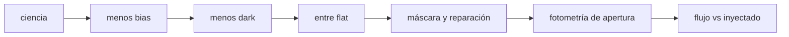

# B44-C20 — Pipeline inicial de calibración de imágenes

<!-- nav:top -->
[🏠 Programa](../../../../README.md) · [📚 Bloque B44](../../../tronco-comun/B44-detectores-y-adquisicion-astronomica.md) · [← Anterior: B44-C19 — Formato FITS y metadatos](../B44-C19-formato-fits-y-metadatos/CLASE.md) · [Siguiente: B45-C01 — Radiometría y fotometría →](../../B45/B45-C01-radiometria-y-fotometria/CLASE.md)
<!-- /nav -->

## 1. Ubicación, nivel y alcance

Clase 20 del bloque B44. Nivel N3. Un **pipeline** encadena los pasos: restar bias, restar dark, dividir por flat, enmascarar y medir. Aquí lo aplicas a un **campo sintético** con una estrella de flujo conocido y comparas el flujo recuperado con el inyectado. Usas [B44-C12](../B44-C12-calibracion-con-bias/CLASE.md), [B44-C13](../B44-C13-calibracion-con-dark/CLASE.md), [B44-C14](../B44-C14-calibracion-con-flat/CLASE.md), [B44-C15](../B44-C15-pixeles-defectuosos/CLASE.md) y [B44-C16](../B44-C16-ruido-cosmico-e-identificacion/CLASE.md). El orden sigue la documentación de ccdproc consultada; no se usó esa biblioteca.

## 2. Por qué esta clase existe

Cada paso es simple, pero el resultado depende del orden y de cada maestro. La decisión central: **¿recupera el pipeline el flujo verdadero dentro de su incertidumbre?**

## 3. Lo que podrás hacer al terminar

1. Construir los maestros de bias, dark y flat.
2. Aplicar los pasos en el orden correcto.
3. Enmascarar rayos cósmicos y píxeles calientes.
4. Medir el flujo con fotometría de apertura.
5. Comparar con el flujo inyectado y la incertidumbre esperada.
6. Explicar la normalización del flat.

La evidencia es la **ficha del pipeline de calibración** del ejercicio 12 (sección 20).

## 4. Con qué llegas y cómo comprobarlo

1. ¿Qué es una incertidumbre?
2. ¿Qué es una simulación Monte Carlo?
3. ¿Qué es una tabla de resultados?
4. ¿Qué es un valor ilustrativo?
5. ¿Qué es una verificación?

<details>
<summary>Ver respuestas</summary>

1. Un intervalo en que se espera el valor verdadero. 2. Repetir con números aleatorios de semilla fija. 3. Un resumen ordenado de cálculos. 4. Un valor propuesto para el ejemplo, no medido. 5. Comparar un cálculo con un caso independiente.
</details>

Con cuatro o cinco aciertos, sigue; si no, repasa los prerrequisitos.

## 5. Un caso de contexto y casos de referencia

Un campo de `64 × 64` con una estrella de `40 000 e⁻` y viñeteo del 10 %: el flujo sin calibrar queda `+7,563 %` fuera del valor de referencia; el del pipeline completo `+0,385 %`, con incertidumbre esperada de `1,31 %`. Es el **ejemplo conductor**. Todo es **sintético**.

## 6. Vocabulario

El **pipeline** es la secuencia de calibración. La **fotometría de apertura** suma el flujo dentro de un círculo y resta el cielo de un anillo. La **normalización del flat** a su media hace que el flujo quede en unidades de un píxel de respuesta media. La **máscara** excluye píxeles dañados.

## 7. Modelo mental: una línea de montaje

Cada estación corrige una cosa, y cambiar el orden estropea el producto: no se pule antes de cortar.



*Descripción textual:* el cuadro de ciencia pasa por bias, dark, flat y máscara antes de la fotometría, cuyo resultado se compara con el valor inyectado.

Analogía: una línea de montaje. Límite: ruido gaussiano, un solo filtro y sin no linealidad.

## 8. La explicación, paso a paso

### 8.1 Máscara

Se enmascaran `10` píxeles: los `6` rayos cósmicos y los `4` calientes. La sigma robusta del cuadro es `44,83 e⁻` (el ruido de fotones del cielo).

### 8.2 Flujo

La respuesta media del campo es `0,9653`; por la normalización del flat, el flujo de referencia es `40 000 × 0,9653 = 38 612,3 e⁻`.

| Caso | Flujo (e⁻) | Error (e⁻) | Error (%) |
|---|---|---|---|
| Sin calibrar | 41 532,7 | 2920,4 | 7,563 |
| Pipeline completo | 38 761,1 | 148,8 | 0,385 |

La incertidumbre esperada (fotones, cielo y lectura, con `115` píxeles de apertura y `301` de anillo) es `523,8 e⁻` (`1,31 %`): el pipeline queda en `0,28σ` y el cuadro sin calibrar en `5,6σ`.

### 8.3 Cielo

El nivel del cielo tras el pipeline es `1931,4 e⁻` (esperado `2000 × 0,9653 = 1930,6`) y su dispersión baja de `71,8` a `44,8 e⁻`.

### 8.4 Lectura

La calibración quita el sesgo y la estructura (patrón de columnas, viñeteo, calientes). El flat deja el flujo en unidades de respuesta media: para un flujo absoluto hace falta una calibración fotométrica aparte.

## 9. Magnitudes, símbolos y unidades

| Símbolo | Qué es | Unidad | Valor / nota |
|---|---|---|---|
| `F` | flujo inyectado | e⁻ | 40 000 |
| `F_ref` | flujo de referencia | e⁻ | 38 612,3 |
| `σ` | incertidumbre esperada | e⁻ | 523,8 |

## 10. Convenciones y referencias

Todo **sintético**: cuadros de 64 × 64; bias, dark y flat con 15, 7 y 15 cuadros; semilla `20261109`. Orden de pasos según ccdproc (consultada el 2026-11-09); no se usó la biblioteca.

## 11. De dónde sale lo que afirmamos

| ID | Fuente | Localizador | Respalda | Estado |
|---|---|---|---|---|
| S1 | Astropy, documentación de ccdproc (reduction toolbox) | https://docs.astropy.org/projects/ccdproc/en/latest/reduction_toolbox.html | el orden de los pasos: overscan y recorte, bias, dark, flat | Consultada el 2026-11-09 (la página de documentación, no el código) |

Límites: la fuente respalda el orden de los pasos, no ninguna cifra; todas las cifras salen del laboratorio sintético.

## 12. Cómo ver el error con y sin calibrar

| Caso | Error (%) |
|---|---|
| Sin calibrar | 7,563 |
| Pipeline | 0,385 |

Descripción larga: la calibración reduce el error casi veinte veces.

## 13. Ejemplo trabajado: flujo de referencia

**Paso 1 · Inyectado.** `F = 40 000 e⁻`.

**Paso 2 · Respuesta media.** `0,9653`.

**Paso 3 · Producto.** `38 612,3 e⁻`.

## 14. Distintas formas de describir una imagen calibrada

**Por pasos:** bias, dark, flat. **Por máscara:** calientes y rayos. **Por medida:** apertura. **Por control:** flujo inyectado.

## 15. Práctica guiada

**Ejercicio 1 · con los pasos indicados.** Flujo de referencia. *Pasos:* ejemplo 13.

<details><summary>Solución comentada</summary>

`38 612,3 e⁻`.
</details>

**Ejercicio 2 · con una pista.** Error relativo del pipeline. *Pista:* `148,8/38 612,3`.

<details><summary>Solución comentada</summary>

`0,385 %`.
</details>

**Ejercicio 3 · casi autónomo.** Incertidumbre esperada. *Pasos:* `√(40 000 + 115 × 2031 × 1,0033)`.

<details><summary>Solución comentada</summary>

`√274 340 = 523,8 e⁻`.
</details>

## 16. Práctica autónoma, transferencia e integrador

**Ejercicio 4.** Error del cuadro sin calibrar en sigmas.

<details><summary>Solución comentada</summary>

`2920,4/523,8 = 5,6`.
</details>

**Ejercicio 5.** Error del pipeline en sigmas.

<details><summary>Solución comentada</summary>

`148,8/523,8 = 0,28`.
</details>

**Ejercicio 6.** Reducción de la dispersión del cielo.

<details><summary>Solución comentada</summary>

`71,8/44,8 = 1,6`.
</details>

**Ejercicio 7.** Cielo esperado tras el flat.

<details><summary>Solución comentada</summary>

`2000 × 0,9653 = 1930,6`.
</details>

**Ejercicio 8.** ¿Por qué el flujo no es `40 000`?

<details><summary>Solución comentada</summary>

El flat se normaliza a su media.
</details>

**Ejercicio 9 · transferencia.** **Transferencia.** ¿Qué pasa si se divide por el flat antes del dark?

<details><summary>Solución comentada</summary>

La oscuridad queda dividida y mal restada.
</details>

**Ejercicio 10 · transferencia.** **Transferencia.** ¿Cómo darías un flujo absoluto?

<details><summary>Solución comentada</summary>

Con una estrella de calibración y un punto cero fotométrico.
</details>

**Ejercicio 11 · transferencia.** **Transferencia.** ¿Qué pasos reales faltan aquí?

<details><summary>Solución comentada</summary>

Overscan, WCS, rechazo avanzado y control de calidad.
</details>

**Ejercicio 12.** **Integrador.** Elabora tu *ficha del pipeline de calibración*: pasos, flujos y control.

<details><summary>Solución comentada</summary>

Secciones 8.1–8.4.
</details>

**Ejercicio 12 · integrador.** **Integrador.** Elabora tu *ficha del pipeline de calibración*: pasos, flujos y control.

<details><summary>Solución modelo</summary>

Secciones 8.1–8.4.
</details>

## 17. Laboratorio: pipeline completo sobre un campo sintético

El script [pipeline.py](pipeline.py) aplica bias, dark, flat, máscara y fotometría de apertura a un campo sintético (**comprueba** que el flujo recuperado está dentro de 4σ y a menos del 1 % de la referencia, y que el cuadro sin calibrar queda peor).

**Datos:** sin constantes; campo y estrella **sintéticos**; orden de pasos de ccdproc (consultada el 2026-11-09); semilla `20261109`. **Predice antes de ejecutar:** ¿qué error tendrá el flujo calibrado? (≈0,4 %.) **Ejecución del 2026-11-09 (Python 3.12.9):**

```text
Python 3.12.9 (biblioteca estandar)
mascara: 10 pixeles (6 de 6 rayos cosmicos, 4 de 4 calientes) ; sigma robusta 44.83 e-
caso                         flujo [e-]  error [e-]  error [%]
respuesta media del campo 0.9653 ; flujo de referencia tras normalizar el flat: 38612.3 e-
sin calibrar                    41532.7      2920.4      7.563
pipeline completo               38761.1       148.8      0.385
incertidumbre esperada (fotones + cielo + lectura): 523.8 e- (1.31 %) ; apertura 115 pix, anillo 301 pix
cielo: nivel 1931.4 e- (esperado 1930.6 = cielo x respuesta media) ; dispersion 44.8 e- tras el pipeline frente a 71.8 e- sin calibrar
Pruebas superadas.
```

```bash
python programa/clases/B44/B44-C20-pipeline-inicial-de-calibracion-de-imagenes/pipeline.py
```

**Límites:** un solo filtro; sin no linealidad; sin calibración absoluta.

## 18. Errores frecuentes y cómo corregirlos

**Cambiar el orden de los pasos.** Se corrige con la sección 11.

**Comparar con el flujo inyectado sin considerar el flat.** Se corrige con 8.2.

**No enmascarar antes de la fotometría.** Se corrige con 8.1.

**Atribuir las cifras a ccdproc.** Se corrige con la sección 11.

## 19. Cómo sabrás que vas bien

Tras la sección 8: ¿qué resultado esperabas y cuál obtuviste? Si dudas, repasa el ejemplo 13. Tras el laboratorio: ¿qué comprueba? (ver la sección 17).

## 20. Qué entregas y cómo se evalúa

El producto es tu **ficha del pipeline de calibración** (ejercicio 12).

| Criterio | Inicial | En desarrollo | Logrado | Destacado |
|---|---|---|---|---|
| Conceptos | Los confunde | Parciales | conceptos de la clase | Explica los límites |
| Cálculo | Sin unidades | Con errores | Tablas completas | Calcula casos nuevos |
| Numérico | Sin comprobar | Un caso | Contraste con el análisis | Interpreta las diferencias |
| Fuentes | Sin fuente | Sin fecha | fuentes con fecha | Declara lo ilustrativo |
| Límites | No los nombra | Uno | Tres | Discute qué falta del modelo |

**Condiciones críticas (no se compensan con promedio):** rotular lo sintético; no atribuir cifras a la fuente; no presentar el pipeline como de un observatorio.

## 21. Ética, seguridad y límites

Clase educativa: los modelos son simplificados. Accesibilidad: tablas equivalentes a las gráficas, fórmulas en texto, ejercicios sin conexión.

## 22. Para cerrar y seguir

El pipeline recupera el flujo con un error de `0,385 %` frente a `7,563 %` sin calibrar. Con esto se cierra el bloque B44: del fotón al flujo calibrado, siempre con datos sintéticos.

**Glosario español–inglés.** calibración · *calibration*; fotometría de apertura · *aperture photometry*; máscara · *mask*; pipeline · *pipeline*; flujo · *flux*.

**Continuidad.** cierra el bloque B44; cada clase terminó con un laboratorio sintético verificable.

**Referencias:** ver sección 11.

<!-- nav:bottom -->
---

[← Anterior: B44-C19 — Formato FITS y metadatos](../B44-C19-formato-fits-y-metadatos/CLASE.md) · [📚 Bloque B44](../../../tronco-comun/B44-detectores-y-adquisicion-astronomica.md) · [Siguiente: B45-C01 — Radiometría y fotometría →](../../B45/B45-C01-radiometria-y-fotometria/CLASE.md)
<!-- /nav -->
