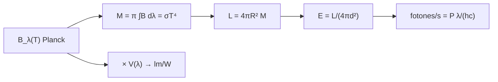

# B45-C01 — Radiometría y fotometría

<!-- nav:top -->
[🏠 Programa](../../../../README.md) · [📚 Bloque B45](../../../tronco-comun/B45-espectroscopia-fotometria-y-polarimetria.md) · [← Anterior: B44-C20 — Pipeline inicial de calibración de imágenes](../../B44/B44-C20-pipeline-inicial-de-calibracion-de-imagenes/CLASE.md) · [Siguiente: B45-C02 — Magnitudes y sistemas de filtros →](../B45-C02-magnitudes-y-sistemas-de-filtros/CLASE.md)
<!-- /nav -->

## 1. Ubicación, nivel y alcance

Clase 1 del bloque B45. Nivel N3. La radiometría mide la energía de la luz en vatios; la fotometría la pondera con la sensibilidad del ojo y los detectores cuentan fotones. Aquí pasas de la **radiancia de Planck** a la **exitancia**, la **irradiancia** a una distancia dada, los **fotones por segundo** y una **eficacia luminosa** ilustrativa. Usas [B05](../../../tronco-comun/B05-fisica-fundamental-para-el-espacio.md) y [B42](../../../tronco-comun/B42-optica-fisica-y-optica-adaptativa.md).

## 2. Por qué esta clase existe

Todo flujo medido en un telescopio es una cantidad radiométrica o fotométrica con una definición precisa; confundir vatios, lúmenes y fotones arruina la calibración. La decisión central: **¿en qué unidades se expresa lo que llega al detector y cómo se pasa de una a otra?**

## 3. Lo que podrás hacer al terminar

1. Distinguir radiancia, exitancia, irradiancia e intensidad.
2. Integrar la ley de Planck y compararla con `σT⁴`.
3. Aplicar la ley del inverso del cuadrado.
4. Convertir potencia en fotones por segundo.
5. Estimar una eficacia luminosa con una curva de sensibilidad dada.
6. Reconocer lo ilustrativo de los datos solares usados.

La evidencia es la **ficha radiométrica** del ejercicio 12 (sección 20).

## 4. Con qué llegas y cómo comprobarlo

1. ¿Qué es un ángulo sólido?
2. ¿Qué es una integral numérica?
3. ¿Cuántos metros tiene una unidad astronómica (orden de magnitud)?
4. ¿Qué es la ley de Planck?
5. ¿Qué es un fotón?

<details>
<summary>Ver respuestas</summary>

1. La región del espacio que abarca un cono; se mide en estereorradianes. 2. Sumar áreas de tiras pequeñas. 3. Unos 1,5 × 10¹¹ m. 4. La emisión espectral de un cuerpo negro. 5. Un cuanto de luz de energía `hf`.
</details>

Con cuatro o cinco aciertos, sigue; si no, repasa los prerrequisitos.

## 5. Un caso de contexto y casos de referencia

Con `T = 5772 K` y `R = 6,957 × 10⁸ m` (valores nominales propuestos, no consultados), la exitancia es `6,29 × 10⁷ W/m²`, la luminosidad `3,83 × 10²⁶ W` y la irradiancia a 1 au `1361,16 W/m²`. Es el **ejemplo conductor**. Las constantes son de NIST (S1).

## 6. Vocabulario

La **radiancia** `B` (W m⁻² sr⁻¹) es la potencia por área proyectada y ángulo sólido. La **exitancia** `M` es la potencia emitida por área (`π B` si es lambertiana). La **irradiancia** `E` es la potencia recibida por área. El **flujo luminoso** se mide en lúmenes con `683 lm/W` a 540 THz. Un **fotón** de longitud de onda `λ` lleva `hc/λ`.

## 7. Modelo mental: una manguera y un regadero

Como el agua: la radiancia es el chorro por unidad de sección y ángulo; la exitancia, el caudal total del grifo por área; la irradiancia, lo que cae sobre una hoja de papel a cierta distancia.



*Descripción textual:* la radiancia de Planck se integra en exitancia, se traslada a luminosidad e irradiancia y se convierte en fotones o lúmenes.

Analogía: una manguera y un regadero. Límite: emisor isótropo y lambertiano.

## 8. La explicación, paso a paso

### 8.1 Integral de Planck

Con `x = hc/(λkT)`, la exitancia es `2π k⁴T⁴/(h³c²) ∫ x³/(eˣ − 1) dx`. La integral numérica vale `6,493939` y `π⁴/15 = 6,493939`; la constante calculada es `σ = 5,670374419 × 10⁻⁸ W m⁻² K⁻⁴`, idéntica a NIST (S1).

### 8.2 Del Sol a la Tierra

| Magnitud | Valor |
|---|---|
| `M(5772 K)` | 6,29 × 10⁷ W/m² |
| `L = 4πR²M` | 3,83 × 10²⁶ W |
| `E` a 1 au | 1361,16 W/m² |
| `E` a 2 au | 340,29 W/m² |
| radiancia lambertiana `M/π` | 2,00 × 10⁷ W m⁻² sr⁻¹ |

### 8.3 Fotones y lúmenes

Un vatio a 550 nm son `2,77 × 10¹⁸` fotones por segundo. Con una curva gaussiana ilustrativa de sensibilidad (máximo en 555 nm, `σ = 42,5 nm`) la eficacia luminosa del cuerpo negro de 5772 K sale `92,1 lm/W`; 540 THz corresponden a `555,171 nm`.

### 8.4 Lectura

La irradiancia cae con el cuadrado de la distancia y los fotones por vatio crecen con `λ`. El valor de la eficacia depende de la curva elegida y no es una medida del ojo.

## 9. Magnitudes, símbolos y unidades

| Símbolo | Qué es | Unidad | Valor / nota |
|---|---|---|---|
| `σ`, `h`, `c`, `k_B` | constantes | SI | S1 |
| `T` | temperatura efectiva nominal | K | 5772 (nominal propuesto) |
| `M` | exitancia | W/m² | 6,29 × 10⁷ |
| `L` | luminosidad | W | 3,83 × 10²⁶ |
| `E` | irradiancia | W/m² | 1361,16 |
| `1 au` | unidad astronómica | m | 149 597 870 700 (definición) |

## 10. Convenciones y referencias

Planck en `λ`; exitancia `M = πB`; integración de Simpson en `x`; `1 au` exacta; datos solares nominales **no consultados**; curva `V` **ilustrativa**; semilla no usada.

## 11. De dónde sale lo que afirmamos

| ID | Fuente | Localizador | Respalda | Estado |
|---|---|---|---|---|
| S1 | NIST, *Fundamental Physical Constants* (CODATA 2022) | https://physics.nist.gov/cuu/Constants/Table/allascii.txt | `σ`, `h`, `c`, `k_B` (exactas) de la sección 9 | Consultada el 2026-11-09 |
| S2 | Valores nominales solares (temperatura efectiva y radio) | — | 5772 K y 6,957 × 10⁸ m, propuestos como nominales | No consultado |

Límites: no se consultó una tabla de irradiancia solar ni la curva CIE de sensibilidad; los resultados son del modelo.

## 12. Cómo ver la irradiancia

| Distancia | Irradiancia (W/m²) |
|---|---|
| 1 au | 1361,16 |
| 2 au | 340,29 |
| 5,2 au | 50,34 |

Descripción larga: la irradiancia cae con el cuadrado de la distancia.

## 13. Ejemplo trabajado: irradiancia a 5,2 au

**Paso 1 · Razón.** `(1/5,2)² = 0,03698`.

**Paso 2 · Producto.** `1361,16 × 0,03698`.

**Paso 3 · Valor.** `50,34 W/m²`.

**Paso 4 · Lectura.** Es 1/27 de la irradiancia a 1 au.

## 14. Distintas formas de describir el resultado

**Por fórmula:** `E = L/(4πd²)`. **Por tabla:** distancias. **Por integral:** Planck. **Por código:** `radiometria.py`.

## 15. Práctica guiada

**Ejercicio 1 · con los pasos indicados.** Irradiancia a 2 au. *Pasos:* divide entre 4.

<details><summary>Solución comentada</summary>

`340,29 W/m²`.
</details>

**Ejercicio 2 · con una pista.** Fotones por segundo en 1 W a 550 nm. *Pista:* `P λ/(hc)`.

<details><summary>Solución comentada</summary>

`2,77 × 10¹⁸`.
</details>

**Ejercicio 3 · casi autónomo.** Radiancia lambertiana de la superficie. *Pasos:* `M/π`.

<details><summary>Solución comentada</summary>

`2,00 × 10⁷ W m⁻² sr⁻¹`.
</details>

## 16. Práctica autónoma, transferencia e integrador

**Ejercicio 4.** Energía de un fotón de 550 nm.

<details><summary>Solución comentada</summary>

`hc/λ = 3,61 × 10⁻¹⁹ J`.
</details>

**Ejercicio 5.** Irradiancia a 5,2 au.

<details><summary>Solución comentada</summary>

`50,34 W/m²`.
</details>

**Ejercicio 6.** Razón `L` si `T = 5000 K` y mismo radio.

<details><summary>Solución comentada</summary>

`(5000/5772)⁴ = 0,5631`.
</details>

**Ejercicio 7.** Potencia sobre 2 m² al 20 % de eficiencia a 1 au.

<details><summary>Solución comentada</summary>

`544,5 W`.
</details>

**Ejercicio 8.** Flujo luminoso de 100 W con la eficacia calculada.

<details><summary>Solución comentada</summary>

`9208 lm`.
</details>

**Ejercicio 9 · transferencia.** **Transferencia.** ¿Por qué un lumen no es una unidad de potencia?

<details><summary>Solución comentada</summary>

Porque pondera la potencia con la sensibilidad del ojo `V(λ)`; el mismo vatio da menos lúmenes lejos de 555 nm.
</details>

**Ejercicio 10 · transferencia.** **Transferencia.** Un detector cuenta fotones y otro mide energía. ¿Cuál lee más en rojo con la misma potencia?

<details><summary>Solución comentada</summary>

El contador de fotones: hay más fotones por vatio a mayor `λ`.
</details>

**Ejercicio 11 · transferencia.** **Transferencia.** Un compañero afirma que el laboratorio mide la constante solar. Responde.

<details><summary>Solución comentada</summary>

Es un cálculo con valores nominales de temperatura y radio; no es una medición.
</details>

**Ejercicio 12.** **Integrador.** Elabora tu *ficha radiométrica*: exitancia, luminosidad, irradiancia a dos distancias, fotones por vatio y límites.

<details><summary>Solución comentada</summary>

Secciones 8.1–8.4.
</details>

**Ejercicio 12 · integrador.** **Integrador.** Elabora tu *ficha radiométrica*: exitancia, luminosidad, irradiancia a dos distancias, fotones por vatio y límites.

<details><summary>Solución modelo</summary>

Secciones 8.1–8.4.
</details>

## 17. Laboratorio: radiancia, irradiancia y fotones

El script [radiometria.py](radiometria.py) integra Planck, compara con `σT⁴` y calcula irradiancia, fotones y eficacia (**comprueba** `σ` a `10⁻⁹` y la integral a `10⁻⁶`).

**Datos:** constantes de NIST (S1); `T`, `R` nominales y curva `V` **ilustrativos**. **Predice antes de ejecutar:** ¿qué irradiancia llega a 1 au? (≈ 1361 W/m².) **Ejecución del 2026-11-09 (Python 3.12.9):**

```text
Python 3.12.9 (biblioteca estandar)
integral x^3/(e^x-1) = 6.493939 ; pi^4/15 = 6.493939
sigma calculada = 5.670374419e-08 W m^-2 K^-4 ; NIST = 5.670374419e-08
M(5772 K) = 6.293859e+07 W/m^2 ; por integral = 6.293859e+07
L = 3.8280e+26 W ; E(1 au) = 1361.16 W/m^2 ; E(2 au) = 340.29 W/m^2
radiancia lambertiana L = M/pi = 2.0034e+07 W m^-2 sr^-1
fotones por segundo en 1 W a 550 nm = 2.7688e+18
eficacia luminosa (V gaussiana ilustrativa) = 92.1 lm/W ; lambda(540 THz) = 555.171 nm
Pruebas superadas.
```

```bash
python programa/clases/B45/B45-C01-radiometria-y-fotometria/radiometria.py
```

**Límites:** cuerpo negro puro, sin atmósfera.

## 18. Errores frecuentes y cómo corregirlos

**Mezclar vatios y lúmenes.** Se corrige con 8.3.

**Olvidar el factor `π` entre radiancia y exitancia.** Se corrige con 8.2.

**Usar la distancia en au sin pasar a metros en `R/d`.** Se corrige con la sección 9.

**Tomar la eficacia gaussiana como el valor real del ojo.** Se corrige con la sección 10.

## 19. Cómo sabrás que vas bien

Tras la sección 8: ¿qué resultado esperabas y cuál obtuviste? Si dudas, repasa el ejemplo 13. Tras el laboratorio: ¿qué comprueba? (ver la sección 17).

## 20. Qué entregas y cómo se evalúa

El producto es tu **ficha radiométrica** (ejercicio 12).

| Criterio | Inicial | En desarrollo | Logrado | Destacado |
|---|---|---|---|---|
| Conceptos | Los confunde | Parciales | conceptos de la clase | Explica los límites |
| Cálculo | Sin unidades | Con errores | Tablas completas | Calcula casos nuevos |
| Numérico | Sin comprobar | Un caso | Contraste con el análisis | Interpreta las diferencias |
| Fuentes | Sin fuente | Sin fecha | fuentes con fecha | Declara lo ilustrativo |
| Límites | No los nombra | Uno | Tres | Discute qué falta del modelo |

**Condiciones críticas (no se compensan con promedio):** rotular los valores nominales y la curva `V` como ilustrativos; no presentar la irradiancia como medida; citar solo lo consultado.

## 21. Ética, seguridad y límites

Clase educativa: los modelos son simplificados. Accesibilidad: tablas equivalentes a las gráficas, fórmulas en texto, ejercicios sin conexión.

## 22. Para cerrar y seguir

El cuerpo negro de 5772 K da 6,29 × 10⁷ W/m² de exitancia y 1361,16 W/m² a 1 au; 1 W a 550 nm son 2,77 × 10¹⁸ fotones por segundo. Queda una pregunta: ¿cómo se expresa esa señal en magnitudes?

**Glosario español–inglés.** radiancia · *radiance*; exitancia · *exitance*; irradiancia · *irradiance*; flujo luminoso · *luminous flux*; fotón · *photon*.

**Continuidad.** [B45-C02](../B45-C02-magnitudes-y-sistemas-de-filtros/CLASE.md) estudia las magnitudes y los sistemas de filtros.

**Referencias:** ver sección 11.

<!-- nav:bottom -->
---

[← Anterior: B44-C20 — Pipeline inicial de calibración de imágenes](../../B44/B44-C20-pipeline-inicial-de-calibracion-de-imagenes/CLASE.md) · [📚 Bloque B45](../../../tronco-comun/B45-espectroscopia-fotometria-y-polarimetria.md) · [Siguiente: B45-C02 — Magnitudes y sistemas de filtros →](../B45-C02-magnitudes-y-sistemas-de-filtros/CLASE.md)
<!-- /nav -->
