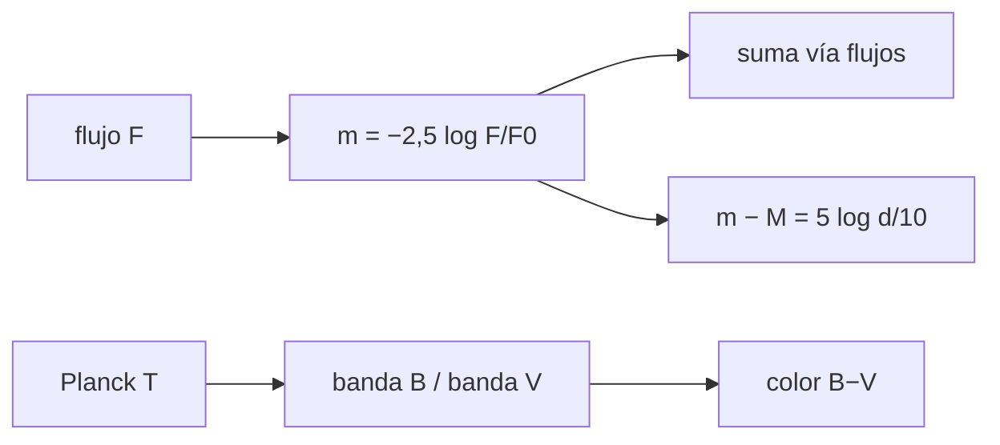

# B45-C02 — Magnitudes y sistemas de filtros

<!-- nav:top -->
[🏠 Programa](../../../../README.md) · [📚 Bloque B45](../../../tronco-comun/B45-espectroscopia-fotometria-y-polarimetria.md) · [← Anterior: B45-C01 — Radiometría y fotometría](../B45-C01-radiometria-y-fotometria/CLASE.md) · [Siguiente: B45-C03 — Curvas de transmisión →](../B45-C03-curvas-de-transmision/CLASE.md)
<!-- /nav -->

## 1. Ubicación, nivel y alcance

Clase 2 del bloque B45. Nivel N3. Una magnitud es un logaritmo del flujo. Aquí compruebas la **escala de Pogson**, el **cero del sistema AB**, la **suma de magnitudes**, el **módulo de distancia** y un **color sintético** que depende de la temperatura con dos filtros rectangulares ilustrativos. Usas [B05](../../../tronco-comun/B05-fisica-fundamental-para-el-espacio.md) y [B12](../../../tronco-comun/B12-probabilidad-estadistica-e-incertidumbre.md).

## 2. Por qué esta clase existe

Los catálogos y las curvas de luz se expresan en magnitudes; sin saber su base, sumarlas o promediarlas da resultados falsos. La decisión central: **¿cómo se convierten flujos en magnitudes, colores y sus errores?**

## 3. Lo que podrás hacer al terminar

1. Aplicar `m = −2,5 log₁₀(F/F₀)` y su inversa.
2. Entender el cero del sistema AB.
3. Sumar magnitudes a través del flujo.
4. Calcular módulo de distancia y error en magnitudes.
5. Obtener un color sintético de un cuerpo negro.
6. Reconocer los límites de filtros rectangulares.

La evidencia es la **ficha de magnitudes** del ejercicio 12 (sección 20).

## 4. Con qué llegas y cómo comprobarlo

1. ¿Qué es un logaritmo decimal?
2. ¿Qué es un jansky?
3. ¿Qué es un parsec (orden de magnitud)?
4. ¿Qué es una banda de paso?
5. ¿Qué es un cociente de flujos?

<details>
<summary>Ver respuestas</summary>

1. El exponente al que se eleva 10. 2. Una unidad de densidad de flujo, 10⁻²⁶ W m⁻² Hz⁻¹. 3. Unos 3,09 × 10¹⁶ m. 4. El intervalo de longitudes de onda que deja pasar un filtro. 5. La división de un flujo entre otro.
</details>

Con cuatro o cinco aciertos, sigue; si no, repasa los prerrequisitos.

## 5. Un caso de contexto y casos de referencia

Con `100^(1/5) = 2,511886`, dos estrellas iguales suman `-0,7526` magnitudes y un cuerpo negro de 5000 K da `B − V = 0,5993` con filtros ilustrativos (cero fijado a 10 000 K). Es el **ejemplo conductor**.

## 6. Vocabulario

La **magnitud** de Pogson `m = −2,5 log₁₀(F/F₀)`: 5 magnitudes son un factor 100. El **sistema AB** fija `m_AB = −2,5 log₁₀ f_ν − 48,60` (`f_ν` en erg s⁻¹ cm⁻² Hz⁻¹), con `m = 0` para 3631 Jy (definición de libro, no consultada). El **color** es la diferencia de dos magnitudes. El **módulo de distancia** es `5 log₁₀(d/10 pc)`.

## 7. Modelo mental: una escala de terremotos

Como la escala de Richter: cada paso multiplica por un factor, no suma; y como allí, mayor magnitud significa menos brillo (la escala está invertida).



*Descripción textual:* el flujo se convierte en magnitud, las magnitudes se suman a través del flujo y el color sale de la razón de dos bandas.

Analogía: una escala de terremotos. Límite: filtros rectangulares y flujo en energía.

## 8. La explicación, paso a paso

### 8.1 Escala y sistema AB

`100^(1/5) = 2,511886`; `10^(0,4·5) = 100,000`. El cero AB da `-0,00007` para 3631 Jy y `8,9000` para 1 Jy.

### 8.2 Sumas y distancias

Dos estrellas iguales suman `-0,7526` magnitudes; magnitudes 12 y 13 dan `11,6361` (no 12,5). A 100 pc el módulo es `5,0`. Un 1 % de error de flujo son `0,01086` mag.

### 8.3 Color sintético

| T (K) | B − V sintético |
|---|---|
| 3500 | 1,1178 |
| 5000 | 0,5993 |
| 6000 | 0,3960 |
| 8000 | 0,1453 |
| 10000 | 0,0000 |
| 20000 | -0,2646 |

El límite de Rayleigh-Jeans (`T = 10⁷ K`) da `-0,88607` numérico frente a `-0,88641` analítico (integral de `λ⁻⁴`).

### 8.4 Lectura

Los cuerpos calientes son más azules (colores menores). Los filtros reales no son rectangulares, de modo que estos colores solo son comparables entre sí.

## 9. Magnitudes, símbolos y unidades

| Símbolo | Qué es | Unidad | Valor / nota |
|---|---|---|---|
| `m` | magnitud | mag | adimensional |
| `F₀` | flujo de referencia | según sistema | Vega o 3631 Jy |
| `f_ν` | densidad de flujo | erg s⁻¹ cm⁻² Hz⁻¹ | 1 Jy = 10⁻²³ |
| `B − V` | color sintético | mag | ver 8.3 |
| `m − M` | módulo de distancia | mag | 5 a 100 pc |

## 10. Convenciones y referencias

Pogson `−2,5 log₁₀`; AB con constante 48,60 (libro); filtros B (400–500 nm) y V (500–600 nm) **ilustrativos**; cero de color a 10 000 K **ilustrativo**.

## 11. De dónde sale lo que afirmamos

| ID | Fuente | Localizador | Respalda | Estado |
|---|---|---|---|---|
| S1 | NIST, *Fundamental Physical Constants* (CODATA 2022) | https://physics.nist.gov/cuu/Constants/Table/allascii.txt | `h`, `c`, `k_B` para Planck | Consultada el 2026-11-09 |
| S2 | Oke y Gunn, definición del sistema AB | — | constante 48,60 y cero en 3631 Jy (conocimiento de libro) | No consultado |

Límites: no se consultó ningún sistema fotométrico real; los filtros y el cero de color son del ejemplo.

## 12. Cómo ver los colores

| T (K) | B − V |
|---|---|
| 3500 | 1,118 |
| 5000 | 0,599 |
| 6000 | 0,396 |
| 8000 | 0,145 |
| 10000 | 0,000 |
| 20000 | -0,265 |

Descripción larga: el color disminuye al subir la temperatura.

## 13. Ejemplo trabajado: magnitud de dos estrellas iguales

**Paso 1 · Flujo total.** Dos veces el de una.

**Paso 2 · Logaritmo.** `−2,5 log₁₀ 2`.

**Paso 3 · Valor.** `-0,7526` mag.

**Paso 4 · Lectura.** El par es 0,75 mag más brillante.

## 14. Distintas formas de describir el resultado

**Por fórmula:** Pogson. **Por tabla:** colores. **Por límite:** Rayleigh-Jeans. **Por código:** `magnitudes.py`.

## 15. Práctica guiada

**Ejercicio 1 · con los pasos indicados.** Factor de flujo para 5 magnitudes. *Pasos:* `10^(0,4·5)`.

<details><summary>Solución comentada</summary>

`100`.
</details>

**Ejercicio 2 · con una pista.** Suma de dos estrellas iguales. *Pasos:* ejemplo 13.

<details><summary>Solución comentada</summary>

`-0,7526` mag.
</details>

**Ejercicio 3 · casi autónomo.** Módulo de distancia a 100 pc.

<details><summary>Solución comentada</summary>

`5,0`.
</details>

## 16. Práctica autónoma, transferencia e integrador

**Ejercicio 4.** Error en mag de un flujo con 2 % de error.

<details><summary>Solución comentada</summary>

`1,0857 × 0,02 = 0,0217`.
</details>

**Ejercicio 5.** Razón de flujos para una diferencia de 2 mag.

<details><summary>Solución comentada</summary>

`10^0,8 = 6,310`.
</details>

**Ejercicio 6.** `m_AB` de 363,1 Jy.

<details><summary>Solución comentada</summary>

`2,500`.
</details>

**Ejercicio 7.** Magnitud conjunta de magnitudes 12 y 13.

<details><summary>Solución comentada</summary>

`11,6361`.
</details>

**Ejercicio 8.** `B − V` a 6000 K.

<details><summary>Solución comentada</summary>

`0,3960`.
</details>

**Ejercicio 9 · transferencia.** **Transferencia.** ¿Por qué no se promedian magnitudes de forma directa para obtener el flujo medio?

<details><summary>Solución comentada</summary>

Porque la escala es logarítmica: el promedio de magnitudes es el logaritmo de la media geométrica de flujos.
</details>

**Ejercicio 10 · transferencia.** **Transferencia.** Un color `B − V` negativo, ¿es más caliente o más frío?

<details><summary>Solución comentada</summary>

Más caliente (más azul).
</details>

**Ejercicio 11 · transferencia.** **Transferencia.** Un compañero llama «real» a un color sintético con filtros rectangulares. Responde.

<details><summary>Solución comentada</summary>

Es ilustrativo: los filtros reales tienen forma y puntos cero propios.
</details>

**Ejercicio 12.** **Integrador.** Elabora tu *ficha de magnitudes*: escala, AB, suma, color y límites.

<details><summary>Solución comentada</summary>

Secciones 8.1–8.4.
</details>

**Ejercicio 12 · integrador.** **Integrador.** Elabora tu *ficha de magnitudes*: escala, AB, suma, color y límites.

<details><summary>Solución modelo</summary>

Secciones 8.1–8.4.
</details>

## 17. Laboratorio: magnitudes y colores sintéticos

El script [magnitudes.py](magnitudes.py) verifica Pogson, AB, suma de magnitudes y colores (**comprueba** el límite de Rayleigh-Jeans a 10⁻³ mag).

**Datos:** constantes de NIST (S1); filtros **ilustrativos**. **Predice antes de ejecutar:** ¿cuánto vale la suma de dos estrellas iguales? (−0,75 mag.) **Ejecución del 2026-11-09 (Python 3.12.9):**

```text
Python 3.12.9 (biblioteca estandar)
100^(1/5) = 2.511886 ; 10^(0,4*5) = 100.000
m_AB(3631 Jy) = -0.00007 ; m_AB(1 Jy) = 8.9000
dos estrellas iguales: -0.7526 mag ; 12 + 13 -> 11.6361
modulo de distancia a 100 pc = 5.0 ; sigma_m para 1 % de flujo = 0.01086
   T (K)  B-V sintetico
    3500         1.1178
    5000         0.5993
    6000         0.3960
    8000         0.1453
   10000         0.0000
   20000        -0.2646
limite Rayleigh-Jeans (T=1e7 K) numerico -0.88607 ; analitico -0.88641
Pruebas superadas.
```

```bash
python programa/clases/B45/B45-C02-magnitudes-y-sistemas-de-filtros/magnitudes.py
```

**Límites:** filtros rectangulares, sin atmósfera.

## 18. Errores frecuentes y cómo corregirlos

**Sumar magnitudes como números.** Se corrige con 8.2.

**Olvidar que menor magnitud es más brillante.** Se corrige con la sección 7.

**Tomar el color sintético como medido.** Se corrige con la sección 10.

**Usar `ln` en lugar de `log₁₀`.** Se corrige con la sección 9.

## 19. Cómo sabrás que vas bien

Tras la sección 8: ¿qué resultado esperabas y cuál obtuviste? Si dudas, repasa el ejemplo 13. Tras el laboratorio: ¿qué comprueba? (ver la sección 17).

## 20. Qué entregas y cómo se evalúa

El producto es tu **ficha de magnitudes** (ejercicio 12).

| Criterio | Inicial | En desarrollo | Logrado | Destacado |
|---|---|---|---|---|
| Conceptos | Los confunde | Parciales | conceptos de la clase | Explica los límites |
| Cálculo | Sin unidades | Con errores | Tablas completas | Calcula casos nuevos |
| Numérico | Sin comprobar | Un caso | Contraste con el análisis | Interpreta las diferencias |
| Fuentes | Sin fuente | Sin fecha | fuentes con fecha | Declara lo ilustrativo |
| Límites | No los nombra | Uno | Tres | Discute qué falta del modelo |

**Condiciones críticas (no se compensan con promedio):** rotular filtros y cero de color como ilustrativos; no dar colores como datos; citar solo lo consultado.

## 21. Ética, seguridad y límites

Clase educativa: los modelos son simplificados. Accesibilidad: tablas equivalentes a las gráficas, fórmulas en texto, ejercicios sin conexión.

## 22. Para cerrar y seguir

La escala de Pogson, el cero AB y la suma de magnitudes se verifican; un cuerpo negro de 5000 K da `B − V = 0,599` con filtros ilustrativos. Queda una pregunta: ¿cómo se describe la forma real de un filtro?

**Glosario español–inglés.** magnitud · *magnitude*; color · *colour*; módulo de distancia · *distance modulus*; punto cero · *zero point*.

**Continuidad.** [B45-C03](../B45-C03-curvas-de-transmision/CLASE.md) estudia las curvas de transmisión.

**Referencias:** ver sección 11.

<!-- nav:bottom -->
---

[← Anterior: B45-C01 — Radiometría y fotometría](../B45-C01-radiometria-y-fotometria/CLASE.md) · [📚 Bloque B45](../../../tronco-comun/B45-espectroscopia-fotometria-y-polarimetria.md) · [Siguiente: B45-C03 — Curvas de transmisión →](../B45-C03-curvas-de-transmision/CLASE.md)
<!-- /nav -->
