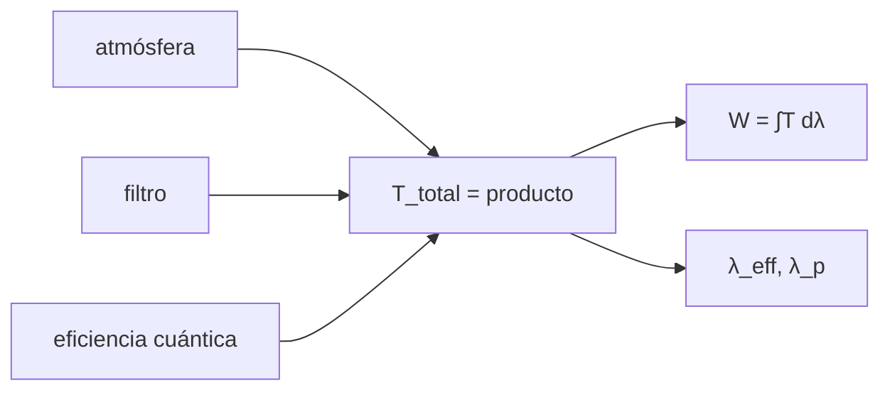

# B45-C03 — Curvas de transmisión

<!-- nav:top -->
[🏠 Programa](../../../../README.md) · [📚 Bloque B45](../../../tronco-comun/B45-espectroscopia-fotometria-y-polarimetria.md) · [← Anterior: B45-C02 — Magnitudes y sistemas de filtros](../B45-C02-magnitudes-y-sistemas-de-filtros/CLASE.md) · [Siguiente: B45-C04 — Redes de difracción →](../B45-C04-redes-de-difraccion/CLASE.md)
<!-- /nav -->

## 1. Ubicación, nivel y alcance

Clase 3 del bloque B45. Nivel N3. La respuesta de un instrumento es el **producto** de curvas (atmósfera × filtro × detector). Aquí multiplicas curvas ilustrativas, calculas el **ancho equivalente**, la **longitud de onda efectiva** (que depende de la fuente), la de **pivote** y el efecto de una **fuga** fuera de banda. Usas [B42](../../../tronco-comun/B42-optica-fisica-y-optica-adaptativa.md) y [B44](../../../tronco-comun/B44-detectores-y-adquisicion-astronomica.md).

## 2. Por qué esta clase existe

Una banda se describe por su curva completa, no por dos números. La decisión central: **¿cómo se combinan las curvas y qué longitud de onda se asigna a una banda?**

## 3. Lo que podrás hacer al terminar

1. Multiplicar curvas de transmisión.
2. Calcular el ancho equivalente `∫T dλ`.
3. Calcular la longitud de onda efectiva con una fuente y la de pivote.
4. Evaluar una fuga fuera de banda.
5. Comparar con el caso gaussiano analítico.
6. Reconocer que la longitud efectiva cambia con la fuente.

La evidencia es la **ficha de la curva de transmisión** del ejercicio 12 (sección 20).

## 4. Con qué llegas y cómo comprobarlo

1. ¿Qué es una integral?
2. ¿Qué es una gaussiana?
3. ¿Qué es una eficiencia cuántica?
4. ¿Qué es una longitud de onda efectiva (idea)?
5. ¿Qué es un producto de funciones?

<details>
<summary>Ver respuestas</summary>

1. El área bajo una curva. 2. La curva en campana `exp(−x²/2σ²)`. 3. La fracción de fotones que genera un electrón. 4. Una longitud de onda típica ponderada por la señal. 5. Multiplicar punto a punto.
</details>

Con cuatro o cinco aciertos, sigue; si no, repasa los prerrequisitos.

## 5. Un caso de contexto y casos de referencia

Un filtro gaussiano ilustrativo (pico 0,9, centro 550 nm, `σ = 40 nm`) tiene ancho equivalente `90,2386 nm`; con detector y atmósfera ilustrativos el pico baja a `0,5904`. Es el **ejemplo conductor**. Todas las curvas son **ilustrativas**.

## 6. Vocabulario

La **transmisión** `T(λ)`. El **ancho equivalente** `W = ∫T dλ`. La **longitud de onda efectiva** `λ_eff = ∫λTS dλ / ∫TS dλ` depende de la fuente `S`. La **longitud de onda de pivote** `λ_p² = ∫Tλ dλ / ∫T/λ dλ` no depende de la fuente. Una **fuga** es transmisión residual fuera de banda.

## 7. Modelo mental: una pila de rejillas

Como poner varias rejillas una tras otra: pasa solo la luz que atraviesa todas, y lo que pasa es el producto de las fracciones.



*Descripción textual:* tres curvas se multiplican y se resumen con ancho equivalente y longitudes de onda efectiva y de pivote.

Analogía: una pila de rejillas. Límite: fuente continua y curvas suaves.

## 8. La explicación, paso a paso

### 8.1 Ancho equivalente

El filtro gaussiano tiene `W = 90,2386 nm` numérico y `90,2386 nm` analítico (`A σ √(2π)`). El producto con detector y atmósfera tiene `W = 58,779 nm`.

### 8.2 Longitudes de onda

| Fuente | `λ_eff` (nm) |
|---|---|
| plana | 548,697 |
| Planck 3000 K | 559,065 |
| Planck 6000 K | 547,202 |
| Planck 10 000 K | 542,513 |

La longitud de pivote vale `547,246 nm`.

### 8.3 Fuga

Una transmisión residual de `10⁻³` sobre 700 nm aumenta el flujo medido un `0,794 %` para 3000 K y un `0,1123 %` para 10 000 K.

### 8.4 Lectura

Una estrella fría se «ve» más roja que una caliente a través del mismo filtro. Las fugas importan más en estrellas rojas.

## 9. Magnitudes, símbolos y unidades

| Símbolo | Qué es | Unidad | Valor / nota |
|---|---|---|---|
| `T(λ)` | transmisión | — | 0 a 1 |
| `W` | ancho equivalente | nm | 90,239 |
| `λ_eff` | longitud de onda efectiva | nm | ver 8.2 |
| `λ_p` | longitud de onda de pivote | nm | 547,246 |

## 10. Convenciones y referencias

Integración de Simpson en 300–1000 nm; fuentes de Planck (constantes exactas de NIST); curvas **ilustrativas**; fuga de `10⁻³` ilustrativa.

## 11. De dónde sale lo que afirmamos

| ID | Fuente | Localizador | Respalda | Estado |
|---|---|---|---|---|
| S1 | NIST, *Fundamental Physical Constants* (CODATA 2022) | https://physics.nist.gov/cuu/Constants/Table/allascii.txt | `h`, `c`, `k_B` para Planck | Consultada el 2026-11-09 |

Límites: no se usó la curva de ningún filtro real ni de ninguna atmósfera; las curvas son del ejemplo.

## 12. Cómo ver las longitudes efectivas

| Fuente | λ_eff (nm) |
|---|---|
| plana | 548,70 |
| 3000 K | 559,07 |
| 6000 K | 547,20 |
| 10 000 K | 542,51 |

Descripción larga: la longitud efectiva baja al subir la temperatura.

## 13. Ejemplo trabajado: ancho equivalente gaussiano

**Paso 1 · Fórmula.** `W = A σ √(2π)`.

**Paso 2 · Números.** `0,9 × 40 nm × 2,5066`.

**Paso 3 · Valor.** `90,239 nm`.

**Paso 4 · Lectura.** Coincide con el numérico `90,239 nm`.

## 14. Distintas formas de describir el resultado

**Por fórmula:** `A σ √(2π)`. **Por tabla:** longitudes efectivas. **Por producto:** curvas. **Por código:** `transmision.py`.

## 15. Práctica guiada

**Ejercicio 1 · con los pasos indicados.** Ancho equivalente del filtro. *Pasos:* ejemplo 13.

<details><summary>Solución comentada</summary>

`90,239 nm`.
</details>

**Ejercicio 2 · con una pista.** Transmisión total en el centro. *Pista:* producto de curvas.

<details><summary>Solución comentada</summary>

`0,5904`.
</details>

**Ejercicio 3 · casi autónomo.** Diferencia `λ_eff(3000 K) − λ_eff(10 000 K)`.

<details><summary>Solución comentada</summary>

`16,55 nm`.
</details>

## 16. Práctica autónoma, transferencia e integrador

**Ejercicio 4.** Cociente de anchos total/filtro.

<details><summary>Solución comentada</summary>

`0,6514`.
</details>

**Ejercicio 5.** Diferencia `λ_eff(plana) − λ_p`.

<details><summary>Solución comentada</summary>

`1,452 nm`.
</details>

**Ejercicio 6.** Aumento por fuga a 3000 K.

<details><summary>Solución comentada</summary>

`0,794 %`.
</details>

**Ejercicio 7.** Aumento por fuga a 10 000 K.

<details><summary>Solución comentada</summary>

`0,1123 %`.
</details>

**Ejercicio 8.** Cociente de fugas frío/caliente.

<details><summary>Solución comentada</summary>

`7,07`.
</details>

**Ejercicio 9 · transferencia.** **Transferencia.** ¿Por qué `λ_p` es útil para convertir `F_λ` y `F_ν`?

<details><summary>Solución comentada</summary>

Porque no depende de la fuente.
</details>

**Ejercicio 10 · transferencia.** **Transferencia.** ¿Qué haría con una fuga en una estrella muy roja?

<details><summary>Solución comentada</summary>

Medir la curva fuera de banda y corregir o usar un filtro de bloqueo.
</details>

**Ejercicio 11 · transferencia.** **Transferencia.** Un compañero dice que `λ_eff` es una propiedad del filtro. Responde.

<details><summary>Solución comentada</summary>

También depende de la fuente observada.
</details>

**Ejercicio 12.** **Integrador.** Elabora tu *ficha de la curva de transmisión*: producto, `W`, `λ_eff`, `λ_p` y fuga.

<details><summary>Solución comentada</summary>

Secciones 8.1–8.4.
</details>

**Ejercicio 12 · integrador.** **Integrador.** Elabora tu *ficha de la curva de transmisión*: producto, `W`, `λ_eff`, `λ_p` y fuga.

<details><summary>Solución modelo</summary>

Secciones 8.1–8.4.
</details>

## 17. Laboratorio: producto de curvas

El script [transmision.py](transmision.py) multiplica curvas, integra y compara con el caso gaussiano (**comprueba** `W` a `10⁻⁶` y el orden de `λ_eff`).

**Datos:** constantes de NIST (S1); curvas **ilustrativas**. **Predice antes de ejecutar:** ¿cuánto vale `W` del filtro? (≈ 90,2 nm.) **Ejecución del 2026-11-09 (Python 3.12.9):**

```text
Python 3.12.9 (biblioteca estandar)
ancho equivalente del filtro = 90.2386 nm ; analitico = 90.2386 nm
pico del filtro = 0.900 ; pico del producto = 0.5904 ; ancho equivalente total = 58.779 nm
lambda efectiva (fuente plana) = 548.697 nm ; lambda de pivote = 547.246 nm
lambda efectiva con Planck 3000 K = 559.065 nm
lambda efectiva con Planck 6000 K = 547.202 nm
lambda efectiva con Planck 10000 K = 542.513 nm
aumento de flujo por una fuga de 1e-3 sobre 700 nm: 3000 K 0.794 % ; 10000 K 0.1123 %
Pruebas superadas.
```

```bash
python programa/clases/B45/B45-C03-curvas-de-transmision/transmision.py
```

**Límites:** curvas suaves, sin variaciones de campo.

## 18. Errores frecuentes y cómo corregirlos

**Suponer que `λ_eff` no depende de la fuente.** Se corrige con 8.2.

**Ignorar la fuga en estrellas rojas.** Se corrige con 8.3.

**Sumar curvas en vez de multiplicarlas.** Se corrige con la sección 7.

**Presentar curvas ilustrativas como reales.** Se corrige con la sección 10.

## 19. Cómo sabrás que vas bien

Tras la sección 8: ¿qué resultado esperabas y cuál obtuviste? Si dudas, repasa el ejemplo 13. Tras el laboratorio: ¿qué comprueba? (ver la sección 17).

## 20. Qué entregas y cómo se evalúa

El producto es tu **ficha de la curva de transmisión** (ejercicio 12).

| Criterio | Inicial | En desarrollo | Logrado | Destacado |
|---|---|---|---|---|
| Conceptos | Los confunde | Parciales | conceptos de la clase | Explica los límites |
| Cálculo | Sin unidades | Con errores | Tablas completas | Calcula casos nuevos |
| Numérico | Sin comprobar | Un caso | Contraste con el análisis | Interpreta las diferencias |
| Fuentes | Sin fuente | Sin fecha | fuentes con fecha | Declara lo ilustrativo |
| Límites | No los nombra | Uno | Tres | Discute qué falta del modelo |

**Condiciones críticas (no se compensan con promedio):** rotular las curvas como ilustrativas; no usarlas para calibrar un instrumento real; citar solo lo consultado.

## 21. Ética, seguridad y límites

Clase educativa: los modelos son simplificados. Accesibilidad: tablas equivalentes a las gráficas, fórmulas en texto, ejercicios sin conexión.

## 22. Para cerrar y seguir

El producto de curvas tiene `W = 58,8 nm`; la longitud efectiva baja de 559,1 a 542,5 nm de 3000 a 10 000 K. Queda una pregunta: ¿cómo se separan las longitudes de onda con una red?

**Glosario español–inglés.** curva de transmisión · *transmission curve*; ancho equivalente · *equivalent width*; longitud efectiva · *effective wavelength*; fuga · *leak*.

**Continuidad.** [B45-C04](../B45-C04-redes-de-difraccion/CLASE.md) estudia las redes de difracción.

**Referencias:** ver sección 11.

<!-- nav:bottom -->
---

[← Anterior: B45-C02 — Magnitudes y sistemas de filtros](../B45-C02-magnitudes-y-sistemas-de-filtros/CLASE.md) · [📚 Bloque B45](../../../tronco-comun/B45-espectroscopia-fotometria-y-polarimetria.md) · [Siguiente: B45-C04 — Redes de difracción →](../B45-C04-redes-de-difraccion/CLASE.md)
<!-- /nav -->
