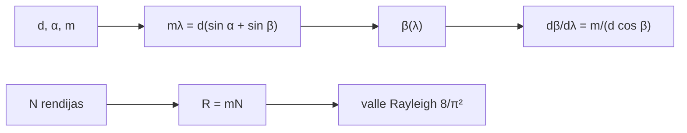

# B45-C04 — Redes de difracción

<!-- nav:top -->
[🏠 Programa](../../../../README.md) · [📚 Bloque B45](../../../tronco-comun/B45-espectroscopia-fotometria-y-polarimetria.md) · [← Anterior: B45-C03 — Curvas de transmisión](../B45-C03-curvas-de-transmision/CLASE.md) · [Siguiente: B45-C05 — Prismas y dispersión →](../B45-C05-prismas-y-dispersion/CLASE.md)
<!-- /nav -->

## 1. Ubicación, nivel y alcance

Clase 4 del bloque B45. Nivel N3. Una red separa la luz por interferencia de muchas rendijas. Aquí aplicas la **ecuación de la red** `mλ = d(sin α + sin β)`, calculas la **dispersión angular**, el **poder de resolución** `R = mN` y compruebas el **criterio de Rayleigh** sumando dos patrones de N rendijas. Usas [B42](../../../tronco-comun/B42-optica-fisica-y-optica-adaptativa.md).

## 2. Por qué esta clase existe

La red es el elemento dispersor de casi todos los espectrógrafos. La decisión central: **¿en qué ángulo sale cada longitud de onda y qué resolución se obtiene?**

## 3. Lo que podrás hacer al terminar

1. Resolver `β` para una longitud de onda y un orden.
2. Calcular la dispersión angular `m/(d cos β)`.
3. Obtener `R = mN` y `δλ = λ/(mN)`.
4. Sumar fasores de N rendijas.
5. Comprobar el valle de Rayleigh `8/π²`.
6. Reconocer que no se modela la eficiencia de blaze.

La evidencia es la **ficha de la red de difracción** del ejercicio 12 (sección 20).

## 4. Con qué llegas y cómo comprobarlo

1. ¿Qué es la interferencia?
2. ¿Qué es una rendija?
3. ¿Qué es un ángulo de incidencia?
4. ¿Qué es un orden de difracción?
5. ¿Qué es un fasor?

<details>
<summary>Ver respuestas</summary>

1. La suma de ondas con fases distintas. 2. Una abertura estrecha. 3. El ángulo entre el haz y la normal. 4. El entero `m` de la ecuación de la red. 5. Un número complejo que representa amplitud y fase.
</details>

Con cuatro o cinco aciertos, sigue; si no, repasa los prerrequisitos.

## 5. Un caso de contexto y casos de referencia

Una red de 600 l/mm (`d = 1666,67 nm`) con 100 mm de ancho (`N = 60 000`) usada en Littrow a `α = 8,627°` para 500 nm da `R = 60 000` en orden 1 (`δλ = 0,00833 nm`). Es el **ejemplo conductor**. Los valores son **ilustrativos**.

## 6. Vocabulario

La **ecuación de la red** `mλ = d(sin α + sin β)`. El **orden** `m`. La **dispersión angular** `dβ/dλ = m/(d cos β)`. El **poder de resolución** `R = λ/δλ = mN`. La configuración **Littrow** es `α = β`. El **blaze** concentra la energía en un orden.

## 7. Modelo mental: una fila de remeros

Como una fila de remeros: las palas sincronizadas empujan más fuerte en una sola dirección que depende de la longitud de onda y del ritmo.



*Descripción textual:* los parámetros de la red fijan el ángulo, la dispersión y, con N, la resolución.

Analogía: una fila de remeros. Límite: red ideal, aproximación escalar.

## 8. La explicación, paso a paso

### 8.1 Ángulos

| λ (nm) | β (grados) |
|---|---|
| 400 | 5,164 |
| 450 | 6,892 |
| 500 | 8,627 |
| 550 | 10,370 |
| 600 | 12,122 |

El orden máximo propagante para 500 nm es `3`.

### 8.2 Dispersión

Numérica `6,068661 × 10⁵ rad/m`; analítica `6,068661 × 10⁵ rad/m` (`0,6069 mrad/nm`).

### 8.3 Resolución

`R = 60000` en orden 1 y `120000` en orden 2; `δλ = 0,00833 nm` a 500 nm.

### 8.4 Criterio de Rayleigh

Con `N = 400` rendijas, dos líneas separadas `λ/(mN)` dan en el punto medio una suma de `0,8126` (el análisis da `8/π² = 0,8106`). Con la mitad de separación la suma es `1,6216` (> 1: no se distinguen).

## 9. Magnitudes, símbolos y unidades

| Símbolo | Qué es | Unidad | Valor / nota |
|---|---|---|---|
| `d` | paso de la red | nm | 1666,67 |
| `α`, `β` | ángulos de incidencia y difracción | grados | ver 8.1 |
| `m` | orden | — | 1 |
| `N` | rendijas iluminadas | — | 60 000 |
| `R` | poder de resolución | — | 60 000 |

## 10. Convenciones y referencias

Ecuación de la red; suma de fasores `(sin(Nφ/2)/(N sin(φ/2)))²`; red de 600 l/mm y 100 mm **ilustrativa**.

## 11. De dónde sale lo que afirmamos

| ID | Fuente | Localizador | Respalda | Estado |
|---|---|---|---|---|
| S1 | Ecuación de la red y criterio de Rayleigh (óptica de libro) | — | relaciones estándar que verifica el laboratorio | No consultado |

Límites: no se consultó ninguna red comercial; la eficiencia no se modela.

## 12. Cómo ver la resolución

| Magnitud | Valor |
|---|---|
| `d` | 1666,67 nm |
| `dβ/dλ` | 0,6069 mrad/nm |
| `R` (m = 1) | 60000 |
| `δλ` | 0,00833 nm |
| valle | 0,8126 |

Descripción larga: más rendijas, más resolución.

## 13. Ejemplo trabajado: ángulo de salida a 550 nm

**Paso 1 · Ecuación.** `sin β = λ/d − sin α`.

**Paso 2 · Números.** `550/1666,67 − sin 8,627°`.

**Paso 3 · Valor.** `β = 10,370°`.

**Paso 4 · Lectura.** Mayor `λ`, mayor `β`.

## 14. Distintas formas de describir el resultado

**Por ecuación:** red. **Por tabla:** ángulos. **Por fasores:** N rendijas. **Por código:** `red.py`.

## 15. Práctica guiada

**Ejercicio 1 · con los pasos indicados.** `β` a 550 nm. *Pasos:* ejemplo 13.

<details><summary>Solución comentada</summary>

`10,370°`.
</details>

**Ejercicio 2 · con una pista.** `δλ` para `R = 60 000` a 500 nm.

<details><summary>Solución comentada</summary>

`0,00833 nm`.
</details>

**Ejercicio 3 · casi autónomo.** Resolución en orden 2.

<details><summary>Solución comentada</summary>

`120000`.
</details>

## 16. Práctica autónoma, transferencia e integrador

**Ejercicio 4.** Dispersión en mrad/nm.

<details><summary>Solución comentada</summary>

`0,6069`.
</details>

**Ejercicio 5.** Número de rendijas de 100 mm a 600 l/mm.

<details><summary>Solución comentada</summary>

`60 000`.
</details>

**Ejercicio 6.** Separación angular entre 500 y 550 nm.

<details><summary>Solución comentada</summary>

`1,743°`.
</details>

**Ejercicio 7.** Valle de Rayleigh analítico.

<details><summary>Solución comentada</summary>

`0,8106`.
</details>

**Ejercicio 8.** `R` si se iluminan solo 50 mm.

<details><summary>Solución comentada</summary>

`30 000`.
</details>

**Ejercicio 9 · transferencia.** **Transferencia.** ¿Por qué se usa un orden alto?

<details><summary>Solución comentada</summary>

Aumenta `R = mN` sin añadir rendijas, a costa de solapar órdenes.
</details>

**Ejercicio 10 · transferencia.** **Transferencia.** ¿Qué es el solapamiento de órdenes?

<details><summary>Solución comentada</summary>

La luz de `λ` en orden 2 coincide con `2λ` en orden 1.
</details>

**Ejercicio 11 · transferencia.** **Transferencia.** Un compañero dice que la red ideal da la eficiencia de blaze. Responde.

<details><summary>Solución comentada</summary>

No: el modelo escalar no la calcula.
</details>

**Ejercicio 12.** **Integrador.** Elabora tu *ficha de la red de difracción*: ángulos, dispersión, resolución y límites.

<details><summary>Solución comentada</summary>

Secciones 8.1–8.4.
</details>

**Ejercicio 12 · integrador.** **Integrador.** Elabora tu *ficha de la red de difracción*: ángulos, dispersión, resolución y límites.

<details><summary>Solución modelo</summary>

Secciones 8.1–8.4.
</details>

## 17. Laboratorio: red de 600 l/mm

El script [red.py](red.py) resuelve los ángulos, verifica la dispersión y el valle de Rayleigh (**comprueba** la dispersión a `10⁻⁶` y el valle a 0,01).

**Datos:** sin constantes externas; red **ilustrativa**. **Predice antes de ejecutar:** ¿qué ángulo tiene la luz de 550 nm? (≈ 10,4°.) **Ejecución del 2026-11-09 (Python 3.12.9):**

```text
Python 3.12.9 (biblioteca estandar)
d = 1666.67 nm ; alpha = 8.627 grados ; orden maximo propagante para 500 nm = 3
lambda 400 nm -> beta = 5.164 grados
lambda 450 nm -> beta = 6.892 grados
lambda 500 nm -> beta = 8.627 grados
lambda 550 nm -> beta = 10.370 grados
lambda 600 nm -> beta = 12.122 grados
dispersion angular numerica 6.068661e+05 rad/m ; analitica 6.068661e+05 rad/m (0.6069 mrad/nm)
R (orden 1) = 60000 ; R (orden 2) = 120000 ; delta lambda a 500 nm = 0.00833 nm
suma de dos lineas en el punto medio: separacion lambda/(mN) -> 0.8126 (8/pi^2 = 0.8106) ; mitad -> 1.6216
Pruebas superadas.
```

```bash
python programa/clases/B45/B45-C04-redes-de-difraccion/red.py
```

**Límites:** red ideal, sin eficiencia ni fantasmas.

## 18. Errores frecuentes y cómo corregirlos

**Olvidar el ángulo de incidencia en la ecuación.** Se corrige con 8.1.

**Confundir `R` con `δλ`.** Se corrige con 8.3.

**Ignorar el solapamiento de órdenes.** Se corrige con la sección 7.

**Dar la red como catálogo.** Se corrige con la sección 10.

## 19. Cómo sabrás que vas bien

Tras la sección 8: ¿qué resultado esperabas y cuál obtuviste? Si dudas, repasa el ejemplo 13. Tras el laboratorio: ¿qué comprueba? (ver la sección 17).

## 20. Qué entregas y cómo se evalúa

El producto es tu **ficha de la red de difracción** (ejercicio 12).

| Criterio | Inicial | En desarrollo | Logrado | Destacado |
|---|---|---|---|---|
| Conceptos | Los confunde | Parciales | conceptos de la clase | Explica los límites |
| Cálculo | Sin unidades | Con errores | Tablas completas | Calcula casos nuevos |
| Numérico | Sin comprobar | Un caso | Contraste con el análisis | Interpreta las diferencias |
| Fuentes | Sin fuente | Sin fecha | fuentes con fecha | Declara lo ilustrativo |
| Límites | No los nombra | Uno | Tres | Discute qué falta del modelo |

**Condiciones críticas (no se compensan con promedio):** rotular la red como ilustrativa; no dar eficiencias; citar solo lo consultado.

## 21. Ética, seguridad y límites

Clase educativa: los modelos son simplificados. Accesibilidad: tablas equivalentes a las gráficas, fórmulas en texto, ejercicios sin conexión.

## 22. Para cerrar y seguir

La red de 600 l/mm da `dβ/dλ = 0,607 mrad/nm` y `R = 60 000` en orden 1; el valle de Rayleigh es `0,8126`. Queda una pregunta: ¿cómo dispersa un prisma?

**Glosario español–inglés.** red de difracción · *diffraction grating*; orden · *order*; poder de resolución · *resolving power*; blaze · *blaze*.

**Continuidad.** [B45-C05](../B45-C05-prismas-y-dispersion/CLASE.md) estudia los prismas y la dispersión.

**Referencias:** ver sección 11.

<!-- nav:bottom -->
---

[← Anterior: B45-C03 — Curvas de transmisión](../B45-C03-curvas-de-transmision/CLASE.md) · [📚 Bloque B45](../../../tronco-comun/B45-espectroscopia-fotometria-y-polarimetria.md) · [Siguiente: B45-C05 — Prismas y dispersión →](../B45-C05-prismas-y-dispersion/CLASE.md)
<!-- /nav -->
