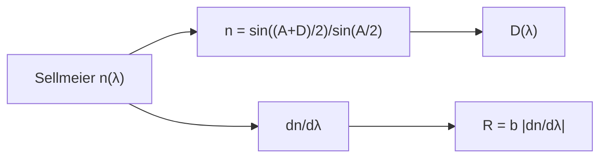

# B45-C05 — Prismas y dispersión

<!-- nav:top -->
[🏠 Programa](../../../../README.md) · [📚 Bloque B45](../../../tronco-comun/B45-espectroscopia-fotometria-y-polarimetria.md) · [← Anterior: B45-C04 — Redes de difracción](../B45-C04-redes-de-difraccion/CLASE.md) · [Siguiente: B45-C06 — Diseño de espectrógrafos →](../B45-C06-diseno-de-espectrografos/CLASE.md)
<!-- /nav -->

## 1. Ubicación, nivel y alcance

Clase 5 del bloque B45. Nivel N3. Un prisma dispersa porque el índice de refracción depende de la longitud de onda. Aquí evalúas la **ecuación de Sellmeier** de un vidrio, la **desviación mínima**, la **dispersión angular** y el poder de resolución `R = b|dn/dλ|`. Usas [B41](../../../tronco-comun/B41-optica-geometrica-y-diseno-de-telescopios.md) y [B42](../../../tronco-comun/B42-optica-fisica-y-optica-adaptativa.md).

## 2. Por qué esta clase existe

Los prismas sirven en espectrógrafos de baja resolución y como cruces de dispersión. La decisión central: **¿cómo se desvía cada color y qué resolución da una base dada?**

## 3. Lo que podrás hacer al terminar

1. Evaluar `n(λ)` con la forma de Sellmeier.
2. Calcular la desviación mínima de un prisma.
3. Obtener la dispersión `dD/dλ` analítica y numérica.
4. Calcular el número de Abbe.
5. Estimar `R = b|dn/dλ|`.
6. Reconocer la dispersión no lineal del prisma.

La evidencia es la **ficha del prisma** del ejercicio 12 (sección 20).

## 4. Con qué llegas y cómo comprobarlo

1. ¿Qué es el índice de refracción?
2. ¿Qué es la ley de Snell?
3. ¿Qué es una derivada?
4. ¿Qué es una dispersión cromática?
5. ¿Qué es un ángulo de vértice?

<details>
<summary>Ver respuestas</summary>

1. La razón entre `c` y la velocidad de la luz en el medio. 2. `n₁ sin θ₁ = n₂ sin θ₂`. 3. La razón de cambio de una función. 4. La dependencia del índice con la longitud de onda. 5. El ángulo entre las dos caras del prisma.
</details>

Con cuatro o cinco aciertos, sigue; si no, repasa los prerrequisitos.

## 5. Un caso de contexto y casos de referencia

Con los coeficientes del vidrio BK7 de la página de Wikipedia (S1), `n(587,6 nm) = 1,51680` y el número de Abbe vale `64,14`. Un prisma de 60° y base de 50 mm da `R ≈ 2516` a 550 nm. Es el **ejemplo conductor**.

## 6. Vocabulario

La **ecuación de Sellmeier** `n² = 1 + Σ Bᵢλ²/(λ² − Cᵢ)`. La **desviación mínima** `n = sin((A+D)/2)/sin(A/2)`. El **número de Abbe** `V = (n_d − 1)/(n_F − n_C)`. La **dispersión angular** `dD/dλ`. El **poder de resolución** de un prisma es `R = b|dn/dλ|` con `b` la base.

## 7. Modelo mental: un tobogán de colores

Como un tobogán que frena más la luz azul que la roja: cada color sale con un ángulo distinto y el azul se abre más.



*Descripción textual:* el índice dependiente de λ fija la desviación y su derivada fija la dispersión y la resolución.

Analogía: un tobogán de colores. Límite: prisma en desviación mínima, sin absorción.

## 8. La explicación, paso a paso

### 8.1 Índice y desviación

| λ (nm) | n | D mínima (°) |
|---|---|---|
| 400 | 1,53085 | 39,8895 |
| 450 | 1,52532 | 39,3985 |
| 500 | 1,52141 | 39,0532 |
| 550 | 1,51852 | 38,7982 |
| 600 | 1,51629 | 38,6023 |
| 650 | 1,51452 | 38,4465 |
| 700 | 1,51306 | 38,3188 |

`n_d = 1,51680`, `n_F = 1,52238`, `n_C = 1,51432` y `V = 64,14`.

### 8.2 Dispersión

En 550 nm: `dD/dλ` numérica `-7,731838 × 10⁻²` y analítica `-7,731838 × 10⁻² rad/µm` (`0,0773 mrad/nm`).

### 8.3 Resolución

`R = b|dn/dλ| = 2516` con `b = 50 mm`; `δλ = 0,219 nm`. El cociente `|dn/dλ|` entre 400 y 700 nm es `5,01`: el prisma dispersa mucho más en el azul.

### 8.4 Lectura

A diferencia de la red, la dispersión del prisma no es lineal: en el azul se separan más los colores.

## 9. Magnitudes, símbolos y unidades

| Símbolo | Qué es | Unidad | Valor / nota |
|---|---|---|---|
| `B`, `C` | coeficientes de Sellmeier | —, µm² | S1 |
| `A` | ángulo de vértice | grados | 60 (ilustrativo) |
| `D` | desviación mínima | grados | ver 8.1 |
| `b` | base del prisma | m | 0,050 (ilustrativo) |
| `V` | número de Abbe | — | 64,14 |

## 10. Convenciones y referencias

Sellmeier de tres términos con λ en µm; `A = 60°` y `b = 50 mm` **ilustrativos**; no se consultó el catálogo del fabricante.

## 11. De dónde sale lo que afirmamos

| ID | Fuente | Localizador | Respalda | Estado |
|---|---|---|---|---|
| S1 | Wikipedia, *Sellmeier equation* | https://en.wikipedia.org/wiki/Sellmeier_equation | coeficientes de Sellmeier del vidrio BK7 (B1, B2, B3, C1, C2, C3); el índice a 587,6 nm se calcula aquí, la página no lo da | Consultada el 2026-11-09 |
| S2 | Catálogo del fabricante del vidrio | — | valores certificados de n_d y V | No consultado |

Límites: se usan los coeficientes de la página enlazada tal como están; el valor de `n_d` es del cálculo y no se contrastó con un catálogo.

## 12. Cómo ver el índice

| λ (nm) | n |
|---|---|
| 400 | 1,5308 |
| 450 | 1,5253 |
| 500 | 1,5214 |
| 550 | 1,5185 |
| 600 | 1,5163 |
| 650 | 1,5145 |
| 700 | 1,5131 |

Descripción larga: el índice decrece al aumentar la longitud de onda.

## 13. Ejemplo trabajado: desviación mínima a 550 nm

**Paso 1 · Índice.** `n = 1,51852`.

**Paso 2 · Seno.** `sin(A/2) = 0,5`; `sin((A+D)/2) = 0,75926`.

**Paso 3 · Ángulo.** `(A+D)/2 = 49,3991°`.

**Paso 4 · Desviación.** `D = 38,7982°`.

## 14. Distintas formas de describir el resultado

**Por ecuación:** Sellmeier. **Por tabla:** n y D. **Por derivada:** analítica y numérica. **Por código:** `prisma.py`.

## 15. Práctica guiada

**Ejercicio 1 · con los pasos indicados.** `n` a 550 nm. *Pasos:* tabla.

<details><summary>Solución comentada</summary>

`1,51852`.
</details>

**Ejercicio 2 · con una pista.** `D` mínima a 550 nm. *Pasos:* ejemplo 13.

<details><summary>Solución comentada</summary>

`38,7982°`.
</details>

**Ejercicio 3 · casi autónomo.** Diferencia de desviación entre 400 y 700 nm.

<details><summary>Solución comentada</summary>

`1,5707°`.
</details>

## 16. Práctica autónoma, transferencia e integrador

**Ejercicio 4.** Número de Abbe.

<details><summary>Solución comentada</summary>

`64,14`.
</details>

**Ejercicio 5.** `R` con base de 100 mm.

<details><summary>Solución comentada</summary>

`5032`.
</details>

**Ejercicio 6.** `δλ` a 550 nm con 50 mm.

<details><summary>Solución comentada</summary>

`0,219 nm`.
</details>

**Ejercicio 7.** Dispersión en mrad/nm.

<details><summary>Solución comentada</summary>

`0,0773`.
</details>

**Ejercicio 8.** Cociente de dispersión azul/rojo.

<details><summary>Solución comentada</summary>

`5,01`.
</details>

**Ejercicio 9 · transferencia.** **Transferencia.** ¿Por qué la red es preferible para alta resolución?

<details><summary>Solución comentada</summary>

Su `R = mN` crece sin límite de material y la dispersión es casi lineal.
</details>

**Ejercicio 10 · transferencia.** **Transferencia.** ¿Qué ventaja da la prisma?

<details><summary>Solución comentada</summary>

Sin solapamiento de órdenes y alta eficiencia.
</details>

**Ejercicio 11 · transferencia.** **Transferencia.** Un compañero usa estos coeficientes para un vidrio distinto. Responde.

<details><summary>Solución comentada</summary>

Cada vidrio tiene los suyos; estos son de BK7 según la página citada.
</details>

**Ejercicio 12.** **Integrador.** Elabora tu *ficha del prisma*: índice, desviación, dispersión, resolución y límites.

<details><summary>Solución comentada</summary>

Secciones 8.1–8.4.
</details>

**Ejercicio 12 · integrador.** **Integrador.** Elabora tu *ficha del prisma*: índice, desviación, dispersión, resolución y límites.

<details><summary>Solución modelo</summary>

Secciones 8.1–8.4.
</details>

## 17. Laboratorio: prisma de BK7

El script [prisma.py](prisma.py) evalúa Sellmeier y verifica la dispersión analítica frente a la numérica (**comprueba** a `10⁻⁶` y `n_d` entre 1,5160 y 1,5175).

**Datos:** coeficientes de la página de Wikipedia (S1); geometría **ilustrativa**. **Predice antes de ejecutar:** ¿qué índice tiene a 550 nm? (≈ 1,5185.) **Ejecución del 2026-11-09 (Python 3.12.9):**

```text
Python 3.12.9 (biblioteca estandar)
n(587,6 nm) = 1.51680 ; n(486,1) = 1.52238 ; n(656,3) = 1.51432 ; numero de Abbe = 64.14
 lambda (nm)         n  D min (grados)
         400   1.53085         39.8895
         450   1.52532         39.3985
         500   1.52141         39.0532
         550   1.51852         38.7982
         600   1.51629         38.6023
         650   1.51452         38.4465
         700   1.51306         38.3188
dD/dlambda en 550 nm: numerica -7.731838e-02 ; analitica -7.731838e-02 rad/micra (0.0773 mrad/nm)
R = b |dn/dl| con b = 50 mm: 2516 ; delta lambda = 0.219 nm
cociente |dn/dl| 400 nm / 700 nm = 5.01
Pruebas superadas.
```

```bash
python programa/clases/B45/B45-C05-prismas-y-dispersion/prisma.py
```

**Límites:** desviación mínima, sin absorción.

## 18. Errores frecuentes y cómo corregirlos

**Usar λ en nm dentro de Sellmeier con coeficientes en µm.** Se corrige con la sección 9.

**Confundir `D` con `A`.** Se corrige con 8.1.

**Suponer dispersión lineal.** Se corrige con 8.3.

**Tomar `n_d` calculado como valor de catálogo.** Se corrige con la sección 11.

## 19. Cómo sabrás que vas bien

Tras la sección 8: ¿qué resultado esperabas y cuál obtuviste? Si dudas, repasa el ejemplo 13. Tras el laboratorio: ¿qué comprueba? (ver la sección 17).

## 20. Qué entregas y cómo se evalúa

El producto es tu **ficha del prisma** (ejercicio 12).

| Criterio | Inicial | En desarrollo | Logrado | Destacado |
|---|---|---|---|---|
| Conceptos | Los confunde | Parciales | conceptos de la clase | Explica los límites |
| Cálculo | Sin unidades | Con errores | Tablas completas | Calcula casos nuevos |
| Numérico | Sin comprobar | Un caso | Contraste con el análisis | Interpreta las diferencias |
| Fuentes | Sin fuente | Sin fecha | fuentes con fecha | Declara lo ilustrativo |
| Límites | No los nombra | Uno | Tres | Discute qué falta del modelo |

**Condiciones críticas (no se compensan con promedio):** citar la página como consultada; no presentar `n_d` como certificado del fabricante; rotular geometría como ilustrativa.

## 21. Ética, seguridad y límites

Clase educativa: los modelos son simplificados. Accesibilidad: tablas equivalentes a las gráficas, fórmulas en texto, ejercicios sin conexión.

## 22. Para cerrar y seguir

El vidrio de la ecuación de Sellmeier tiene `n_d = 1,5168` y `V = 64,1`; un prisma de 50 mm resuelve `δλ = 0,22 nm` a 550 nm. Queda una pregunta: ¿cómo se combinan estos elementos en un espectrógrafo?

**Glosario español–inglés.** prisma · *prism*; desviación mínima · *minimum deviation*; número de Abbe · *Abbe number*; índice de refracción · *refractive index*.

**Continuidad.** [B45-C06](../B45-C06-diseno-de-espectrografos/CLASE.md) estudia el diseño de espectrógrafos.

**Referencias:** ver sección 11.

<!-- nav:bottom -->
---

[← Anterior: B45-C04 — Redes de difracción](../B45-C04-redes-de-difraccion/CLASE.md) · [📚 Bloque B45](../../../tronco-comun/B45-espectroscopia-fotometria-y-polarimetria.md) · [Siguiente: B45-C06 — Diseño de espectrógrafos →](../B45-C06-diseno-de-espectrografos/CLASE.md)
<!-- /nav -->
