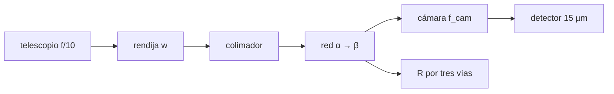

# B45-C06 — Diseño de espectrógrafos

<!-- nav:top -->
[🏠 Programa](../../../../README.md) · [📚 Bloque B45](../../../tronco-comun/B45-espectroscopia-fotometria-y-polarimetria.md) · [← Anterior: B45-C05 — Prismas y dispersión](../B45-C05-prismas-y-dispersion/CLASE.md) · [Siguiente: B45-C07 — Resolución espectral →](../B45-C07-resolucion-espectral/CLASE.md)
<!-- /nav -->

## 1. Ubicación, nivel y alcance

Clase 6 del bloque B45. Nivel N3. Un espectrógrafo de rendija une telescopio, colimador, red, cámara y detector. Aquí dimensionas la **rendija**, el **haz colimado**, el **factor anamórfico**, la **dispersión lineal** y la **resolución** por **tres vías independientes**, y revisas el **muestreo** en píxeles. Usas [B41](../../../tronco-comun/B41-optica-geometrica-y-diseno-de-telescopios.md), [B42](../../../tronco-comun/B42-optica-fisica-y-optica-adaptativa.md) y [B44](../../../tronco-comun/B44-detectores-y-adquisicion-astronomica.md).

## 2. Por qué esta clase existe

El diseño se decide con unos pocos parámetros que se compensan entre sí. La decisión central: **¿qué ancho de rendija da la resolución deseada y cuántos píxeles muestrean cada elemento?**

## 3. Lo que podrás hacer al terminar

1. Pasar de segundos de arco a micras en la rendija.
2. Calcular el haz colimado y el factor anamórfico.
3. Obtener la resolución por fórmula, por dispersión lineal y por trazado de rayos.
4. Verificar el muestreo de Nyquist.
5. Calcular la cobertura espectral del detector.
6. Reconocer lo que no incluye el modelo paraxial.

La evidencia es la **ficha del espectrógrafo** del ejercicio 12 (sección 20).

## 4. Con qué llegas y cómo comprobarlo

1. ¿Qué es una distancia focal?
2. ¿Qué es un segundo de arco?
3. ¿Qué es un píxel?
4. ¿Qué es una rendija?
5. ¿Qué es un haz colimado?

<details>
<summary>Ver respuestas</summary>

1. La distancia a la que una lente enfoca un haz paralelo. 2. 1/3600 de grado. 3. El elemento básico del detector. 4. Una abertura estrecha. 5. Un haz de rayos paralelos.
</details>

Con cuatro o cinco aciertos, sigue; si no, repasa los prerrequisitos.

## 5. Un caso de contexto y casos de referencia

Con un telescopio de 4 m a f/10, rendija de 1" (`w = 193,9 µm`), colimador de 500 mm, cámara de 250 mm y red de 600 l/mm, la resolución es `R = 864,0` por las tres vías; la imagen de la rendija ocupa `6,45` píxeles. Es el **ejemplo conductor**. Todo es **ilustrativo**.

## 6. Vocabulario

La **rendija** limita la entrada. El **colimador** da un haz paralelo. El **factor anamórfico** `cos α / cos β` cambia el ancho del haz. La **dispersión lineal** `d cos β/(m f_cam)` da nm por mm en el detector. El **elemento de resolución** es la imagen de la rendija. El **muestreo de Nyquist** pide al menos 2 píxeles por elemento.

## 7. Modelo mental: un embudo con regla

Como un embudo que deja pasar una franja de la imagen y una regla que reparte los colores sobre el detector: el ancho de la franja contra la longitud de cada color da la resolución.



*Descripción textual:* la rendija se proyecta sobre el detector y su ancho dividido por la dispersión lineal da el ancho espectral.

Analogía: un embudo con regla. Límite: sistema paraxial ideal.

## 8. La explicación, paso a paso

### 8.1 Geometría

| Magnitud | Valor |
|---|---|
| rendija `w` | 193,9 µm |
| haz colimado | 50,0 mm |
| `β` (550 nm) | 8,995° |
| factor anamórfico | 0,9971 |
| imagen `w'` | 96,68 µm = 6,45 píxeles |
| dispersión | 0,0988 nm/píxel |
| cobertura | 202,3 nm |

### 8.2 Resolución por tres vías

Fórmula `R = (sin α + sin β) f_col/(w cos α)`: `863,97`. Por dispersión lineal: `863,97`. Por trazado de rayos con diferencias finitas: `863,97`. Coinciden a `10⁻³`.

### 8.3 Consecuencias

`δλ = 0,6366 nm` y `δv = 347,0 km/s`. Con rendija de 2" la resolución baja a `432,0`. Para muestrear con 2 píxeles hace falta una rendija de `0,310"`.

### 8.4 Lectura

La resolución sube al estrechar la rendija, a costa de luz. Este diseño está sobremuestreado: 6,4 píxeles por elemento.

## 9. Magnitudes, símbolos y unidades

| Símbolo | Qué es | Unidad | Valor / nota |
|---|---|---|---|
| `w` | ancho de rendija | µm | 193,9 |
| `f_col`, `f_cam` | focales | mm | 500; 250 (ilustrativos) |
| `d` | paso de red | µm | 1,667 |
| `α` | incidencia | grados | 10 |
| `R` | resolución | — | 864,0 |

## 10. Convenciones y referencias

Unidades SI con `1″ = π/648000 rad`; telescopio y detector **ilustrativos**; ángulos paraxiales.

## 11. De dónde sale lo que afirmamos

| ID | Fuente | Localizador | Respalda | Estado |
|---|---|---|---|---|
| S1 | Óptica de espectrógrafos (relaciones estándar) | — | fórmula de resolución y dispersión lineal verificadas en el laboratorio | No consultado |

Límites: no se consultó el diseño de ningún instrumento real; los parámetros son del ejemplo.

## 12. Cómo ver la resolución

| Vía | R |
|---|---|
| fórmula | 863,97 |
| dispersión lineal | 863,97 |
| trazado de rayos | 863,97 |

Descripción larga: las tres vías dan el mismo valor.

## 13. Ejemplo trabajado: rendija física

**Paso 1 · Escala.** `f_tel = 40 m`.

**Paso 2 · Ángulo.** `1″ = 4,848 × 10⁻⁶ rad`.

**Paso 3 · Producto.** `40 × 4,848 × 10⁻⁶ = 193,9 µm`.

**Paso 4 · Lectura.** Casi 0,2 mm.

## 14. Distintas formas de describir el resultado

**Por fórmula:** `R`. **Por geometría:** `w'`. **Por trazado:** diferencias finitas. **Por código:** `espectrografo.py`.

## 15. Práctica guiada

**Ejercicio 1 · con los pasos indicados.** Ancho físico de la rendija. *Pasos:* ejemplo 13.

<details><summary>Solución comentada</summary>

`193,9 µm`.
</details>

**Ejercicio 2 · con una pista.** Haz colimado `f_col/(f/10)`.

<details><summary>Solución comentada</summary>

`50,0 mm`.
</details>

**Ejercicio 3 · casi autónomo.** Resolución. *Pista:* fórmula.

<details><summary>Solución comentada</summary>

`864,0`.
</details>

## 16. Práctica autónoma, transferencia e integrador

**Ejercicio 4.** `δλ` a 550 nm.

<details><summary>Solución comentada</summary>

`0,6366 nm`.
</details>

**Ejercicio 5.** Píxeles por elemento.

<details><summary>Solución comentada</summary>

`6,45`.
</details>

**Ejercicio 6.** Cobertura espectral.

<details><summary>Solución comentada</summary>

`202,3 nm`.
</details>

**Ejercicio 7.** `R` con rendija de 2″.

<details><summary>Solución comentada</summary>

`432,0`.
</details>

**Ejercicio 8.** Rendija para 2 píxeles.

<details><summary>Solución comentada</summary>

`0,310″`.
</details>

**Ejercicio 9 · transferencia.** **Transferencia.** ¿Por qué sobremuestrear no mejora `R`?

<details><summary>Solución comentada</summary>

Porque `R` lo fija el ancho de la rendija; más píxeles solo describen mejor el perfil.
</details>

**Ejercicio 10 · transferencia.** **Transferencia.** ¿Qué pasa si el seeing es peor que la rendija?

<details><summary>Solución comentada</summary>

Se pierde luz y el perfil se ensancha por la rendija, no por el aire.
</details>

**Ejercicio 11 · transferencia.** **Transferencia.** Un compañero dice que `R = 864` es el de un instrumento real. Responde.

<details><summary>Solución comentada</summary>

Es el de un diseño ilustrativo; no hay instrumento detrás.
</details>

**Ejercicio 12.** **Integrador.** Elabora tu *ficha del espectrógrafo*: parámetros, `R` por tres vías, muestreo y límites.

<details><summary>Solución comentada</summary>

Secciones 8.1–8.4.
</details>

**Ejercicio 12 · integrador.** **Integrador.** Elabora tu *ficha del espectrógrafo*: parámetros, `R` por tres vías, muestreo y límites.

<details><summary>Solución modelo</summary>

Secciones 8.1–8.4.
</details>

## 17. Laboratorio: espectrógrafo de rendija

El script [espectrografo.py](espectrografo.py) calcula `R` por tres vías y el muestreo (**comprueba** que coinciden a `10⁻³` y que hay más de 2 píxeles por elemento).

**Datos:** sin constantes; instrumento **ilustrativo**. **Predice antes de ejecutar:** ¿qué resolución se obtiene? (≈ 864.) **Ejecución del 2026-11-09 (Python 3.12.9):**

```text
Python 3.12.9 (biblioteca estandar)
rendija fisica w = 193.9 um ; haz colimado = 50.0 mm ; beta(550 nm) = 8.995 grados ; factor anamorfico = 0.9971
imagen de la rendija w' = 96.68 um = 6.45 pixeles ; dispersion = 0.0988 nm/pixel ; cobertura = 202.3 nm
R por formula = 863.97 ; por dispersion lineal = 863.97 ; por trazado de rayos = 863.97
delta lambda = 0.6366 nm ; delta v = 347.0 km/s ; con rendija de 2 segundos R = 432.0
rendija para muestreo de 2 pixeles = 0.310 segundos de arco
Pruebas superadas.
```

```bash
python programa/clases/B45/B45-C06-diseno-de-espectrografos/espectrografo.py
```

**Límites:** paraxial, sin aberraciones ni seeing.

## 18. Errores frecuentes y cómo corregirlos

**Confundir ancho de rendija con ancho de imagen.** Se corrige con 8.1.

**Olvidar el factor anamórfico.** Se corrige con la sección 9.

**Creer que más píxeles dan más `R`.** Se corrige con 8.3.

**Presentar el diseño como real.** Se corrige con la sección 10.

## 19. Cómo sabrás que vas bien

Tras la sección 8: ¿qué resultado esperabas y cuál obtuviste? Si dudas, repasa el ejemplo 13. Tras el laboratorio: ¿qué comprueba? (ver la sección 17).

## 20. Qué entregas y cómo se evalúa

El producto es tu **ficha del espectrógrafo** (ejercicio 12).

| Criterio | Inicial | En desarrollo | Logrado | Destacado |
|---|---|---|---|---|
| Conceptos | Los confunde | Parciales | conceptos de la clase | Explica los límites |
| Cálculo | Sin unidades | Con errores | Tablas completas | Calcula casos nuevos |
| Numérico | Sin comprobar | Un caso | Contraste con el análisis | Interpreta las diferencias |
| Fuentes | Sin fuente | Sin fecha | fuentes con fecha | Declara lo ilustrativo |
| Límites | No los nombra | Uno | Tres | Discute qué falta del modelo |

**Condiciones críticas (no se compensan con promedio):** rotular el instrumento como ilustrativo; no dar prestaciones; citar solo lo consultado.

## 21. Ética, seguridad y límites

Clase educativa: los modelos son simplificados. Accesibilidad: tablas equivalentes a las gráficas, fórmulas en texto, ejercicios sin conexión.

## 22. Para cerrar y seguir

El diseño ilustrativo da `R = 864` por tres vías independientes, 6,4 píxeles por elemento y 202 nm de cobertura. Queda una pregunta: ¿qué significa exactamente «resolución espectral»?

**Glosario español–inglés.** rendija · *slit*; colimador · *collimator*; factor anamórfico · *anamorphic factor*; dispersión lineal · *linear dispersion*; muestreo · *sampling*.

**Continuidad.** [B45-C07](../B45-C07-resolucion-espectral/CLASE.md) estudia la resolución espectral.

**Referencias:** ver sección 11.

<!-- nav:bottom -->
---

[← Anterior: B45-C05 — Prismas y dispersión](../B45-C05-prismas-y-dispersion/CLASE.md) · [📚 Bloque B45](../../../tronco-comun/B45-espectroscopia-fotometria-y-polarimetria.md) · [Siguiente: B45-C07 — Resolución espectral →](../B45-C07-resolucion-espectral/CLASE.md)
<!-- /nav -->
