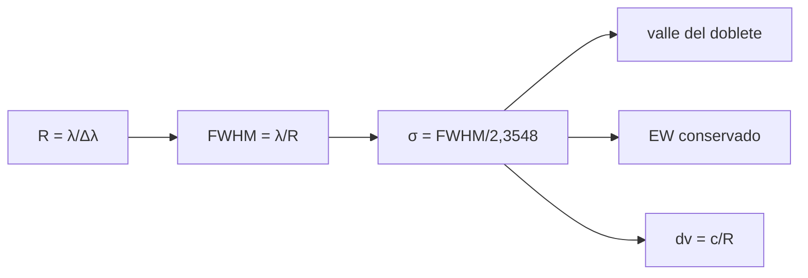

# B45-C07 — Resolución espectral

<!-- nav:top -->
[🏠 Programa](../../../../README.md) · [📚 Bloque B45](../../../tronco-comun/B45-espectroscopia-fotometria-y-polarimetria.md) · [← Anterior: B45-C06 — Diseño de espectrógrafos](../B45-C06-diseno-de-espectrografos/CLASE.md) · [Siguiente: B45-C08 — Calibración en longitud de onda →](../B45-C08-calibracion-en-longitud-de-onda/CLASE.md)
<!-- /nav -->

## 1. Ubicación, nivel y alcance

Clase 7 del bloque B45. Nivel N3. La resolución espectral `R = λ/Δλ` dice qué tan cerca pueden estar dos líneas para verse separadas. Aquí relacionas la **resolución** con el perfil instrumental gaussiano, la **anchura a media altura**, el **valle de un doblete**, la **conservación del ancho equivalente** y la **recuperación del ancho** con ruido. Usas [B12](../../../tronco-comun/B12-probabilidad-estadistica-e-incertidumbre.md) y [B15](../../../tronco-comun/B15-senales-imagenes-y-estimacion-cientifica.md).

## 2. Por qué esta clase existe

La resolución limita qué se puede medir (separar un doblete, medir una velocidad). La decisión central: **¿qué `R` se necesita para el objetivo científico y cómo se mide?**

## 3. Lo que podrás hacer al terminar

1. Pasar de `R` a FWHM y a `σ`.
2. Expresar la resolución en km/s.
3. Calcular el valle de un doblete como función de `R`.
4. Comprobar que el ancho equivalente se conserva al convolucionar.
5. Recuperar `σ` de una línea con ruido por momentos.
6. Reconocer que el perfil real no es gaussiano.

La evidencia es la **ficha de resolución espectral** del ejercicio 12 (sección 20).

## 4. Con qué llegas y cómo comprobarlo

1. ¿Qué es una convolución?
2. ¿Qué es una gaussiana?
3. ¿Qué es un doblete?
4. ¿Qué es el ancho equivalente?
5. ¿Qué es una desviación estándar?

<details>
<summary>Ver respuestas</summary>

1. Un promedio ponderado que ensancha una señal. 2. Una campana `exp(−x²/2σ²)`. 3. Dos líneas muy cercanas. 4. El ancho de un rectángulo de altura 1 con la misma área que la línea. 5. Una medida de dispersión.
</details>

Con cuatro o cinco aciertos, sigue; si no, repasa los prerrequisitos.

## 5. Un caso de contexto y casos de referencia

Un doblete sintético de 589,0 y 589,6 nm (separación 0,6 nm) necesita `R ≳ 982`: con `R = 1000` el valle es `0,923` de la profundidad de una línea y con `R = 1500` baja a `0,396`. Es el **ejemplo conductor** (datos sintéticos).

## 6. Vocabulario

El **perfil instrumental** (LSF) es la respuesta a una línea infinitamente estrecha. La **resolución** `R = λ/Δλ`, con `Δλ` la FWHM. Para una gaussiana `FWHM = √(8 ln 2) σ = 2,3548 σ`. La **resolución en velocidad** es `c/R`. El **ancho equivalente** de una línea no cambia al convolucionarla.

## 7. Modelo mental: una foto desenfocada

Como una foto desenfocada: el desenfoque (el perfil) ensancha cada punto, y dos puntos muy próximos se funden en uno; la energía total, en cambio, no cambia.



*Descripción textual:* la resolución fija la anchura del perfil, que decide si un doblete se separa y deja intacto el ancho equivalente.

Analogía: una foto desenfocada. Límite: perfil gaussiano e invariante.

## 8. La explicación, paso a paso

### 8.1 Resolución y doblete

| R | FWHM (nm) | σ (nm) | valle/línea (num.) | analítico | dv (km/s) |
|---|---|---|---|---|---|
| 500 | 1,1786 | 0,50051 | 1,1235 | 1,1235 | 599,58 |
| 1000 | 0,5893 | 0,25025 | 0,9228 | 0,9228 | 299,79 |
| 1500 | 0,3929 | 0,16684 | 0,3965 | 0,3965 | 199,86 |
| 3000 | 0,1964 | 0,08342 | 0,0031 | 0,0031 | 99,93 |
| 10000 | 0,0589 | 0,02503 | 0,0000 | 0,0000 | 29,98 |

El valle es la profundidad en el punto medio dividida por la profundidad en el centro de una línea; mayor que 1 significa que no hay valle. La fórmula analítica es `2 exp(−(s/2)²/2σ²)/(1 + exp(−s²/2σ²))` con `s = 0,6 nm`.

### 8.2 Ancho equivalente

Una línea de ancho equivalente intrínseco `0,05 nm` mantiene `0,05000 nm` con `R = 1000` y `0,05000 nm` con `R = 10 000`.

### 8.3 Recuperar la anchura

Con `R = 3000` (S/N 50 en el continuo) y 300 repeticiones, la `σ` verdadera `0,08342 nm` se recupera como `0,08285 nm` (dispersión `0,00426`, error estándar de la media `0,00025`): la diferencia es del orden de 2 errores estándar, atribuible al truncamiento de la ventana.

### 8.4 Lectura

Para separar el doblete hace falta `R` cercano a 1000, y el valle solo es profundo para `R ≥ 1500`. Un ensanchamiento instrumental no altera la energía de la línea, sí su profundidad.

## 9. Magnitudes, símbolos y unidades

| Símbolo | Qué es | Unidad | Valor / nota |
|---|---|---|---|
| `R` | resolución espectral | — | 500 a 10 000 |
| `FWHM` | anchura a media altura | nm | `λ/R` |
| `σ` | desviación del perfil | nm | FWHM/2,3548 |
| `dv` | resolución en velocidad | km/s | `c/R` |
| `c` | velocidad de la luz | km/s | 299 792,458 (exacta, S1) |

## 10. Convenciones y referencias

Perfil gaussiano; muestreo de 0,02 nm; doblete sintético de profundidad 0,5; semilla `20261109`.

## 11. De dónde sale lo que afirmamos

| ID | Fuente | Localizador | Respalda | Estado |
|---|---|---|---|---|
| S1 | NIST, *Fundamental Physical Constants* (CODATA 2022) | https://physics.nist.gov/cuu/Constants/Table/allascii.txt | `c` exacta | Consultada el 2026-11-09 |
| S2 | Longitudes de onda de laboratorio del doblete del sodio | — | no consultadas; el doblete es sintético | No consultado |

Límites: el perfil real tiene alas y varía con la longitud de onda; el doblete no es el del sodio medido.

## 12. Cómo ver el doblete

| R | valle/línea |
|---|---|
| 500 | 1,123 |
| 1000 | 0,923 |
| 1500 | 0,396 |
| 3000 | 0,003 |
| 10000 | 0,000 |

Descripción larga: el valle se profundiza al subir R.

## 13. Ejemplo trabajado: FWHM con R = 1000

**Paso 1 · Fórmula.** `FWHM = λ/R`.

**Paso 2 · Números.** `589,3/1000`.

**Paso 3 · Valor.** `0,5893 nm`.

**Paso 4 · Lectura.** Casi igual a la separación del doblete.

## 14. Distintas formas de describir el resultado

**Por fórmula:** `λ/R`. **Por tabla:** valles. **Por simulación:** momentos con ruido. **Por código:** `resolucion.py`.

## 15. Práctica guiada

**Ejercicio 1 · con los pasos indicados.** FWHM con `R = 1000`. *Pasos:* ejemplo 13.

<details><summary>Solución comentada</summary>

`0,5893 nm`.
</details>

**Ejercicio 2 · con una pista.** `σ` con `R = 1000`. *Pista:* divide entre 2,3548.

<details><summary>Solución comentada</summary>

`0,25025 nm`.
</details>

**Ejercicio 3 · casi autónomo.** Resolución en velocidad con `R = 3000`.

<details><summary>Solución comentada</summary>

`99,93 km/s`.
</details>

## 16. Práctica autónoma, transferencia e integrador

**Ejercicio 4.** `R` mínimo para el doblete.

<details><summary>Solución comentada</summary>

`982`.
</details>

**Ejercicio 5.** Valle con `R = 1500`.

<details><summary>Solución comentada</summary>

`0,396`.
</details>

**Ejercicio 6.** Ancho equivalente tras convolucionar con `R = 10 000`.

<details><summary>Solución comentada</summary>

`0,05000 nm`.
</details>

**Ejercicio 7.** FWHM con `R = 10 000`.

<details><summary>Solución comentada</summary>

`0,0589 nm`.
</details>

**Ejercicio 8.** `R` necesario para 10 km/s.

<details><summary>Solución comentada</summary>

`29979`.
</details>

**Ejercicio 9 · transferencia.** **Transferencia.** ¿Por qué un perfil con alas puede dar un valle distinto?

<details><summary>Solución comentada</summary>

Porque las alas rellenan el valle entre las líneas.
</details>

**Ejercicio 10 · transferencia.** **Transferencia.** ¿La resolución depende de la longitud de onda?

<details><summary>Solución comentada</summary>

`R` puede ser constante, pero `Δλ = λ/R` crece con λ.
</details>

**Ejercicio 11 · transferencia.** **Transferencia.** Un compañero dice que el ensanchamiento pierde energía de la línea. Responde.

<details><summary>Solución comentada</summary>

No: el ancho equivalente se conserva; baja la profundidad.
</details>

**Ejercicio 12.** **Integrador.** Elabora tu *ficha de resolución espectral*: FWHM, doblete, EW y límites.

<details><summary>Solución comentada</summary>

Secciones 8.1–8.4.
</details>

**Ejercicio 12 · integrador.** **Integrador.** Elabora tu *ficha de resolución espectral*: FWHM, doblete, EW y límites.

<details><summary>Solución modelo</summary>

Secciones 8.1–8.4.
</details>

## 17. Laboratorio: doblete y perfil instrumental

El script [resolucion.py](resolucion.py) construye el doblete para varios `R`, verifica el EW y recupera `σ` con ruido (**comprueba** el valle a `2 × 10⁻³`).

**Datos:** `c` de NIST (S1); espectro **sintético**. **Predice antes de ejecutar:** ¿se separa el doblete con R = 1000? (valle ≈ 0,92: apenas.) **Ejecución del 2026-11-09 (Python 3.12.9):**

```text
Python 3.12.9 (biblioteca estandar)
     R  FWHM (nm)  sigma (nm) valle/linea num  analitico  dv (km/s)
   500     1.1786     0.50051          1.1235     1.1235     599.58
  1000     0.5893     0.25025          0.9228     0.9228     299.79
  1500     0.3929     0.16684          0.3965     0.3965     199.86
  3000     0.1964     0.08342          0.0031     0.0031      99.93
 10000     0.0589     0.02503          0.0000     0.0000      29.98
R minimo para separar el doblete (R = lambda/delta lambda) = 982
ancho equivalente tras convolucion (EW intrinseco 0,05 nm): R=1000 0.05000 ; R=10000 0.05000
sigma verdadera 0.08342 nm ; media por momentos 0.08285 nm ; dispersion 0.00426 ; error estandar de la media 0.00025
Pruebas superadas.
```

```bash
python programa/clases/B45/B45-C07-resolucion-espectral/resolucion.py
```

**Límites:** perfil gaussiano e invariante.

## 18. Errores frecuentes y cómo corregirlos

**Confundir FWHM con `σ`.** Se corrige con la sección 6.

**Creer que el ensanchamiento cambia el EW.** Se corrige con 8.2.

**Olvidar que `Δλ` crece con λ.** Se corrige con la sección 9.

**Presentar el doblete como el del sodio medido.** Se corrige con la sección 10.

## 19. Cómo sabrás que vas bien

Tras la sección 8: ¿qué resultado esperabas y cuál obtuviste? Si dudas, repasa el ejemplo 13. Tras el laboratorio: ¿qué comprueba? (ver la sección 17).

## 20. Qué entregas y cómo se evalúa

El producto es tu **ficha de resolución espectral** (ejercicio 12).

| Criterio | Inicial | En desarrollo | Logrado | Destacado |
|---|---|---|---|---|
| Conceptos | Los confunde | Parciales | conceptos de la clase | Explica los límites |
| Cálculo | Sin unidades | Con errores | Tablas completas | Calcula casos nuevos |
| Numérico | Sin comprobar | Un caso | Contraste con el análisis | Interpreta las diferencias |
| Fuentes | Sin fuente | Sin fecha | fuentes con fecha | Declara lo ilustrativo |
| Límites | No los nombra | Uno | Tres | Discute qué falta del modelo |

**Condiciones críticas (no se compensan con promedio):** rotular el doblete como sintético; no dar prestaciones de ningún instrumento; citar solo lo consultado.

## 21. Ética, seguridad y límites

Clase educativa: los modelos son simplificados. Accesibilidad: tablas equivalentes a las gráficas, fórmulas en texto, ejercicios sin conexión.

## 22. Para cerrar y seguir

`R = 1000` apenas separa un doblete de 0,6 nm (valle 0,92); `R = 1500` lo hace claramente (valle 0,40); el EW se conserva al convolucionar. Queda una pregunta: ¿cómo se asigna la longitud de onda a cada píxel?

**Glosario español–inglés.** resolución espectral · *spectral resolution*; perfil instrumental · *line spread function*; anchura a media altura · *FWHM*; doblete · *doublet*.

**Continuidad.** [B45-C08](../B45-C08-calibracion-en-longitud-de-onda/CLASE.md) estudia la calibración en longitud de onda.

**Referencias:** ver sección 11.

<!-- nav:bottom -->
---

[← Anterior: B45-C06 — Diseño de espectrógrafos](../B45-C06-diseno-de-espectrografos/CLASE.md) · [📚 Bloque B45](../../../tronco-comun/B45-espectroscopia-fotometria-y-polarimetria.md) · [Siguiente: B45-C08 — Calibración en longitud de onda →](../B45-C08-calibracion-en-longitud-de-onda/CLASE.md)
<!-- /nav -->
