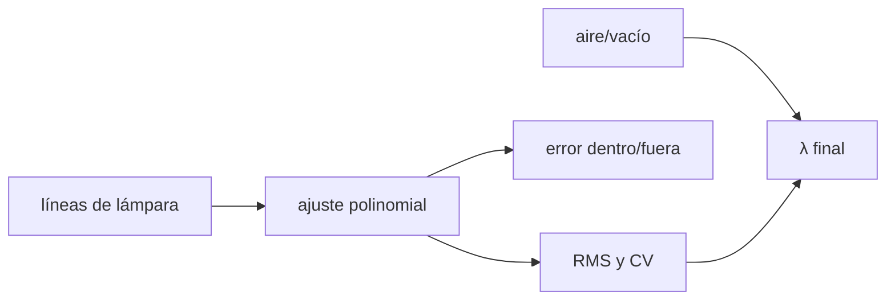

# B45-C08 — Calibración en longitud de onda

<!-- nav:top -->
[🏠 Programa](../../../../README.md) · [📚 Bloque B45](../../../tronco-comun/B45-espectroscopia-fotometria-y-polarimetria.md) · [← Anterior: B45-C07 — Resolución espectral](../B45-C07-resolucion-espectral/CLASE.md) · [Siguiente: B45-C09 — Calibración de respuesta instrumental →](../B45-C09-calibracion-de-respuesta-instrumental/CLASE.md)
<!-- /nav -->

## 1. Ubicación, nivel y alcance

Clase 8 del bloque B45. Nivel N3. Asignar longitud de onda a cada píxel exige una lámpara con líneas conocidas y un ajuste. Aquí ajustas **polinomios** de grado 1 a 5 a catorce líneas **sintéticas**, evalúas el **RMS**, la **validación cruzada** y el **error al extrapolar**, y estimas el efecto **aire frente a vacío**. Usas [B12](../../../tronco-comun/B12-probabilidad-estadistica-e-incertidumbre.md) y [B15](../../../tronco-comun/B15-senales-imagenes-y-estimacion-cientifica.md).

## 2. Por qué esta clase existe

Un error de calibración es un error de velocidad o de identificación de líneas. La decisión central: **¿qué grado del polinomio es adecuado y cuánto se puede fiar el ajuste fuera de las líneas?**

## 3. Lo que podrás hacer al terminar

1. Ajustar un polinomio por mínimos cuadrados.
2. Comparar RMS del ajuste y de la validación cruzada.
3. Elegir el grado por parsimonia.
4. Medir el error dentro y fuera del rango de líneas.
5. Estimar el efecto aire/vacío.
6. Reconocer los límites del catálogo sintético.

La evidencia es la **ficha de calibración en longitud de onda** del ejercicio 12 (sección 20).

## 4. Con qué llegas y cómo comprobarlo

1. ¿Qué es un polinomio?
2. ¿Qué es el método de mínimos cuadrados?
3. ¿Qué es un centroide?
4. ¿Qué es un residuo?
5. ¿Qué es el sobreajuste?

<details>
<summary>Ver respuestas</summary>

1. Una suma de potencias. 2. Minimizar la suma de residuos al cuadrado. 3. El centro ponderado de una línea. 4. Dato menos modelo. 5. Ajustar el ruido en vez de la señal.
</details>

Con cuatro o cinco aciertos, sigue; si no, repasa los prerrequisitos.

## 5. Un caso de contexto y casos de referencia

Con 14 líneas entre `x = 371` y `1978` y centroides con ruido de 0,05 píxeles, el grado 3 da RMS `0,00239 nm` y error interno `0,00199 nm`; el grado 1 deja `0,356 nm`. Es el **ejemplo conductor** (todo sintético).

## 6. Vocabulario

La **solución de dispersión** `λ(x)`. La **línea de lámpara** con longitud de onda de catálogo. El **centroide** de una línea. El **RMS** de los residuos. La **validación cruzada** deja una línea fuera. La **extrapolación** fuera del rango de líneas. El **índice del aire** `n` hace `λ_aire = λ_vacío/n`.

## 7. Modelo mental: trazar una regla con marcas

Como graduar una regla con unas pocas marcas conocidas: entre marcas es fiable; fuera de ellas, la curva se desmanda.



*Descripción textual:* las líneas conocidas fijan un polinomio cuyo grado se elige por el error de validación y cuyo uso se limita al rango cubierto.

Analogía: trazar una regla con marcas. Límite: ruido blanco y catálogo exacto.

## 8. La explicación, paso a paso

### 8.1 Grados del polinomio

| grado | RMS ajuste (nm) | RMS validación (nm) | error dentro (nm) | error en x = −150 (nm) |
|---|---|---|---|---|
| 1 | 0,35571 | 0,40614 | 0,39219 | 3,4307 |
| 2 | 0,07577 | 0,09984 | 0,09402 | 1,5040 |
| 3 | 0,00239 | 0,00320 | 0,00199 | 0,0214 |
| 4 | 0,00214 | 0,00316 | 0,00208 | 0,0510 |
| 5 | 0,00214 | 0,00375 | 0,00207 | 0,0362 |

La dispersión media es `47,87 pm/píxel`. El grado 3 coincide con la dispersión verdadera (cúbica); subir a 4 o 5 no mejora la validación y empeora la extrapolación.

### 8.2 Aire frente a vacío

En 589,3 nm: `n − 1 = 2,7713 × 10⁻⁴`, `Δλ = 0,1633 nm`, equivalente a `83,1 km/s`.

### 8.3 Lectura

El error dentro del rango es de `1,99 pm`, unas `24` veces menor que la dispersión de un píxel. Fuera del rango, el grado 3 se desvía `21,4 pm` a 150 píxeles del borde y el grado 1 `3,43 nm`.

## 9. Magnitudes, símbolos y unidades

| Símbolo | Qué es | Unidad | Valor / nota |
|---|---|---|---|
| `x` | posición en el detector | píxel | 0 a 2047 |
| `λ(x)` | solución de dispersión | nm | polinomio |
| RMS | residuo cuadrático medio | nm | ver 8.1 |
| `n − 1` | índice del aire | — | 2,771 × 10⁻⁴ |
| `dv` | desplazamiento equivalente | km/s | 83,1 |

## 10. Convenciones y referencias

Variable normalizada `u = (x − 1023,5)/1023,5`; ecuaciones normales con eliminación gaussiana; semilla `20261109`; fórmula del aire de libro (no consultada).

## 11. De dónde sale lo que afirmamos

| ID | Fuente | Localizador | Respalda | Estado |
|---|---|---|---|---|
| S1 | Fórmula de Edlén o de Birch y Downs para el índice del aire | — | constantes 8342,13, 2 406 030, 130, 15 997 y 38,9 (de libro) | No consultado |
| S2 | Catálogo de líneas de una lámpara | — | no se usó: las líneas son sintéticas | No consultado |

Límites: las líneas son sintéticas y su catálogo exacto; en la realidad el catálogo y las mezclas de líneas añaden incertidumbre.

## 12. Cómo ver los grados

| grado | RMS CV (nm) |
|---|---|
| 1 | 0,40614 |
| 2 | 0,09984 |
| 3 | 0,00320 |
| 4 | 0,00316 |
| 5 | 0,00375 |

Descripción larga: el error de validación se estanca desde el grado 3.

## 13. Ejemplo trabajado: error en velocidad del grado 3

**Paso 1 · Error.** `0,00199 nm`.

**Paso 2 · Relación.** `dv = c Δλ/λ` con `λ = 600 nm`.

**Paso 3 · Valor.** `0,99 km/s`.

**Paso 4 · Lectura.** Un error relativo de `3,3 × 10⁻⁶` en `λ` equivale a cerca de 1 km/s.

## 14. Distintas formas de describir el resultado

**Por ajuste:** mínimos cuadrados. **Por tabla:** RMS. **Por validación:** línea fuera. **Por código:** `calibracion_lambda.py`.

## 15. Práctica guiada

**Ejercicio 1 · con los pasos indicados.** Error interno del grado 3 en km/s a 600 nm. *Pasos:* ejemplo 13.

<details><summary>Solución comentada</summary>

`0,99 km/s`.
</details>

**Ejercicio 2 · con una pista.** RMS del grado 1. *Pista:* tabla.

<details><summary>Solución comentada</summary>

`0,356 nm`.
</details>

**Ejercicio 3 · casi autónomo.** Grado con menor RMS de validación.

<details><summary>Solución comentada</summary>

El 4 (`0,00316`) apenas supera al 3 (`0,00320`).
</details>

## 16. Práctica autónoma, transferencia e integrador

**Ejercicio 4.** Dispersión media en pm/píxel.

<details><summary>Solución comentada</summary>

`47,87`.
</details>

**Ejercicio 5.** Error del grado 5 en x = −150.

<details><summary>Solución comentada</summary>

`0,0362 nm`.
</details>

**Ejercicio 6.** Cambio aire/vacío en 589,3 nm.

<details><summary>Solución comentada</summary>

`0,1633 nm`.
</details>

**Ejercicio 7.** Equivalente en km/s.

<details><summary>Solución comentada</summary>

`83,1`.
</details>

**Ejercicio 8.** Líneas por parámetro en el grado 3.

<details><summary>Solución comentada</summary>

`14/4 = 3,5`.
</details>

**Ejercicio 9 · transferencia.** **Transferencia.** ¿Por qué no usar el grado 5?

<details><summary>Solución comentada</summary>

No mejora la validación y empeora la extrapolación (sobreajuste).
</details>

**Ejercicio 10 · transferencia.** **Transferencia.** ¿Qué hacer si falta una línea cerca del borde?

<details><summary>Solución comentada</summary>

Añadir líneas o limitar el uso del ajuste al rango cubierto.
</details>

**Ejercicio 11 · transferencia.** **Transferencia.** Un compañero olvida el cambio aire/vacío. ¿Qué error comete?

<details><summary>Solución comentada</summary>

Un desplazamiento de unos 83 km/s en 589 nm.
</details>

**Ejercicio 12.** **Integrador.** Elabora tu *ficha de calibración en longitud de onda*: grado elegido, RMS, validación, extrapolación y límites.

<details><summary>Solución comentada</summary>

Secciones 8.1–8.3.
</details>

**Ejercicio 12 · integrador.** **Integrador.** Elabora tu *ficha de calibración en longitud de onda*: grado elegido, RMS, validación, extrapolación y límites.

<details><summary>Solución modelo</summary>

Secciones 8.1–8.3.
</details>

## 17. Laboratorio: lámpara sintética

El script [calibracion_lambda.py](calibracion_lambda.py) ajusta cinco grados, valida y estima aire/vacío (**comprueba** que el grado 3 queda bajo 0,003 nm).

**Datos:** sin constantes; líneas **sintéticas**. **Predice antes de ejecutar:** ¿qué grado conviene? (3.) **Ejecución del 2026-11-09 (Python 3.12.9):**

```text
Python 3.12.9 (biblioteca estandar)
14 lineas entre x = 371.3 y 1978.0 ; dispersion media = 47.87 pm/pixel
grado  RMS ajuste (nm)  RMS CV (nm)  error dentro (nm)  error en x=-150 (nm)
    1          0.35571      0.40614            0.39219                3.4307
    2          0.07577      0.09984            0.09402                1.5040
    3          0.00239      0.00320            0.00199                0.0214
    4          0.00214      0.00316            0.00208                0.0510
    5          0.00214      0.00375            0.00207                0.0362
indice del aire en 589,3 nm: n - 1 = 2.7713e-04 ; delta lambda = 0.1633 nm ; equivale a 83.1 km/s
Pruebas superadas.
```

```bash
python programa/clases/B45/B45-C08-calibracion-en-longitud-de-onda/calibracion_lambda.py
```

**Límites:** ruido blanco; catálogo exacto.

## 18. Errores frecuentes y cómo corregirlos

**Subir el grado hasta que el RMS baje.** Se corrige con la validación cruzada.

**Extrapolar sin aviso.** Se corrige con 8.3.

**Mezclar aire y vacío.** Se corrige con 8.2.

**Tratar las líneas sintéticas como lámpara real.** Se corrige con la sección 10.

## 19. Cómo sabrás que vas bien

Tras la sección 8: ¿qué resultado esperabas y cuál obtuviste? Si dudas, repasa el ejemplo 13. Tras el laboratorio: ¿qué comprueba? (ver la sección 17).

## 20. Qué entregas y cómo se evalúa

El producto es tu **ficha de calibración en longitud de onda** (ejercicio 12).

| Criterio | Inicial | En desarrollo | Logrado | Destacado |
|---|---|---|---|---|
| Conceptos | Los confunde | Parciales | conceptos de la clase | Explica los límites |
| Cálculo | Sin unidades | Con errores | Tablas completas | Calcula casos nuevos |
| Numérico | Sin comprobar | Un caso | Contraste con el análisis | Interpreta las diferencias |
| Fuentes | Sin fuente | Sin fecha | fuentes con fecha | Declara lo ilustrativo |
| Límites | No los nombra | Uno | Tres | Discute qué falta del modelo |

**Condiciones críticas (no se compensan con promedio):** rotular las líneas como sintéticas; no extrapolar sin reportarlo; citar solo lo consultado.

## 21. Ética, seguridad y límites

Clase educativa: los modelos son simplificados. Accesibilidad: tablas equivalentes a las gráficas, fórmulas en texto, ejercicios sin conexión.

## 22. Para cerrar y seguir

El polinomio de grado 3 reproduce la dispersión sintética con `2,0 pm` de error interno; la extrapolación y el cambio aire/vacío (0,16 nm) pesan más. Queda una pregunta: ¿cómo se calibra la respuesta en flujo?

**Glosario español–inglés.** calibración en longitud de onda · *wavelength calibration*; lámpara · *arc lamp*; validación cruzada · *cross validation*; vacío · *vacuum*.

**Continuidad.** [B45-C09](../B45-C09-calibracion-de-respuesta-instrumental/CLASE.md) estudia la calibración de la respuesta instrumental.

**Referencias:** ver sección 11.

<!-- nav:bottom -->
---

[← Anterior: B45-C07 — Resolución espectral](../B45-C07-resolucion-espectral/CLASE.md) · [📚 Bloque B45](../../../tronco-comun/B45-espectroscopia-fotometria-y-polarimetria.md) · [Siguiente: B45-C09 — Calibración de respuesta instrumental →](../B45-C09-calibracion-de-respuesta-instrumental/CLASE.md)
<!-- /nav -->
