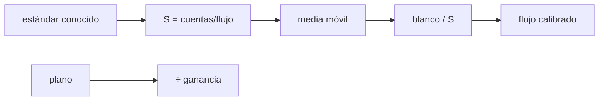

# B45-C09 — Calibración de respuesta instrumental

<!-- nav:top -->
[🏠 Programa](../../../../README.md) · [📚 Bloque B45](../../../tronco-comun/B45-espectroscopia-fotometria-y-polarimetria.md) · [← Anterior: B45-C08 — Calibración en longitud de onda](../B45-C08-calibracion-en-longitud-de-onda/CLASE.md) · [Siguiente: B45-C10 — Líneas de emisión →](../B45-C10-lineas-de-emision/CLASE.md)
<!-- /nav -->

## 1. Ubicación, nivel y alcance

Clase 9 del bloque B45. Nivel N3. La respuesta instrumental combina la eficiencia de la red (blaze), la del detector y la del telescopio. Aquí obtienes la **sensibilidad** con una estrella estándar sintética, la aplicas a un **blanco** de otra temperatura, comparas el error con la **propagación del ruido** y corriges un **campo plano** con ganancia por píxel. Usas [B44](../../../tronco-comun/B44-detectores-y-adquisicion-astronomica.md) y [B15](../../../tronco-comun/B15-senales-imagenes-y-estimacion-cientifica.md).

## 2. Por qué esta clase existe

Sin respuesta, un espectro en cuentas no es un espectro físico. La decisión central: **¿cómo se pasa de cuentas a flujo y con qué incertidumbre?**

## 3. Lo que podrás hacer al terminar

1. Calcular la sensibilidad `S = cuentas/flujo`.
2. Suavizar `S` con una media móvil.
3. Corregir el blanco con `S`.
4. Propagar el ruido del estándar y del blanco.
5. Corregir un campo plano.
6. Reconocer el sesgo del suavizado.

La evidencia es la **ficha de respuesta instrumental** del ejercicio 12 (sección 20).

## 4. Con qué llegas y cómo comprobarlo

1. ¿Qué es una ganancia?
2. ¿Qué es el ruido de Poisson?
3. ¿Qué es una media móvil?
4. ¿Qué es una estrella estándar?
5. ¿Qué es una propagación de errores?

<details>
<summary>Ver respuestas</summary>

1. El factor entre electrones y cuentas. 2. La raíz de la cuenta de fotones. 3. El promedio de vecinos consecutivos. 4. Una estrella de flujo conocido. 5. Calcular el error de un resultado a partir de los de sus datos.
</details>

Con cuatro o cinco aciertos, sigue; si no, repasa los prerrequisitos.

## 5. Un caso de contexto y casos de referencia

La respuesta ilustrativa varía en un factor `5,1` (máximo `0,767`, mínimo `0,150`); sin calibrar, el flujo del blanco se aparta `68,4 %` y calibrado con el estándar `0,413 %`. Es el **ejemplo conductor** (todo sintético).

## 6. Vocabulario

La **respuesta** o **sensibilidad** `S(λ)` en cuentas por unidad de flujo. El **estándar** es una fuente de flujo conocido. El **campo plano** corrige la ganancia píxel a píxel. La **propagación de errores** suma las varianzas relativas. El **blaze** es el pico de eficiencia de la red.

## 7. Modelo mental: una balanza con tara

Como pesar con una balanza que lee mal: primero pesas una pesa conocida para saber cuánto se equivoca y luego corriges las demás pesadas.



*Descripción textual:* el estándar da la sensibilidad, que se suaviza y se divide en el blanco, con el ruido propagado de ambos.

Analogía: una balanza con tara. Límite: respuesta estable, cuentas altas.

## 8. La explicación, paso a paso

### 8.1 Calibración con el estándar

| Magnitud | Valor |
|---|---|
| razón máx/mín de la respuesta | 5,1 |
| RMS relativo sin calibrar | 68,4 % |
| RMS relativo calibrado | 0,413 % |
| RMS previsto (propagación) | 0,236 % |

El RMS observado excede lo previsto en un factor `1,75`: la media móvil de 11 bins sesga la respuesta donde cambia rápido.

### 8.2 Campo plano

| Magnitud | Valor |
|---|---|
| dispersión de los píxeles antes | 2,102 % |
| después de dividir por el plano | 0,782 % |
| ruido de Poisson solo (2×10⁴ cuentas) | 0,707 % |
| predicción con plano ruidoso | 0,775 % |

### 8.3 Lectura

El plano elimina la ganancia de 2 %, pero añade su propio ruido (1/√10⁵); el resultado coincide con la predicción a 1 %.

## 9. Magnitudes, símbolos y unidades

| Símbolo | Qué es | Unidad | Valor / nota |
|---|---|---|---|
| `S(λ)` | sensibilidad | cuentas por unidad de flujo | ver 8.1 |
| `N` | cuentas | — | estándar 4×10⁶ de pico |
| `σ/F` | error relativo | — | 0,00413 |
| `g` | ganancia por píxel | — | 1 ± 0,02 |

## 10. Convenciones y referencias

Bins de 1 nm entre 400 y 700 nm; media móvil de 11 bins; Poisson aproximado por gaussiana; semilla `20261109`; respuesta y estándares **sintéticos**.

## 11. De dónde sale lo que afirmamos

| ID | Fuente | Localizador | Respalda | Estado |
|---|---|---|---|---|
| S1 | NIST, *Fundamental Physical Constants* (CODATA 2022) | https://physics.nist.gov/cuu/Constants/Table/allascii.txt | `h`, `c`, `k_B` para Planck | Consultada el 2026-11-09 |
| S2 | Flujos de estrellas estándar reales | — | no se usaron: el estándar es un cuerpo negro sintético | No consultado |

Límites: no se usó ninguna estrella estándar real ni un espectrógrafo real.

## 12. Cómo ver la corrección

| Caso | RMS |
|---|---|
| sin calibrar | 68,4 % |
| calibrado | 0,413 % |
| previsto | 0,236 % |

Descripción larga: la calibración reduce el error en dos órdenes.

## 13. Ejemplo trabajado: ruido previsto de un bin

**Paso 1 · Blanco.** `1/N_t` con `N_t = 10⁶`·(respuesta).

**Paso 2 · Estándar.** `1/(N_s · 11)`.

**Paso 3 · Suma.** Varianzas relativas.

**Paso 4 · Valor medio.** `0,236 %`.

## 14. Distintas formas de describir el resultado

**Por cociente:** cuentas/flujo. **Por tabla:** RMS. **Por propagación:** suma de varianzas. **Por código:** `respuesta.py`.

## 15. Práctica guiada

**Ejercicio 1 · con los pasos indicados.** Reducción del error con la calibración. *Pasos:* cociente.

<details><summary>Solución comentada</summary>

`166` veces.
</details>

**Ejercicio 2 · con una pista.** Razón máx/mín de la respuesta. *Pista:* tabla.

<details><summary>Solución comentada</summary>

`5,1`.
</details>

**Ejercicio 3 · casi autónomo.** Ruido de Poisson de 2×10⁴ cuentas.

<details><summary>Solución comentada</summary>

`0,707 %`.
</details>

## 16. Práctica autónoma, transferencia e integrador

**Ejercicio 4.** Ruido previsto con plano de 10⁵.

<details><summary>Solución comentada</summary>

`0,775 %`.
</details>

**Ejercicio 5.** Dispersión antes del plano.

<details><summary>Solución comentada</summary>

`2,102 %`.
</details>

**Ejercicio 6.** Dispersión después.

<details><summary>Solución comentada</summary>

`0,782 %`.
</details>

**Ejercicio 7.** Factor RMS observado/previsto.

<details><summary>Solución comentada</summary>

`1,75`.
</details>

**Ejercicio 8.** RMS previsto.

<details><summary>Solución comentada</summary>

`0,236 %`.
</details>

**Ejercicio 9 · transferencia.** **Transferencia.** ¿Por qué se suaviza la sensibilidad?

<details><summary>Solución comentada</summary>

Para no inyectar en el blanco el ruido de cada bin del estándar.
</details>

**Ejercicio 10 · transferencia.** **Transferencia.** ¿Qué pasa con las líneas de absorción del estándar?

<details><summary>Solución comentada</summary>

Hay que enmascararlas o interpolarlas antes de suavizar.
</details>

**Ejercicio 11 · transferencia.** **Transferencia.** Un compañero afirma que el plano no añade ruido. Responde.

<details><summary>Solución comentada</summary>

Sí lo añade (1/√N del plano).
</details>

**Ejercicio 12.** **Integrador.** Elabora tu *ficha de respuesta instrumental*: sensibilidad, error propagado, plano y límites.

<details><summary>Solución comentada</summary>

Secciones 8.1–8.3.
</details>

**Ejercicio 12 · integrador.** **Integrador.** Elabora tu *ficha de respuesta instrumental*: sensibilidad, error propagado, plano y límites.

<details><summary>Solución modelo</summary>

Secciones 8.1–8.3.
</details>

## 17. Laboratorio: estándar sintético y plano

El script [respuesta.py](respuesta.py) recupera el flujo de un blanco con la sensibilidad del estándar y corrige un plano (**comprueba** RMS bajo el doble de lo previsto y plano a 10 %).

**Datos:** constantes de NIST (S1); estrellas y respuesta **sintéticas**. **Predice antes de ejecutar:** ¿cuánto baja el error al calibrar? (≈ 165 veces.) **Ejecución del 2026-11-09 (Python 3.12.9):**

```text
Python 3.12.9 (biblioteca estandar)
respuesta: maximo 0.767, minimo 0.150, cociente 5.1
flujo del blanco sin calibrar: RMS relativo = 68.4 % ; calibrado con el estandar: 0.413 % ; predicho: 0.236 %
campo plano (ganancia 2 % RMS, 2e4 cuentas): dispersion antes 2.102 % ; despues 0.782 % ; ruido de Poisson solo 0.707 % ; prediccion con plano ruidoso 0.775 %
Pruebas superadas.
```

```bash
python programa/clases/B45/B45-C09-calibracion-de-respuesta-instrumental/respuesta.py
```

**Límites:** respuesta estable; sin cielo ni telúricas.

## 18. Errores frecuentes y cómo corregirlos

**Suavizar sin enmascarar líneas.** Se corrige con la pregunta de transferencia.

**Ignorar el ruido del estándar.** Se corrige con 8.1.

**Creer que el plano no añade ruido.** Se corrige con 8.2.

**Presentar el estándar como real.** Se corrige con la sección 10.

## 19. Cómo sabrás que vas bien

Tras la sección 8: ¿qué resultado esperabas y cuál obtuviste? Si dudas, repasa el ejemplo 13. Tras el laboratorio: ¿qué comprueba? (ver la sección 17).

## 20. Qué entregas y cómo se evalúa

El producto es tu **ficha de respuesta instrumental** (ejercicio 12).

| Criterio | Inicial | En desarrollo | Logrado | Destacado |
|---|---|---|---|---|
| Conceptos | Los confunde | Parciales | conceptos de la clase | Explica los límites |
| Cálculo | Sin unidades | Con errores | Tablas completas | Calcula casos nuevos |
| Numérico | Sin comprobar | Un caso | Contraste con el análisis | Interpreta las diferencias |
| Fuentes | Sin fuente | Sin fecha | fuentes con fecha | Declara lo ilustrativo |
| Límites | No los nombra | Uno | Tres | Discute qué falta del modelo |

**Condiciones críticas (no se compensan con promedio):** rotular estándar y respuesta como sintéticos; no dar sensibilidades de instrumentos; citar solo lo consultado.

## 21. Ética, seguridad y límites

Clase educativa: los modelos son simplificados. Accesibilidad: tablas equivalentes a las gráficas, fórmulas en texto, ejercicios sin conexión.

## 22. Para cerrar y seguir

La sensibilidad del estándar baja el error del blanco de 68 % a 0,41 %; el plano deja los píxeles al nivel del ruido de Poisson. Queda una pregunta: ¿qué dicen las líneas del espectro?

**Glosario español–inglés.** respuesta instrumental · *instrument response*; sensibilidad · *sensitivity*; campo plano · *flat field*; estrella estándar · *standard star*.

**Continuidad.** [B45-C10](../B45-C10-lineas-de-emision/CLASE.md) estudia las líneas de emisión.

**Referencias:** ver sección 11.

<!-- nav:bottom -->
---

[← Anterior: B45-C08 — Calibración en longitud de onda](../B45-C08-calibracion-en-longitud-de-onda/CLASE.md) · [📚 Bloque B45](../../../tronco-comun/B45-espectroscopia-fotometria-y-polarimetria.md) · [Siguiente: B45-C10 — Líneas de emisión →](../B45-C10-lineas-de-emision/CLASE.md)
<!-- /nav -->
