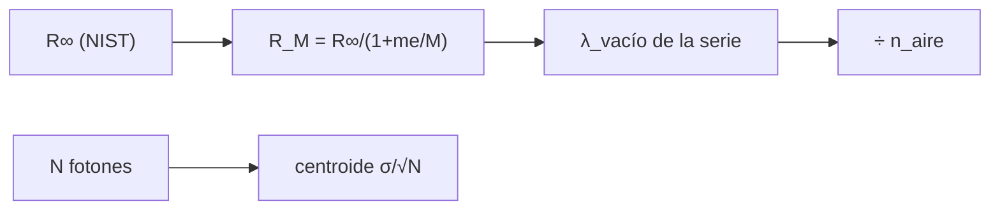

# B45-C10 — Líneas de emisión

<!-- nav:top -->
[🏠 Programa](../../../../README.md) · [📚 Bloque B45](../../../tronco-comun/B45-espectroscopia-fotometria-y-polarimetria.md) · [← Anterior: B45-C09 — Calibración de respuesta instrumental](../B45-C09-calibracion-de-respuesta-instrumental/CLASE.md) · [Siguiente: B45-C11 — Líneas de absorción →](../B45-C11-lineas-de-absorcion/CLASE.md)
<!-- /nav -->

## 1. Ubicación, nivel y alcance

Clase 10 del bloque B45. Nivel N3. Una línea de emisión aparece cuando un átomo pasa de un nivel alto a otro bajo. Aquí calculas las **series del hidrógeno** con la constante de Rydberg de NIST, el efecto de la **masa reducida** (hidrógeno frente a deuterio) y la **precisión del centroide** de una línea con ruido de fotones. Usas [B05](../../../tronco-comun/B05-fisica-fundamental-para-el-espacio.md) y [B31](../../../tronco-comun/B31-fisica-cuantica-nuclear-y-astroparticulas.md).

## 2. Por qué esta clase existe

Las líneas de emisión identifican elementos y miden velocidad y flujo. La decisión central: **¿dónde está cada línea del hidrógeno y con qué precisión se mide su posición?**

## 3. Lo que podrás hacer al terminar

1. Aplicar `1/λ = R_M (1/n₁² − 1/n₂²)`.
2. Corregir por masa reducida.
3. Pasar de vacío a aire.
4. Calcular el desplazamiento H–D.
5. Medir un centroide y su error `σ/√N`.
6. Reconocer la estructura fina no modelada.

La evidencia es la **ficha de líneas de emisión** del ejercicio 12 (sección 20).

## 4. Con qué llegas y cómo comprobarlo

1. ¿Qué es un nivel de energía?
2. ¿Qué es una serie espectral?
3. ¿Qué es un fotón?
4. ¿Qué es un centroide?
5. ¿Qué es el ruido de fotones?

<details>
<summary>Ver respuestas</summary>

1. Una energía permitida de un átomo. 2. Las líneas que terminan en el mismo nivel. 3. Un cuanto de luz. 4. El promedio ponderado de posición. 5. La fluctuación `√N` de la cuenta de fotones.
</details>

Con cuatro o cinco aciertos, sigue; si no, repasa los prerrequisitos.

## 5. Un caso de contexto y casos de referencia

Hα tiene longitud de onda en vacío `656,4696 nm` y en aire `656,2907 nm`; el centroide de una línea de 4000 fotones y `σ = 0,08 nm` se mide con `1,25 pm` (`0,57 km/s`). Es el **ejemplo conductor**. La línea es **sintética**.

## 6. Vocabulario

La **serie de Lyman** (`n₁ = 1`), **Balmer** (`n₁ = 2`) y **Paschen** (`n₁ = 3`). La **constante de Rydberg** `R_∞`. La **masa reducida** `R_M = R_∞/(1 + m_e/M)`. El **centroide** de una línea. El **ancho equivalente**. La **longitud de onda en aire** es `λ_vacío/n_aire`.

## 7. Modelo mental: campanadas de una torre

Como las campanadas de una torre: cada nivel emite una nota fija, y la serie completa permite reconocer la torre.



*Descripción textual:* la constante de Rydberg con masa reducida da las longitudes de onda y el ruido de fotones fija la precisión del centroide.

Analogía: campanadas de una torre. Límite: hidrógeno no relativista.

## 8. La explicación, paso a paso

### 8.1 Series del hidrógeno

| línea | vacío (nm) | aire (nm) |
|---|---|---|
| Ly alfa | 121,5684 | — |
| Ly beta | 102,5734 | — |
| H alfa | 656,4696 | 656,2907 |
| H beta | 486,2738 | 486,1413 |
| H gamma | 434,1730 | 434,0547 |
| H delta | 410,2935 | 410,1817 |
| Pa alfa | 1875,6274 | 1875,1163 |
| Br alfa | 4052,2815 | 4051,1771 |

El límite de Balmer es `364,705 nm` y el de Lyman `91,176 nm`. El factor de masa reducida del hidrógeno es `0,99945568`.

### 8.2 Isótopos

El desplazamiento H–D en Hα es `0,1786 nm`.

### 8.3 Centroide

Con 4000 fotones y `σ = 0,08 nm` (FWHM `0,188 nm`), 2000 repeticiones dan centroide medio `655,99999 nm`, dispersión `0,00125 nm` frente a `σ/√N = 0,00126 nm`; el flujo tiene dispersión `64,3` (√N = 63,2).

### 8.4 Lectura

La posición se mide mucho mejor que la anchura de la línea: `1,25 pm` es 1/64 de la `σ`. Las lámparas de laboratorio y la estructura fina limitan en la práctica.

## 9. Magnitudes, símbolos y unidades

| Símbolo | Qué es | Unidad | Valor / nota |
|---|---|---|---|
| `R_∞` | constante de Rydberg | m⁻¹ | 10 973 731,568157 (S1) |
| `m_e`, `m_p`, `m_d` | masas | kg | S1 |
| `λ` | longitud de onda | nm | ver 8.1 |
| `N` | fotones de la línea | — | 4000 (ilustrativo) |
| `σ` | ancho de la línea | nm | 0,08 (ilustrativo) |

## 10. Convenciones y referencias

Rydberg con masa reducida; aire por la fórmula de libro (no consultada); línea gaussiana **sintética**; ventana de 4 `σ`; semilla `20261109`.

## 11. De dónde sale lo que afirmamos

| ID | Fuente | Localizador | Respalda | Estado |
|---|---|---|---|---|
| S1 | NIST, *Fundamental Physical Constants* (CODATA 2022) | https://physics.nist.gov/cuu/Constants/Table/allascii.txt | `R_∞`, `m_e`, `m_p`, `m_d` (sección 9) | Consultada el 2026-11-09 |
| S2 | Longitudes de onda de laboratorio de las líneas del hidrógeno | — | no consultadas; el laboratorio verifica Hα en aire con 0,02 nm de tolerancia frente al valor de libro 656,28 nm | No consultado |

Límites: no se consultó ninguna tabla de líneas atómicas; el valor 656,28 nm es de libro y solo se usa de verificación gruesa.

## 12. Cómo ver la serie

| línea | vacío (nm) |
|---|---|
| Ly alfa | 121,568 |
| Ly beta | 102,573 |
| H alfa | 656,470 |
| H beta | 486,274 |
| H gamma | 434,173 |
| H delta | 410,294 |
| Pa alfa | 1875,627 |
| Br alfa | 4052,282 |

Descripción larga: las líneas de una serie se acercan al límite de la serie.

## 13. Ejemplo trabajado: Hβ en vacío

**Paso 1 · Fórmula.** `1/λ = R_M (1/4 − 1/16)`.

**Paso 2 · Factor.** `3/16 = 0,1875`.

**Paso 3 · Cálculo.** `λ = 1/(R_M × 0,1875)`.

**Paso 4 · Valor.** `486,2738 nm`.

## 14. Distintas formas de describir el resultado

**Por fórmula:** Rydberg. **Por tabla:** series. **Por simulación:** centroide. **Por código:** `emision.py`.

## 15. Práctica guiada

**Ejercicio 1 · con los pasos indicados.** Hβ en vacío. *Pasos:* ejemplo 13.

<details><summary>Solución comentada</summary>

`486,2738 nm`.
</details>

**Ejercicio 2 · con una pista.** Hγ en vacío. *Pista:* `(1/4 − 1/25)`.

<details><summary>Solución comentada</summary>

`434,1730 nm`.
</details>

**Ejercicio 3 · casi autónomo.** Límite de Balmer.

<details><summary>Solución comentada</summary>

`364,705 nm`.
</details>

## 16. Práctica autónoma, transferencia e integrador

**Ejercicio 4.** Lyα en vacío.

<details><summary>Solución comentada</summary>

`121,5684 nm`.
</details>

**Ejercicio 5.** Hα en aire.

<details><summary>Solución comentada</summary>

`656,2907 nm`.
</details>

**Ejercicio 6.** Desplazamiento H–D.

<details><summary>Solución comentada</summary>

`0,1786 nm`.
</details>

**Ejercicio 7.** Error del centroide con 4000 fotones.

<details><summary>Solución comentada</summary>

`0,00126 nm`.
</details>

**Ejercicio 8.** Error equivalente en km/s.

<details><summary>Solución comentada</summary>

`0,57 km/s`.
</details>

**Ejercicio 9 · transferencia.** **Transferencia.** ¿Cuántos fotones hacen falta para 0,1 km/s con σ = 0,08 nm en 656 nm?

<details><summary>Solución comentada</summary>

`δλ = 0,1/299792 × 656 = 0,219 pm`; `N = (80/0,219)² ≈ 1.34e+05`.
</details>

**Ejercicio 10 · transferencia.** **Transferencia.** ¿Por qué la fórmula de Rydberg no da el desdoblamiento fino?

<details><summary>Solución comentada</summary>

Porque ignora el espín y los efectos relativistas.
</details>

**Ejercicio 11 · transferencia.** **Transferencia.** Un compañero dice que el 656,28 nm del laboratorio es una medida de NIST. Responde.

<details><summary>Solución comentada</summary>

No: es un valor de libro no consultado; solo verifica en forma gruesa.
</details>

**Ejercicio 12.** **Integrador.** Elabora tu *ficha de líneas de emisión*: series, masa reducida, centroide y límites.

<details><summary>Solución comentada</summary>

Secciones 8.1–8.4.
</details>

**Ejercicio 12 · integrador.** **Integrador.** Elabora tu *ficha de líneas de emisión*: series, masa reducida, centroide y límites.

<details><summary>Solución modelo</summary>

Secciones 8.1–8.4.
</details>

## 17. Laboratorio: hidrógeno y centroide

El script [emision.py](emision.py) calcula las series del hidrógeno y la dispersión del centroide por Monte Carlo (**comprueba** Hα a 0,02 nm de 656,28 y el centroide a 10 %).

**Datos:** constantes de NIST (S1); línea **sintética**. **Predice antes de ejecutar:** ¿dónde cae Hα en aire? (≈ 656,29 nm.) **Ejecución del 2026-11-09 (Python 3.12.9):**

```text
Python 3.12.9 (biblioteca estandar)
   linea  vacio (nm)  aire (nm)
 Ly alfa    121.5684        nan
 Ly beta    102.5734        nan
  H alfa    656.4696   656.2907
  H beta    486.2738   486.1413
 H gamma    434.1730   434.0547
 H delta    410.2935   410.1817
 Pa alfa   1875.6274  1875.1163
 Br alfa   4052.2815  4051.1771
limite de Balmer = 364.705 nm ; limite de Lyman = 91.176 nm ; factor de masa reducida (H) = 0.99945568
desplazamiento H - D en H alfa = 0.1786 nm
centroide: media 655.99999 nm ; dispersion MC 0.00125 nm ; sigma/sqrt(N) = 0.00126 nm ; equivale a 0.57 km/s
flujo (cuentas): media 3999.9 ; dispersion 64.3 ; sqrt(N) = 63.2
Pruebas superadas.
```

```bash
python programa/clases/B45/B45-C10-lineas-de-emision/emision.py
```

**Límites:** no relativista, sin estructura fina.

## 18. Errores frecuentes y cómo corregirlos

**Mezclar longitudes en aire y en vacío.** Se corrige con 8.1.

**Olvidar la masa reducida.** Se corrige con 8.2.

**Confundir el error del centroide con el ancho.** Se corrige con 8.3.

**Dar la línea sintética como medida.** Se corrige con la sección 10.

## 19. Cómo sabrás que vas bien

Tras la sección 8: ¿qué resultado esperabas y cuál obtuviste? Si dudas, repasa el ejemplo 13. Tras el laboratorio: ¿qué comprueba? (ver la sección 17).

## 20. Qué entregas y cómo se evalúa

El producto es tu **ficha de líneas de emisión** (ejercicio 12).

| Criterio | Inicial | En desarrollo | Logrado | Destacado |
|---|---|---|---|---|
| Conceptos | Los confunde | Parciales | conceptos de la clase | Explica los límites |
| Cálculo | Sin unidades | Con errores | Tablas completas | Calcula casos nuevos |
| Numérico | Sin comprobar | Un caso | Contraste con el análisis | Interpreta las diferencias |
| Fuentes | Sin fuente | Sin fecha | fuentes con fecha | Declara lo ilustrativo |
| Límites | No los nombra | Uno | Tres | Discute qué falta del modelo |

**Condiciones críticas (no se compensan con promedio):** rotular la línea como sintética; no citar el valor de libro como medida de NIST; citar solo lo consultado.

## 21. Ética, seguridad y límites

Clase educativa: los modelos son simplificados. Accesibilidad: tablas equivalentes a las gráficas, fórmulas en texto, ejercicios sin conexión.

## 22. Para cerrar y seguir

Las series se calculan con las constantes de NIST (Hα en aire 656,29 nm) y 4000 fotones fijan el centroide a 1,3 pm. Queda una pregunta: ¿qué pasa cuando el gas absorbe en lugar de emitir?

**Glosario español–inglés.** línea de emisión · *emission line*; serie de Balmer · *Balmer series*; masa reducida · *reduced mass*; centroide · *centroid*.

**Continuidad.** [B45-C11](../B45-C11-lineas-de-absorcion/CLASE.md) estudia las líneas de absorción.

**Referencias:** ver sección 11.

<!-- nav:bottom -->
---

[← Anterior: B45-C09 — Calibración de respuesta instrumental](../B45-C09-calibracion-de-respuesta-instrumental/CLASE.md) · [📚 Bloque B45](../../../tronco-comun/B45-espectroscopia-fotometria-y-polarimetria.md) · [Siguiente: B45-C11 — Líneas de absorción →](../B45-C11-lineas-de-absorcion/CLASE.md)
<!-- /nav -->
