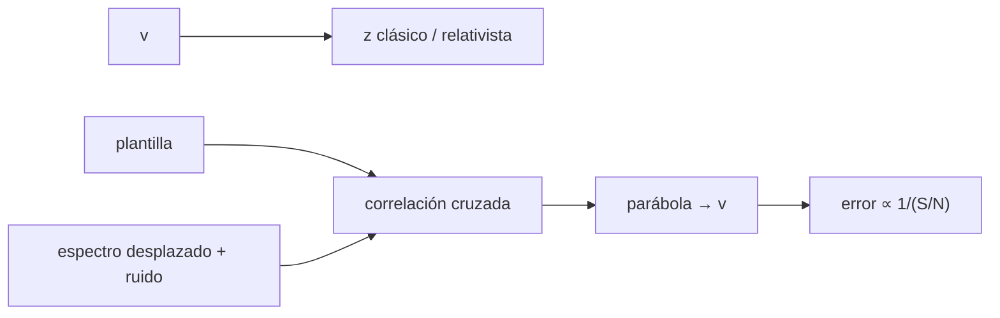

# B45-C12 — Efecto Doppler en espectros

<!-- nav:top -->
[🏠 Programa](../../../../README.md) · [📚 Bloque B45](../../../tronco-comun/B45-espectroscopia-fotometria-y-polarimetria.md) · [← Anterior: B45-C11 — Líneas de absorción](../B45-C11-lineas-de-absorcion/CLASE.md) · [Siguiente: B45-C13 — Temperatura y espectro de cuerpo negro →](../B45-C13-temperatura-y-espectro-de-cuerpo-negro/CLASE.md)
<!-- /nav -->

## 1. Ubicación, nivel y alcance

Clase 12 del bloque B45. Nivel N3. El corrimiento Doppler de las líneas da la velocidad a lo largo de la línea de visión. Aquí comparas el **Doppler clásico y el relativista**, calculas la **velocidad orbital** de la Tierra y mides una **velocidad radial** de un espectro sintético por **correlación cruzada** con y sin ruido. Usas [B05](../../../tronco-comun/B05-fisica-fundamental-para-el-espacio.md) y [B15](../../../tronco-comun/B15-senales-imagenes-y-estimacion-cientifica.md).

## 2. Por qué esta clase existe

Las velocidades radiales descubren planetas, binarias y la expansión del universo. La decisión central: **¿cómo se pasa de un corrimiento a una velocidad y con qué precisión?**

## 3. Lo que podrás hacer al terminar

1. Calcular `z` y `v` con las fórmulas clásica y relativista.
2. Calcular la velocidad orbital terrestre.
3. Medir un corrimiento por correlación cruzada.
4. Refinar el máximo con una parábola.
5. Comprobar la escala del error con S/N.
6. Reconocer el sesgo de la interpolación.

La evidencia es la **ficha de velocidad radial** del ejercicio 12 (sección 20).

## 4. Con qué llegas y cómo comprobarlo

1. ¿Qué es la velocidad de la luz?
2. ¿Qué es un logaritmo natural?
3. ¿Qué es una correlación?
4. ¿Qué es una parábola?
5. ¿Qué es un corrimiento al rojo?

<details>
<summary>Ver respuestas</summary>

1. 299 792 458 m/s. 2. El inverso de la exponencial. 3. La suma del producto de dos series. 4. La curva `ax² + bx + c`. 5. Líneas desplazadas hacia mayores longitudes de onda.
</details>

Con cuatro o cinco aciertos, sigue; si no, repasa los prerrequisitos.

## 5. Un caso de contexto y casos de referencia

La Tierra se mueve a `29,785 km/s` (órbita circular); un espectro sintético con 40 líneas desplazado `7,3 km/s` se recupera como `7,328 km/s` sin ruido y con dispersión `0,023 km/s` a S/N 50. Es el **ejemplo conductor** (espectro **sintético**).

## 6. Vocabulario

El **corrimiento** `z = Δλ/λ`. El **Doppler clásico** `z = v/c`; el **relativista** `1 + z = √((1+β)/(1−β))`. La **correlación cruzada** compara el espectro con una plantilla desplazada. El **paso en velocidad** de un espectro en `ln λ` es constante. La **corrección baricéntrica** quita el movimiento de la Tierra.

## 7. Modelo mental: una sirena que pasa

Como la sirena de una ambulancia: el tono sube al acercarse y baja al alejarse; el corrimiento de las líneas es proporcional a la velocidad.



*Descripción textual:* una plantilla se desplaza y se compara con el espectro; el máximo de la correlación da la velocidad.

Analogía: una sirena que pasa. Límite: ruido blanco, plantilla sin ruido.

## 8. La explicación, paso a paso

### 8.1 Doppler clásico y relativista

| v (km/s) | z clásico | z relativista | diferencia relativa |
|---|---|---|---|
| 30,0 | 0,000100 | 0,000100 | 0,0001 |
| 3000,0 | 0,010007 | 0,010057 | 0,0050 |
| 30000,0 | 0,100069 | 0,105619 | 0,0525 |
| 29979,2 | 0,100000 | 0,105542 | 0,0525 |
| 149896,2 | 0,500000 | 0,732051 | 0,3170 |

Para `z = 0,1` la velocidad relativista es `β = 0,095023` (el clásico daría 0,1).

### 8.2 Velocidad radial por correlación

Espectro de 2970 píxeles, 1,999 km/s por píxel, `v` inyectada 7,3 km/s. Sin ruido: `7,328 km/s` (sesgo de interpolación `0,028`).

| S/N | media (km/s) | dispersión (km/s) |
|---|---|---|
| 50 | 7,329 | 0,023 |
| 200 | 7,328 | 0,008 |

El cociente de dispersiones es `3,05` (el valor ideal para S/N × 4 sería 4; con 60 repeticiones y el sesgo de interpolación queda por debajo).

### 8.3 Lectura

El efecto relativista es del 5 % a 30 000 km/s y del 0,005 % a 3000 km/s. La Tierra añade hasta ±29,8 km/s que hay que quitar antes de comparar épocas.

## 9. Magnitudes, símbolos y unidades

| Símbolo | Qué es | Unidad | Valor / nota |
|---|---|---|---|
| `z` | corrimiento al rojo | — | ver 8.1 |
| `β` | `v/c` | — | ver 8.1 |
| `v_orb` | velocidad orbital terrestre | km/s | 29,785 |
| `R` | resolución del espectro | — | 50 000 (ilustrativa) |
| `S/N` | señal a ruido por píxel | — | 50 y 200 |

## 10. Convenciones y referencias

Eje `ln λ` con 3 píxeles por FWHM; correlación con desplazamientos enteros y máximo parabólico; semilla `20261109`.

## 11. De dónde sale lo que afirmamos

| ID | Fuente | Localizador | Respalda | Estado |
|---|---|---|---|---|
| S1 | NIST, *Fundamental Physical Constants* (CODATA 2022) | https://physics.nist.gov/cuu/Constants/Table/allascii.txt | `c` exacta | Consultada el 2026-11-09 |
| S2 | Plantilla estelar real o espectro observado | — | no se usó: el espectro es sintético | No consultado |

Límites: el sesgo de la interpolación parabólica es real y se informa; no hay telúricas ni variación de perfil.

## 12. Cómo ver la velocidad

| S/N | dispersión (km/s) |
|---|---|
| 50 | 0,023 |
| 200 | 0,008 |

Descripción larga: más S/N, menos dispersión.

## 13. Ejemplo trabajado: velocidad de un corrimiento

**Paso 1 · Dato.** `z = 0,001`.

**Paso 2 · Clásico.** `v = c z = 299,79 km/s`.

**Paso 3 · Relativista.** `β = ((1+z)² − 1)/((1+z)² + 1) = 0,001000`.

**Paso 4 · Valor.** `299,64 km/s`.

## 14. Distintas formas de describir el resultado

**Por fórmula:** Doppler. **Por tabla:** relativista. **Por correlación:** plantilla. **Por código:** `doppler.py`.

## 15. Práctica guiada

**Ejercicio 1 · con los pasos indicados.** `v` clásico con `z = 0,001`. *Pasos:* ejemplo 13.

<details><summary>Solución comentada</summary>

`299,79 km/s`.
</details>

**Ejercicio 2 · con una pista.** `v` relativista con `z = 0,001`.

<details><summary>Solución comentada</summary>

`299,64 km/s`.
</details>

**Ejercicio 3 · casi autónomo.** Velocidad orbital de la Tierra.

<details><summary>Solución comentada</summary>

`29,785 km/s`.
</details>

## 16. Práctica autónoma, transferencia e integrador

**Ejercicio 4.** Desplazamiento de Hα (656,28 nm) a 30 km/s.

<details><summary>Solución comentada</summary>

`0,0657 nm`.
</details>

**Ejercicio 5.** `β` para `z = 0,1`.

<details><summary>Solución comentada</summary>

`0,095023`.
</details>

**Ejercicio 6.** Cociente de dispersiones.

<details><summary>Solución comentada</summary>

`3,05`.
</details>

**Ejercicio 7.** Sesgo sin ruido.

<details><summary>Solución comentada</summary>

`0,028 km/s`.
</details>

**Ejercicio 8.** Paso en velocidad por píxel.

<details><summary>Solución comentada</summary>

`1,999 km/s`.
</details>

**Ejercicio 9 · transferencia.** **Transferencia.** ¿Por qué se usa `ln λ`?

<details><summary>Solución comentada</summary>

Porque un desplazamiento en velocidad es una traslación constante.
</details>

**Ejercicio 10 · transferencia.** **Transferencia.** ¿Qué es la corrección baricéntrica?

<details><summary>Solución comentada</summary>

Pasar la velocidad al centro de masas del Sistema Solar.
</details>

**Ejercicio 11 · transferencia.** **Transferencia.** Un compañero afirma que el laboratorio mide una velocidad estelar. Responde.

<details><summary>Solución comentada</summary>

Es un espectro sintético con una velocidad inyectada.
</details>

**Ejercicio 12.** **Integrador.** Elabora tu *ficha de velocidad radial*: fórmulas, correlación, error y límites.

<details><summary>Solución comentada</summary>

Secciones 8.1–8.3.
</details>

**Ejercicio 12 · integrador.** **Integrador.** Elabora tu *ficha de velocidad radial*: fórmulas, correlación, error y límites.

<details><summary>Solución modelo</summary>

Secciones 8.1–8.3.
</details>

## 17. Laboratorio: velocidad radial sintética

El script [doppler.py](doppler.py) inyecta `7,3 km/s`, correlaciona y estima el error con S/N 50 y 200 (**comprueba** el sesgo bajo 0,15 km/s).

**Datos:** `c` de NIST (S1); espectro **sintético**. **Predice antes de ejecutar:** ¿qué velocidad se recupera? (≈ 7,33 km/s.) **Ejecución del 2026-11-09 (Python 3.12.9):**

```text
Python 3.12.9 (biblioteca estandar)
velocidad orbital de la Tierra (orbita circular, 1 au, 1 ano juliano) = 29.785 km/s
    v (km/s)    z clasico  z relativista  diferencia rel.
        30.0     0.000100       0.000100           0.0001
      3000.0     0.010007       0.010057           0.0050
     30000.0     0.100069       0.105619           0.0525
     29979.2     0.100000       0.105542           0.0525
    149896.2     0.500000       0.732051           0.3170
velocidad/c para z = 0,1: 0.095023
2970 pixeles, 1.999 km/s por pixel ; v inyectada 7.3 km/s ; sin ruido: 7.328 km/s
S/N = 50: media 7.329 km/s ; dispersion 0.023 km/s ; error estandar de la media 0.003
S/N = 200: media 7.328 km/s ; dispersion 0.008 km/s ; error estandar de la media 0.001
cociente de dispersiones S/N 50 frente a 200 = 3.05 (esperado 4)
Pruebas superadas.
```

```bash
python programa/clases/B45/B45-C12-efecto-doppler-en-espectros/doppler.py
```

**Límites:** ruido blanco, plantilla exacta.

## 18. Errores frecuentes y cómo corregirlos

**Usar la fórmula clásica a velocidades relativistas.** Se corrige con 8.1.

**Olvidar la corrección baricéntrica.** Se corrige con 8.3.

**Ignorar el sesgo de interpolación.** Se corrige con 8.2.

**Dar el resultado como medida real.** Se corrige con la sección 10.

## 19. Cómo sabrás que vas bien

Tras la sección 8: ¿qué resultado esperabas y cuál obtuviste? Si dudas, repasa el ejemplo 13. Tras el laboratorio: ¿qué comprueba? (ver la sección 17).

## 20. Qué entregas y cómo se evalúa

El producto es tu **ficha de velocidad radial** (ejercicio 12).

| Criterio | Inicial | En desarrollo | Logrado | Destacado |
|---|---|---|---|---|
| Conceptos | Los confunde | Parciales | conceptos de la clase | Explica los límites |
| Cálculo | Sin unidades | Con errores | Tablas completas | Calcula casos nuevos |
| Numérico | Sin comprobar | Un caso | Contraste con el análisis | Interpreta las diferencias |
| Fuentes | Sin fuente | Sin fecha | fuentes con fecha | Declara lo ilustrativo |
| Límites | No los nombra | Uno | Tres | Discute qué falta del modelo |

**Condiciones críticas (no se compensan con promedio):** rotular el espectro como sintético; no dar velocidades de estrellas reales; citar solo lo consultado.

## 21. Ética, seguridad y límites

Clase educativa: los modelos son simplificados. Accesibilidad: tablas equivalentes a las gráficas, fórmulas en texto, ejercicios sin conexión.

## 22. Para cerrar y seguir

La correlación recupera 7,33 km/s con un sesgo de 28 m/s y un error de 23 m/s a S/N 50. Queda una pregunta: ¿qué temperatura dice el continuo?

**Glosario español–inglés.** efecto Doppler · *Doppler effect*; velocidad radial · *radial velocity*; correlación cruzada · *cross-correlation*; corrección baricéntrica · *barycentric correction*.

**Continuidad.** [B45-C13](../B45-C13-temperatura-y-espectro-de-cuerpo-negro/CLASE.md) estudia la temperatura y el espectro de cuerpo negro.

**Referencias:** ver sección 11.

<!-- nav:bottom -->
---

[← Anterior: B45-C11 — Líneas de absorción](../B45-C11-lineas-de-absorcion/CLASE.md) · [📚 Bloque B45](../../../tronco-comun/B45-espectroscopia-fotometria-y-polarimetria.md) · [Siguiente: B45-C13 — Temperatura y espectro de cuerpo negro →](../B45-C13-temperatura-y-espectro-de-cuerpo-negro/CLASE.md)
<!-- /nav -->
