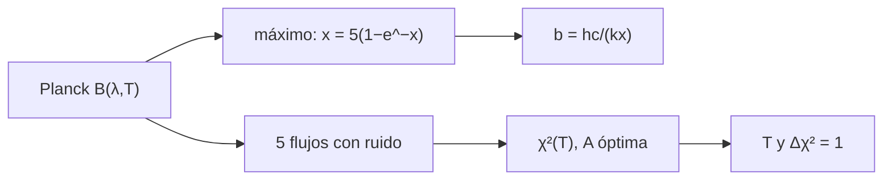

# B45-C13 — Temperatura y espectro de cuerpo negro

<!-- nav:top -->
[🏠 Programa](../../../../README.md) · [📚 Bloque B45](../../../tronco-comun/B45-espectroscopia-fotometria-y-polarimetria.md) · [← Anterior: B45-C12 — Efecto Doppler en espectros](../B45-C12-efecto-doppler-en-espectros/CLASE.md) · [Siguiente: B45-C14 — Composición química por espectros →](../B45-C14-composicion-quimica-por-espectros/CLASE.md)
<!-- /nav -->

## 1. Ubicación, nivel y alcance

Clase 13 del bloque B45. Nivel N3. El continuo de una estrella informa de su temperatura. Aquí obtienes la **constante de Wien** resolviendo `x = 5(1 − e⁻ˣ)` y la comparas con NIST, distingues el pico en `λ` y en `ν`, y **ajustas la temperatura** a cinco flujos en banda con ruido, con su intervalo por `Δχ² = 1`. Usas [B05](../../../tronco-comun/B05-fisica-fundamental-para-el-espacio.md) y [B12](../../../tronco-comun/B12-probabilidad-estadistica-e-incertidumbre.md).

## 2. Por qué esta clase existe

La temperatura se estima del color o del espectro, y el pico depende de si se mide por unidad de λ o de ν. La decisión central: **¿qué temperatura y con qué error dan unos flujos en banda?**

## 3. Lo que podrás hacer al terminar

1. Resolver numéricamente el máximo de Planck.
2. Comparar `b` con NIST.
3. Distinguir el pico en λ y en ν.
4. Ajustar `T` y amplitud por mínimos cuadrados.
5. Obtener el error por `Δχ² = 1`.
6. Calcular una temperatura de color.

La evidencia es la **ficha de temperatura de cuerpo negro** del ejercicio 12 (sección 20).

## 4. Con qué llegas y cómo comprobarlo

1. ¿Qué es una temperatura en kelvin?
2. ¿Qué es un mínimo cuadrado?
3. ¿Qué es un cuerpo negro?
4. ¿Qué es una raíz de una ecuación?
5. ¿Qué es un intervalo de confianza?

<details>
<summary>Ver respuestas</summary>

1. Una temperatura absoluta. 2. Minimizar la suma de residuos al cuadrado. 3. Un emisor ideal. 4. Un valor que anula la función. 5. Un rango que contiene el valor con cierta probabilidad.
</details>

Con cuatro o cinco aciertos, sigue; si no, repasa los prerrequisitos.

## 5. Un caso de contexto y casos de referencia

El pico de un cuerpo negro de 5772 K está en `502,04 nm` en `λ` y en `339,33 THz` en `ν` (equivale a `883,5 nm`). El ajuste a cinco bandas sintéticas (T verdadera 6500 K) da `6530 K` con intervalo `6470` a `6590 K`. Es el **ejemplo conductor** (datos sintéticos).

## 6. Vocabulario

La **ley de Wien** `λ_max T = b`. La **constante** `b = hc/(k x)` con `x = 4,9651`. El pico en frecuencia usa `x = 2,8214`. La **temperatura de color** viene de la razón de dos bandas. El **chi cuadrado** mide el ajuste; `Δχ² = 1` da el intervalo de 68 %.

## 7. Modelo mental: un horno que cambia de color

Como un horno: al subir la temperatura pasa del rojo al blanco; el color (la razón de dos bandas) mide la temperatura aunque no conozcas el tamaño.



*Descripción textual:* el máximo de Planck da la constante de Wien y el ajuste de χ² da la temperatura a partir de flujos con ruido.

Analogía: un horno que cambia de color. Límite: cuerpo negro puro sin extinción.

## 8. La explicación, paso a paso

### 8.1 Wien

Las raíces valen `x_λ = 4,965114232` y `x_ν = 2,821439372`. Entonces `b = 2,897771955 × 10⁻³ m K` y `b_ν = 5,878925758 × 10¹⁰ Hz/K`, que coinciden con NIST (S1) a `10⁻⁹`. La constante de Stefan-Boltzmann calculada es igual a NIST con razón `1,000000000033`.

| T (K) | λ_max (nm) |
|---|---|
| 3000 | 965,92 |
| 5772 | 502,04 |
| 10000 | 289,78 |
| 30000 | 96,59 |

Con `T = 5772 K` el pico en `ν` equivale a `883,5 nm`, mucho más rojo que el pico en `λ` (`502,0 nm`).

### 8.2 Ajuste de temperatura

| Magnitud | Valor |
|---|---|
| T verdadera | 6500 K |
| T ajustada | 6530 K |
| intervalo Δχ² = 1 | 6470 a 6590 K |
| χ² mínimo (3 gl) | 2,73 |
| amplitud ajustada | 0,9847 (verdadera 1) |

La temperatura de color por razón 400/700 nm sin ruido es `6500,00 K`.

### 8.3 Lectura

El ruido de 2 % por banda da un error de unos `60 K` (1 %). Un cuerpo no negro tendría un χ² mucho mayor.

## 9. Magnitudes, símbolos y unidades

| Símbolo | Qué es | Unidad | Valor / nota |
|---|---|---|---|
| `b` | constante de Wien en λ | m K | 2,897771955 × 10⁻³ (S1) |
| `T` | temperatura | K | ver 8.2 |
| `χ²` | estadístico de ajuste | — | 2,73 |
| `A` | amplitud geométrica | — | 0,9847 |

## 10. Convenciones y referencias

Planck en `λ`; bandas de 50 nm centradas en 400, 500, 600, 700 y 800 nm; ruido de 2 %; rejilla de 3000 a 12 000 K en pasos de 10 K; semilla `20261109`.

## 11. De dónde sale lo que afirmamos

| ID | Fuente | Localizador | Respalda | Estado |
|---|---|---|---|---|
| S1 | NIST, *Fundamental Physical Constants* (CODATA 2022) | https://physics.nist.gov/cuu/Constants/Table/allascii.txt | `b`, `b_ν`, `σ`, `h`, `c`, `k_B` | Consultada el 2026-11-09 |
| S2 | Fotometría de una estrella real | — | no se usó: los flujos son sintéticos | No consultado |

Límites: los flujos son sintéticos; una estrella real no es un cuerpo negro.

## 12. Cómo ver el ajuste

| T (K) | χ² |
|---|---|
| ajustada 6530 | 2,73 |

Descripción larga: el mínimo de χ² fija la temperatura.

## 13. Ejemplo trabajado: pico de 3000 K

**Paso 1 · Constante.** `b = 2,897771955 × 10⁻³ m K`.

**Paso 2 · División.** `b/3000`.

**Paso 3 · Valor.** `965,92 nm`.

**Paso 4 · Lectura.** En el infrarrojo cercano.

## 14. Distintas formas de describir el resultado

**Por fórmula:** Wien. **Por raíz:** `x = 5(1−e⁻ˣ)`. **Por ajuste:** χ². **Por código:** `cuerpo_negro.py`.

## 15. Práctica guiada

**Ejercicio 1 · con los pasos indicados.** Pico de 3000 K. *Pasos:* ejemplo 13.

<details><summary>Solución comentada</summary>

`965,92 nm`.
</details>

**Ejercicio 2 · con una pista.** Pico de 10 000 K.

<details><summary>Solución comentada</summary>

`289,78 nm`.
</details>

**Ejercicio 3 · casi autónomo.** Pico en λ de 5772 K.

<details><summary>Solución comentada</summary>

`502,04 nm`.
</details>

## 16. Práctica autónoma, transferencia e integrador

**Ejercicio 4.** Pico en ν de 5772 K.

<details><summary>Solución comentada</summary>

`339,33 THz`.
</details>

**Ejercicio 5.** Temperatura cuyo pico en λ es 500 nm.

<details><summary>Solución comentada</summary>

`5796 K`.
</details>

**Ejercicio 6.** Error relativo de T ajustada.

<details><summary>Solución comentada</summary>

`0,46 %`.
</details>

**Ejercicio 7.** Error previsto (media del intervalo).

<details><summary>Solución comentada</summary>

`60 K`.
</details>

**Ejercicio 8.** Temperatura de color sin ruido.

<details><summary>Solución comentada</summary>

`6500,00 K`.
</details>

**Ejercicio 9 · transferencia.** **Transferencia.** ¿Por qué los picos en λ y ν no coinciden?

<details><summary>Solución comentada</summary>

Porque `B_ν dν` y `B_λ dλ` difieren por el jacobiano `c/λ²`.
</details>

**Ejercicio 10 · transferencia.** **Transferencia.** ¿Qué pasa con la extinción interestelar?

<details><summary>Solución comentada</summary>

Enrojece el continuo y sesga la temperatura de color a menos que se corrija.
</details>

**Ejercicio 11 · transferencia.** **Transferencia.** Un compañero llama «temperatura efectiva» a la de color. Responde.

<details><summary>Solución comentada</summary>

No son iguales: la efectiva sale de la luminosidad total.
</details>

**Ejercicio 12.** **Integrador.** Elabora tu *ficha de temperatura de cuerpo negro*: Wien, ajuste, error y límites.

<details><summary>Solución comentada</summary>

Secciones 8.1–8.3.
</details>

**Ejercicio 12 · integrador.** **Integrador.** Elabora tu *ficha de temperatura de cuerpo negro*: Wien, ajuste, error y límites.

<details><summary>Solución modelo</summary>

Secciones 8.1–8.3.
</details>

## 17. Laboratorio: Wien y ajuste de T

El script [cuerpo_negro.py](cuerpo_negro.py) resuelve las raíces de Wien, compara con NIST y ajusta `T` a cinco bandas sintéticas (**comprueba** `b` a `10⁻⁹` y `T` dentro de 3 errores).

**Datos:** constantes de NIST (S1); flujos **sintéticos**. **Predice antes de ejecutar:** ¿qué T se recupera? (≈ 6530 K.) **Ejecución del 2026-11-09 (Python 3.12.9):**

```text
Python 3.12.9 (biblioteca estandar)
raices: x = 4.965114232 (lambda) ; x = 2.821439372 (nu)
b = 2.897771955e-03 m K (NIST 2,897771955e-3) ; b_nu = 5.878925758e+10 Hz/K (NIST 5,878925757e10)
T = 5772 K: pico en lambda 502.04 nm ; pico en nu 339.33 THz = 883.48 nm
  T =    3000 K -> lambda_max =   965.92 nm
  T =    5772 K -> lambda_max =   502.04 nm
  T =   10000 K -> lambda_max =   289.78 nm
  T =   30000 K -> lambda_max =    96.59 nm
sigma calculada / NIST = 1.000000000033
ajuste a 5 bandas: T = 6530 K (verdadera 6500) ; chi2 = 2.73 para 3 grados de libertad ; intervalo delta chi2 = 1: 6470 a 6590 K ; amplitud = 0.9847
temperatura de color sin ruido por razon 400/700 nm = 6500.00 K
Pruebas superadas.
```

```bash
python programa/clases/B45/B45-C13-temperatura-y-espectro-de-cuerpo-negro/cuerpo_negro.py
```

**Límites:** cuerpo negro puro.

## 18. Errores frecuentes y cómo corregirlos

**Confundir el pico en λ con el pico en ν.** Se corrige con 8.1.

**Tomar la T de color como efectiva.** Se corrige con la pregunta de transferencia.

**Olvidar la amplitud del ajuste.** Se corrige con 8.2.

**Dar flujos sintéticos como observación.** Se corrige con la sección 10.

## 19. Cómo sabrás que vas bien

Tras la sección 8: ¿qué resultado esperabas y cuál obtuviste? Si dudas, repasa el ejemplo 13. Tras el laboratorio: ¿qué comprueba? (ver la sección 17).

## 20. Qué entregas y cómo se evalúa

El producto es tu **ficha de temperatura de cuerpo negro** (ejercicio 12).

| Criterio | Inicial | En desarrollo | Logrado | Destacado |
|---|---|---|---|---|
| Conceptos | Los confunde | Parciales | conceptos de la clase | Explica los límites |
| Cálculo | Sin unidades | Con errores | Tablas completas | Calcula casos nuevos |
| Numérico | Sin comprobar | Un caso | Contraste con el análisis | Interpreta las diferencias |
| Fuentes | Sin fuente | Sin fecha | fuentes con fecha | Declara lo ilustrativo |
| Límites | No los nombra | Uno | Tres | Discute qué falta del modelo |

**Condiciones críticas (no se compensan con promedio):** rotular los flujos como sintéticos; no dar temperaturas de estrellas reales; citar solo lo consultado.

## 21. Ética, seguridad y límites

Clase educativa: los modelos son simplificados. Accesibilidad: tablas equivalentes a las gráficas, fórmulas en texto, ejercicios sin conexión.

## 22. Para cerrar y seguir

La constante de Wien calculada coincide con NIST a 10⁻⁹ y el ajuste a cinco bandas recupera 6530 K (6470 a 6590 K). Queda una pregunta: ¿cómo se pasa de la temperatura a la composición?

**Glosario español–inglés.** ley de Wien · *Wien's law*; temperatura de color · *colour temperature*; cuerpo negro · *blackbody*; chi cuadrado · *chi-squared*.

**Continuidad.** [B45-C14](../B45-C14-composicion-quimica-por-espectros/CLASE.md) estudia la composición química por espectros.

**Referencias:** ver sección 11.

<!-- nav:bottom -->
---

[← Anterior: B45-C12 — Efecto Doppler en espectros](../B45-C12-efecto-doppler-en-espectros/CLASE.md) · [📚 Bloque B45](../../../tronco-comun/B45-espectroscopia-fotometria-y-polarimetria.md) · [Siguiente: B45-C14 — Composición química por espectros →](../B45-C14-composicion-quimica-por-espectros/CLASE.md)
<!-- /nav -->
