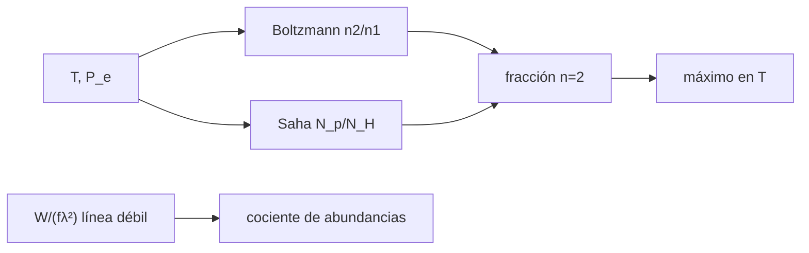

# B45-C14 — Composición química por espectros

<!-- nav:top -->
[🏠 Programa](../../../../README.md) · [📚 Bloque B45](../../../tronco-comun/B45-espectroscopia-fotometria-y-polarimetria.md) · [← Anterior: B45-C13 — Temperatura y espectro de cuerpo negro](../B45-C13-temperatura-y-espectro-de-cuerpo-negro/CLASE.md) · [Siguiente: B45-C15 — Polarización lineal y circular →](../B45-C15-polarizacion-lineal-y-circular/CLASE.md)
<!-- /nav -->

## 1. Ubicación, nivel y alcance

Clase 14 del bloque B45. Nivel N3. La intensidad de una línea depende de cuántos átomos están en el nivel inferior (Boltzmann) y de cuántos están ionizados (Saha). Aquí calculas la **fracción de hidrógeno en n = 2** en función de la temperatura a presión electrónica fija, hallas su **máximo**, y mides un **cociente de abundancias** con líneas débiles. Usas [B05](../../../tronco-comun/B05-fisica-fundamental-para-el-espacio.md) y [B31](../../../tronco-comun/B31-fisica-cuantica-nuclear-y-astroparticulas.md).

## 2. Por qué esta clase existe

Las líneas de Balmer son más fuertes en estrellas A que en estrellas frías o calientes. La decisión central: **¿por qué hay un máximo de temperatura y cómo se pasa de intensidades a abundancias?**

## 3. Lo que podrás hacer al terminar

1. Aplicar la ecuación de Boltzmann con pesos `g = 2n²`.
2. Aplicar la ecuación de Saha.
3. Encontrar la temperatura del máximo de n = 2.
4. Verificar la fracción por dos cálculos.
5. Estimar un cociente de abundancias con líneas débiles.
6. Reconocer los límites del hidrógeno puro.

La evidencia es la **ficha de excitación e ionización** del ejercicio 12 (sección 20).

## 4. Con qué llegas y cómo comprobarlo

1. ¿Qué es un peso estadístico?
2. ¿Qué es un electronvoltio?
3. ¿Qué es una ionización?
4. ¿Qué es una función exponencial?
5. ¿Qué es una dex?

<details>
<summary>Ver respuestas</summary>

1. El número de estados de un nivel. 2. 1,602 × 10⁻¹⁹ J. 3. Arrancar un electrón a un átomo. 4. Una función `e^x`. 5. Un factor 10 en escala logarítmica.
</details>

Con cuatro o cinco aciertos, sigue; si no, repasa los prerrequisitos.

## 5. Un caso de contexto y casos de referencia

Con `P_e = 2 Pa` (ilustrativa), la población de `n = 2` pasa por un máximo de `1,94 × 10⁻⁶` a `8800 K` y el hidrógeno está ionizado al 50 % a `8516 K`. Es el **ejemplo conductor** (modelo de gas de hidrógeno puro, no una atmósfera real).

## 6. Vocabulario

La **ecuación de Boltzmann** `n₂/n₁ = (g₂/g₁) e^(−ΔE/kT)`. La **ecuación de Saha** relaciona los iones con los neutros y la densidad de electrones. La **función de partición** `U` suma los niveles. La **presión electrónica** `P_e = n_e k T`. La **abundancia** se obtiene de `W/(f λ²)` en líneas débiles.

## 7. Modelo mental: una escalera con una puerta

Como una escalera con una puerta: con poca energía casi nadie sube al peldaño 2; con demasiada, los átomos salen por la puerta (ionización) y ya no hay quien absorba.



*Descripción textual:* Boltzmann y Saha compiten y producen un máximo de población en n = 2; las líneas débiles dan abundancias relativas.

Analogía: una escalera con una puerta. Límite: equilibrio termodinámico local y gas de H puro.

## 8. La explicación, paso a paso

### 8.1 Población de n = 2

La energía de ionización con masa reducida es `χ = 13,59829 eV` y `E₂ − E₁ = 10,19872 eV`.

| T (K) | N_H/N_tot | N(n=2)/N_tot | N_p/N_H |
|---|---|---|---|
| 5000 | 1,00000 | 2,100 × 10⁻¹⁰ | 5,793 × 10⁻⁷ |
| 7000 | 0,98905 | 1,797 × 10⁻⁷ | 1,107 × 10⁻² |
| 9000 | 0,24329 | 1,893 × 10⁻⁶ | 3,110 × 10⁰ |
| 10000 | 0,04104 | 1,189 × 10⁻⁶ | 2,337 × 10¹ |
| 12000 | 0,00195 | 4,065 × 10⁻⁷ | 5,109 × 10² |
| 15000 | 0,00008 | 1,208 × 10⁻⁷ | 1,222 × 10⁴ |
| 20000 | 0,00000 | 3,049 × 10⁻⁸ | 2,990 × 10⁵ |

El máximo está en `8800 K` con `1,940 × 10⁻⁶`; la ionización del 50 % ocurre en `8516 K`.

### 8.2 Dos vías

A 10 000 K, la fracción de n = 2 respecto de los neutros es `2,897923 × 10⁻⁵` por suma directa de niveles y `2,897923 × 10⁻⁵` por la fórmula con la función de partición; el cociente de Boltzmann entre n = 2 y n = 1 es `2,8982 × 10⁻⁵`.

### 8.3 Abundancias

Con cuatro líneas débiles por elemento y 5 % de error en cada ancho equivalente, el cociente `log N₂ − log N₁` verdadero de `0,300` dex se recupera como `0,3000` con dispersión `0,0157` (predicción analítica `0,0154`).

### 8.4 Lectura

El máximo cae donde la excitación ya es alta pero la mayoría del H aún es neutro. Cambiar `P_e` desplaza el máximo; el modelo no sustituye a una atmósfera.

## 9. Magnitudes, símbolos y unidades

| Símbolo | Qué es | Unidad | Valor / nota |
|---|---|---|---|
| `χ` | energía de ionización del H | eV | 13,59829 |
| `g_n` | peso estadístico | — | `2n²` |
| `P_e` | presión electrónica | Pa | 2 (ilustrativa) |
| `T_pico` | máximo de n = 2 | K | 8800 |
| `log N` | abundancia relativa | dex | ver 8.3 |

## 10. Convenciones y referencias

Rydberg de NIST con masa reducida; niveles hasta `n = 10` (truncamiento ilustrativo); `P_e` ilustrativa; semilla `20261109`.

## 11. De dónde sale lo que afirmamos

| ID | Fuente | Localizador | Respalda | Estado |
|---|---|---|---|---|
| S1 | NIST, *Fundamental Physical Constants* (CODATA 2022) | https://physics.nist.gov/cuu/Constants/Table/allascii.txt | `h`, `k_B`, `m_e`, `e`, energía de Rydberg y `m_e/m_p` | Consultada el 2026-11-09 |
| S2 | Tablas de partición y niveles atómicos | — | no se usaron | No consultado |

Límites: no se consultó ningún modelo de atmósfera; el máximo depende de `P_e` y del truncamiento de la función de partición.

## 12. Cómo ver el máximo

| T (K) | N(n=2)/N_tot |
|---|---|
| 5000 | 2,10 × 10⁻¹⁰ |
| 7000 | 1,80 × 10⁻⁷ |
| 9000 | 1,89 × 10⁻⁶ |
| 10000 | 1,19 × 10⁻⁶ |
| 12000 | 4,07 × 10⁻⁷ |
| 15000 | 1,21 × 10⁻⁷ |
| 20000 | 3,05 × 10⁻⁸ |

Descripción larga: la población sube, pasa por un máximo y cae.

## 13. Ejemplo trabajado: n₂/n₁ a 10 000 K

**Paso 1 · Peso.** `g₂/g₁ = 8/2 = 4`.

**Paso 2 · Exponente.** `ΔE/kT = 11,8351`.

**Paso 3 · Factor.** `exp(−11,8351)`.

**Paso 4 · Valor.** `2,8982 × 10⁻⁵`.

## 14. Distintas formas de describir el resultado

**Por Boltzmann:** excitación. **Por Saha:** ionización. **Por tabla:** máximo. **Por código:** `saha_boltzmann.py`.

## 15. Práctica guiada

**Ejercicio 1 · con los pasos indicados.** `n₂/n₁` a 10 000 K. *Pasos:* ejemplo 13.

<details><summary>Solución comentada</summary>

`2,8982 × 10⁻⁵`.
</details>

**Ejercicio 2 · con una pista.** `T` del máximo de n = 2.

<details><summary>Solución comentada</summary>

`8800 K`.
</details>

**Ejercicio 3 · casi autónomo.** `T` de ionización 50 %.

<details><summary>Solución comentada</summary>

`8516 K`.
</details>

## 16. Práctica autónoma, transferencia e integrador

**Ejercicio 4.** Fracción de neutros a 9000 K.

<details><summary>Solución comentada</summary>

`0,24329`.
</details>

**Ejercicio 5.** `N_p/N_H` a 7000 K.

<details><summary>Solución comentada</summary>

`1,107 × 10⁻²`.
</details>

**Ejercicio 6.** `N(n=2)/N_tot` a 5000 K.

<details><summary>Solución comentada</summary>

`2,100 × 10⁻¹⁰`.
</details>

**Ejercicio 7.** Cociente de abundancias recuperado.

<details><summary>Solución comentada</summary>

`0,3000` dex.
</details>

**Ejercicio 8.** Dispersión prevista.

<details><summary>Solución comentada</summary>

`0,0154` dex.
</details>

**Ejercicio 9 · transferencia.** **Transferencia.** ¿Por qué las líneas de Balmer son débiles en estrellas frías?

<details><summary>Solución comentada</summary>

Porque casi nadie está en n = 2 (Boltzmann).
</details>

**Ejercicio 10 · transferencia.** **Transferencia.** ¿Y en estrellas muy calientes?

<details><summary>Solución comentada</summary>

Porque el hidrógeno está ionizado (Saha).
</details>

**Ejercicio 11 · transferencia.** **Transferencia.** Un compañero dice que el máximo del laboratorio es el de las estrellas A. Responde.

<details><summary>Solución comentada</summary>

Es el de un gas de H puro con presión ilustrativa; las estrellas reales difieren.
</details>

**Ejercicio 12.** **Integrador.** Elabora tu *ficha de excitación e ionización*: máximo, dos vías, abundancia y límites.

<details><summary>Solución comentada</summary>

Secciones 8.1–8.4.
</details>

**Ejercicio 12 · integrador.** **Integrador.** Elabora tu *ficha de excitación e ionización*: máximo, dos vías, abundancia y límites.

<details><summary>Solución modelo</summary>

Secciones 8.1–8.4.
</details>

## 17. Laboratorio: Saha-Boltzmann del hidrógeno

El script [saha_boltzmann.py](saha_boltzmann.py) calcula la fracción de n = 2 contra T, halla el máximo y mide un cociente de abundancias (**comprueba** las dos vías a `10⁻¹²` y la dispersión a 10 %).

**Datos:** constantes de NIST (S1); `P_e` **ilustrativa**. **Predice antes de ejecutar:** ¿cerca de qué T se maximiza? (≈ 8800 K.) **Ejecución del 2026-11-09 (Python 3.12.9):**

```text
Python 3.12.9 (biblioteca estandar)
chi (H, masa reducida) = 13.59829 eV ; E(n=2) - E(n=1) = 10.19872 eV ; P_e = 2.0 Pa
  T (K)  N_H/N_tot  N(n=2)/N_tot      N_p/N_H
   5000    1.00000    2.0999e-10   5.7925e-07
   7000    0.98905    1.7969e-07   1.1074e-02
   9000    0.24329    1.8930e-06   3.1103e+00
  10000    0.04104    1.1892e-06   2.3369e+01
  12000    0.00195    4.0654e-07   5.1087e+02
  15000    0.00008    1.2081e-07   1.2219e+04
  20000    0.00000    3.0495e-08   2.9899e+05
maximo de la poblacion n = 2: T = 8800 K, fraccion 1.9404e-06 ; ionizacion del 50 % en T = 8516 K
T = 10000 K: poblacion de n = 2 relativa al neutro, suma directa 2.897923e-05 ; formula 2.897923e-05 ; n2/n1 de Boltzmann = 2.8982e-05
cociente de abundancias (dex): verdadero 0.300 ; media MC 0.3000 ; dispersion MC 0.0157 ; propagacion analitica 0.0154
Pruebas superadas.
```

```bash
python programa/clases/B45/B45-C14-composicion-quimica-por-espectros/saha_boltzmann.py
```

**Límites:** ETL, gas de H puro.

## 18. Errores frecuentes y cómo corregirlos

**Olvidar el peso estadístico `g`.** Se corrige con 8.2.

**Usar la temperatura del máximo para una estrella real.** Se corrige con 8.4.

**Mezclar eV y J.** Se corrige con la sección 9.

**Tomar el cociente de abundancias como medida real.** Se corrige con la sección 10.

## 19. Cómo sabrás que vas bien

Tras la sección 8: ¿qué resultado esperabas y cuál obtuviste? Si dudas, repasa el ejemplo 13. Tras el laboratorio: ¿qué comprueba? (ver la sección 17).

## 20. Qué entregas y cómo se evalúa

El producto es tu **ficha de excitación e ionización** (ejercicio 12).

| Criterio | Inicial | En desarrollo | Logrado | Destacado |
|---|---|---|---|---|
| Conceptos | Los confunde | Parciales | conceptos de la clase | Explica los límites |
| Cálculo | Sin unidades | Con errores | Tablas completas | Calcula casos nuevos |
| Numérico | Sin comprobar | Un caso | Contraste con el análisis | Interpreta las diferencias |
| Fuentes | Sin fuente | Sin fecha | fuentes con fecha | Declara lo ilustrativo |
| Límites | No los nombra | Uno | Tres | Discute qué falta del modelo |

**Condiciones críticas (no se compensan con promedio):** rotular `P_e` y el truncamiento como ilustrativos; no dar abundancias reales; citar solo lo consultado.

## 21. Ética, seguridad y límites

Clase educativa: los modelos son simplificados. Accesibilidad: tablas equivalentes a las gráficas, fórmulas en texto, ejercicios sin conexión.

## 22. Para cerrar y seguir

La población de n = 2 pasa por un máximo de 1,94 × 10⁻⁶ a 8800 K; la ionización llega al 50 % a 8516 K, y un cociente de abundancias de 0,30 dex se recupera con ±0,016 dex. Queda una pregunta: ¿cómo se describe la polarización de la luz?

**Glosario español–inglés.** ecuación de Saha · *Saha equation*; ecuación de Boltzmann · *Boltzmann equation*; función de partición · *partition function*; abundancia · *abundance*.

**Continuidad.** [B45-C15](../B45-C15-polarizacion-lineal-y-circular/CLASE.md) estudia la polarización lineal y circular.

**Referencias:** ver sección 11.

<!-- nav:bottom -->
---

[← Anterior: B45-C13 — Temperatura y espectro de cuerpo negro](../B45-C13-temperatura-y-espectro-de-cuerpo-negro/CLASE.md) · [📚 Bloque B45](../../../tronco-comun/B45-espectroscopia-fotometria-y-polarimetria.md) · [Siguiente: B45-C15 — Polarización lineal y circular →](../B45-C15-polarizacion-lineal-y-circular/CLASE.md)
<!-- /nav -->
