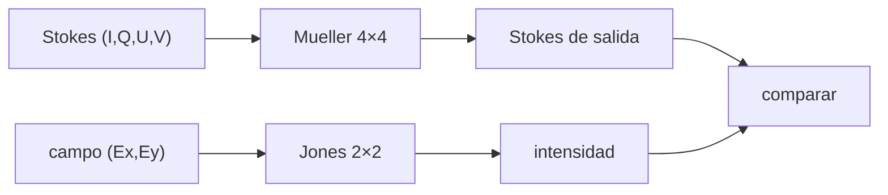

# B45-C15 — Polarización lineal y circular

<!-- nav:top -->
[🏠 Programa](../../../../README.md) · [📚 Bloque B45](../../../tronco-comun/B45-espectroscopia-fotometria-y-polarimetria.md) · [← Anterior: B45-C14 — Composición química por espectros](../B45-C14-composicion-quimica-por-espectros/CLASE.md) · [Siguiente: B45-C16 — Polarímetros astronómicos →](../B45-C16-polarimetros-astronomicos/CLASE.md)
<!-- /nav -->

## 1. Ubicación, nivel y alcance

Clase 15 del bloque B45. Nivel N3. La luz se describe con cuatro números, los **parámetros de Stokes**, y los elementos ópticos con matrices de **Mueller**. Aquí verificas la **ley de Malus**, la acción de una **lámina de media onda** y de **cuarto de onda**, y comparas Mueller con **Jones** en una cadena óptica. Usas [B42](../../../tronco-comun/B42-optica-fisica-y-optica-adaptativa.md).

## 2. Por qué esta clase existe

La polarización informa de campos magnéticos, dispersión y geometría. La decisión central: **¿cómo se calcula el estado de polarización tras cada elemento?**

## 3. Lo que podrás hacer al terminar

1. Escribir los parámetros de Stokes de un estado.
2. Aplicar matrices de Mueller de polarizador y retardador.
3. Verificar la ley de Malus.
4. Comprobar que una media onda rota el plano en `2φ − ψ`.
5. Obtener luz circular con un cuarto de onda a 45°.
6. Contrastar Mueller y Jones.

La evidencia es la **ficha de polarización** del ejercicio 12 (sección 20).

## 4. Con qué llegas y cómo comprobarlo

1. ¿Qué es una onda transversal?
2. ¿Qué es una matriz?
3. ¿Qué es un coseno?
4. ¿Qué es un número complejo?
5. ¿Qué es una lámina de onda?

<details>
<summary>Ver respuestas</summary>

1. Una onda cuya vibración es perpendicular a la propagación. 2. Una tabla de números que transforma vectores. 3. La proyección en un eje. 4. Un número `a + bi`. 5. Un cristal que retrasa un componente del campo.
</details>

Con cuatro o cinco aciertos, sigue; si no, repasa los prerrequisitos.

## 5. Un caso de contexto y casos de referencia

Una luz con `P = 0,30` y ángulo `20,0°` tiene Stokes `(1; 0,2298; 0,1928; 0)`. Una media onda a 22,5° la lleva a `25,0°` sin cambiar `P`. Es el **ejemplo conductor** (estados **sintéticos**).

## 6. Vocabulario

Los **parámetros de Stokes** `(I, Q, U, V)`. El **grado de polarización** `P = √(Q²+U²+V²)/I`. El **ángulo** `χ = ½ atan2(U, Q)`. La **matriz de Mueller** 4×4 actúa sobre Stokes; el **cálculo de Jones** actúa sobre el campo. Un **retardador** tiene retardancia `δ` y eje rápido `θ`.

## 7. Modelo mental: unas gafas de sol

Como unas gafas polarizadas: dejan pasar solo la vibración alineada, y girarlas cambia cuánta luz pasa según el coseno al cuadrado.



*Descripción textual:* el estado de entrada pasa por matrices de Mueller o de Jones y las intensidades de salida coinciden.

Analogía: unas gafas de sol. Límite: elementos ideales, longitud de onda única.

## 8. La explicación, paso a paso

### 8.1 Malus

| θ (°) | I salida | cos² θ |
|---|---|---|
| 0 | 1,000000 | 1,000000 |
| 30 | 0,750000 | 0,750000 |
| 45 | 0,500000 | 0,500000 |
| 60 | 0,250000 | 0,250000 |
| 90 | 0,000000 | 0,000000 |

### 8.2 Media onda

| φ (°) | ángulo de salida (°) | P | 2φ − 20° |
|---|---|---|---|
| 0,0 | -20,000 | 0,3000 | -20,000 |
| 10,0 | 0,000 | 0,3000 | 0,000 |
| 22,5 | 25,000 | 0,3000 | 25,000 |
| 45,0 | 70,000 | 0,3000 | 70,000 |

### 8.3 Cuarto de onda y cadena

Luz horizontal con un cuarto de onda a 45° da Stokes `(1,0000; 0,0000; 0,0000; -1,0000)`: circular pura. En la cadena luz horizontal – polarizador 0° – cuarto de onda 45° – analizador a θ, la intensidad es `0,5` para todo θ (Mueller y Jones coinciden a `10⁻¹²`).

### 8.4 Conservación

Un retardador de 77° con eje a 13° deja `P = 0,229129` igual que antes (`0,229129`).

## 9. Magnitudes, símbolos y unidades

| Símbolo | Qué es | Unidad | Valor / nota |
|---|---|---|---|
| `I, Q, U, V` | Stokes | intensidad | ver 8.1 |
| `P` | grado de polarización | — | 0,30 |
| `χ` | ángulo de polarización | grados | 20,0 |
| `δ`, `θ` | retardancia y eje del retardador | rad, rad | según el elemento |

## 10. Convenciones y referencias

Eje horizontal como 0°; ángulos antihorarios; Mueller del retardador con convención de V fijada en el código; Jones `E = (Ex, Ey)` con `S₃ = 2 Im(Ex* Ey)`.

## 11. De dónde sale lo que afirmamos

| ID | Fuente | Localizador | Respalda | Estado |
|---|---|---|---|---|
| S1 | Matrices de Mueller y de Jones (óptica de libro) | — | relaciones estándar que verifica el laboratorio | No consultado |

Límites: no se consultó una fuente; el signo de V depende de la convención y aquí no se contrasta con una norma.

## 12. Cómo ver los estados

| Elemento | Resultado |
|---|---|
| polarizador a 30° | 0,75 |
| media onda a 22,5° | ángulo 25° |
| cuarto de onda a 45° | circular |

Descripción larga: tres comprobaciones.

## 13. Ejemplo trabajado: ley de Malus a 60°

**Paso 1 · Fórmula.** `I = I₀ cos²θ`.

**Paso 2 · Coseno.** `cos 60° = 0,5`.

**Paso 3 · Cuadrado.** `0,25`.

**Paso 4 · Lectura.** Pasa la cuarta parte.

## 14. Distintas formas de describir el resultado

**Por Mueller:** 4×4. **Por Jones:** 2×2. **Por tabla:** Malus. **Por código:** `polarizacion.py`.

## 15. Práctica guiada

**Ejercicio 1 · con los pasos indicados.** Intensidad a 60° (Malus). *Pasos:* ejemplo 13.

<details><summary>Solución comentada</summary>

`0,25`.
</details>

**Ejercicio 2 · con una pista.** Ángulo de salida de una media onda a 22,5°.

<details><summary>Solución comentada</summary>

`25,0°`.
</details>

**Ejercicio 3 · casi autónomo.** `P` del estado inicial.

<details><summary>Solución comentada</summary>

`0,30`.
</details>

## 16. Práctica autónoma, transferencia e integrador

**Ejercicio 4.** `Q` del estado inicial.

<details><summary>Solución comentada</summary>

`0,2298`.
</details>

**Ejercicio 5.** `U` del estado inicial.

<details><summary>Solución comentada</summary>

`0,1928`.
</details>

**Ejercicio 6.** Valor de `V` tras el cuarto de onda.

<details><summary>Solución comentada</summary>

`-1,0`.
</details>

**Ejercicio 7.** Intensidad de la cadena para cualquier θ.

<details><summary>Solución comentada</summary>

`0,5`.
</details>

**Ejercicio 8.** `P` tras el retardador de 77°.

<details><summary>Solución comentada</summary>

`0,2291`.
</details>

**Ejercicio 9 · transferencia.** **Transferencia.** ¿Por qué una media onda a 45° cambia Q en −Q?

<details><summary>Solución comentada</summary>

Rota el plano en `2·45° − ψ`, con lo que Q cambia de signo.
</details>

**Ejercicio 10 · transferencia.** **Transferencia.** ¿Qué hace un retardador con `P`?

<details><summary>Solución comentada</summary>

Lo conserva (es unitario sobre el vector (Q, U, V)).
</details>

**Ejercicio 11 · transferencia.** **Transferencia.** Un compañero llama «medida» al estado sintético. Responde.

<details><summary>Solución comentada</summary>

Es un estado propuesto para el ejemplo.
</details>

**Ejercicio 12.** **Integrador.** Elabora tu *ficha de polarización*: Stokes, Malus, láminas y límites.

<details><summary>Solución comentada</summary>

Secciones 8.1–8.4.
</details>

**Ejercicio 12 · integrador.** **Integrador.** Elabora tu *ficha de polarización*: Stokes, Malus, láminas y límites.

<details><summary>Solución modelo</summary>

Secciones 8.1–8.4.
</details>

## 17. Laboratorio: Mueller y Jones

El script [polarizacion.py](polarizacion.py) verifica Malus, media onda, cuarto de onda y una cadena por dos cálculos (**comprueba** a `10⁻¹²`).

**Datos:** sin constantes; estados **sintéticos**. **Predice antes de ejecutar:** ¿cuánta luz pasa a 60°? (25 %.) **Ejecución del 2026-11-09 (Python 3.12.9):**

```text
Python 3.12.9 (biblioteca estandar)
estado inicial: S = (1.0000; 0.2298; 0.1928; 0.0000) ; P = 0.3000 ; angulo = 20.000 grados
ley de Malus (polarizador a theta, luz 100 % polarizada a 0 grados): theta, I salida, cos^2
    0 1.000000 1.000000
   30 0.750000 0.750000
   45 0.500000 0.500000
   60 0.250000 0.250000
   90 0.000000 0.000000
lamina de media onda a phi sobre el estado inicial: phi, angulo salida, P, 2 phi - angulo inicial
    0.0  -20.000 0.3000  -20.000
   10.0    0.000 0.3000    0.000
   22.5   25.000 0.3000   25.000
   45.0   70.000 0.3000   70.000
cuarto de onda a 45 grados sobre luz horizontal: S = (1.0000; 0.0000; 0.0000; -1.0000)
cadena: luz horizontal, polarizador 0, cuarto de onda 45 y analizador: theta, intensidad Mueller, intensidad Jones
    0 0.500000 0.500000
   45 0.500000 0.500000
   90 0.500000 0.500000
  135 0.500000 0.500000
P antes 0.229129 ; P despues del retardador 0.229129
Pruebas superadas.
```

```bash
python programa/clases/B45/B45-C15-polarizacion-lineal-y-circular/polarizacion.py
```

**Límites:** elementos ideales.

## 18. Errores frecuentes y cómo corregirlos

**Confundir el ángulo del eje con el ángulo del plano de polarización.** Se corrige con 8.2.

**Mezclar convenciones del signo de V.** Se corrige con la sección 10.

**Creer que un retardador despolariza.** Se corrige con 8.4.

**Usar Stokes con ángulos en grados sin pasar a radianes.** Se corrige con la sección 9.

## 19. Cómo sabrás que vas bien

Tras la sección 8: ¿qué resultado esperabas y cuál obtuviste? Si dudas, repasa el ejemplo 13. Tras el laboratorio: ¿qué comprueba? (ver la sección 17).

## 20. Qué entregas y cómo se evalúa

El producto es tu **ficha de polarización** (ejercicio 12).

| Criterio | Inicial | En desarrollo | Logrado | Destacado |
|---|---|---|---|---|
| Conceptos | Los confunde | Parciales | conceptos de la clase | Explica los límites |
| Cálculo | Sin unidades | Con errores | Tablas completas | Calcula casos nuevos |
| Numérico | Sin comprobar | Un caso | Contraste con el análisis | Interpreta las diferencias |
| Fuentes | Sin fuente | Sin fecha | fuentes con fecha | Declara lo ilustrativo |
| Límites | No los nombra | Uno | Tres | Discute qué falta del modelo |

**Condiciones críticas (no se compensan con promedio):** rotular los estados como sintéticos; declarar la convención del signo; citar solo lo consultado.

## 21. Ética, seguridad y límites

Clase educativa: los modelos son simplificados. Accesibilidad: tablas equivalentes a las gráficas, fórmulas en texto, ejercicios sin conexión.

## 22. Para cerrar y seguir

Mueller y Jones coinciden a 10⁻¹²; la media onda rota el plano (25° con φ = 22,5°) y el cuarto de onda a 45° da luz circular. Queda una pregunta: ¿cómo se mide la polarización de un astro?

**Glosario español–inglés.** parámetros de Stokes · *Stokes parameters*; matriz de Mueller · *Mueller matrix*; retardador · *retarder*; ley de Malus · *Malus's law*.

**Continuidad.** [B45-C16](../B45-C16-polarimetros-astronomicos/CLASE.md) estudia los polarímetros astronómicos.

**Referencias:** ver sección 11.

<!-- nav:bottom -->
---

[← Anterior: B45-C14 — Composición química por espectros](../B45-C14-composicion-quimica-por-espectros/CLASE.md) · [📚 Bloque B45](../../../tronco-comun/B45-espectroscopia-fotometria-y-polarimetria.md) · [Siguiente: B45-C16 — Polarímetros astronómicos →](../B45-C16-polarimetros-astronomicos/CLASE.md)
<!-- /nav -->
