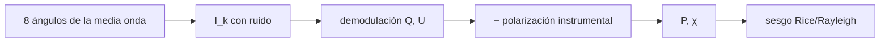

# B45-C16 — Polarímetros astronómicos

<!-- nav:top -->
[🏠 Programa](../../../../README.md) · [📚 Bloque B45](../../../tronco-comun/B45-espectroscopia-fotometria-y-polarimetria.md) · [← Anterior: B45-C15 — Polarización lineal y circular](../B45-C15-polarizacion-lineal-y-circular/CLASE.md) · [Siguiente: B45-C17 — Fotometría diferencial →](../B45-C17-fotometria-diferencial/CLASE.md)
<!-- /nav -->

## 1. Ubicación, nivel y alcance

Clase 16 del bloque B45. Nivel N3. Un polarímetro de placa de media onda rotante modula la señal y se demodula con una combinación de las lecturas. Aquí simulas **ocho ángulos**, obtienes **Q y U** con su ruido, corriges una **polarización instrumental** y estudias el **sesgo de la amplitud** de polarización (Rayleigh y Rice). Usas [B12](../../../tronco-comun/B12-probabilidad-estadistica-e-incertidumbre.md) y [B15](../../../tronco-comun/B15-senales-imagenes-y-estimacion-cientifica.md).

## 2. Por qué esta clase existe

La polarización medida es siempre positiva y por eso sesgada hacia arriba cuando el ruido es comparable a la señal. La decisión central: **¿cómo se miden Q y U y cómo se corrige el sesgo?**

## 3. Lo que podrás hacer al terminar

1. Escribir `I_k` con la media onda y el analizador.
2. Demodular `Q` y `U`.
3. Predecir el ruido `√(2/N)`.
4. Corregir una polarización instrumental.
5. Reproducir el sesgo de Rayleigh y de Rice.
6. Aplicar un estimador sin sesgo básico.

La evidencia es la **ficha del polarímetro** del ejercicio 12 (sección 20).

## 4. Con qué llegas y cómo comprobarlo

1. ¿Qué es un parámetro de Stokes?
2. ¿Qué es una distribución de Rayleigh?
3. ¿Qué es una demodulación?
4. ¿Qué es el ruido de fotones?
5. ¿Qué es una semilla aleatoria?

<details>
<summary>Ver respuestas</summary>

1. Un número que describe la polarización. 2. La del módulo de dos gaussianas sin media. 3. Extraer la amplitud de una oscilación. 4. La fluctuación `√N`. 5. Un valor que hace reproducible la simulación.
</details>

Con cuatro o cinco aciertos, sigue; si no, repasa los prerrequisitos.

## 5. Un caso de contexto y casos de referencia

Con 4 × 10⁶ fotones en ocho ángulos el ruido es `0,0707 %` por componente (Monte Carlo `0,0720 %`). Para `P = 0` la media de `P` medida es `1,249 σ` (Rayleigh `1,253 σ`). Es el **ejemplo conductor** (datos **sintéticos**).

## 6. Vocabulario

La **placa de media onda** gira el plano; con un **analizador fijo** la señal es `I_k = ½[I + Q cos 4θ_k + U sin 4θ_k]`. La **demodulación** da `Q = (4/K) Σ I_k cos 4θ_k`. La **polarización instrumental** suma un `(q_i, u_i)`. El **sesgo**: `P = √(q² + u²)` es siempre positivo.

## 7. Modelo mental: un faro que gira

Como un faro que gira: la luz recibida sube y baja con el ángulo; la amplitud y la fase de esa oscilación dan la polarización.



*Descripción textual:* las ocho lecturas se demodulan en Q y U, se corrige el instrumento y se estima P con su sesgo.

Analogía: un faro que gira. Límite: placa ideal, ruido de fotones.

## 8. La explicación, paso a paso

### 8.1 Q, U y su ruido

Estado verdadero `q = 0,030`, `u = -0,010` (`P = 3,1623 %`, `χ = -9,217°`). Con una polarización instrumental sumada de `(+0,005; −0,002)` se mide `q = 0,03498`, `u = -0,01201`; tras restar el instrumento, `q = 0,02998` y `u = -0,01001`, con ángulo `-9,229°`.

El ruido por componente es `0,0720 %` (q) y `0,0713 %` (u) por Monte Carlo, frente a `0,0707 %` previsto.

### 8.2 Sesgo de P (en unidades de σ)

| P verdadero / σ | media de P medida MC | Rice (integral) | tras restar el sesgo |
|---|---|---|---|
| 0,0 | 1,2487 | 1,2533 | 0,7555 |
| 1,0 | 1,5469 | 1,5486 | 1,1151 |
| 2,0 | 2,2730 | 2,2724 | 1,9781 |
| 3,0 | 3,1743 | 3,1726 | 2,9853 |
| 5,0 | 5,1004 | 5,1011 | 4,9969 |

Con `P = 0`, la media es `1,2487 σ` y Rayleigh da `1,2533 σ`: la polarización medida nunca es cero. La corrección `√(P² − σ²)` reduce el sesgo pero no lo elimina para `P ≲ σ`.

### 8.3 Lectura

Las fuentes de la literatura (S1 y S2) tratan el mismo problema con mejores estimadores; aquí solo se verificó el comportamiento básico por simulación e integración.

## 9. Magnitudes, símbolos y unidades

| Símbolo | Qué es | Unidad | Valor / nota |
|---|---|---|---|
| `q, u` | Stokes normalizados | — | ver 8.1 |
| `σ` | ruido por componente | — | 7,07 × 10⁻⁴ |
| `P` | fracción de polarización | — | 3,162 % |
| `χ` | ángulo | grados | -9,22 |
| `N` | fotones totales | — | 4 × 10⁶ |

## 10. Convenciones y referencias

Ocho ángulos de 22,5° entre 0 y 157,5°; ruido de fotones gaussiano; semilla `20261109`; Rice por integración numérica de la densidad con `I₀` en serie.

## 11. De dónde sale lo que afirmamos

| ID | Fuente | Localizador | Respalda | Estado |
|---|---|---|---|---|
| S1 | Plaszczynski et al., *A novel estimator of the polarization amplitude from normally distributed Stokes parameters* | https://arxiv.org/abs/1312.0437 | existencia del problema del sesgo de la amplitud de polarización (solo el extracto de un resultado de búsqueda) | Solo extracto de búsqueda, consultado el 2026-11-09 |
| S2 | Montier et al., *Polarization measurement analysis I* | https://arxiv.org/abs/1406.6536 | estudio por Monte Carlo del sesgo y la varianza de la fracción y del ángulo (solo el extracto de un resultado de búsqueda) | Solo extracto de búsqueda, consultado el 2026-11-09 |

Límites: de S1 y S2 solo se leyeron los extractos de una búsqueda web; ninguna cifra se toma de ellos; el estimador mejorado no se implementa.

## 12. Cómo ver el sesgo

| P / σ | media medida / σ |
|---|---|
| 0,0 | 1,249 |
| 1,0 | 1,547 |
| 2,0 | 2,273 |
| 3,0 | 3,174 |
| 5,0 | 5,100 |

Descripción larga: el sesgo desaparece cuando P supera varias σ.

## 13. Ejemplo trabajado: ruido de q

**Paso 1 · Fotones.** `N = 4 × 10⁶`.

**Paso 2 · Fórmula.** `σ = √(2/N)`.

**Paso 3 · Cálculo.** `√(5 × 10⁻⁷)`.

**Paso 4 · Valor.** `7,071 × 10⁻⁴` = `0,0707 %`.

## 14. Distintas formas de describir el resultado

**Por demodulación:** Q, U. **Por Monte Carlo:** ruido. **Por integral:** Rice. **Por código:** `polarimetro.py`.

## 15. Práctica guiada

**Ejercicio 1 · con los pasos indicados.** Ruido por componente. *Pasos:* ejemplo 13.

<details><summary>Solución comentada</summary>

`0,0707 %`.
</details>

**Ejercicio 2 · con una pista.** Media de P para P = 0.

<details><summary>Solución comentada</summary>

`1,2533 σ`.
</details>

**Ejercicio 3 · casi autónomo.** P verdadero.

<details><summary>Solución comentada</summary>

`3,1623 %`.
</details>

## 16. Práctica autónoma, transferencia e integrador

**Ejercicio 4.** Ángulo verdadero.

<details><summary>Solución comentada</summary>

`-9,217°`.
</details>

**Ejercicio 5.** `q` corregido.

<details><summary>Solución comentada</summary>

`0,02998`.
</details>

**Ejercicio 6.** Media de P para P = 2σ (Rice).

<details><summary>Solución comentada</summary>

`2,2724 σ`.
</details>

**Ejercicio 7.** Sesgo para P = σ.

<details><summary>Solución comentada</summary>

`0,547 σ`.
</details>

**Ejercicio 8.** Ruido si N = 1,6 × 10⁷.

<details><summary>Solución comentada</summary>

`0,0354 %`.
</details>

**Ejercicio 9 · transferencia.** **Transferencia.** ¿Por qué se rota la placa en lugar de girar el analizador?

<details><summary>Solución comentada</summary>

Para modular sin mover el detector y reducir la polarización instrumental.
</details>

**Ejercicio 10 · transferencia.** **Transferencia.** ¿Qué se hace si P ≲ σ?

<details><summary>Solución comentada</summary>

Dar un límite superior, no un valor.
</details>

**Ejercicio 11 · transferencia.** **Transferencia.** Un compañero dice que S1 da la fórmula usada. Responde.

<details><summary>Solución comentada</summary>

No: de S1 solo se leyó un extracto de búsqueda; las fórmulas son estándar y se verifican aquí.
</details>

**Ejercicio 12.** **Integrador.** Elabora tu *ficha del polarímetro*: demodulación, ruido, corrección del instrumento, sesgo y límites.

<details><summary>Solución comentada</summary>

Secciones 8.1–8.3.
</details>

**Ejercicio 12 · integrador.** **Integrador.** Elabora tu *ficha del polarímetro*: demodulación, ruido, corrección del instrumento, sesgo y límites.

<details><summary>Solución modelo</summary>

Secciones 8.1–8.3.
</details>

## 17. Laboratorio: polarímetro rotante

El script [polarimetro.py](polarimetro.py) simula las lecturas, demodula y estudia el sesgo de P (**comprueba** el ruido a 3 % y Rayleigh a 3 %).

**Datos:** sin constantes; datos **sintéticos**. **Predice antes de ejecutar:** ¿cuánto vale la media de P si P = 0? (≈ 1,25 σ.) **Ejecución del 2026-11-09 (Python 3.12.9):**

```text
Python 3.12.9 (biblioteca estandar)
ruido previsto por componente = sqrt(2/N) = 0.0707 % (N = 4e6) ; Monte Carlo: sigma_q = 0.0720 %, sigma_u = 0.0713 %
q medido +0.03498, u medido -0.01201 (con polarizacion instrumental +0.005, -0.002) ; corregidos: q = +0.02998, u = -0.01001 ; verdaderos +0.03000, -0.01000
P verdadero = 3.1623 % ; angulo verdadero = -9.217 grados ; angulo recuperado = -9.229 grados
 P/sigma  media P/sigma MC  Rice (integral)   P sin sesgo/sigma
     0.0            1.2487           1.2533              0.7555
     1.0            1.5469           1.5486              1.1151
     2.0            2.2730           2.2724              1.9781
     3.0            3.1743           3.1726              2.9853
     5.0            5.1004           5.1011              4.9969
Rayleigh: sqrt(pi/2) = 1.2533
Pruebas superadas.
```

```bash
python programa/clases/B45/B45-C16-polarimetros-astronomicos/polarimetro.py
```

**Límites:** placa ideal.

## 18. Errores frecuentes y cómo corregirlos

**Dar P como valor cuando es menor que el ruido.** Se corrige con la pregunta de transferencia.

**Olvidar la polarización instrumental.** Se corrige con 8.1.

**Confundir ruido de q con ruido de P.** Se corrige con 8.2.

**Atribuir cifras a S1 o S2.** Se corrige con la sección 11.

## 19. Cómo sabrás que vas bien

Tras la sección 8: ¿qué resultado esperabas y cuál obtuviste? Si dudas, repasa el ejemplo 13. Tras el laboratorio: ¿qué comprueba? (ver la sección 17).

## 20. Qué entregas y cómo se evalúa

El producto es tu **ficha del polarímetro** (ejercicio 12).

| Criterio | Inicial | En desarrollo | Logrado | Destacado |
|---|---|---|---|---|
| Conceptos | Los confunde | Parciales | conceptos de la clase | Explica los límites |
| Cálculo | Sin unidades | Con errores | Tablas completas | Calcula casos nuevos |
| Numérico | Sin comprobar | Un caso | Contraste con el análisis | Interpreta las diferencias |
| Fuentes | Sin fuente | Sin fecha | fuentes con fecha | Declara lo ilustrativo |
| Límites | No los nombra | Uno | Tres | Discute qué falta del modelo |

**Condiciones críticas (no se compensan con promedio):** rotular los datos como sintéticos; no atribuir cifras a artículos no leídos; citar solo lo consultado.

## 21. Ética, seguridad y límites

Clase educativa: los modelos son simplificados. Accesibilidad: tablas equivalentes a las gráficas, fórmulas en texto, ejercicios sin conexión.

## 22. Para cerrar y seguir

El polarímetro simulado mide q y u con 0,071 % de ruido y recupera el instrumento; para P = 0 el sesgo es de 1,25 σ. Queda una pregunta: ¿cómo se reduce la fotometría de un campo?

**Glosario español–inglés.** polarímetro · *polarimeter*; placa de media onda · *half-wave plate*; sesgo · *bias*; distribución de Rice · *Rice distribution*.

**Continuidad.** [B45-C17](../B45-C17-fotometria-diferencial/CLASE.md) estudia la fotometría diferencial.

**Referencias:** ver sección 11.

<!-- nav:bottom -->
---

[← Anterior: B45-C15 — Polarización lineal y circular](../B45-C15-polarizacion-lineal-y-circular/CLASE.md) · [📚 Bloque B45](../../../tronco-comun/B45-espectroscopia-fotometria-y-polarimetria.md) · [Siguiente: B45-C17 — Fotometría diferencial →](../B45-C17-fotometria-diferencial/CLASE.md)
<!-- /nav -->
