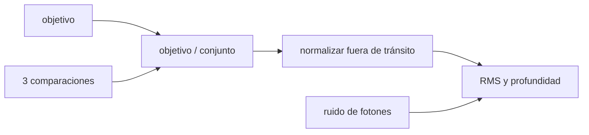

# B45-C17 — Fotometría diferencial

<!-- nav:top -->
[🏠 Programa](../../../../README.md) · [📚 Bloque B45](../../../tronco-comun/B45-espectroscopia-fotometria-y-polarimetria.md) · [← Anterior: B45-C16 — Polarímetros astronómicos](../B45-C16-polarimetros-astronomicos/CLASE.md) · [Siguiente: B45-C18 — Extracción de espectros →](../B45-C18-extraccion-de-espectros/CLASE.md)
<!-- /nav -->

## 1. Ubicación, nivel y alcance

Clase 17 del bloque B45. Nivel N3. La fotometría diferencial divide el flujo del objetivo por el de estrellas de comparación para cancelar la transparencia común de la atmósfera. Aquí simulas una **curva de luz con tránsito**, comparas el objetivo **sin dividir**, con **una comparación** y con **un conjunto**, y verificas el **ruido previsto** y la **profundidad recuperada**. Usas [B12](../../../tronco-comun/B12-probabilidad-estadistica-e-incertidumbre.md) y [B44](../../../tronco-comun/B44-detectores-y-adquisicion-astronomica.md).

## 2. Por qué esta clase existe

La atmósfera varía más que la señal; sin una referencia, la curva de luz no sirve. La decisión central: **¿qué comparaciones y qué precisión se necesitan para una profundidad dada?**

## 3. Lo que podrás hacer al terminar

1. Construir una curva diferencial.
2. Calcular el ruido previsto `√(1/N_obj + 1/N_comp)`.
3. Comparar una comparación y un conjunto.
4. Medir una profundidad de tránsito y su error.
5. Reconocer la hipótesis de transparencia común.
6. Interpretar el RMS fuera de tránsito.

La evidencia es la **ficha de fotometría diferencial** del ejercicio 12 (sección 20).

## 4. Con qué llegas y cómo comprobarlo

1. ¿Qué es una curva de luz?
2. ¿Qué es un tránsito?
3. ¿Qué es el ruido de fotones?
4. ¿Qué es una normalización?
5. ¿Qué es un RMS?

<details>
<summary>Ver respuestas</summary>

1. El brillo en función del tiempo. 2. El paso de un cuerpo por delante de una estrella. 3. La fluctuación √N. 4. Dividir por un nivel de referencia. 5. La raíz de la media de los cuadrados.
</details>

Con cuatro o cinco aciertos, sigue; si no, repasa los prerrequisitos.

## 5. Un caso de contexto y casos de referencia

Con un objetivo de 2 × 10⁵ cuentas y tres comparaciones, la transparencia común produce `3,39 %` de RMS en el objetivo solo y `0,245 %` con el conjunto (previsto `0,254 %`); la profundidad vale `1,022 %` (verdadera 1 %). Es el **ejemplo conductor** (datos **sintéticos**).

## 6. Vocabulario

La **curva diferencial** es objetivo/comparación. La **transparencia** es la fracción de luz que llega. El **conjunto** suma las comparaciones. El **ruido de fotones** relativo es `1/√N`. La **profundidad** es `1 − F_en/F_fuera`. Una **estrella de comparación** debe ser constante.

## 7. Modelo mental: dos barcos en el mismo oleaje

Como dos barcos en el mismo oleaje: el balanceo común se cancela al restar el uno del otro y queda solo el movimiento propio de uno de ellos.



*Descripción textual:* la división por las comparaciones elimina la variación común y deja el ruido de fotones y el tránsito.

Analogía: dos barcos en el mismo oleaje. Límite: transparencia igual para todas las estrellas.

## 8. La explicación, paso a paso

### 8.1 Curvas

| curva | RMS fuera (%) | profundidad (%) |
|---|---|---|
| objetivo sin dividir | 3,392 | 4,031 |
| comparación de 1×10⁵ | 0,401 | 1,047 |
| comparación de 2×10⁵ | 0,315 | 1,072 |
| comparación de 4×10⁵ | 0,266 | 0,991 |
| conjunto de tres | 0,245 | 1,022 |

La variación de la transparencia fuera de tránsito es `3,410 %` RMS.

### 8.2 Ruido previsto

Conjunto `0,254 %`; con la comparación de 10⁵, `0,387 %`; con la de 4 × 10⁵, `0,274 %`; solo el objetivo `0,224 %`.

### 8.3 Profundidad

El error previsto de la profundidad es `0,0431 %` (con 40 puntos dentro y 260 fuera); la recuperada es `1,022 %`: 0,5 errores respecto de 1 %.

### 8.4 Lectura

Dividir elimina el 93 % del ruido; más comparaciones acercan el ruido al límite del objetivo. Si las comparaciones varían, la técnica falla.

## 9. Magnitudes, símbolos y unidades

| Símbolo | Qué es | Unidad | Valor / nota |
|---|---|---|---|
| `N_obj` | cuentas del objetivo | — | 2 × 10⁵ |
| `N_comp` | cuentas de comparaciones | — | 1, 2 y 4 × 10⁵ |
| `σ` | ruido relativo | % | 0,254 |
| `δ` | profundidad | % | 1,022 |

## 10. Convenciones y referencias

300 exposiciones; tránsito de las 130 a las 169; transparencia con tendencia de 3 % y oscilación de 4 %; semilla `20261109`; datos **sintéticos**.

## 11. De dónde sale lo que afirmamos

| ID | Fuente | Localizador | Respalda | Estado |
|---|---|---|---|---|
| S1 | Fotometría diferencial de campo (técnica estándar) | — | descripción de libro; no se consultó | No consultado |

Límites: no se usó ninguna curva real; sin términos de color ni de masa de aire.

## 12. Cómo ver el ruido

| curva | RMS (%) |
|---|---|
| sin dividir | 3,39 |
| conjunto | 0,245 |

Descripción larga: dividir baja el ruido más de diez veces.

## 13. Ejemplo trabajado: ruido previsto del conjunto

**Paso 1 · Objetivo.** `1/2×10⁵ = 5×10⁻⁶`.

**Paso 2 · Conjunto.** `1/7×10⁵ = 1,429 × 10⁻⁶`.

**Paso 3 · Suma y raíz.** `√(6,429 × 10⁻⁶)`.

**Paso 4 · Valor.** `0,254 %`.

## 14. Distintas formas de describir el resultado

**Por división:** objetivo/comparación. **Por tabla:** RMS. **Por fórmula:** fotones. **Por código:** `diferencial.py`.

## 15. Práctica guiada

**Ejercicio 1 · con los pasos indicados.** Ruido previsto del conjunto. *Pasos:* ejemplo 13.

<details><summary>Solución comentada</summary>

`0,254 %`.
</details>

**Ejercicio 2 · con una pista.** Ruido solo del objetivo.

<details><summary>Solución comentada</summary>

`0,224 %`.
</details>

**Ejercicio 3 · casi autónomo.** Mejora del RMS al dividir.

<details><summary>Solución comentada</summary>

`13,8` veces.
</details>

## 16. Práctica autónoma, transferencia e integrador

**Ejercicio 4.** Profundidad recuperada.

<details><summary>Solución comentada</summary>

`1,022 %`.
</details>

**Ejercicio 5.** Error previsto de la profundidad.

<details><summary>Solución comentada</summary>

`0,0431 %`.
</details>

**Ejercicio 6.** Ruido con la comparación de 10⁵ (previsto).

<details><summary>Solución comentada</summary>

`0,387 %`.
</details>

**Ejercicio 7.** Ruido con la de 4×10⁵ (previsto).

<details><summary>Solución comentada</summary>

`0,274 %`.
</details>

**Ejercicio 8.** Puntos dentro del tránsito.

<details><summary>Solución comentada</summary>

`40`.
</details>

**Ejercicio 9 · transferencia.** **Transferencia.** ¿Qué pasa si una comparación es variable?

<details><summary>Solución comentada</summary>

Introduce su variación en la curva; hay que descartarla o ponderar.
</details>

**Ejercicio 10 · transferencia.** **Transferencia.** ¿Por qué importa el color de las comparaciones?

<details><summary>Solución comentada</summary>

La extinción depende del color y no se cancela exactamente.
</details>

**Ejercicio 11 · transferencia.** **Transferencia.** Un compañero llama «detección» al tránsito sintético. Responde.

<details><summary>Solución comentada</summary>

Es una señal inyectada en datos simulados.
</details>

**Ejercicio 12.** **Integrador.** Elabora tu *ficha de fotometría diferencial*: curvas, ruido previsto, profundidad y límites.

<details><summary>Solución comentada</summary>

Secciones 8.1–8.4.
</details>

**Ejercicio 12 · integrador.** **Integrador.** Elabora tu *ficha de fotometría diferencial*: curvas, ruido previsto, profundidad y límites.

<details><summary>Solución modelo</summary>

Secciones 8.1–8.4.
</details>

## 17. Laboratorio: tránsito sintético

El script [diferencial.py](diferencial.py) construye la curva diferencial y compara RMS y profundidad (**comprueba** el RMS a 10 % del previsto y la profundidad a 3 errores).

**Datos:** sin constantes; datos **sintéticos**. **Predice antes de ejecutar:** ¿cuánto baja el RMS al dividir? (más de diez veces.) **Ejecución del 2026-11-09 (Python 3.12.9):**

```text
Python 3.12.9 (biblioteca estandar)
300 exposiciones (260 fuera y 40 dentro del transito) ; profundidad verdadera 1,000 %
transparencia comun: variacion RMS fuera de transito = 3.410 %
                 curva  RMS fuera (%)  profundidad (%)
  objetivo sin dividir          3.392            4.031
     comparacion 1e+05          0.401            1.047
     comparacion 2e+05          0.315            1.072
     comparacion 4e+05          0.266            0.991
         conjunto de 3          0.245            1.022
previsto: ruido de fotones del conjunto 0.254 % ; con la comparacion de 1e5 0.387 % ; con la de 4e5 0.274 % ; solo objetivo 0.224 %
error previsto de la profundidad = 0.0431 % ; recuperada 1.0220 %
Pruebas superadas.
```

```bash
python programa/clases/B45/B45-C17-fotometria-diferencial/diferencial.py
```

**Límites:** transparencia común.

## 18. Errores frecuentes y cómo corregirlos

**Usar como comparación una estrella variable.** Se corrige con la pregunta de transferencia.

**Normalizar con puntos en tránsito.** Se corrige con 8.1.

**Ignorar el color de las estrellas.** Se corrige con la pregunta de transferencia.

**Llamar detección a datos simulados.** Se corrige con la sección 10.

## 19. Cómo sabrás que vas bien

Tras la sección 8: ¿qué resultado esperabas y cuál obtuviste? Si dudas, repasa el ejemplo 13. Tras el laboratorio: ¿qué comprueba? (ver la sección 17).

## 20. Qué entregas y cómo se evalúa

El producto es tu **ficha de fotometría diferencial** (ejercicio 12).

| Criterio | Inicial | En desarrollo | Logrado | Destacado |
|---|---|---|---|---|
| Conceptos | Los confunde | Parciales | conceptos de la clase | Explica los límites |
| Cálculo | Sin unidades | Con errores | Tablas completas | Calcula casos nuevos |
| Numérico | Sin comprobar | Un caso | Contraste con el análisis | Interpreta las diferencias |
| Fuentes | Sin fuente | Sin fecha | fuentes con fecha | Declara lo ilustrativo |
| Límites | No los nombra | Uno | Tres | Discute qué falta del modelo |

**Condiciones críticas (no se compensan con promedio):** rotular la curva como sintética; no anunciar detecciones; citar solo lo consultado.

## 21. Ética, seguridad y límites

Clase educativa: los modelos son simplificados. Accesibilidad: tablas equivalentes a las gráficas, fórmulas en texto, ejercicios sin conexión.

## 22. Para cerrar y seguir

Dividir por el conjunto baja el RMS de 3,39 % a 0,25 % y recupera la profundidad inyectada (1,02 %). Queda una pregunta: ¿cómo se extrae un espectro de una imagen 2D?

**Glosario español–inglés.** fotometría diferencial · *differential photometry*; estrella de comparación · *comparison star*; curva de luz · *light curve*; tránsito · *transit*.

**Continuidad.** [B45-C18](../B45-C18-extraccion-de-espectros/CLASE.md) estudia la extracción de espectros.

**Referencias:** ver sección 11.

<!-- nav:bottom -->
---

[← Anterior: B45-C16 — Polarímetros astronómicos](../B45-C16-polarimetros-astronomicos/CLASE.md) · [📚 Bloque B45](../../../tronco-comun/B45-espectroscopia-fotometria-y-polarimetria.md) · [Siguiente: B45-C18 — Extracción de espectros →](../B45-C18-extraccion-de-espectros/CLASE.md)
<!-- /nav -->
