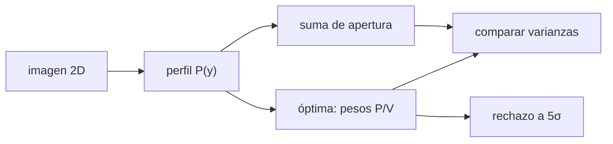

# B45-C18 — Extracción de espectros

<!-- nav:top -->
[🏠 Programa](../../../../README.md) · [📚 Bloque B45](../../../tronco-comun/B45-espectroscopia-fotometria-y-polarimetria.md) · [← Anterior: B45-C17 — Fotometría diferencial](../B45-C17-fotometria-diferencial/CLASE.md) · [Siguiente: B45-C19 — Reducción e incertidumbre instrumental →](../B45-C19-reduccion-e-incertidumbre-instrumental/CLASE.md)
<!-- /nav -->

## 1. Ubicación, nivel y alcance

Clase 18 del bloque B45. Nivel N3. Extraer un espectro es convertir una imagen 2D en una columna de flujos. Aquí comparas la **suma en apertura** con la **extracción óptima** que pondera por el perfil espacial, verificas las varianzas previstas por Monte Carlo y estudias el efecto de un **rayo cósmico**. Usas [B15](../../../tronco-comun/B15-senales-imagenes-y-estimacion-cientifica.md) y [B44](../../../tronco-comun/B44-detectores-y-adquisicion-astronomica.md).

## 2. Por qué esta clase existe

Una extracción ingenua pierde señal a ruido y es sensible a defectos. La decisión central: **¿qué pesos dan la menor varianza y cómo se protege la extracción de valores atípicos?**

## 3. Lo que podrás hacer al terminar

1. Construir un perfil espacial normalizado.
2. Sumar en apertura con corrección por la fracción encerrada.
3. Calcular la extracción óptima y su varianza.
4. Comparar con Monte Carlo.
5. Rechazar un rayo cósmico a 5σ.
6. Reconocer que el perfil y el cielo se suponen conocidos.

La evidencia es la **ficha de extracción** del ejercicio 12 (sección 20).

## 4. Con qué llegas y cómo comprobarlo

1. ¿Qué es un perfil gaussiano?
2. ¿Qué es el ruido de lectura?
3. ¿Qué es una varianza?
4. ¿Qué es un peso?
5. ¿Qué es un rayo cósmico?

<details>
<summary>Ver respuestas</summary>

1. Una campana. 2. El ruido del amplificador del detector. 3. El cuadrado de la desviación. 4. Un factor que da importancia relativa. 5. Una partícula que deja carga espuria en el detector.
</details>

Con cuatro o cinco aciertos, sigue; si no, repasa los prerrequisitos.

## 5. Un caso de contexto y casos de referencia

Para una columna de 400 e⁻ con perfil gaussiano de `σ = 2` píxeles, cielo de 60 e⁻/píxel y ruido de lectura de 6 e⁻, la suma da `σ = 40,18 e⁻` y la extracción óptima `33,22 e⁻`: mejora de `1,209`. Es el **ejemplo conductor** (columna **sintética**).

## 6. Vocabulario

El **perfil espacial** `P(y)` normalizado. La **suma de apertura** suma los píxeles y corrige la fracción. La **extracción óptima** (de Horne, citada de memoria) usa `F = Σ P D/V / Σ P²/V`. La **varianza** es `1/Σ(P²/V)`. Un **rayo cósmico** es un pico espurio. Un **residuo normalizado** compara con la varianza del modelo.

## 7. Modelo mental: una votación con pesos

Como una votación donde los votos más fiables (píxeles de mayor señal) pesan más y los dudosos casi nada.



*Descripción textual:* el perfil define los pesos y la varianza mínima; un rechazo de valores atípicos protege la estimación.

Analogía: una votación con pesos. Límite: perfil y cielo conocidos, ruido independiente.

## 8. La explicación, paso a paso

### 8.1 Varianzas

La fracción del perfil dentro de ±6 píxeles es `0,99898`.

| método | media (e⁻) | σ Monte Carlo | σ prevista | S/N |
|---|---|---|---|---|
| suma simple | 399,51 | 40,179 | 40,632 | 9,96 |
| óptima | 399,63 | 33,223 | 33,603 | 12,04 |

La mejora de la desviación es `1,209` (prevista `1,209`).

### 8.2 Rayo cósmico

Un rayo cósmico de 3000 e⁻ en un píxel a +4 del centro (flujo verdadero 400): la suma da `3403,0`, la óptima sin rechazo `1255,9` y la óptima con rechazo a 5σ `401,1` (dispersión `70,55`).

### 8.3 Lectura

La óptima da un S/N un 21 % mayor sin más luz, pero depende del perfil. El rechazo restaura el valor, aunque su dispersión sube porque descarta también píxeles buenos.

## 9. Magnitudes, símbolos y unidades

| Símbolo | Qué es | Unidad | Valor / nota |
|---|---|---|---|
| `P(y)` | perfil espacial | — | gaussiano σ = 2 píxeles |
| `F` | flujo | e⁻ | 400 |
| `B`, `RN` | cielo, ruido de lectura | e⁻ | 60; 6 |
| `V` | varianza por píxel | e⁻² | `P F + B + RN²` |

## 10. Convenciones y referencias

41 píxeles espaciales; apertura de ±6 píxeles; 5000 repeticiones; semilla `20261109`; el método de Horne se cita de memoria.

## 11. De dónde sale lo que afirmamos

| ID | Fuente | Localizador | Respalda | Estado |
|---|---|---|---|---|
| S1 | Horne (1986), extracción óptima | — | no consultada; es el método descrito | No consultado |

Límites: perfil y cielo conocidos; en la práctica se ajustan y su error entra en la incertidumbre.

## 12. Cómo ver las varianzas

| método | σ (e⁻) |
|---|---|
| suma | 40,18 |
| óptima | 33,22 |

Descripción larga: la óptima tiene menor dispersión.

## 13. Ejemplo trabajado: mejora prevista

**Paso 1 · Suma.** `40,632 e⁻`.

**Paso 2 · Óptima.** `33,603 e⁻`.

**Paso 3 · Cociente.** `40,632/33,603`.

**Paso 4 · Valor.** `1,209`.

## 14. Distintas formas de describir el resultado

**Por pesos:** `P/V`. **Por varianza:** fórmula. **Por Monte Carlo:** 5000 columnas. **Por código:** `extraccion.py`.

## 15. Práctica guiada

**Ejercicio 1 · con los pasos indicados.** σ prevista de la suma. *Pasos:* tabla.

<details><summary>Solución comentada</summary>

`40,632 e⁻`.
</details>

**Ejercicio 2 · con una pista.** σ prevista de la óptima.

<details><summary>Solución comentada</summary>

`33,603 e⁻`.
</details>

**Ejercicio 3 · casi autónomo.** Mejora prevista. *Pasos:* ejemplo 13.

<details><summary>Solución comentada</summary>

`1,209`.
</details>

## 16. Práctica autónoma, transferencia e integrador

**Ejercicio 4.** S/N de la óptima.

<details><summary>Solución comentada</summary>

`12,04`.
</details>

**Ejercicio 5.** S/N de la suma.

<details><summary>Solución comentada</summary>

`9,96`.
</details>

**Ejercicio 6.** Fracción encerrada en ±6 px.

<details><summary>Solución comentada</summary>

`0,99898`.
</details>

**Ejercicio 7.** Sesgo de la suma con el rayo cósmico.

<details><summary>Solución comentada</summary>

`3003 e⁻`.
</details>

**Ejercicio 8.** Valor con rechazo a 5σ.

<details><summary>Solución comentada</summary>

`401,1 e⁻`.
</details>

**Ejercicio 9 · transferencia.** **Transferencia.** ¿Por qué la óptima gana más con poca señal?

<details><summary>Solución comentada</summary>

Porque da peso a los píxeles centrales y casi nulo a los dominados por cielo y lectura.
</details>

**Ejercicio 10 · transferencia.** **Transferencia.** ¿Qué pasa si el perfil usado es erróneo?

<details><summary>Solución comentada</summary>

La estimación se sesga; hay que ajustar el perfil con los datos.
</details>

**Ejercicio 11 · transferencia.** **Transferencia.** Un compañero atribuye a Horne las cifras de la tabla. Responde.

<details><summary>Solución comentada</summary>

Las cifras son de este laboratorio; el método se citó de memoria.
</details>

**Ejercicio 12.** **Integrador.** Elabora tu *ficha de extracción*: pesos, varianzas, rayo cósmico y límites.

<details><summary>Solución comentada</summary>

Secciones 8.1–8.3.
</details>

**Ejercicio 12 · integrador.** **Integrador.** Elabora tu *ficha de extracción*: pesos, varianzas, rayo cósmico y límites.

<details><summary>Solución modelo</summary>

Secciones 8.1–8.3.
</details>

## 17. Laboratorio: suma y óptima

El script [extraccion.py](extraccion.py) compara la suma y la extracción óptima por Monte Carlo y rechaza un rayo cósmico (**comprueba** las desviaciones a 5 % de lo previsto).

**Datos:** sin constantes; columna **sintética**. **Predice antes de ejecutar:** ¿cuánto mejora la óptima? (≈ 21 %.) **Ejecución del 2026-11-09 (Python 3.12.9):**

```text
Python 3.12.9 (biblioteca estandar)
fraccion del perfil dentro de +-6 pixeles = 0.99898
          metodo     media  sigma MC  sigma prevista     S/N
     suma simple    399.51    40.179          40.632    9.96
  optima (Horne)    399.63    33.223          33.603   12.04
mejora de la desviacion: 1.209 (prevista 1.209)
con rayo cosmico de 3000 e- a +4 pixeles (verdadero 400): suma 3403.0 ; optima sin rechazo 1255.9 ; optima con rechazo a 5 sigma 401.1 (sigma 70.55)
Pruebas superadas.
```

```bash
python programa/clases/B45/B45-C18-extraccion-de-espectros/extraccion.py
```

**Límites:** perfil y cielo conocidos.

## 18. Errores frecuentes y cómo corregirlos

**Sumar sin corregir la fracción encerrada.** Se corrige con 8.1.

**Usar pesos sin la varianza correcta.** Se corrige con la sección 9.

**No enmascarar rayos cósmicos.** Se corrige con 8.2.

**Atribuir cifras a un artículo no leído.** Se corrige con la sección 11.

## 19. Cómo sabrás que vas bien

Tras la sección 8: ¿qué resultado esperabas y cuál obtuviste? Si dudas, repasa el ejemplo 13. Tras el laboratorio: ¿qué comprueba? (ver la sección 17).

## 20. Qué entregas y cómo se evalúa

El producto es tu **ficha de extracción** (ejercicio 12).

| Criterio | Inicial | En desarrollo | Logrado | Destacado |
|---|---|---|---|---|
| Conceptos | Los confunde | Parciales | conceptos de la clase | Explica los límites |
| Cálculo | Sin unidades | Con errores | Tablas completas | Calcula casos nuevos |
| Numérico | Sin comprobar | Un caso | Contraste con el análisis | Interpreta las diferencias |
| Fuentes | Sin fuente | Sin fecha | fuentes con fecha | Declara lo ilustrativo |
| Límites | No los nombra | Uno | Tres | Discute qué falta del modelo |

**Condiciones críticas (no se compensan con promedio):** rotular la columna como sintética; no atribuir cifras a la referencia; citar solo lo consultado.

## 21. Ética, seguridad y límites

Clase educativa: los modelos son simplificados. Accesibilidad: tablas equivalentes a las gráficas, fórmulas en texto, ejercicios sin conexión.

## 22. Para cerrar y seguir

La extracción óptima baja la desviación de 40,2 a 33,2 e⁻ y, con rechazo a 5σ, un rayo cósmico de 3000 e⁻ deja 401 e⁻. Queda una pregunta: ¿cómo se propaga el error de toda la reducción?

**Glosario español–inglés.** extracción óptima · *optimal extraction*; perfil espacial · *spatial profile*; rayo cósmico · *cosmic ray*; apertura · *aperture*.

**Continuidad.** [B45-C19](../B45-C19-reduccion-e-incertidumbre-instrumental/CLASE.md) estudia la reducción y la incertidumbre instrumental.

**Referencias:** ver sección 11.

<!-- nav:bottom -->
---

[← Anterior: B45-C17 — Fotometría diferencial](../B45-C17-fotometria-diferencial/CLASE.md) · [📚 Bloque B45](../../../tronco-comun/B45-espectroscopia-fotometria-y-polarimetria.md) · [Siguiente: B45-C19 — Reducción e incertidumbre instrumental →](../B45-C19-reduccion-e-incertidumbre-instrumental/CLASE.md)
<!-- /nav -->
