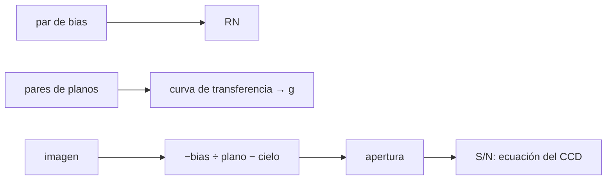

# B45-C19 — Reducción e incertidumbre instrumental

<!-- nav:top -->
[🏠 Programa](../../../../README.md) · [📚 Bloque B45](../../../tronco-comun/B45-espectroscopia-fotometria-y-polarimetria.md) · [← Anterior: B45-C18 — Extracción de espectros](../B45-C18-extraccion-de-espectros/CLASE.md) · [Siguiente: B45-C20 — Campaña fotométrica o espectroscópica →](../B45-C20-campana-fotometrica-o-espectroscopica/CLASE.md)
<!-- /nav -->

## 1. Ubicación, nivel y alcance

Clase 19 del bloque B45. Nivel N3. Reducir un CCD es quitar el sesgo, el oscuro y la ganancia por píxel, y cuantificar el ruido. Aquí estimas el **ruido de lectura** con un par de tramas de sesgo, la **ganancia** con la **curva de transferencia de fotones**, y comparas el **S/N** de una estrella con la **ecuación del CCD**. Usas [B12](../../../tronco-comun/B12-probabilidad-estadistica-e-incertidumbre.md) y [B44](../../../tronco-comun/B44-detectores-y-adquisicion-astronomica.md).

## 2. Por qué esta clase existe

Un flujo sin incertidumbre no es una medida. La decisión central: **¿qué términos dominan el ruido y cómo se estiman ganancia y ruido de lectura?**

## 3. Lo que podrás hacer al terminar

1. Estimar `RN` con dos tramas de sesgo.
2. Hallar la ganancia con la curva de transferencia.
3. Dividir por un plano y restar un oscuro.
4. Aplicar la ecuación del CCD.
5. Incluir el error de la estimación del cielo.
6. Reconocer que la ordenada de la curva no sirve para `RN`.

La evidencia es la **ficha de reducción e incertidumbre** del ejercicio 12 (sección 20).

## 4. Con qué llegas y cómo comprobarlo

1. ¿Qué es una ganancia?
2. ¿Qué es el ruido de lectura?
3. ¿Qué es una corriente de oscuro?
4. ¿Qué es un plano?
5. ¿Qué es una mediana?

<details>
<summary>Ver respuestas</summary>

1. Electrones por ADU. 2. El ruido al leer el píxel. 3. La señal sin luz por agitación térmica. 4. Una imagen de iluminación uniforme. 5. El valor central de una lista ordenada.
</details>

Con cuatro o cinco aciertos, sigue; si no, repasa los prerrequisitos.

## 5. Un caso de contexto y casos de referencia

En un CCD sintético con ganancia 2,0 e⁻/ADU y ruido de lectura 6,0 e⁻, el par de sesgos da `6,026 e⁻` y la curva de transferencia da una ganancia de `1,9730 e⁻/ADU`. Una estrella de `38711 e⁻` en la apertura tiene S/N `76,3` (Monte Carlo). Es el **ejemplo conductor** (detector **sintético**).

## 6. Vocabulario

El **sesgo** (bias) es el nivel sin luz. El **oscuro** es la corriente térmica. La **ganancia** convierte electrones en ADU. La **curva de transferencia de fotones** es `var = media/g + RN²/g²`. La **ecuación del CCD** es `S/N = S/√(S + n(B + D + RN²))`. El **plano** corrige la ganancia por píxel.

## 7. Modelo mental: una cocina con ruido

Como cocinar con una balanza imprecisa: tara (sesgo), corriente de aire (oscuro) y platos de distinto tamaño (plano); el ruido total suma las incertidumbres de cada paso.



*Descripción textual:* los calibrados dan ganancia y ruido de lectura y estos alimentan la ecuación del CCD que predice el S/N.

Analogía: una cocina con ruido. Límite: respuesta lineal, ruido gaussiano.

## 8. La explicación, paso a paso

### 8.1 Ruido de lectura y ganancia

Con el par de sesgos, `RN = 6,026 e⁻` (verdadero 6,0; sesgo medio `499,97 ADU`). La curva de transferencia con diez niveles de plano:

| e⁻/píxel | media (ADU) | varianza (ADU²) |
|---|---|---|
| 200 | 99,94 | 59,07 |
| 500 | 250,23 | 136,35 |
| 1000 | 500,15 | 255,90 |
| 2000 | 999,75 | 518,80 |
| 4000 | 1999,89 | 1021,25 |
| 8000 | 4000,20 | 2060,59 |
| 12000 | 5999,88 | 2907,39 |
| 16000 | 7999,77 | 4073,67 |
| 20000 | 10000,99 | 5150,88 |
| 25000 | 12499,99 | 6316,57 |

La pendiente da `g = 1,9730 e⁻/ADU` (verdadero 2,0, error `1,4 %`). La ordenada daría un ruido de lectura de `2,87 e⁻`: está mal determinada porque el error de la pendiente multiplicado por señales grandes domina; el ruido de lectura se toma de los sesgos.

### 8.2 S/N de una estrella

La apertura de 69 píxeles encierra el `96,78 %` del flujo: `38711 e⁻` esperados y `38711 e⁻` recuperados (σ MC `508`). Términos de varianza (e⁻²): señal 38711, cielo 172500, oscuro 690, lectura 2484.

| S/N | valor |
|---|---|
| Monte Carlo | 76,26 |
| ecuación con cielo conocido | 83,61 |
| ecuación con cielo estimado por mediana (704 px) | 78,78 |

### 8.3 Lectura

El cielo domina la varianza (`80 %`). Estimar el cielo añade error y baja el S/N un `5,8 %`; el Monte Carlo queda `3,2 %` por debajo de esa ecuación.

## 9. Magnitudes, símbolos y unidades

| Símbolo | Qué es | Unidad | Valor / nota |
|---|---|---|---|
| `g` | ganancia | e⁻/ADU | 1,973 |
| `RN` | ruido de lectura | e⁻ | 6,03 |
| `B` | cielo | e⁻/píxel | 25 e⁻/s/píxel × 100 s |
| `D` | oscuro | e⁻/s/píxel | 0,1 |
| `S/N` | señal a ruido | — | 76,3 |

## 10. Convenciones y referencias

64 × 64 píxeles; ganancia verdadera 2,0; bias 500 ADU; planos con ganancia por píxel de 2 % RMS; 300 repeticiones; semilla `20261109`.

## 11. De dónde sale lo que afirmamos

| ID | Fuente | Localizador | Respalda | Estado |
|---|---|---|---|---|
| S1 | Ecuación del CCD y curva de transferencia (técnica de libro) | — | relaciones estándar que verifica el laboratorio | No consultado |

Límites: detector sintético; sin no linealidad, carga de arrastre ni patrón fijo extra.

## 12. Cómo ver el S/N

| Caso | S/N |
|---|---|
| Monte Carlo | 76,3 |
| ecuación (cielo conocido) | 83,6 |
| ecuación (cielo estimado) | 78,8 |

Descripción larga: estimar el cielo baja el S/N.

## 13. Ejemplo trabajado: S/N con cielo conocido

**Paso 1 · Señal.** `S = 38711 e⁻`.

**Paso 2 · Varianza.** `S + n(B+D+RN²) = 214385`.

**Paso 3 · Raíz.** `463,0`.

**Paso 4 · Cociente.** `83,61`.

## 14. Distintas formas de describir el resultado

**Por ecuación:** CCD. **Por curva:** transferencia. **Por Monte Carlo:** 300 imágenes. **Por código:** `reduccion.py`.

## 15. Práctica guiada

**Ejercicio 1 · con los pasos indicados.** S/N con cielo conocido. *Pasos:* ejemplo 13.

<details><summary>Solución comentada</summary>

`83,61`.
</details>

**Ejercicio 2 · con una pista.** Ruido de lectura desde los sesgos.

<details><summary>Solución comentada</summary>

`6,026 e⁻`.
</details>

**Ejercicio 3 · casi autónomo.** Ganancia estimada.

<details><summary>Solución comentada</summary>

`1,9730 e⁻/ADU`.
</details>

## 16. Práctica autónoma, transferencia e integrador

**Ejercicio 4.** Error relativo de la ganancia.

<details><summary>Solución comentada</summary>

`1,4 %`.
</details>

**Ejercicio 5.** Fracción encerrada.

<details><summary>Solución comentada</summary>

`96,78 %`.
</details>

**Ejercicio 6.** Fracción de varianza del cielo.

<details><summary>Solución comentada</summary>

`80 %`.
</details>

**Ejercicio 7.** S/N con cielo estimado.

<details><summary>Solución comentada</summary>

`78,78`.
</details>

**Ejercicio 8.** S/N Monte Carlo.

<details><summary>Solución comentada</summary>

`76,26`.
</details>

**Ejercicio 9 · transferencia.** **Transferencia.** ¿Por qué se usan parejas de planos?

<details><summary>Solución comentada</summary>

La diferencia cancela el patrón fijo de ganancia y deja solo el ruido.
</details>

**Ejercicio 10 · transferencia.** **Transferencia.** ¿Cuándo domina la lectura?

<details><summary>Solución comentada</summary>

Con cielo y señal bajos, p. ej. en bandas oscuras o exposiciones cortas.
</details>

**Ejercicio 11 · transferencia.** **Transferencia.** Un compañero dice que la ordenada da el ruido de lectura. Responde.

<details><summary>Solución comentada</summary>

Aquí no: está mal determinada; se mide con sesgos.
</details>

**Ejercicio 12.** **Integrador.** Elabora tu *ficha de reducción e incertidumbre*: ganancia, ruido de lectura, S/N y límites.

<details><summary>Solución comentada</summary>

Secciones 8.1–8.3.
</details>

**Ejercicio 12 · integrador.** **Integrador.** Elabora tu *ficha de reducción e incertidumbre*: ganancia, ruido de lectura, S/N y límites.

<details><summary>Solución modelo</summary>

Secciones 8.1–8.3.
</details>

## 17. Laboratorio: CCD sintético

El script [reduccion.py](reduccion.py) estima RN y ganancia, reduce y compara el S/N con la ecuación del CCD (**comprueba** la ganancia a 3 % y el S/N a 5 % de la ecuación con cielo estimado).

**Datos:** sin constantes; detector **sintético**. **Predice antes de ejecutar:** ¿qué ganancia saldrá? (≈ 1,97 e⁻/ADU.) **Ejecución del 2026-11-09 (Python 3.12.9):**

```text
Python 3.12.9 (biblioteca estandar)
bias maestro = 499.97 ADU ; ruido de lectura desde el par de bias = 6.026 e- (verdadero 6.0)
 e-/pixel  media ADU  varianza ADU^2
      200      99.94          59.065
      500     250.23         136.353
     1000     500.15         255.903
     2000     999.75         518.797
     4000    1999.89        1021.255
     8000    4000.20        2060.591
    12000    5999.88        2907.390
    16000    7999.77        4073.672
    20000   10000.99        5150.881
    25000   12499.99        6316.568
curva de transferencia: ganancia = 1.9730 e-/ADU (verdadera 2.0) ; ruido de lectura de la ordenada = 2.87 e-
apertura de 69 pixeles encierra 96.78 % del flujo ; senal esperada 38711 e- ; recuperada 38711 e- (sigma MC 508)
terminos de varianza (e-^2): senal 38711, cielo 172500, oscuro 690, lectura 2484
S/N: Monte Carlo 76.26 ; ecuacion del CCD con cielo conocido 83.61 ; con cielo estimado por mediana de 704 pixeles 78.78
Pruebas superadas.
```

```bash
python programa/clases/B45/B45-C19-reduccion-e-incertidumbre-instrumental/reduccion.py
```

**Límites:** respuesta lineal.

## 18. Errores frecuentes y cómo corregirlos

**Tomar el ruido de lectura de la ordenada.** Se corrige con 8.1.

**Ignorar el error del cielo.** Se corrige con 8.2.

**Olvidar la fracción encerrada.** Se corrige con 8.2.

**Presentar el detector como real.** Se corrige con la sección 10.

## 19. Cómo sabrás que vas bien

Tras la sección 8: ¿qué resultado esperabas y cuál obtuviste? Si dudas, repasa el ejemplo 13. Tras el laboratorio: ¿qué comprueba? (ver la sección 17).

## 20. Qué entregas y cómo se evalúa

El producto es tu **ficha de reducción e incertidumbre** (ejercicio 12).

| Criterio | Inicial | En desarrollo | Logrado | Destacado |
|---|---|---|---|---|
| Conceptos | Los confunde | Parciales | conceptos de la clase | Explica los límites |
| Cálculo | Sin unidades | Con errores | Tablas completas | Calcula casos nuevos |
| Numérico | Sin comprobar | Un caso | Contraste con el análisis | Interpreta las diferencias |
| Fuentes | Sin fuente | Sin fecha | fuentes con fecha | Declara lo ilustrativo |
| Límites | No los nombra | Uno | Tres | Discute qué falta del modelo |

**Condiciones críticas (no se compensan con promedio):** rotular el detector como sintético; no dar ganancias de cámaras; citar solo lo consultado.

## 21. Ética, seguridad y límites

Clase educativa: los modelos son simplificados. Accesibilidad: tablas equivalentes a las gráficas, fórmulas en texto, ejercicios sin conexión.

## 22. Para cerrar y seguir

El par de sesgos da RN = 6,03 e⁻, la curva de transferencia g = 1,973 e⁻/ADU y el S/N de una estrella brillante es 76 (ecuación 79). Queda una pregunta: ¿cómo se planifica una campaña completa?

**Glosario español–inglés.** reducción · *reduction*; curva de transferencia de fotones · *photon transfer curve*; ruido de lectura · *read noise*; ganancia · *gain*.

**Continuidad.** [B45-C20](../B45-C20-campana-fotometrica-o-espectroscopica/CLASE.md) estudia la planificación de una campaña.

**Referencias:** ver sección 11.

<!-- nav:bottom -->
---

[← Anterior: B45-C18 — Extracción de espectros](../B45-C18-extraccion-de-espectros/CLASE.md) · [📚 Bloque B45](../../../tronco-comun/B45-espectroscopia-fotometria-y-polarimetria.md) · [Siguiente: B45-C20 — Campaña fotométrica o espectroscópica →](../B45-C20-campana-fotometrica-o-espectroscopica/CLASE.md)
<!-- /nav -->
