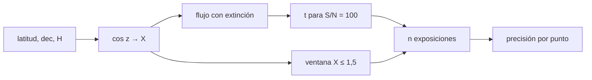

# B45-C20 — Campaña fotométrica o espectroscópica

<!-- nav:top -->
[🏠 Programa](../../../../README.md) · [📚 Bloque B45](../../../tronco-comun/B45-espectroscopia-fotometria-y-polarimetria.md) · [← Anterior: B45-C19 — Reducción e incertidumbre instrumental](../B45-C19-reduccion-e-incertidumbre-instrumental/CLASE.md) · [Siguiente: B45-C21 — Estándares fotométricos y sistemas de referencia →](../B45-C21-estandares-fotometricos-y-sistemas-de-referencia/CLASE.md)
<!-- /nav -->

## 1. Ubicación, nivel y alcance

Clase 20 del bloque B45. Nivel N3. Planificar una campaña es decidir cuándo observar, cuánto exponer y qué precisión se obtiene. Aquí calculas la **masa de aire** de un objetivo en un sitio ilustrativo, el **tiempo de exposición** que da S/N = 100 con la ecuación del CCD, la **ventana** de masa de aire ≤ 1,5, el **número de exposiciones** y la **eficiencia**. Usas [B44](../../../tronco-comun/B44-detectores-y-adquisicion-astronomica.md) y [B12](../../../tronco-comun/B12-probabilidad-estadistica-e-incertidumbre.md).

## 2. Por qué esta clase existe

Una campaña mal planificada gasta noches sin llegar a la precisión pedida. La decisión central: **¿cuánto exponer, durante cuánto tiempo y con qué precisión por punto?**

## 3. Lo que podrás hacer al terminar

1. Calcular `cos z` y la masa de aire de Kasten-Young.
2. Pasar de magnitud a electrones por segundo con extinción.
3. Resolver el tiempo de exposición para un S/N.
4. Calcular la ventana de observación.
5. Estimar número de exposiciones y eficiencia.
6. Convertir S/N en precisión en milimagnitudes.

La evidencia es la **plan de campaña** del ejercicio 12 (sección 20).

## 4. Con qué llegas y cómo comprobarlo

1. ¿Qué es la altura sobre el horizonte?
2. ¿Qué es un ángulo horario?
3. ¿Qué es una magnitud?
4. ¿Qué es una ecuación cuadrática?
5. ¿Qué es un S/N?

<details>
<summary>Ver respuestas</summary>

1. El ángulo sobre el plano del horizonte. 2. El tiempo desde el paso por el meridiano. 3. Un logaritmo del flujo. 4. `ax² + bx + c = 0`. 5. La relación entre señal y ruido.
</details>

Con cuatro o cinco aciertos, sigue; si no, repasa los prerrequisitos.

## 5. Un caso de contexto y casos de referencia

Un objetivo de V = 14,0 a declinación −10° desde latitud −30° (ilustrativos) tiene una ventana de `6,30 h` con masa de aire ≤ 1,5; a `X = 1,25` la exposición para S/N = 100 es `76,5 s` y caben `234` exposiciones con `10,9 mmag` por punto. Es el **ejemplo conductor** (todo **ilustrativo**).

## 6. Vocabulario

La **masa de aire** `X` mide el camino en la atmósfera. La **fórmula de Kasten y Young** `X = 1/[cos z + 0,50572 (96,07995 − z)^−1,6364]`. El **ángulo horario** `H`. La **extinción** `k`. El **punto cero** `ZP`. La **eficiencia** es obturador/(obturador + sobrecarga). La **precisión** por punto es `1,0857/(S/N)`.

## 7. Modelo mental: reservar un telescopio como una agenda

Como reservar una sala: la ventana es el horario disponible, cada reunión dura lo que pide la precisión, y los traslados entre reuniones (lectura) se cuentan aparte.



*Descripción textual:* la geometría fija la masa de aire y la ventana; el flujo con extinción fija el tiempo de exposición; ambos dan el número de puntos.

Analogía: reservar un telescopio como una agenda. Límite: extinción constante, sin Luna.

## 8. La explicación, paso a paso

### 8.1 Masa de aire y exposición

| H (h) | z (°) | X (K-Y) | sec z | S (e⁻/s) | t (s) | S/N |
|---|---|---|---|---|---|---|
| 0,0 | 20,00 | 1,0637 | 1,0642 | 544,7 | 73,2 | 100,000 |
| 1,0 | 24,41 | 1,0976 | 1,0981 | 542,2 | 73,8 | 100,000 |
| 2,0 | 34,37 | 1,2106 | 1,2115 | 533,8 | 75,8 | 100,000 |
| 3,0 | 46,38 | 1,4477 | 1,4495 | 516,6 | 80,2 | 100,000 |
| 4,0 | 59,12 | 1,9431 | 1,9483 | 482,4 | 90,4 | 100,000 |
| 5,0 | 72,09 | 3,2221 | 3,2514 | 404,3 | 123,6 | 100,000 |

La fórmula de Kasten-Young (leída en la página de Wikipedia citada) da `0,99971` en el cenit y a 80° vale `5,586` frente a `5,759` de `sec z`.

### 8.2 Ventana y presupuesto

Con X ≤ 1,5 la ventana es `|H| ≤ 3,15 h` = `6,30 h`. A `X = 1,25` la exposición es `76,5 s`; con 20 s de sobrecarga la eficiencia es `79,3 %`, caben `234` exposiciones y `4,97 h` de obturador. La precisión por punto es `10,86 mmag`.

### 8.3 Comprobación

El S/N de la fórmula a X = 1,25 es `100,000` y el de una simulación de 20 000 realizaciones `99,692` (la simulación usa la misma varianza, de modo que solo comprueba la coherencia de la implementación). Pasar de X = 1,0 a 1,5 cuesta `0,075 mag`.

## 9. Magnitudes, símbolos y unidades

| Símbolo | Qué es | Unidad | Valor / nota |
|---|---|---|---|
| `X` | masa de aire | — | 1,0 a 3,2 |
| `H` | ángulo horario | h | −5 a 5 |
| `ZP` | punto cero | mag | 21,0 (ilustrativo) |
| `k` | extinción | mag/X | 0,15 (ilustrativo) |
| `t` | exposición | s | 76,5 |
| `n` | exposiciones | — | 234 |

## 10. Convenciones y referencias

Latitud −30°, declinación −10°, V = 14,0, cielo 20 e⁻/s/píxel, apertura 80 píxeles, `RN = 5 e⁻`, sobrecarga 20 s; Kasten-Young en grados; semilla `20261109`.

## 11. De dónde sale lo que afirmamos

| ID | Fuente | Localizador | Respalda | Estado |
|---|---|---|---|---|
| S1 | Wikipedia, *Air mass (astronomy)* | https://en.wikipedia.org/wiki/Air_mass_(astronomy) | fórmula de Kasten y Young (1989) y sus valores 5,59 y 10,31 a 80 y 85 grados | Consultada el 2026-11-09 |

Límites: todos los parámetros del sitio y del instrumento son ilustrativos; la Luna, la variabilidad de la transparencia y la sobrecarga real no se modelan.

## 12. Cómo ver la ventana

| X máxima | ventana (h) |
|---|---|
| 1,5 | 6,30 |

Descripción larga: más masa de aire, menos horas útiles.

## 13. Ejemplo trabajado: exposición y precisión

**Paso 1 · Flujo.** `S = 10^(−0,4(V − ZP + kX))` con `X = 1,25`.

**Paso 2 · Cuadrática.** `S²t² − SNR²(S + nB)t − SNR² n RN² = 0`.

**Paso 3 · Raíz.** `t = 76,5 s`.

**Paso 4 · Precisión.** `1,0857/100 = 10,86 mmag`.

## 14. Distintas formas de describir el resultado

**Por geometría:** `cos z`. **Por ecuación:** S/N. **Por tabla:** H. **Por código:** `campana.py`.

## 15. Práctica guiada

**Ejercicio 1 · con los pasos indicados.** Masa de aire en `H = 0`. *Pasos:* tabla.

<details><summary>Solución comentada</summary>

`1,0637`.
</details>

**Ejercicio 2 · con una pista.** Exposición en `H = 0`.

<details><summary>Solución comentada</summary>

`73,2 s`.
</details>

**Ejercicio 3 · casi autónomo.** Exposición en `H = 5 h`.

<details><summary>Solución comentada</summary>

`123,6 s`.
</details>

## 16. Práctica autónoma, transferencia e integrador

**Ejercicio 4.** Ventana con X ≤ 1,5.

<details><summary>Solución comentada</summary>

`6,30 h`.
</details>

**Ejercicio 5.** Exposiciones en la ventana.

<details><summary>Solución comentada</summary>

`234`.
</details>

**Ejercicio 6.** Eficiencia.

<details><summary>Solución comentada</summary>

`79,3 %`.
</details>

**Ejercicio 7.** Precisión por punto.

<details><summary>Solución comentada</summary>

`10,86 mmag`.
</details>

**Ejercicio 8.** Pérdida de 1,0 a 1,5 de masa de aire.

<details><summary>Solución comentada</summary>

`0,075 mag`.
</details>

**Ejercicio 9 · transferencia.** **Transferencia.** ¿Cómo cambiaría el plan con Luna llena?

<details><summary>Solución comentada</summary>

El cielo sube y `t` aumenta; se añadiría un término de cielo variable.
</details>

**Ejercicio 10 · transferencia.** **Transferencia.** ¿Qué pasa si la transparencia cae?

<details><summary>Solución comentada</summary>

Baja el S/N; se necesita una monitorización y exposiciones adaptativas.
</details>

**Ejercicio 11 · transferencia.** **Transferencia.** Un compañero presenta el plan como programa de un observatorio. Responde.

<details><summary>Solución comentada</summary>

Todos los parámetros son ilustrativos.
</details>

**Ejercicio 12.** **Integrador.** Elabora tu *plan de campaña*: ventana, exposición, número de puntos, precisión y límites.

<details><summary>Solución comentada</summary>

Secciones 8.1–8.3.
</details>

**Ejercicio 12 · integrador.** **Integrador.** Elabora tu *plan de campaña*: ventana, exposición, número de puntos, precisión y límites.

<details><summary>Solución modelo</summary>

Secciones 8.1–8.3.
</details>

## 17. Laboratorio: plan de campaña

El script [campana.py](campana.py) calcula masa de aire, exposición, ventana y precisión (**comprueba** S/N = 100 a `10⁻⁹` y la masa de aire cenital a `10⁻³`).

**Datos:** Kasten-Young (S1); todo lo demás **ilustrativo**. **Predice antes de ejecutar:** ¿cuántas exposiciones caben? (≈ 234.) **Ejecución del 2026-11-09 (Python 3.12.9):**

```text
Python 3.12.9 (biblioteca estandar)
 H (h)  z (grados)  X (K-Y)   sec z  S (e-/s)    t (s)     S/N
   0.0       20.00   1.0637  1.0642   544.726     73.2 100.000
   1.0       24.41   1.0976  1.0981   542.182     73.8 100.000
   2.0       34.37   1.2106  1.2115   533.781     75.8 100.000
   3.0       46.38   1.4477  1.4495   516.579     80.2 100.000
   4.0       59.12   1.9431  1.9483   482.406     90.4 100.000
   5.0       72.09   3.2221  3.2514   404.270    123.6 100.000
masa de aire en el cenit (K-Y) = 0.99971 ; a z = 80 grados: K-Y 5.586 frente a sec z 5.759
ventana X <= 1,5: |H| <= 3.15 h, es decir 6.30 h ; exposicion a X = 1,25: 76.5 s ; eficiencia 79.3 %
numero de exposiciones en la ventana = 234 ; tiempo de obturador = 4.97 h ; sigma por punto = 10.86 mmag
S/N a X = 1,25: formula 100.000 ; Monte Carlo 99.692 ; perdida de 0.075 mag entre X = 1,0 y 1,5
Pruebas superadas.
```

```bash
python programa/clases/B45/B45-C20-campana-fotometrica-o-espectroscopica/campana.py
```

**Límites:** sin Luna, extinción constante.

## 18. Errores frecuentes y cómo corregirlos

**Usar `sec z` cerca del horizonte.** Se corrige con 8.1.

**Olvidar la sobrecarga.** Se corrige con 8.2.

**Fijar el tiempo sin la ecuación del CCD.** Se corrige con el ejemplo 13.

**Presentar el plan como real.** Se corrige con la sección 10.

## 19. Cómo sabrás que vas bien

Tras la sección 8: ¿qué resultado esperabas y cuál obtuviste? Si dudas, repasa el ejemplo 13. Tras el laboratorio: ¿qué comprueba? (ver la sección 17).

## 20. Qué entregas y cómo se evalúa

El producto es tu **plan de campaña** (ejercicio 12).

| Criterio | Inicial | En desarrollo | Logrado | Destacado |
|---|---|---|---|---|
| Conceptos | Los confunde | Parciales | conceptos de la clase | Explica los límites |
| Cálculo | Sin unidades | Con errores | Tablas completas | Calcula casos nuevos |
| Numérico | Sin comprobar | Un caso | Contraste con el análisis | Interpreta las diferencias |
| Fuentes | Sin fuente | Sin fecha | fuentes con fecha | Declara lo ilustrativo |
| Límites | No los nombra | Uno | Tres | Discute qué falta del modelo |

**Condiciones críticas (no se compensan con promedio):** rotular el sitio, el objetivo y el instrumento como ilustrativos; no dar planes de observatorios reales; citar solo lo consultado.

## 21. Ética, seguridad y límites

Clase educativa: los modelos son simplificados. Accesibilidad: tablas equivalentes a las gráficas, fórmulas en texto, ejercicios sin conexión.

## 22. Para cerrar y seguir

El plan ilustrativo da una ventana de 6,3 h, 77 s por exposición, 234 puntos y 10,9 mmag por punto. Queda una pregunta: ¿cómo se calibra la escala fotométrica con estándares?

**Glosario español–inglés.** campaña · *observing campaign*; masa de aire · *airmass*; tiempo de exposición · *exposure time*; sobrecarga · *overhead*.

**Continuidad.** [B45-C21](../B45-C21-estandares-fotometricos-y-sistemas-de-referencia/CLASE.md) estudia los estándares fotométricos y los sistemas de referencia.

**Referencias:** ver sección 11.

<!-- nav:bottom -->
---

[← Anterior: B45-C19 — Reducción e incertidumbre instrumental](../B45-C19-reduccion-e-incertidumbre-instrumental/CLASE.md) · [📚 Bloque B45](../../../tronco-comun/B45-espectroscopia-fotometria-y-polarimetria.md) · [Siguiente: B45-C21 — Estándares fotométricos y sistemas de referencia →](../B45-C21-estandares-fotometricos-y-sistemas-de-referencia/CLASE.md)
<!-- /nav -->
