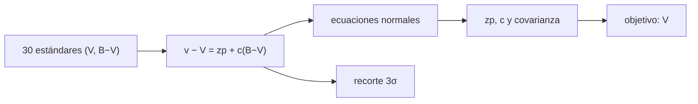

# B45-C21 — Estándares fotométricos y sistemas de referencia

<!-- nav:top -->
[🏠 Programa](../../../../README.md) · [📚 Bloque B45](../../../tronco-comun/B45-espectroscopia-fotometria-y-polarimetria.md) · [← Anterior: B45-C20 — Campaña fotométrica o espectroscópica](../B45-C20-campana-fotometrica-o-espectroscopica/CLASE.md) · [Siguiente: B45-C22 — Extinción atmosférica, masa de aire y coeficientes de color →](../B45-C22-extincion-atmosferica-masa-de-aire-y-coeficientes-de-color/CLASE.md)
<!-- /nav -->

## 1. Ubicación, nivel y alcance

Clase 21 del bloque B45. Nivel N3. Para llevar magnitudes instrumentales al sistema estándar se ajustan un **punto cero** y un **término de color** con estrellas estándar. Aquí lo haces con 30 estándares **sintéticos**, con su **covarianza**, el **rechazo de atípicos** a 3σ y la propagación a un objetivo. Usas [B12](../../../tronco-comun/B12-probabilidad-estadistica-e-incertidumbre.md) y [B44](../../../tronco-comun/B44-detectores-y-adquisicion-astronomica.md).

## 2. Por qué esta clase existe

Sin estándares la escala de un cielo concreto es arbitraria. La decisión central: **¿qué ecuación de transformación se ajusta y con qué error en la magnitud final?**

## 3. Lo que podrás hacer al terminar

1. Plantear `v − V = zp + c (B−V)`.
2. Resolver las ecuaciones normales 2×2.
3. Obtener errores formales y su correlación.
4. Rechazar atípicos de forma iterativa.
5. Transformar un objetivo con su incertidumbre.
6. Reconocer el efecto de ignorar el término de color.

La evidencia es la **ficha de transformación al sistema estándar** del ejercicio 12 (sección 20).

## 4. Con qué llegas y cómo comprobarlo

1. ¿Qué es un punto cero?
2. ¿Qué son las ecuaciones normales?
3. ¿Qué es una covarianza?
4. ¿Qué es un valor atípico?
5. ¿Qué es una magnitud estándar?

<details>
<summary>Ver respuestas</summary>

1. El desfase entre magnitud instrumental y estándar. 2. Las ecuaciones que dan los mínimos cuadrados. 3. La medida de variación conjunta de dos parámetros. 4. Un dato muy alejado del resto. 5. Una magnitud en un sistema definido.
</details>

Con cuatro o cinco aciertos, sigue; si no, repasa los prerrequisitos.

## 5. Un caso de contexto y casos de referencia

Con 30 estándares sintéticos y ruido de 0,015 mag, el ajuste da `zp = -3,2065 ± 0,0046` (verdadero −3,200) y `c = 0,0507 ± 0,0050` (verdadero 0,045). Un objetivo con `v = 17,654` y `B−V = 0,80` queda en `V = 20,820 ± 0,015`. Es el **ejemplo conductor** (estándares **sintéticos**).

## 6. Vocabulario

El **punto cero** `zp`. El **término de color** `c`. Un **estándar** tiene magnitud conocida. La **covarianza** de los parámetros es `σ² (AᵀA)⁻¹`. El **recorte a 3σ** descarta residuos grandes. La **conversión AB** es `m_AB = −2,5 log₁₀(f/3631 Jy)`.

## 7. Modelo mental: calibrar una báscula con pesas

Como calibrar una báscula con pesas conocidas: se ajustan el cero y la pendiente y el error depende de cuántas pesas y de lo distintas que sean.



*Descripción textual:* las estándares fijan dos parámetros por mínimos cuadrados; la covarianza propaga el error al objetivo.

Analogía: calibrar una báscula con pesas. Límite: ruido gaussiano, color lineal.

## 8. La explicación, paso a paso

### 8.1 Ajuste

| Magnitud | Valor |
|---|---|
| `zp` | -3,2065 ± 0,0046 (verdadero −3,2000) |
| `c` | 0,0507 ± 0,0050 (verdadero 0,0450) |
| RMS de los residuos | 0,0140 mag |
| correlación `zp`–`c` | -0,799 |

### 8.2 Atípicos

Con dos estándares estropeadas en ±0,25 mag: `zp = -3,2146`, `c = 0,0618`. El recorte a 3σ descarta 2 estrellas (3, 17) y da `zp = -3,2057`, `c = 0,0489`.

### 8.3 Objetivo

Con `v = 17,654` y `B−V = 0,80`: `V = 20,820`; sin el término de color sería `20,860` (diferencia `0,041 mag`). El error previsto es `0,0153 mag`.

### 8.4 Comprobación por Monte Carlo

Con 3000 repeticiones: `σ_zp = 0,0046` (formal `0,0046`) y `σ_c = 0,0050` (formal `0,0050`).

Conversión AB: 3631,0 Jy → -0,000, 363,1 Jy → 2,500, 1,0 Jy → 8,900, 0,001 Jy → 16,400.

## 9. Magnitudes, símbolos y unidades

| Símbolo | Qué es | Unidad | Valor / nota |
|---|---|---|---|
| `zp` | punto cero | mag | -3,2065 |
| `c` | término de color | mag/mag | 0,0507 |
| `σ` | ruido por estrella | mag | 0,015 |
| `ρ` | correlación | — | -0,799 |
| `m_AB` | magnitud AB | mag | ver 8.4 |

## 10. Convenciones y referencias

Ecuaciones normales 2×2; recorte a 3σ con cinco iteraciones; semilla `20261109`; estándares **sintéticos**; cero AB de libro (no consultado).

## 11. De dónde sale lo que afirmamos

| ID | Fuente | Localizador | Respalda | Estado |
|---|---|---|---|---|
| S1 | Estándares fotométricos reales (Landolt u otros) | — | no se usaron; los estándares son sintéticos | No consultado |
| S2 | Definición del sistema AB | — | 3631 Jy (libro) | No consultado |

Límites: no hay ninguna estándar real; los parámetros verdaderos son del ejemplo.

## 12. Cómo ver la transformación

| Parámetro | Ajustado | Verdadero |
|---|---|---|
| zp | -3,2065 | −3,2000 |
| c | 0,0507 | 0,0450 |

Descripción larga: ambos parámetros dentro de un error formal.

## 13. Ejemplo trabajado: V del objetivo

**Paso 1 · Color.** `c × 0,80 = 0,0406`.

**Paso 2 · Resta.** `v − zp − c(B−V)`.

**Paso 3 · Cálculo.** `17,654 − (-3,2065) − 0,0406`.

**Paso 4 · Valor.** `20,820`.

## 14. Distintas formas de describir el resultado

**Por ajuste:** normales. **Por tabla:** parámetros. **Por Monte Carlo:** covarianza. **Por código:** `estandares.py`.

## 15. Práctica guiada

**Ejercicio 1 · con los pasos indicados.** `V` del objetivo. *Pasos:* ejemplo 13.

<details><summary>Solución comentada</summary>

`20,820`.
</details>

**Ejercicio 2 · con una pista.** Diferencia por ignorar el color.

<details><summary>Solución comentada</summary>

`0,041 mag`.
</details>

**Ejercicio 3 · casi autónomo.** Error formal de `zp`.

<details><summary>Solución comentada</summary>

`0,0046`.
</details>

## 16. Práctica autónoma, transferencia e integrador

**Ejercicio 4.** Error formal de `c`.

<details><summary>Solución comentada</summary>

`0,0050`.
</details>

**Ejercicio 5.** Correlación `zp`–`c`.

<details><summary>Solución comentada</summary>

`-0,799`.
</details>

**Ejercicio 6.** Estrellas rechazadas.

<details><summary>Solución comentada</summary>

`2`.
</details>

**Ejercicio 7.** Error previsto del objetivo.

<details><summary>Solución comentada</summary>

`0,0153 mag`.
</details>

**Ejercicio 8.** `m_AB` de 363,1 Jy.

<details><summary>Solución comentada</summary>

`2,500`.
</details>

**Ejercicio 9 · transferencia.** **Transferencia.** ¿Por qué `zp` y `c` están correlacionados?

<details><summary>Solución comentada</summary>

Porque el color medio de las estándares no es cero.
</details>

**Ejercicio 10 · transferencia.** **Transferencia.** ¿Cómo bajar el error de `c`?

<details><summary>Solución comentada</summary>

Usar estándares con mayor rango de color.
</details>

**Ejercicio 11 · transferencia.** **Transferencia.** Un compañero dice que las estándares son de Landolt. Responde.

<details><summary>Solución comentada</summary>

Son sintéticas; no se usó ningún catálogo.
</details>

**Ejercicio 12.** **Integrador.** Elabora tu *ficha de transformación al sistema estándar*: ecuación, parámetros, covarianza, atípicos y límites.

<details><summary>Solución comentada</summary>

Secciones 8.1–8.4.
</details>

**Ejercicio 12 · integrador.** **Integrador.** Elabora tu *ficha de transformación al sistema estándar*: ecuación, parámetros, covarianza, atípicos y límites.

<details><summary>Solución modelo</summary>

Secciones 8.1–8.4.
</details>

## 17. Laboratorio: estándares sintéticas

El script [estandares.py](estandares.py) ajusta `zp` y `c`, rechaza atípicos y compara la covarianza con Monte Carlo (**comprueba** a 10 % y que se descartan las dos estrellas dañadas).

**Datos:** sin constantes; estándares **sintéticas**. **Predice antes de ejecutar:** ¿qué V sale? (≈ 20,82.) **Ejecución del 2026-11-09 (Python 3.12.9):**

```text
Python 3.12.9 (biblioteca estandar)
30 estandares: zp = -3.2065 +- 0.0046 (verdadero -3.2) ; c = 0.0507 +- 0.0050 (verdadero 0.045) ; RMS de los residuos = 0.0140 mag ; correlacion zp-c = -0.799
con dos atipicos de +-0,25: zp = -3.2146, c = 0.0618
recorte a 3 sigma: descarta 2 estrellas [3, 17] ; zp = -3.2057, c = 0.0489, sigma residual 0.0136
objetivo v = 17,654 con B-V = 0,80: V = 20.820 (sin termino de color 20.860) ; error previsto = 0.0153 mag
Monte Carlo (3000 repeticiones): sigma_zp = 0.0046 (formal 0.0046) ; sigma_c = 0.0050 (formal 0.0050)
m_AB = -2,5 log10(f/3631 Jy): 3631 Jy -> -0.000, 363.1 Jy -> 2.500, 1 Jy -> 8.900, 0.001 Jy -> 16.400
Pruebas superadas.
```

```bash
python programa/clases/B45/B45-C21-estandares-fotometricos-y-sistemas-de-referencia/estandares.py
```

**Límites:** ruido gaussiano; color lineal.

## 18. Errores frecuentes y cómo corregirlos

**Ignorar el término de color.** Se corrige con 8.3.

**No recortar atípicos.** Se corrige con 8.2.

**Confundir error formal con residuo.** Se corrige con 8.4.

**Citar estándares reales sin haberlas usado.** Se corrige con la sección 11.

## 19. Cómo sabrás que vas bien

Tras la sección 8: ¿qué resultado esperabas y cuál obtuviste? Si dudas, repasa el ejemplo 13. Tras el laboratorio: ¿qué comprueba? (ver la sección 17).

## 20. Qué entregas y cómo se evalúa

El producto es tu **ficha de transformación al sistema estándar** (ejercicio 12).

| Criterio | Inicial | En desarrollo | Logrado | Destacado |
|---|---|---|---|---|
| Conceptos | Los confunde | Parciales | conceptos de la clase | Explica los límites |
| Cálculo | Sin unidades | Con errores | Tablas completas | Calcula casos nuevos |
| Numérico | Sin comprobar | Un caso | Contraste con el análisis | Interpreta las diferencias |
| Fuentes | Sin fuente | Sin fecha | fuentes con fecha | Declara lo ilustrativo |
| Límites | No los nombra | Uno | Tres | Discute qué falta del modelo |

**Condiciones críticas (no se compensan con promedio):** rotular las estándares como sintéticas; no dar puntos cero de instrumentos; citar solo lo consultado.

## 21. Ética, seguridad y límites

Clase educativa: los modelos son simplificados. Accesibilidad: tablas equivalentes a las gráficas, fórmulas en texto, ejercicios sin conexión.

## 22. Para cerrar y seguir

El ajuste recupera zp y c a menos de 1,5 errores formales y el término de color mueve el objetivo 0,041 mag. Queda una pregunta: ¿cuánto absorbe la atmósfera?

**Glosario español–inglés.** estrella estándar · *standard star*; punto cero · *zero point*; término de color · *colour term*; recorte · *clipping*.

**Continuidad.** [B45-C22](../B45-C22-extincion-atmosferica-masa-de-aire-y-coeficientes-de-color/CLASE.md) estudia la extinción atmosférica.

**Referencias:** ver sección 11.

<!-- nav:bottom -->
---

[← Anterior: B45-C20 — Campaña fotométrica o espectroscópica](../B45-C20-campana-fotometrica-o-espectroscopica/CLASE.md) · [📚 Bloque B45](../../../tronco-comun/B45-espectroscopia-fotometria-y-polarimetria.md) · [Siguiente: B45-C22 — Extinción atmosférica, masa de aire y coeficientes de color →](../B45-C22-extincion-atmosferica-masa-de-aire-y-coeficientes-de-color/CLASE.md)
<!-- /nav -->
