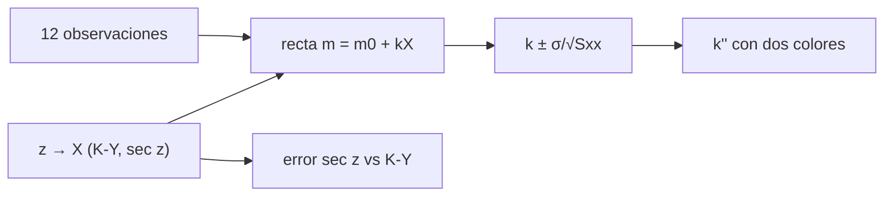

# B45-C22 — Extinción atmosférica, masa de aire y coeficientes de color

<!-- nav:top -->
[🏠 Programa](../../../../README.md) · [📚 Bloque B45](../../../tronco-comun/B45-espectroscopia-fotometria-y-polarimetria.md) · [← Anterior: B45-C21 — Estándares fotométricos y sistemas de referencia](../B45-C21-estandares-fotometricos-y-sistemas-de-referencia/CLASE.md) · [Siguiente: B45-C23 — Fotometría de apertura y estimación del cielo →](../B45-C23-fotometria-de-apertura-y-estimacion-del-cielo/CLASE.md)
<!-- /nav -->

## 1. Ubicación, nivel y alcance

Clase 22 del bloque B45. Nivel N3. La atmósfera absorbe más cuanto más masa de aire atraviesa la luz: `m = m₀ + kX` (ley de Bouguer). Aquí ajustas una **recta de Langley** con 12 masas de aire, comparas **fórmulas de masa de aire**, estimas el **coeficiente de extinción** `k` con su error y el **término de color** `k''`. Usas [B12](../../../tronco-comun/B12-probabilidad-estadistica-e-incertidumbre.md) y [B44](../../../tronco-comun/B44-detectores-y-adquisicion-astronomica.md).

## 2. Por qué esta clase existe

Sin corregir la extinción, la fotometría terrestre depende de la hora. La decisión central: **¿qué `k` y qué fórmula de masa de aire dan la corrección y con qué error?**

## 3. Lo que podrás hacer al terminar

1. Calcular `X` con Kasten-Young y `sec z`.
2. Ajustar la recta de Langley.
3. Obtener el error formal de `k`.
4. Ver cómo el rango de masa de aire cambia el error.
5. Estimar `k''` con dos colores.
6. Cuantificar el error de usar `sec z`.

La evidencia es la **ficha de extinción atmosférica** del ejercicio 12 (sección 20).

## 4. Con qué llegas y cómo comprobarlo

1. ¿Qué es una masa de aire?
2. ¿Qué es una pendiente?
3. ¿Qué es el ángulo cenital?
4. ¿Qué es una regresión lineal?
5. ¿Qué es la transparencia?

<details>
<summary>Ver respuestas</summary>

1. El camino relativo al cenit. 2. La razón de cambio de una recta. 3. El ángulo con la vertical. 4. Ajustar una recta a datos. 5. La fracción de luz que atraviesa la atmósfera.
</details>

Con cuatro o cinco aciertos, sigue; si no, repasa los prerrequisitos.

## 5. Un caso de contexto y casos de referencia

Con 12 observaciones de una estrella entre `X = 1,24` y `2,49` el ajuste da `k = 0,1819 ± 0,0060` (verdadero 0,180) y `m₀ = 11,9932`. A 80° `sec z` sobreestima la masa de aire en `0,173`, es decir, `31,1 mmag`. Es el **ejemplo conductor** (datos **sintéticos**).

## 6. Vocabulario

La **ley de Bouguer** `m = m₀ + kX`. El **gráfico de Langley** es `m` frente a `X`. La **masa de aire** `X ≈ sec z` para `z` pequeño. La **fórmula de Kasten y Young** corrige la curvatura. El **coeficiente de color** `k''` hace `k = k' + k'' (B−V)`. El **error formal** es `σ/√S_XX`.

## 7. Modelo mental: una niebla que se espesa

Como una niebla: cuanto más camino recorre la luz, más se atenúa; la pendiente de la recta es la espesura por unidad de camino.



*Descripción textual:* las magnitudes medidas en varias masas de aire dan una recta cuya pendiente es la extinción.

Analogía: una niebla que se espesa. Límite: atmósfera estable, ruido gaussiano.

## 8. La explicación, paso a paso

### 8.1 Masa de aire

| z (°) | Kasten-Young | sec z |
|---|---|---|
| 0 | 0,9997 | 1,0000 |
| 30 | 1,1540 | 1,1547 |
| 60 | 1,9943 | 2,0000 |
| 70 | 2,9031 | 2,9238 |
| 80 | 5,5860 | 5,7588 |
| 85 | 10,3058 | 11,4737 |

Los valores a 80° (5,59) y 85° (10,31) coinciden con los de la página citada (S1).

### 8.2 Langley

`k = 0,1819 ± 0,0060` y `m₀ = 11,9932 ± 0,0110` (RMS `0,0137`). Con 4000 repeticiones la dispersión de `k` es `0,00588` (formal `0,00596`; media `0,17998`). Con un rango estrecho (1,0 a 1,5) el error sube a `0,0184`, `3,09` veces más.

### 8.3 Color

- B−V = 0,0: k verdadero 0,1800; medido 0,1767 ± 0,0070.
- B−V = 1,5: k verdadero 0,1350; medido 0,1484 ± 0,0063.
- `k''` estimado: `-0,0189 ± 0,0063` (verdadero −0,030).

### 8.4 Dependencia con la longitud de onda (ilustrativa)

Con `k(550) = 0,15` y una escala `λ⁻⁴` (solo ilustrativa): 400 nm → 0,536, 450 nm → 0,335, 550 nm → 0,150, 700 nm → 0,057, 900 nm → 0,021.

## 9. Magnitudes, símbolos y unidades

| Símbolo | Qué es | Unidad | Valor / nota |
|---|---|---|---|
| `X` | masa de aire | — | 1 a 2,5 |
| `k` | extinción | mag/X | 0,1819 |
| `m₀` | magnitud fuera de la atmósfera | mag | 11,993 |
| `k''` | coeficiente de color | mag/X/mag | -0,019 |

## 10. Convenciones y referencias

K-Y con `z` en grados; recta por mínimos cuadrados; error formal `σ/√S_XX`; escala de Rayleigh `λ⁻⁴` **ilustrativa**; semilla `20261109`.

## 11. De dónde sale lo que afirmamos

| ID | Fuente | Localizador | Respalda | Estado |
|---|---|---|---|---|
| S1 | Wikipedia, *Air mass (astronomy)* | https://en.wikipedia.org/wiki/Air_mass_(astronomy) | fórmula de Kasten y Young (1989) y sus valores 5,59 y 10,31 a 80 y 85 grados | Consultada el 2026-11-09 |

Límites: no se usó ninguna noche real; la fórmula `λ⁻⁴` es un ejemplo y no una medida; el modelo supone atmósfera estable.

## 12. Cómo ver la recta

| Magnitud | Valor |
|---|---|
| k | 0,1819 |
| error | 0,0060 |
| rango estrecho | 0,0184 |

Descripción larga: un rango estrecho triplica el error.

## 13. Ejemplo trabajado: error de sec z a 80 grados

**Paso 1 · sec z.** `1/cos 80° = 5,759`.

**Paso 2 · K-Y.** `5,586`.

**Paso 3 · Diferencia.** `0,173`.

**Paso 4 · Magnitudes.** `0,18 × 0,173 = 31,1 mmag`.

## 14. Distintas formas de describir el resultado

**Por fórmula:** K-Y. **Por recta:** Langley. **Por tabla:** z. **Por código:** `extincion.py`.

## 15. Práctica guiada

**Ejercicio 1 · con los pasos indicados.** Diferencia `sec z` − K-Y a 80°. *Pasos:* ejemplo 13.

<details><summary>Solución comentada</summary>

`0,173`.
</details>

**Ejercicio 2 · con una pista.** Error en magnitudes con `k = 0,18`.

<details><summary>Solución comentada</summary>

`31,1 mmag`.
</details>

**Ejercicio 3 · casi autónomo.** `k` ajustado.

<details><summary>Solución comentada</summary>

`0,1819`.
</details>

## 16. Práctica autónoma, transferencia e integrador

**Ejercicio 4.** Error formal de `k`.

<details><summary>Solución comentada</summary>

`0,0060`.
</details>

**Ejercicio 5.** Aumento del error con rango estrecho.

<details><summary>Solución comentada</summary>

`3,09` veces.
</details>

**Ejercicio 6.** `X` K-Y a 85°.

<details><summary>Solución comentada</summary>

`10,306`.
</details>

**Ejercicio 7.** `k''` estimado.

<details><summary>Solución comentada</summary>

`-0,0189`.
</details>

**Ejercicio 8.** `k` ilustrativo a 400 nm.

<details><summary>Solución comentada</summary>

`0,536`.
</details>

**Ejercicio 9 · transferencia.** **Transferencia.** ¿Por qué observar un rango amplio de `X`?

<details><summary>Solución comentada</summary>

Porque el error de la pendiente baja con la dispersión de `X`.
</details>

**Ejercicio 10 · transferencia.** **Transferencia.** ¿Qué hacer con nubes?

<details><summary>Solución comentada</summary>

Descartar la noche o los puntos; la recta supone transparencia estable.
</details>

**Ejercicio 11 · transferencia.** **Transferencia.** Un compañero usa la escala `λ⁻⁴` como dato de un sitio. Responde.

<details><summary>Solución comentada</summary>

Es una escala ilustrativa; el `k` de un sitio se mide.
</details>

**Ejercicio 12.** **Integrador.** Elabora tu *ficha de extinción atmosférica*: fórmulas, recta, error, color y límites.

<details><summary>Solución comentada</summary>

Secciones 8.1–8.4.
</details>

**Ejercicio 12 · integrador.** **Integrador.** Elabora tu *ficha de extinción atmosférica*: fórmulas, recta, error, color y límites.

<details><summary>Solución modelo</summary>

Secciones 8.1–8.4.
</details>

## 17. Laboratorio: recta de Langley

El script [extincion.py](extincion.py) ajusta `k`, compara fórmulas de masa de aire y estima `k''` (**comprueba** `k` a 3 errores y la dispersión a 5 %).

**Datos:** K-Y (S1); observaciones **sintéticas**. **Predice antes de ejecutar:** ¿qué k sale? (≈ 0,182.) **Ejecución del 2026-11-09 (Python 3.12.9):**

```text
Python 3.12.9 (biblioteca estandar)
z (grados)      K-Y    sec z
         0   0.9997   1.0000
        30   1.1540   1.1547
        60   1.9943   2.0000
        70   2.9031   2.9238
        80   5.5860   5.7588
        85  10.3058  11.4737
Langley: 12 masas de aire entre 1.242 y 2.491 ; k = 0.1819 +- 0.0060 (verdadero 0.18) ; m0 = 11.9932 +- 0.0110 (verdadero 12.0) ; RMS = 0.0137
Monte Carlo (4000): sigma_k = 0.00588 (formal 0.00596) ; media 0.17998
con un rango estrecho de masa de aire (1,0 a 1,5) el error formal sube a 0.0184 (3.09 veces)
a z = 80 grados sec z - K-Y = 0.173 masas de aire -> 31.1 mmag con k = 0,18
estrella con B-V = 0.0: k verdadero 0.1800 ; medido 0.1767 +- 0.0070
estrella con B-V = 1.5: k verdadero 0.1350 ; medido 0.1484 +- 0.0063
k'' estimado = -0.0189 +- 0.0063 (verdadero -0.030)
escala ilustrativa k(lambda) = 0,15 (550/lambda)^4: 400 nm -> 0.536, 450 nm -> 0.335, 550 nm -> 0.150, 700 nm -> 0.057, 900 nm -> 0.021
Pruebas superadas.
```

```bash
python programa/clases/B45/B45-C22-extincion-atmosferica-masa-de-aire-y-coeficientes-de-color/extincion.py
```

**Límites:** atmósfera estable.

## 18. Errores frecuentes y cómo corregirlos

**Usar `sec z` cerca del horizonte.** Se corrige con 8.1.

**Ajustar con poco rango de `X`.** Se corrige con 8.2.

**Ignorar el término de color.** Se corrige con 8.3.

**Dar la escala λ⁻⁴ como medida.** Se corrige con la sección 10.

## 19. Cómo sabrás que vas bien

Tras la sección 8: ¿qué resultado esperabas y cuál obtuviste? Si dudas, repasa el ejemplo 13. Tras el laboratorio: ¿qué comprueba? (ver la sección 17).

## 20. Qué entregas y cómo se evalúa

El producto es tu **ficha de extinción atmosférica** (ejercicio 12).

| Criterio | Inicial | En desarrollo | Logrado | Destacado |
|---|---|---|---|---|
| Conceptos | Los confunde | Parciales | conceptos de la clase | Explica los límites |
| Cálculo | Sin unidades | Con errores | Tablas completas | Calcula casos nuevos |
| Numérico | Sin comprobar | Un caso | Contraste con el análisis | Interpreta las diferencias |
| Fuentes | Sin fuente | Sin fecha | fuentes con fecha | Declara lo ilustrativo |
| Límites | No los nombra | Uno | Tres | Discute qué falta del modelo |

**Condiciones críticas (no se compensan con promedio):** rotular los datos como sintéticos; no dar coeficientes de sitios reales; citar solo lo consultado.

## 21. Ética, seguridad y límites

Clase educativa: los modelos son simplificados. Accesibilidad: tablas equivalentes a las gráficas, fórmulas en texto, ejercicios sin conexión.

## 22. Para cerrar y seguir

La recta de Langley recupera k = 0,182 ± 0,006; un rango estrecho de masa de aire triplica el error y sec z comete 31 mmag a 80°. Queda una pregunta: ¿cómo se mide el flujo de una estrella una vez corregido?

**Glosario español–inglés.** extinción atmosférica · *atmospheric extinction*; masa de aire · *airmass*; gráfico de Langley · *Langley plot*; ley de Bouguer · *Bouguer's law*.

**Continuidad.** [B45-C23](../B45-C23-fotometria-de-apertura-y-estimacion-del-cielo/CLASE.md) estudia la fotometría de apertura y la estimación del cielo.

**Referencias:** ver sección 11.

<!-- nav:bottom -->
---

[← Anterior: B45-C21 — Estándares fotométricos y sistemas de referencia](../B45-C21-estandares-fotometricos-y-sistemas-de-referencia/CLASE.md) · [📚 Bloque B45](../../../tronco-comun/B45-espectroscopia-fotometria-y-polarimetria.md) · [Siguiente: B45-C23 — Fotometría de apertura y estimación del cielo →](../B45-C23-fotometria-de-apertura-y-estimacion-del-cielo/CLASE.md)
<!-- /nav -->
