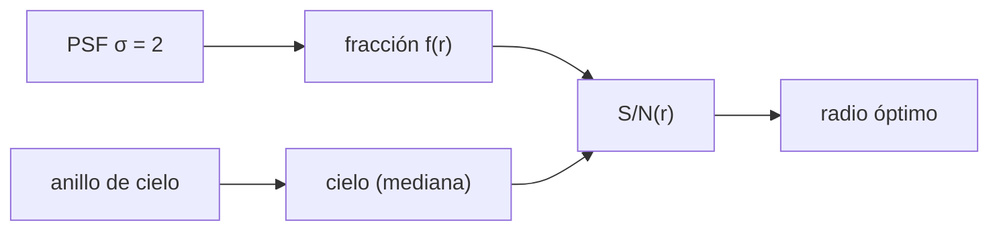

# B45-C23 — Fotometría de apertura y estimación del cielo

<!-- nav:top -->
[🏠 Programa](../../../../README.md) · [📚 Bloque B45](../../../tronco-comun/B45-espectroscopia-fotometria-y-polarimetria.md) · [← Anterior: B45-C22 — Extinción atmosférica, masa de aire y coeficientes de color](../B45-C22-extincion-atmosferica-masa-de-aire-y-coeficientes-de-color/CLASE.md) · [Siguiente: B45-C24 — Fotometría por ajuste de PSF →](../B45-C24-fotometria-por-ajuste-de-psf/CLASE.md)
<!-- /nav -->

## 1. Ubicación, nivel y alcance

Clase 23 del bloque B45. Nivel N3. La fotometría de apertura suma los píxeles dentro de un círculo y resta el cielo medido en un anillo. Aquí calculas la **fracción encerrada**, el **S/N frente al radio**, el **radio óptimo** y el efecto de **estimar el cielo** con la mediana o con un anillo contaminado. Usas [B12](../../../tronco-comun/B12-probabilidad-estadistica-e-incertidumbre.md) y [B44](../../../tronco-comun/B44-detectores-y-adquisicion-astronomica.md).

## 2. Por qué esta clase existe

Una apertura pequeña pierde flujo y una grande añade ruido de cielo. La decisión central: **¿qué radio da el mejor S/N y cómo se mide el cielo?**

## 3. Lo que podrás hacer al terminar

1. Calcular la fracción encerrada de una PSF gaussiana.
2. Evaluar `S/N(r)`.
3. Hallar el radio óptimo.
4. Incluir el error de la estimación del cielo por mediana.
5. Reconocer la contaminación de un anillo cercano.
6. Comparar con Monte Carlo.

La evidencia es la **ficha de fotometría de apertura** del ejercicio 12 (sección 20).

## 4. Con qué llegas y cómo comprobarlo

1. ¿Qué es una PSF?
2. ¿Qué es un anillo?
3. ¿Qué es una mediana?
4. ¿Qué es un FWHM?
5. ¿Qué es un radio?

<details>
<summary>Ver respuestas</summary>

1. La imagen de una fuente puntual. 2. La región entre dos círculos. 3. El valor central. 4. La anchura a media altura. 5. La distancia del centro al borde.
</details>

Con cuatro o cinco aciertos, sigue; si no, repasa los prerrequisitos.

## 5. Un caso de contexto y casos de referencia

Para una estrella de 8000 e⁻ con PSF gaussiana de FWHM `4,71` píxeles sobre cielo de 30 e⁻/píxel, el S/N máximo es `70,7` con un radio de `4,3` píxeles (`0,91 FWHM`). Es el **ejemplo conductor** (imagen **sintética**).

## 6. Vocabulario

La **apertura** es un círculo de radio `r`. La **fracción encerrada** continua es `1 − exp(−r²/2σ²)`. El **anillo de cielo** da el fondo. La **mediana** del anillo es robusta pero un factor `π/2` más ruidosa que la media. La **contaminación** del anillo sesga el cielo.

## 7. Modelo mental: una red de pesca

Como una red de pesca: una red pequeña deja escapar peces (flujo perdido), una grande recoge más agua (ruido de cielo); hay un tamaño óptimo.



*Descripción textual:* la fracción encerrada y el ruido del cielo compiten y dan un máximo de S/N en un radio cercano a la FWHM.

Analogía: una red de pesca. Límite: PSF conocida y centrada, cielo plano.

## 8. La explicación, paso a paso

### 8.1 S/N frente al radio

| r/FWHM | r (px) | n (px) | f discreta | f continua | S/N cielo conocido | S/N cielo estimado | S/N MC |
|---|---|---|---|---|---|---|---|
| 0,50 | 2,35 | 21 | 0,5711 | 0,5000 | 60,39 | 60,10 | 60,58 |
| 0,75 | 3,53 | 37 | 0,7725 | 0,7898 | 68,19 | 67,49 | 69,35 |
| 1,00 | 4,71 | 69 | 0,9377 | 0,9375 | 70,58 | 68,79 | 70,63 |
| 1,50 | 7,06 | 149 | 0,9973 | 0,9980 | 62,74 | 57,97 | 58,22 |
| 2,00 | 9,42 | 277 | 1,0000 | 1,0000 | 52,48 | 44,16 | 43,54 |

El anillo de cielo (12 a 19 píxeles) tiene 692 píxeles.

### 8.2 Radio óptimo

El barrido fino da el máximo de S/N con cielo conocido en `r = 4,3` píxeles (0,91 FWHM), `S/N = 70,67`. Con aperturas muy grandes el S/N cae por el ruido del cielo.

### 8.3 Anillo contaminado

Un anillo de 3 a 6 píxeles, cerca de la estrella, sobreestima el cielo en `32,64 e⁻/píxel`, lo que quita el `61,0 %` del flujo en una apertura de 1,5 FWHM.

### 8.4 Lectura

Para pocos píxeles la fracción discreta se aparta de la continua (0,571 frente a 0,500 con 21 píxeles); a partir de 1 FWHM coinciden a 0,005.

## 9. Magnitudes, símbolos y unidades

| Símbolo | Qué es | Unidad | Valor / nota |
|---|---|---|---|
| `σ` | ancho de la PSF | px | 2,0 |
| `r` | radio de apertura | px | ver 8.1 |
| `f(r)` | fracción encerrada | — | ver 8.1 |
| `B` | cielo | e⁻/px | 30 |
| `RN` | ruido de lectura | e⁻ | 5 |

## 10. Convenciones y referencias

Pixeles incluidos si su centro está dentro del radio; 41×41 píxeles; 1500 repeticiones; cielo por mediana; semilla `20261109`; imagen **sintética**.

## 11. De dónde sale lo que afirmamos

| ID | Fuente | Localizador | Respalda | Estado |
|---|---|---|---|---|
| S1 | Fotometría de apertura (técnica estándar) | — | descripción de libro | No consultado |

Límites: PSF gaussiana exacta y cielo plano; en una imagen real la PSF cambia y hay estrellas vecinas.

## 12. Cómo ver S/N y radio

| r/FWHM | S/N (cielo estimado) |
|---|---|
| 0,50 | 60,1 |
| 0,75 | 67,5 |
| 1,00 | 68,8 |
| 1,50 | 58,0 |
| 2,00 | 44,2 |

Descripción larga: el S/N sube hasta 1 FWHM y luego baja.

## 13. Ejemplo trabajado: fracción encerrada a 1 FWHM

**Paso 1 · Radio.** `r = 2,3548 σ`.

**Paso 2 · Exponente.** `r²/2σ² = 2,7726`.

**Paso 3 · Cálculo.** `1 − e^(−2,7726) = 0,9375`.

**Paso 4 · Contraste.** Discreta `0,9377`.

## 14. Distintas formas de describir el resultado

**Por fórmula:** fracción continua. **Por suma:** píxeles. **Por Monte Carlo:** S/N. **Por código:** `apertura.py`.

## 15. Práctica guiada

**Ejercicio 1 · con los pasos indicados.** Fracción encerrada a 1 FWHM. *Pasos:* ejemplo 13.

<details><summary>Solución comentada</summary>

`0,9375`.
</details>

**Ejercicio 2 · con una pista.** Píxeles en 1 FWHM.

<details><summary>Solución comentada</summary>

`69`.
</details>

**Ejercicio 3 · casi autónomo.** S/N con cielo conocido a 1 FWHM.

<details><summary>Solución comentada</summary>

`70,58`.
</details>

## 16. Práctica autónoma, transferencia e integrador

**Ejercicio 4.** S/N con cielo estimado a 1 FWHM.

<details><summary>Solución comentada</summary>

`68,79`.
</details>

**Ejercicio 5.** S/N MC a 1 FWHM.

<details><summary>Solución comentada</summary>

`70,63`.
</details>

**Ejercicio 6.** Radio óptimo.

<details><summary>Solución comentada</summary>

`4,3 px`.
</details>

**Ejercicio 7.** S/N máximo.

<details><summary>Solución comentada</summary>

`70,67`.
</details>

**Ejercicio 8.** Tamaño del anillo.

<details><summary>Solución comentada</summary>

`692` píxeles.
</details>

**Ejercicio 9 · transferencia.** **Transferencia.** ¿Por qué una apertura grande empeora el S/N?

<details><summary>Solución comentada</summary>

Añade píxeles de cielo sin añadir señal.
</details>

**Ejercicio 10 · transferencia.** **Transferencia.** ¿Qué es una corrección de apertura?

<details><summary>Solución comentada</summary>

Escalar a flujo total con la fracción encerrada medida en estrellas aisladas.
</details>

**Ejercicio 11 · transferencia.** **Transferencia.** Un compañero llama «óptimo» al radio para cualquier campo. Responde.

<details><summary>Solución comentada</summary>

Depende de PSF, cielo y ruido de lectura de cada imagen.
</details>

**Ejercicio 12.** **Integrador.** Elabora tu *ficha de fotometría de apertura*: fracción, S/N(r), radio óptimo, cielo y límites.

<details><summary>Solución comentada</summary>

Secciones 8.1–8.4.
</details>

**Ejercicio 12 · integrador.** **Integrador.** Elabora tu *ficha de fotometría de apertura*: fracción, S/N(r), radio óptimo, cielo y límites.

<details><summary>Solución modelo</summary>

Secciones 8.1–8.4.
</details>

## 17. Laboratorio: apertura sobre cielo

El script [apertura.py](apertura.py) calcula la fracción, el S/N y el cielo por mediana, y compara con Monte Carlo (**comprueba** a 4 % y que el óptimo cae entre 0,5 y 1,5 FWHM).

**Datos:** sin constantes; imagen **sintética**. **Predice antes de ejecutar:** ¿qué radio es óptimo? (≈ 0,9 FWHM.) **Ejecución del 2026-11-09 (Python 3.12.9):**

```text
Python 3.12.9 (biblioteca estandar)
FWHM = 4.710 pixeles ; anillo de cielo de 692 pixeles
 r/FWHM  r (px)     n  f discreta  f continua  S/N cielo conocido  S/N cielo estimado   S/N MC
   0.50   2.355    21     0.57110     0.50000               60.39               60.10    60.58
   0.75   3.532    37     0.77252     0.78978               68.19               67.49    69.35
   1.00   4.710    69     0.93766     0.93750               70.58               68.79    70.63
   1.50   7.064   149     0.99734     0.99805               62.74               57.97    58.22
   2.00   9.419   277     0.99998     0.99998               52.48               44.16    43.54
radio de maximo S/N (cielo conocido) = 4.3 pixeles = 0.91 FWHM ; S/N = 70.67
anillo de 3 a 6 pixeles contaminado: sobreestimacion del cielo = 32.64 e-/pixel -> perdida de 61.0 % del flujo en la apertura de 1,5 FWHM
Pruebas superadas.
```

```bash
python programa/clases/B45/B45-C23-fotometria-de-apertura-y-estimacion-del-cielo/apertura.py
```

**Límites:** PSF conocida; cielo plano.

## 18. Errores frecuentes y cómo corregirlos

**Elegir una apertura muy grande «para no perder flujo».** Se corrige con 8.1.

**Estimar el cielo cerca de la estrella.** Se corrige con 8.3.

**Olvidar el error de la estimación del cielo.** Se corrige con 8.1.

**Aplicar este radio a otro campo.** Se corrige con la pregunta de transferencia.

## 19. Cómo sabrás que vas bien

Tras la sección 8: ¿qué resultado esperabas y cuál obtuviste? Si dudas, repasa el ejemplo 13. Tras el laboratorio: ¿qué comprueba? (ver la sección 17).

## 20. Qué entregas y cómo se evalúa

El producto es tu **ficha de fotometría de apertura** (ejercicio 12).

| Criterio | Inicial | En desarrollo | Logrado | Destacado |
|---|---|---|---|---|
| Conceptos | Los confunde | Parciales | conceptos de la clase | Explica los límites |
| Cálculo | Sin unidades | Con errores | Tablas completas | Calcula casos nuevos |
| Numérico | Sin comprobar | Un caso | Contraste con el análisis | Interpreta las diferencias |
| Fuentes | Sin fuente | Sin fecha | fuentes con fecha | Declara lo ilustrativo |
| Límites | No los nombra | Uno | Tres | Discute qué falta del modelo |

**Condiciones críticas (no se compensan con promedio):** rotular la imagen como sintética; no dar radios óptimos de instrumentos; citar solo lo consultado.

## 21. Ética, seguridad y límites

Clase educativa: los modelos son simplificados. Accesibilidad: tablas equivalentes a las gráficas, fórmulas en texto, ejercicios sin conexión.

## 22. Para cerrar y seguir

El S/N máximo (71) se logra con r ≈ 0,9 FWHM; con un anillo contaminado se pierde el 61 % del flujo. Queda una pregunta: ¿qué hacer en un campo poblado?

**Glosario español–inglés.** fotometría de apertura · *aperture photometry*; fracción encerrada · *enclosed fraction*; anillo de cielo · *sky annulus*; corrección de apertura · *aperture correction*.

**Continuidad.** [B45-C24](../B45-C24-fotometria-por-ajuste-de-psf/CLASE.md) estudia la fotometría por ajuste de PSF.

**Referencias:** ver sección 11.

<!-- nav:bottom -->
---

[← Anterior: B45-C22 — Extinción atmosférica, masa de aire y coeficientes de color](../B45-C22-extincion-atmosferica-masa-de-aire-y-coeficientes-de-color/CLASE.md) · [📚 Bloque B45](../../../tronco-comun/B45-espectroscopia-fotometria-y-polarimetria.md) · [Siguiente: B45-C24 — Fotometría por ajuste de PSF →](../B45-C24-fotometria-por-ajuste-de-psf/CLASE.md)
<!-- /nav -->
