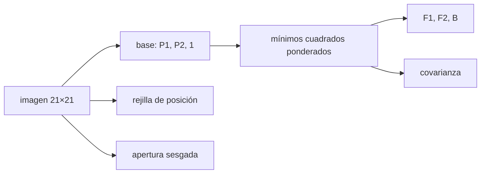

# B45-C24 — Fotometría por ajuste de PSF

<!-- nav:top -->
[🏠 Programa](../../../../README.md) · [📚 Bloque B45](../../../tronco-comun/B45-espectroscopia-fotometria-y-polarimetria.md) · [← Anterior: B45-C23 — Fotometría de apertura y estimación del cielo](../B45-C23-fotometria-de-apertura-y-estimacion-del-cielo/CLASE.md) · [Siguiente: B46-C01 — Espectro radioastronómico →](../../B46/B46-C01-espectro-radioastronomico/CLASE.md)
<!-- /nav -->

## 1. Ubicación, nivel y alcance

Clase 24 del bloque B45. Nivel N3. En un campo poblado la apertura mezcla estrellas vecinas. Aquí ajustas una **PSF gaussiana** a dos estrellas **mezcladas** con un ajuste lineal ponderado de los flujos y el cielo, calculas la **covarianza** formal, la comparas con **Monte Carlo** y estimas la posición de la segunda estrella. Usas [B12](../../../tronco-comun/B12-probabilidad-estadistica-e-incertidumbre.md) y [B42](../../../tronco-comun/B42-optica-fisica-y-optica-adaptativa.md).

## 2. Por qué esta clase existe

La apertura sesga los flujos de estrellas próximas y el ajuste de PSF los separa. La decisión central: **¿qué sesgo evita el ajuste y con qué incertidumbre y correlación?**

## 3. Lo que podrás hacer al terminar

1. Escribir el modelo `D = F₁P₁ + F₂P₂ + B`.
2. Resolver los flujos por mínimos cuadrados ponderados.
3. Obtener la covarianza `(AᵀWA)⁻¹`.
4. Comparar con Monte Carlo.
5. Medir el sesgo de la apertura.
6. Estimar la posición por rejilla de χ².

La evidencia es la **ficha de fotometría PSF** del ejercicio 12 (sección 20).

## 4. Con qué llegas y cómo comprobarlo

1. ¿Qué es una PSF?
2. ¿Qué es un ajuste ponderado?
3. ¿Qué es una covarianza?
4. ¿Qué es una mezcla de fuentes?
5. ¿Qué es un campo poblado?

<details>
<summary>Ver respuestas</summary>

1. La respuesta a una fuente puntual. 2. Un ajuste que pesa más los datos más fiables. 3. La variación conjunta de dos magnitudes. 4. El solapamiento de dos imágenes estelares. 5. Una región con muchas estrellas próximas.
</details>

Con cuatro o cinco aciertos, sigue; si no, repasa los prerrequisitos.

## 5. Un caso de contexto y casos de referencia

Dos estrellas (3000 y 1000 e⁻) separadas 3 píxeles con PSF de `σ = 2` se miden con apertura sesgada `+664 e⁻`, mientras que el ajuste de PSF da `2997,8` y `999,8 e⁻` (errores `94,0` y `84,2`). Es el **ejemplo conductor** (imagen **sintética**).

## 6. Vocabulario

La **PSF** es la respuesta a una fuente puntual. El **ajuste de PSF** modela cada estrella como flujo × PSF. La **covarianza** `(AᵀWA)⁻¹` da los errores y su correlación. La **mezcla** (blending) es el solapamiento de PSF. La **rejilla de χ²** busca la posición. El **cielo** es un parámetro más.

## 7. Modelo mental: separar dos voces en un coro

Como separar dos voces que cantan casi la misma nota: si conoces la forma de cada voz (la PSF), puedes asignar a cada una su volumen aunque se mezclen.



*Descripción textual:* el modelo lineal de flujos con PSF conocida separa las estrellas y su covarianza dice cuánto se mezclan los errores.

Analogía: separar dos voces en un coro. Límite: PSF conocida, pesos fijos.

## 8. La explicación, paso a paso

### 8.1 Covarianza formal

`σ_F1 = 94,89 e⁻`, `σ_F2 = 83,74 e⁻` y correlación `F₁`–`F₂` de `-0,479`: un flujo extra en una estrella se paga con menos en la otra.

### 8.2 Ajuste frente a apertura

| método | media F₁ | σ F₁ | media F₂ | σ F₂ |
|---|---|---|---|---|
| ajuste de PSF | 2997,8 | 93,98 | 999,8 | 84,16 |
| apertura de radio 4 | 3663,5 | 81,31 | — | — |

La apertura de radio 4 (48 píxeles; fracción de F₁ `0,8510`) predice un sesgo de `666,9 e⁻` por la vecina, y se observa `663,5`.

### 8.3 Posición

La posición de la segunda estrella, ajustada por rejilla y parábola, tiene desplazamiento medio `-0,0031` píxeles y dispersión `0,2511` píxeles: muy mal determinada por la mezcla.

### 8.4 Lectura

El ajuste no tiene sesgo y su error coincide con la covarianza a 8 %. La apertura da una precisión menor que su sesgo (`81,3 e⁻` frente a `664 e⁻`) y por eso no sirve.

## 9. Magnitudes, símbolos y unidades

| Símbolo | Qué es | Unidad | Valor / nota |
|---|---|---|---|
| `F₁, F₂` | flujos | e⁻ | 3000; 1000 |
| `σ` | ancho de la PSF | px | 2,0 |
| `d` | separación | px | 3,0 |
| `B` | cielo | e⁻/px | 20 |
| `ρ` | correlación de flujos | — | -0,479 |

## 10. Convenciones y referencias

Imagen 21×21; PSF muestreada en el centro de los píxeles; pesos `1/(modelo + RN²)` fijos; 600 repeticiones; semilla `20261109`; imagen **sintética**; rejilla de ±0,4 px en pasos de 0,1.

## 11. De dónde sale lo que afirmamos

| ID | Fuente | Localizador | Respalda | Estado |
|---|---|---|---|---|
| S1 | Stetson (1987), DAOPHOT | — | no consultado; no se reproduce ningún paquete | No consultado |

Límites: PSF gaussiana exacta; una PSF real se construye con estrellas aisladas y cambia en el campo.

## 12. Cómo ver el sesgo

| Método | media F₁ |
|---|---|
| ajuste | 2997,8 |
| apertura | 3663,5 |
| verdadero | 3000 |

Descripción larga: el ajuste recupera F₁; la apertura la sobreestima.

## 13. Ejemplo trabajado: sesgo de la apertura

**Paso 1 · Vecina en la apertura.** `567,6 e⁻`.

**Paso 2 · Fracción de F₁.** `0,8510`.

**Paso 3 · Cociente.** `567,6/0,8510`.

**Paso 4 · Valor.** `666,9 e⁻`.

## 14. Distintas formas de describir el resultado

**Por mínimos cuadrados:** flujos. **Por covarianza:** errores. **Por Monte Carlo:** 600 imágenes. **Por código:** `ajuste_psf.py`.

## 15. Práctica guiada

**Ejercicio 1 · con los pasos indicados.** Sesgo de la apertura. *Pasos:* ejemplo 13.

<details><summary>Solución comentada</summary>

`666,9 e⁻`.
</details>

**Ejercicio 2 · con una pista.** Sesgo observado.

<details><summary>Solución comentada</summary>

`663,5 e⁻`.
</details>

**Ejercicio 3 · casi autónomo.** σ formal de F₁.

<details><summary>Solución comentada</summary>

`94,89 e⁻`.
</details>

## 16. Práctica autónoma, transferencia e integrador

**Ejercicio 4.** σ formal de F₂.

<details><summary>Solución comentada</summary>

`83,74 e⁻`.
</details>

**Ejercicio 5.** Correlación F₁–F₂.

<details><summary>Solución comentada</summary>

`-0,479`.
</details>

**Ejercicio 6.** Media F₁ del ajuste.

<details><summary>Solución comentada</summary>

`2997,8 e⁻`.
</details>

**Ejercicio 7.** Dispersión de la posición.

<details><summary>Solución comentada</summary>

`0,251 px`.
</details>

**Ejercicio 8.** Error relativo de F₂ (σ/F₂).

<details><summary>Solución comentada</summary>

`8,4 %`.
</details>

**Ejercicio 9 · transferencia.** **Transferencia.** ¿Qué pasa si la PSF usada es más ancha que la real?

<details><summary>Solución comentada</summary>

Los flujos se sesgan y el χ² empeora.
</details>

**Ejercicio 10 · transferencia.** **Transferencia.** ¿Por qué se ajustan posiciones solo si hace falta?

<details><summary>Solución comentada</summary>

Porque el ajuste lineal de flujos es mejor condicionado.
</details>

**Ejercicio 11 · transferencia.** **Transferencia.** Un compañero llama a este laboratorio «DAOPHOT». Responde.

<details><summary>Solución comentada</summary>

No: es un ejemplo mínimo de ajuste lineal; no se reproduce ningún paquete.
</details>

**Ejercicio 12.** **Integrador.** Elabora tu *ficha de fotometría PSF*: modelo, covarianza, sesgo de la apertura y límites.

<details><summary>Solución comentada</summary>

Secciones 8.1–8.4.
</details>

**Ejercicio 12 · integrador.** **Integrador.** Elabora tu *ficha de fotometría PSF*: modelo, covarianza, sesgo de la apertura y límites.

<details><summary>Solución modelo</summary>

Secciones 8.1–8.4.
</details>

## 17. Laboratorio: dos estrellas mezcladas

El script [ajuste_psf.py](ajuste_psf.py) ajusta flujos y cielo, compara con la covarianza y con la apertura y estima la posición (**comprueba** a 8 % y que la apertura sobreestima F₁ más de 10 %).

**Datos:** sin constantes; imagen **sintética**. **Predice antes de ejecutar:** ¿cuánto sesga la apertura? (≈ +660 e⁻.) **Ejecución del 2026-11-09 (Python 3.12.9):**

```text
Python 3.12.9 (biblioteca estandar)
covarianza formal: sigma_F1 = 94.89 e- ; sigma_F2 = 83.74 e- ; correlacion F1-F2 = -0.479
apertura de radio 4 px (48 pixeles, fraccion de F1 = 0.8510): sesgo previsto por la vecina = 666.9 e-
                metodo  media F1  sigma F1  media F2  sigma F2
         ajuste de PSF    2997.8     93.98     999.8     84.16
    apertura (F1 solo)    3663.5     81.31
posicion de la estrella 2 (desplazamiento respecto de lo verdadero, px): media -0.0031 ; sigma 0.2511
Pruebas superadas.
```

```bash
python programa/clases/B45/B45-C24-fotometria-por-ajuste-de-psf/ajuste_psf.py
```

**Límites:** PSF conocida y pesos fijos.

## 18. Errores frecuentes y cómo corregirlos

**Usar apertura en un campo poblado.** Se corrige con 8.2.

**Ignorar la correlación de flujos.** Se corrige con 8.1.

**Suponer que se determina la posición bien.** Se corrige con 8.3.

**Presentar el laboratorio como un paquete de producción.** Se corrige con la sección 11.

## 19. Cómo sabrás que vas bien

Tras la sección 8: ¿qué resultado esperabas y cuál obtuviste? Si dudas, repasa el ejemplo 13. Tras el laboratorio: ¿qué comprueba? (ver la sección 17).

## 20. Qué entregas y cómo se evalúa

El producto es tu **ficha de fotometría PSF** (ejercicio 12).

| Criterio | Inicial | En desarrollo | Logrado | Destacado |
|---|---|---|---|---|
| Conceptos | Los confunde | Parciales | conceptos de la clase | Explica los límites |
| Cálculo | Sin unidades | Con errores | Tablas completas | Calcula casos nuevos |
| Numérico | Sin comprobar | Un caso | Contraste con el análisis | Interpreta las diferencias |
| Fuentes | Sin fuente | Sin fecha | fuentes con fecha | Declara lo ilustrativo |
| Límites | No los nombra | Uno | Tres | Discute qué falta del modelo |

**Condiciones críticas (no se compensan con promedio):** rotular la imagen como sintética; no presentar el código como un paquete de fotometría; citar solo lo consultado.

## 21. Ética, seguridad y límites

Clase educativa: los modelos son simplificados. Accesibilidad: tablas equivalentes a las gráficas, fórmulas en texto, ejercicios sin conexión.

## 22. Para cerrar y seguir

El ajuste de PSF recupera F₁ y F₂ sin sesgo (error 94 y 84 e⁻) mientras la apertura sobreestima F₁ en 664 e⁻. Con esto se cierra el bloque: la luz de un astro se mide, se descompone y se calibra.

**Glosario español–inglés.** fotometría PSF · *PSF photometry*; mezcla · *blending*; covarianza · *covariance*; campo poblado · *crowded field*.

**Continuidad.** cierra el bloque de espectroscopía, fotometría y polarimetría; sigue con la radioastronomía en el bloque B46.

**Referencias:** ver sección 11.

<!-- nav:bottom -->
---

[← Anterior: B45-C23 — Fotometría de apertura y estimación del cielo](../B45-C23-fotometria-de-apertura-y-estimacion-del-cielo/CLASE.md) · [📚 Bloque B45](../../../tronco-comun/B45-espectroscopia-fotometria-y-polarimetria.md) · [Siguiente: B46-C01 — Espectro radioastronómico →](../../B46/B46-C01-espectro-radioastronomico/CLASE.md)
<!-- /nav -->
