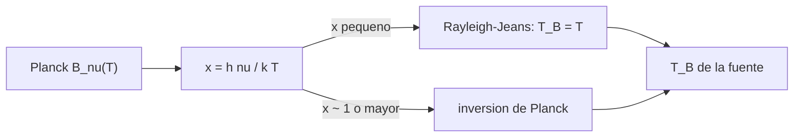

# B46-C01 — Espectro radioastronómico

<!-- nav:top -->
[🏠 Programa](../../../../README.md) · [📚 Bloque B46](../../../tronco-comun/B46-radioastronomia-e-interferometria.md) · [← Anterior: B45-C24 — Fotometría por ajuste de PSF](../../B45/B45-C24-fotometria-por-ajuste-de-psf/CLASE.md) · [Siguiente: B46-C02 — Propagación de ondas de radio →](../B46-C02-propagacion-de-ondas-de-radio/CLASE.md)
<!-- /nav -->

## 1. Ubicación, nivel y alcance

Clase 1 del bloque B46. Nivel N3. El cielo en radio se describe con el flujo, el brillo y la **temperatura de brillo**. Aquí comparas la ley de Planck con su límite de Rayleigh–Jeans para un cuerpo negro de 10 K entre 1,4 y 1000 GHz, inviertes el brillo para recuperar la temperatura y calculas la longitud de onda de la línea de 21 cm. Usas [B05](../../../tronco-comun/B05-fisica-fundamental-para-el-espacio.md). No se observa ningún objeto real.

## 2. Por qué esta clase existe

Casi toda la radioastronomía usa Rayleigh–Jeans porque convierte brillo en temperatura de forma lineal, pero deja de valer cuando `hν` se acerca a `kT`. La decisión central: **¿en qué frecuencia y temperatura es válida la aproximación de Rayleigh–Jeans?**

## 3. Lo que podrás hacer al terminar

1. Calcular el brillo de Planck de un cuerpo negro.
2. Calcular `x = hν/kT` y el error de Rayleigh–Jeans.
3. Definir y calcular la temperatura de brillo.
4. Invertir Planck sin aproximar.
5. Pasar de frecuencia a longitud de onda.
6. Reconocer cuándo la temperatura de brillo no es una temperatura física.

La evidencia es la **ficha del espectro radioastronómico** del ejercicio 12 (sección 20).

## 4. Con qué llegas y cómo comprobarlo

1. ¿Qué es una incertidumbre?
2. ¿Qué es una simulación Monte Carlo?
3. ¿Qué es una tabla de resultados?
4. ¿Qué es un valor ilustrativo?
5. ¿Qué es una verificación?

<details>
<summary>Ver respuestas</summary>

1. Un intervalo en que se espera el valor verdadero. 2. Repetir con números aleatorios de semilla fija. 3. Un resumen ordenado de cálculos. 4. Un valor propuesto para el ejemplo, no medido. 5. Comparar un cálculo con un caso independiente.
</details>

Con cuatro o cinco aciertos, sigue; si no, repasa los prerrequisitos.

## 5. Un caso de contexto y casos de referencia

Para un cuerpo negro de 10 K, a 1,4 GHz el error de Rayleigh–Jeans es de `0,34 %`; a 100 GHz sube a `28,3 %`; a 1000 GHz la aproximación sobreestima el brillo por un factor `25,1`. Es el **ejemplo conductor**. El cuerpo negro de 10 K es **ilustrativo**.

## 6. Vocabulario

El **brillo** `B_ν` (W m⁻² Hz⁻¹ sr⁻¹). El **flujo** `S` es el brillo integrado en el ángulo sólido de la fuente (se mide en janskys). La **temperatura de brillo** `T_B` es la temperatura de un cuerpo negro con ese brillo a esa frecuencia. **Rayleigh–Jeans** es el límite `hν ≪ kT`. El **jansky** vale `10⁻²⁶ W m⁻² Hz⁻¹`.

## 7. Modelo mental: un termómetro con escala lineal

Rayleigh–Jeans es una regla que mide temperatura con una escala lineal; funciona en el centro de la escala y se deforma al borde, cuando el fotón tiene energía comparable a la térmica.



*Descripción textual:* el brillo de Planck se compara con su límite lineal según el valor de `hν/kT`, y la temperatura de brillo se obtiene por inversión.

Analogía: un termómetro con escala lineal. Límite: equilibrio termodinámico y sin absorción.

## 8. La explicación, paso a paso

### 8.1 Brillo y aproximación

`B_ν = (2hν³/c²)/(exp(hν/kT) − 1)`. En el límite `x = hν/kT ≪ 1` se reduce a `2kTν²/c²`, con error relativo cercano a `x/2`.

| ν (GHz) | `x` | RJ/Planck − 1 | `T_B` RJ (K) | `T_B` Planck (K) |
|---|---|---|---|---|
| 1,4 | 0,00672 | 0,00337 | 9,9664 | 10,000000 |
| 10,0 | 0,04799 | 0,02438 | 9,7620 | 10,000000 |
| 100,0 | 0,47992 | 0,28344 | 7,7916 | 10,000000 |
| 1000,0 | 4,79924 | 24,09114 | 0,3985 | 10,000000 |

A 1,4 GHz el error `0,00337` coincide con `x/2 = 0,00336` en menos del 1 %.

### 8.2 Fondo cósmico (ilustrativo)

Con 2,7255 K (valor no consultado en esta clase) la temperatura de brillo de Rayleigh–Jeans es `2,6920 K` a 1,4 GHz y `0,9962 K` a 100 GHz, aunque la de Planck vale 2,7255 K en ambas: a 100 GHz la aproximación subestima la temperatura.

### 8.3 La línea de 21 cm

La frecuencia 1420,405751768 MHz da `λ = 21,106 cm` (consultada en Wikipedia). El pico de `B_ν` de un cuerpo de 10 K está en `587,9 GHz` (desplazamiento de Wien en frecuencia, de NIST).

### 8.4 Lectura

Las nubes frías observadas a 1,4 GHz están en el régimen lineal; el polvo frío a cientos de GHz, no. El texto distingue dos operaciones: usar RJ como **definición** de `T_B` (convención) y usarla como **aproximación** de la temperatura física (válida solo si `x ≪ 1`).

## 9. Magnitudes, símbolos y unidades

| Símbolo | Qué es | Unidad | Valor / nota |
|---|---|---|---|
| `h` | constante de Planck | J Hz⁻¹ | 6,62607015 × 10⁻³⁴ (exacta, NIST) |
| `k` | constante de Boltzmann | J K⁻¹ | 1,380649 × 10⁻²³ (exacta, NIST) |
| `x` | `hν/kT` | — | 0,0067 a 4,8 |
| `T_B` | temperatura de brillo | K | según la fuente |

## 10. Convenciones y referencias

Cuerpo negro de 10 K y cuatro frecuencias **ilustrativas**; `h`, `k`, `c` de NIST CODATA 2022.

## 11. De dónde sale lo que afirmamos

| ID | Fuente | Localizador | Respalda | Estado |
|---|---|---|---|---|
| S1 | NIST, *Fundamental Physical Constants* (CODATA 2022) | https://physics.nist.gov/cuu/Constants/Table/allascii.txt | constantes citadas en la sección 9 | Consultada el 2026-11-09 |
| S2 | Wikipedia, *Hydrogen line* | https://en.wikipedia.org/wiki/Hydrogen_line | frecuencia 1420.405751768 MHz y longitud de onda de 21.106 cm | Solo la página, consultada el 2026-11-09 |

Límites: no se consultó ningún espectro real ni el valor del fondo cósmico.

## 12. Cómo ver las cifras

| Magnitud | Valor |
|---|---|
| `x` a 1,4 GHz | 0,00672 |
| error RJ a 1,4 GHz | 0,34 % |
| error RJ a 100 GHz | 28,3 % |
| `λ` de 1420,405751768 MHz | 21,106 cm |

Descripción larga: el error crece con la frecuencia y la aproximación falla a 1000 GHz.

## 13. Ejemplo trabajado: el error de Rayleigh–Jeans

**Paso 1 · Parámetro.** `x = hν/kT` con `ν = 10 GHz` y `T = 10 K`: `0,04799`.

**Paso 2 · Error.** `x/2 = 0,02400`.

**Paso 3 · Exacto.** El laboratorio da `0,02438`.

**Paso 4 · Temperatura.** `T_B` de RJ vale `9,762 K` en lugar de 10 K.

## 14. Distintas formas de describir un espectro

**Por fórmula:** Planck y su límite. **Por tabla:** `x` y error. **Por temperatura:** `T_B` frente a la temperatura física. **Por longitud de onda:** `λ = c/ν`.

## 15. Práctica guiada

**Ejercicio 1 · con los pasos indicados.** Convierte `λ = 21,106 cm` en frecuencia. *Pasos:* `ν = c/λ`.

<details><summary>Solución comentada</summary>

`1,4204 GHz`.
</details>

**Ejercicio 2 · con una pista.** Calcula `x` para 10 K a 10 GHz. *Pasos:* `hν/kT`.

<details><summary>Solución comentada</summary>

`0,0480`.
</details>

**Ejercicio 3 · casi autónomo.** Estima el error de RJ a 10 GHz con `x/2` y compáralo con el exacto.

<details><summary>Solución comentada</summary>

`0,0240` frente a `0,0244`.
</details>

## 16. Práctica autónoma, transferencia e integrador

**Ejercicio 4.** `T_B` de RJ a 100 GHz para 10 K.

<details><summary>Solución comentada</summary>

`7,79 K`.
</details>

**Ejercicio 5.** Factor de sobreestimación del brillo por RJ a 1000 GHz.

<details><summary>Solución comentada</summary>

`25,09`.
</details>

**Ejercicio 6.** ¿Por qué la inversión de Planck devuelve 10 K en todas las frecuencias?

<details><summary>Solución comentada</summary>

Porque el brillo se generó con 10 K y la inversión es exacta.
</details>

**Ejercicio 7.** `T_B` de RJ del fondo de 2,7255 K a 100 GHz.

<details><summary>Solución comentada</summary>

`0,996 K`.
</details>

**Ejercicio 8.** ¿En qué frecuencia está el máximo de `B_ν` a 10 K?

<details><summary>Solución comentada</summary>

`587,9 GHz`.
</details>

**Ejercicio 9 · transferencia.** **Transferencia.** ¿Es válida RJ para una nube de 10 K observada a 1,4 GHz?

<details><summary>Solución comentada</summary>

Sí: el error es de `0,34 %`.
</details>

**Ejercicio 10 · transferencia.** **Transferencia.** ¿Y para polvo a 20 K observado a 850 GHz?

<details><summary>Solución comentada</summary>

No: `x ≈ 2` y RJ falla por un factor grande.
</details>

**Ejercicio 11 · transferencia.** **Transferencia.** Una fuente no térmica tiene `T_B = 10⁶ K`. ¿Es su temperatura física?

<details><summary>Solución comentada</summary>

No: `T_B` es una medida de brillo, no un termómetro.
</details>

**Ejercicio 12.** **Integrador.** Elabora tu *ficha del espectro radioastronómico*: tabla de `x` y error, `T_B` y `λ` de 21 cm.

<details><summary>Solución comentada</summary>

Secciones 8.1–8.3.
</details>

**Ejercicio 12 · integrador.** **Integrador.** Elabora tu *ficha del espectro radioastronómico*: tabla de `x` y error, `T_B` y `λ` de 21 cm.

<details><summary>Solución modelo</summary>

Secciones 8.1–8.3.
</details>

## 17. Laboratorio: espectro y temperatura de brillo

El script [espectro.py](espectro.py) calcula el brillo de Planck, el error de RJ y la inversión (**comprueba** el error `x/2` y la inversión exacta).

**Datos:** constantes de NIST; cuerpo negro de 10 K **ilustrativo**. **Predice antes de ejecutar:** ¿cuánto valdrá el error de RJ a 1,4 GHz? (0,34 %.) **Ejecución del 2026-11-09 (Python 3.12.9):**

```text
Python 3.12.9 (biblioteca estandar)
 nu [GHz]  x=h nu/kT  RJ/Planck-1  T_B RJ [K]  T_B Planck [K]
      1.4    0.00672      0.00337      9.9664       10.000000
     10.0    0.04799      0.02438      9.7620       10.000000
    100.0    0.47992      0.28344      7.7916       10.000000
   1000.0    4.79924     24.09114      0.3985       10.000000
fondo de 2.7255 K a 1.4 GHz: T_B(RJ) = 2.6920 K ; T_B(Planck) = 2.725500 K
fondo de 2.7255 K a 100.0 GHz: T_B(RJ) = 0.9962 K ; T_B(Planck) = 2.725500 K
lambda(1420.405751768 MHz) = 21.106 cm ; pico de B_nu a 10 K en 587.9 GHz
Pruebas superadas.
```

```bash
python programa/clases/B46/B46-C01-espectro-radioastronomico/espectro.py
```

**Límites:** cuerpo negro puro, sin absorción ni transferencia radiativa.

## 18. Errores frecuentes y cómo corregirlos

**Usar RJ a cualquier frecuencia.** Se corrige con 8.1.

**Confundir `T_B` con la temperatura física.** Se corrige con 8.4.

**Mezclar GHz con Hz.** Se corrige con la sección 9.

**Presentar un cuerpo negro de 10 K como una nube real.** Se corrige con la sección 10.

## 19. Cómo sabrás que vas bien

Tras la sección 8: ¿qué resultado esperabas y cuál obtuviste? Si dudas, repasa el ejemplo 13. Tras el laboratorio: ¿qué comprueba? (ver la sección 17).

## 20. Qué entregas y cómo se evalúa

El producto es tu **ficha del espectro radioastronómico** (ejercicio 12).

| Criterio | Inicial | En desarrollo | Logrado | Destacado |
|---|---|---|---|---|
| Conceptos | Los confunde | Parciales | conceptos de la clase | Explica los límites |
| Cálculo | Sin unidades | Con errores | Tablas completas | Calcula casos nuevos |
| Numérico | Sin comprobar | Un caso | Contraste con el análisis | Interpreta las diferencias |
| Fuentes | Sin fuente | Sin fecha | fuentes con fecha | Declara lo ilustrativo |
| Límites | No los nombra | Uno | Tres | Discute qué falta del modelo |

**Condiciones críticas (no se compensan con promedio):** rotular lo ilustrativo; no dar `T_B` por temperatura física; citar solo lo consultado.

## 21. Ética, seguridad y límites

Clase educativa: los modelos son simplificados. Accesibilidad: tablas equivalentes a las gráficas, fórmulas en texto, ejercicios sin conexión.

## 22. Para cerrar y seguir

A 1,4 GHz el error de RJ es de 0,34 % y a 100 GHz de 28,3 %. Queda una pregunta: ¿qué le pasa a la señal en su camino hasta la antena?

**Glosario español–inglés.** espectro · *spectrum*; temperatura de brillo · *brightness temperature*; jansky · *jansky*; cuerpo negro · *blackbody*.

**Continuidad.** [B46-C02](../B46-C02-propagacion-de-ondas-de-radio/CLASE.md) estudia la propagación de las ondas de radio.

**Referencias:** ver sección 11.

<!-- nav:bottom -->
---

[← Anterior: B45-C24 — Fotometría por ajuste de PSF](../../B45/B45-C24-fotometria-por-ajuste-de-psf/CLASE.md) · [📚 Bloque B46](../../../tronco-comun/B46-radioastronomia-e-interferometria.md) · [Siguiente: B46-C02 — Propagación de ondas de radio →](../B46-C02-propagacion-de-ondas-de-radio/CLASE.md)
<!-- /nav -->
